_26.1127 reorganized_

<!--  (the original version (before 26.1127) of this page: **[3c Enterprise](/pal))**
layout: page
title: 3c Enterprise
permalink: /pal/ -->

 

#### **EI (Enterprise intelligence) focuses on Palantir Foundry** 
- Foundry is an **excellent enterprise framework** (with integrated AI) with lots of demos.
- Foundry offers a **generous free trial version**. 

 

------------------

 

<!-- 
**Your goal** (even if you don't know it yet) 
- is **not to master Foundry** (working without docs or assistance is old-style pre-AI), 
- but rather **to learn**
  - **what Foundry can do** and
  - **how Foundry can do it**
- so that you 
  - **know what problems Foundry can solve** and
  - **can work with FDE** (Foundry's AI tool) to get the job done (even for problems you dont fully understand).
  
**Knowing the needs of your enterprise** takes priority over programming expertise (welcome to the AI age).

 

------------------

   -->

To learn Foundry:
- **Sign up for Foundry** as described in section 2. 
- Follow the section **3 ZAI quick starts** learning path. For the first week focus on 2 skillsets:
  - **Using FDE**
  - **Navigating the applications and dialogs**. It takes weeks to master the basics (UI, workflows, terminology, core concepts, etc). **ZAI substantially minimizes the learning curve**.
- Then explore section **4 Deep dives**.

 

------------------

 

#### **TOC**

<!-- _**To get started ASAP with Enterprise AI programming using Foundry**, sign up to Foundry (2), then do the ZAI tutorials (3) start to finish (while referring often to the core concepts (1))._ -->

- **1 Concepts** (rewritten 26.1117)
- **2 Foundry free tier sign up** 
- **3 ZAI quick starts (Foundry basics)**
- **4 ZAI deep dives (DD's)**. These consist of 
  - ZAI versions of Palantir Foundry Speedruns, deep dives, (installable) examples, etc.
  - Original ZAI DD's (created with help of FDE)
- **5 Project/doc sources** (Foundry and ZAI)

  

--------------------
--------------------
--------------------
--------------------
--------------------
--------------------

 

## **[1 Concepts](/pal_concepts_all/)**

 

For Enterprise Intelligence (centered on Foundry) there are 6 main concepts (click on heading above for details):

- **1 Workflows**
- **2 Models -- Inference**
- **3 Framework** 
- **4 Framework tools** 
- **5 Agents** 
- **6 Models -- Training** 

<!-- Old links (before 26.1127)
  - **[3b Workflow platform](/3.3-ai-projects/)** (such as n8n) demos of practical agentic AI applications. _The workflow platform controls the architecture._
  - **[3c Enterprise AI](/pal/)** demos (**current focus is on Palantir**). _The enterprise platform controls almost everything. -->

 

The **ZAI take on Ontology** (the most talked about aspect of Foundry):
- **Pipelines convert input data into clean datasets**. 
- **Clean datasets "back" (are the input data for) the ontology** 
- **Ontology contains persistent Object types, action types, and link types** (analogous to backend persistent objects).
- **Ontology has an "API"** that is analogous to a **REST API**.
- The **Ontology API can be called by existing tools or a UI** that you create.

There is a lot of very valuable functionality beyond that simple summary above (espeically with governance and security). **But the core gist really is that simple.** 

  

**General Foundry concepts:**
- Foundry represents the **logical culmination of ZiptieAI**.
- Foundry is a **modern enterprise platform** for data integration, ontology, analytics, applications, **AI assistance**, and governance.
- Foundry takes a **very practical no-nonsense approach to AI in the enterprise** (Foundry was a market leader over 20 years ago, long before AI).
- Palantir offers a **generous Foundry free trial**.
- Foundry's **built-in AI assistant (FDE)** makes hands-on self-study practical.

  

--------------------
--------------------
--------------------
--------------------
--------------------
--------------------

 

## **2 Foundry free tier sign up**

 

I did not record how I signed up, and its not a process I can repeat. But I can tell you the following:
  - **You must be in a country that PAL supports** (thats only a few countries).
  - **You can NOT use a VPN**.
  - **You must have a passport or some picture ID of good enough quality for facial recognition verification**. My passport is almost 10 years old, but it still worked.
  - **You need a camera on your PC to take a pic of yourself. PAL will compare your ID and the pic.**
  - I think you need a **mobile phone number** (and email).

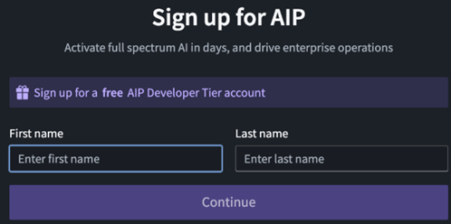 

  

--------------------
--------------------
--------------------
--------------------
--------------------
--------------------

 

## **3 ZAI quick starts (Foundry basics)**

 

These quickstarts are the most effective method to get started with Foundry (consider using the **[MS Word docx](https://drive.google.com/drive/folders/1-Adawag9uA8_bq-hDF-nOuPYaRLz1eEO)** files as a template for your own lab notes):

- **3.0 Corequisites (primarily FDE)** (26.1120). Topics to at least be aware of while you are doing the tutorials.
- **3.1 QS0: Workflows (no AI)**. Detect/analyze haystack needles 1 (install a Foundry example) (26.1119) (QS0 was originally QS2). 
- **3.2 QS1: Models - Inference (AI)**. Detect/analyze haystack needles 2 (start from scratch) (26.1113). 
- **3.3 QS3: Framework tools** (Broaden your Foundry skills (WIP)).
- **3.4 QS4: (TODO) Agents**
- **3.5 QS5: (TODO) Models - Training**

<!-- - **3.4b QS3b: (WIP) Complete overview of foundry tools (65 apps)** (26.1127) -->

 

Note: Quick starts, tutorials, etc in the past needed to provide all the details to learn a new SW tool. But things have changed in the AI age. 
- You will work with FDE to do these demos. 
- All you really need from the docs are (1) what prompts to ask and (2) conceptual explanations. 
- The prompts in ZAI tutorials are sometimes not text, but screenshots. FDE and I would often have long discussions with a very specific pattern: (1) FDE tells me what to do, (2) I post a screenshot of the results (no text), and repeat. 
- In the future, Foundry will probably be able to see your screen (you wont have to paste screenshots) and you will have audio chats. Foundry might even do all keyboard and mouse work.

<!-- 
Note: In Palantir docs
- The initial demos (D1, D2, etc) were called "speedruns". These were actually deep dives.
- There were no quick starts.  -->

 

--------------------

 

#### **[3.0 Corequisites (primarily FDE)](/pal_fde/)** (26.1125)

  - Quick demo of a **realistic real-world demo whose technical details you probably don't understand** (finding matching intelligence records in a large set of data) and 
  - **You don't need to understand (fully) the technical details** thanks to FDE.
  - The **QS0 algorithm does not require AI** to get the job done (Palantir's original mission; Palantir was founded 25 years ago, before today’s generative-AI/LLM era). 
  - Intros haystack datasets, pipeline (that detects needles), and objects/maps/UI for display of needles.     

Knowing how to use FDE (Forward Deployed Engineer, Foundry's excellent AI assistant) is the most important skill you will learn. There also a few other things to keep in mind while working with Foundry.

_**[Single source docx #685](https://drive.google.com/drive/folders/1-Adawag9uA8_bq-hDF-nOuPYaRLz1eEO)** (WIP) for FDE webpages (markdown and PNG's are extracted by ChatGPT)._

_The FDE error that you will run into sooner or later (a show stopper; without FDE you are going nowhere)_ 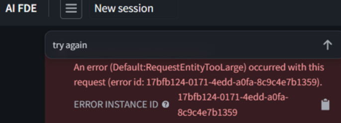 

 

--------------------

 

#### **[3.1 QS0: Workflows (Detect/analyze haystack needles without AI) (install a Foundry example)](/pal_qs0/)** (26.1126)

In QS0 (originally QS2) you install a Foundry "needle in the haystack" real-world Example, then rebuild it yourself.  
- The haystack: a collection of data records imported into Foundry.
- The needle: any record whose text or numeric properties match criteria expressed in a user prompt.

QS0 uses a real world example, but is a simpler demo than the next QS1 (that focuses on the mechanics of Foundry):
- Ch1: First steps (sign up/in, FDE)
- Ch2: PAL Example (real-world) install. The large and complex (haystack) dataset demonstrates the power of PySpark.
- Ch3/4: Pipeline (no-code) filters out the chaff (everything but the needles). Input 2 raw datasets (haystack, 5K rows) and outputs (needle, 4 rows) dataset.
- Ch5: Very basic ontology (a single object type, no actions, no links). 
- Ch6. Display the needle dataset in the Maps tool.
- Ch7. Create a custom UI to display the needle dataset (display only; no actions in QS0).

_**[Single source docx #686](https://drive.google.com/drive/folders/1-Adawag9uA8_bq-hDF-nOuPYaRLz1eEO)** for QS0 webpages (markdown and PNG's are extracted by ChatGPT)._

_(This diagram is a first draft by GPT)_ 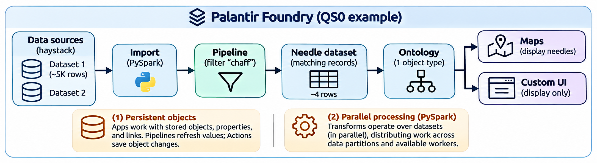

<!-- 
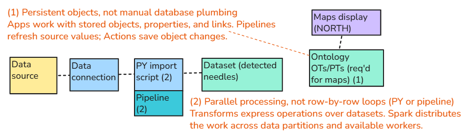 -->

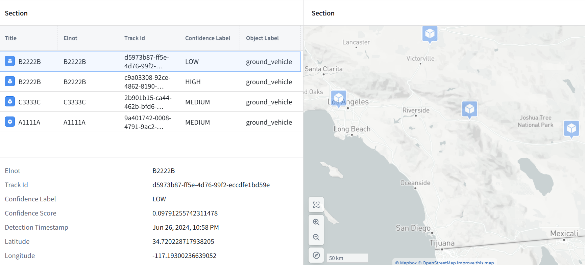

 

--------------------

 

#### **[3.2 QS1: Models - inference (Detect/analyze haystack needles using AI) (start from scratch) (26.1113)](/pal_693_qs/)**

  - A non-realistic demo that focuses on mechanical details. 
  - Intros AI, actions, automation/scheduling, and governance. 

QS1 is also a “needle in the haystack” demo (using Foundry to identify records that match user-defined criteria), but
- Ch1: MockAPI (very simple external datasource that you control).
- Ch2/3/4: AI. MockAPI records are very few and simple. But the messy human language content is not simple for a computer without AI. This is core reason AI is used in Foundry.
- Ch5/6: Actions. AI calls actions to create ontology objects.
- Ch7/8/8a: Automation (scheduling dataset updates and updating objects).
- Ch8b: Governance (access control, monitoring (especially of AI), etc).

How QS1 differs from QS0: 
- Focuses on Foundry mechanics and workflows (a small dataset, not a real-world search demo).
- Python scripts replace the pipeline.
- Actions, AI (AIPL and functions), automation and governance.

_**[Single source docx #693](https://drive.google.com/drive/folders/1-Adawag9uA8_bq-hDF-nOuPYaRLz1eEO)** for QS1 webpages (markdown and PNG's are extracted by ChatGPT)._

_Example workflow diagram (a first draft by GPT)_ 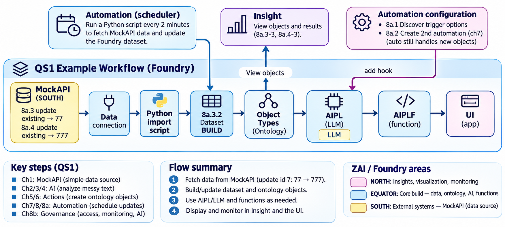

<!-- _Example workflow diagram_ 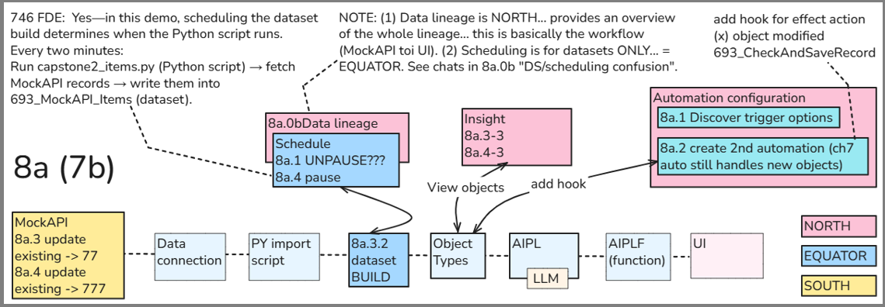
-->

_Runtime Automation example (Foundry checks for updates in the external data source)_ 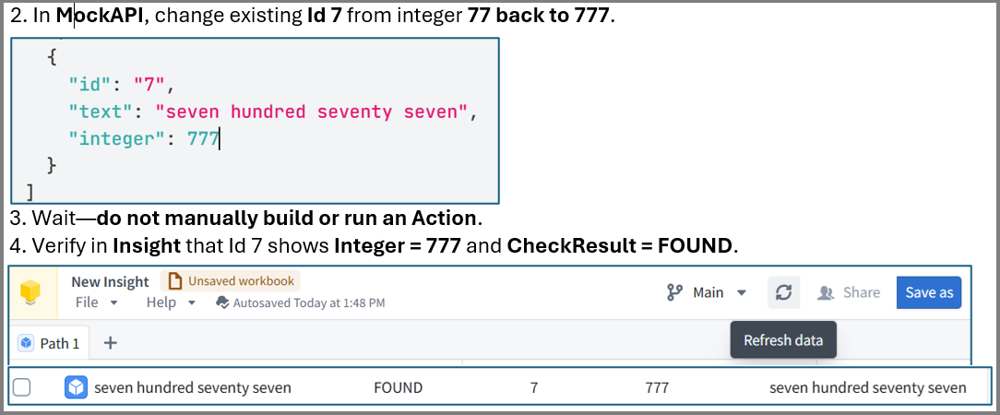

 

---------------------------

 

#### **[3.3 QS3: Framework tools (WIP)](/pal_693_dd/)** (26.1124)

<!--  Broaden your Foundry skills -->

  - More step by step directions for more Foundry functionality and algorithms (like the other two QS's).
  - Suggesting "inline" (while you are doing QS3) various topics to study in more depth.

QS0 and QS1 introduced Foundry through a focused goal: find the “needle in the haystack.” 

**QS3 broadens that foundation, accelerating your discovery of more Foundry apps**, capabilities, and techniques. QS3 will have small, connected exercises retain the step-by-step Quick Start style, showing what each tool does, where it fits, and how to verify the result.  
  - A1 Office (a few examples)
  - A2 Backend (EQUATOR)
  - A3 Haystack needles
  - A4a Inference (AI)
  - xxA4b Training (AI) (QS4)
  - A5 Governance / security
  - xxA6 Agentic (central loop) (QS4)

<!-- QS3 will also focus on introducing as many of Foundry "apps" (tools) as possible. _Foundry’s application landscape—approximately 65 apps in the environment shown._ 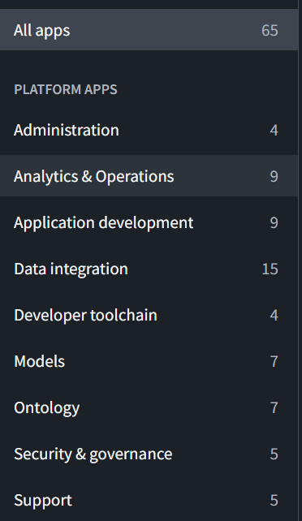 -->

<!-- please create your best diagram for the attached.
"xx" means will not do in qs3.
(will do this in qs4).
remember we have the North / equator / south idea. 
north is analytics, ui, etc.
south is external data, models, etc.
and we have 65 foundry "apps" (tools; I call apps what you create using foundry) -->

_**Single source docx's:**_ 
-	D1: Import and transform data _(**[#692\_pal\_foundry\_d1\_data\_xforms\_.docx](https://drive.google.com/drive/folders/1-Adawag9uA8_bq-hDF-nOuPYaRLz1eEO)**)_
-	D2: Create object types and links from datasets _(**[#691\_pal\_foundry\_d2\_linked\_objects\_.docx](https://drive.google.com/drive/folders/1-Adawag9uA8_bq-hDF-nOuPYaRLz1eEO)**)_
-	D3: Interact with linked objects through the UI _(**[#690\_pal\_foundry\_d3\_ui\_.docx](https://drive.google.com/drive/folders/1-Adawag9uA8_bq-hDF-nOuPYaRLz1eEO)**)_
-	D4: Use Actions to change objects through the UI _(**[#689\_pal\_foundry\_d4\_actions\_.docx](https://drive.google.com/drive/folders/1-Adawag9uA8_bq-hDF-nOuPYaRLz1eEO)**)_
-	D5: Combine objects, AI, Actions, and human review _(**[#688\_pal\_foundry\_d5\_ai\_human\_.docx](https://drive.google.com/drive/folders/1-Adawag9uA8_bq-hDF-nOuPYaRLz1eEO)**)_
-	D6: Operate and govern the overall workflow _(**[#687\_pal\_foundry\_d6\_governance\_.docx](https://drive.google.com/drive/folders/1-Adawag9uA8_bq-hDF-nOuPYaRLz1eEO)**)_

_(this diagram is a first draft by GPT based on the text above)_ 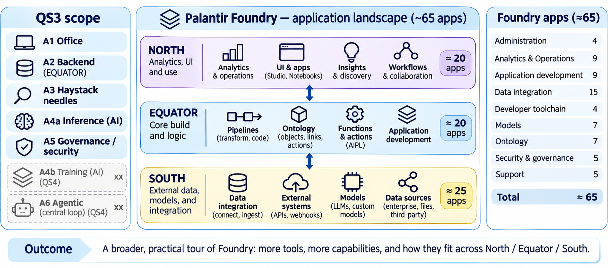

_Runtime example ("Generate suggestion" means AI generates)_ 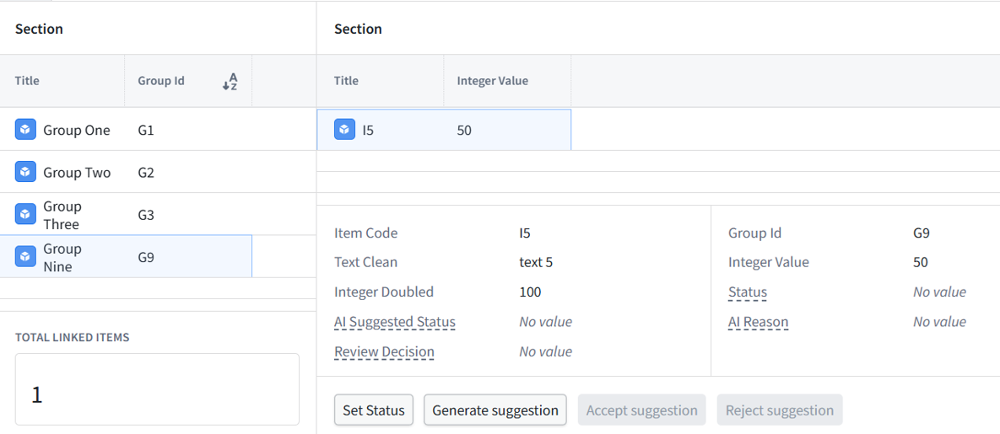

<!-- 
_Foundry deep dive master diagram_ 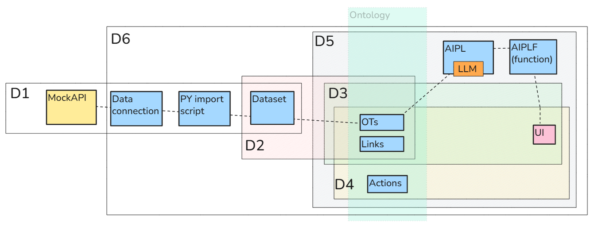 -->

 

---------------------------

 

<!--  #### **[3.4b (TODO) QS3b: Complete overview of foundry tools (apps)](/pal_qs3b/)** (26.1127)

- QS3b
- projects/apps

 

---------------------------

  -->

#### **[3.4 (TODO) QS4: Agents](/pal_qs4/)** (26.1125)

QS4 will demo (step by step):
  - A6 Agentic (central loop) 

_(this diagram is a first draft by GPT based on the text above)_ 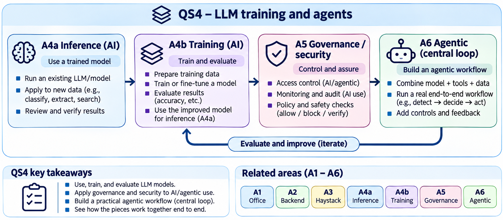

 

---------------------------

 

#### **[3.5 QS5: (TODO) Models - training]()**

QS5 will demo (step by step):
  - A4b Training (AI) (evaluation, etc) 

_(need a diagram)_ 

  

--------------------
--------------------
--------------------
--------------------
--------------------
--------------------

 

## **4 ZAI deep dives (DD's)**

> It was a challenge for me to figure out the learning path (there were many forks in the path) and the concepts when I started with Foundry. Some of the early demos were a real challenge (at least for me; the demo 2 docs say you need 90 minutes to complete; it took me a week to understand D2; this is one reason I created the QS's). So I initially focused on anything I could get working. I collected whatever I did into this DD section on 26.1124 (it wasn't until then that I had a clear picture of how to organize them). It will take a bit of time to get everything organized.

In Palantir there are several kinds of tutorials:
- Speedruns are the initial demos (D1, D2, etc) intended for beginners.
- Examples are installable tutorials.
- "Deep dives". 

ZAI calls all of the above "deep dives" and organizes (ZAI versions of) them and ZAI original deep dives (created with the help of FDE) into the following categories:

- **4.1 Office**. FDE added this section; for now its empty and not a priority.
- **4.2 Backend (EQUATOR)**. What is "ontology"? Its basic the objects in the backend you build in Foundry. And it only a part of what ZAI calls the "equator" (Foundry diagrams have north/ontology/south; ZAI replaces south with equator that contains the ontology).
- **4.3 Haystack needles**. This is why Palantir was founded. 9/11 occurred because the intelligence that raised alarms got stuck in a giant human bureaucracy. Palantir's job was to make sure that did not happen again. ZAI refers to this as find the "needle in the haystack". The original Foundry did this without AI.
- **4.4a Inference (AI)**. Use AI as an assistant in Foundry.
- **4.4b Training (AI)**. Train and deploy models in Foundry.
- **4.5 Governance / security**. Protect enterprise data by tracking everthing.
- **4.6 Agentic (central loop)**. Creating a central execution loop that runs 24/7.

The last section is the inventory of all tutorials (working list)
- **4.7 Planning list**. 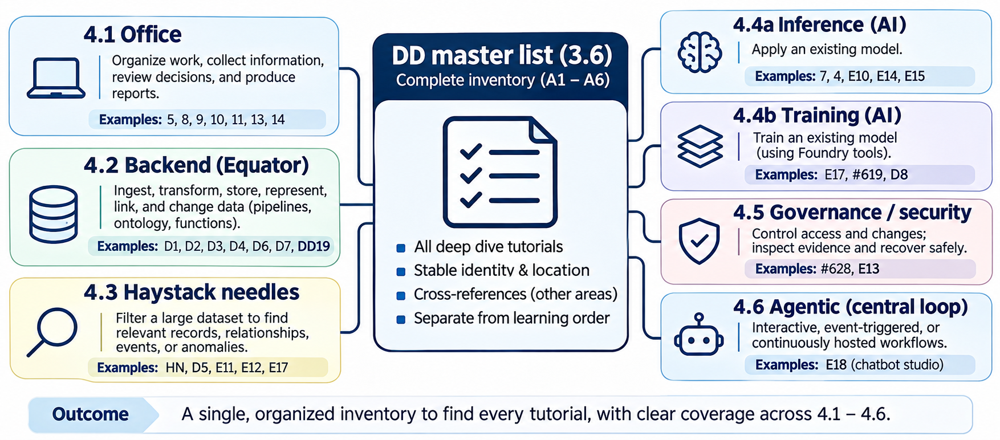 

<!-- - **4.3 ZAI versions of the core ~8 Foundry getting started demos**. The core demos (speedruns) meant for beginners. (2b.4)
- **4.4 ZAI versions of PAL Examples (installable)**. Real-world demos. ZiptieAI uses one of these demos as the very first demo for beginners. (2b.5) -->

 

---------------------------

 

#### **[4.1 Office](/pal_4.1_a1_office/)** (v1 26.1124)

_This section currently has no examples_.

Organize work, collect information, review decisions, and produce reports.
- Put incoming tasks into a prioritized inbox and notify their assignees	Dynamic inbox and Action notifications.
- Guide someone through submitting a complete record with attachments	Guided forms and questionnaires.
- Generate a report for a selected record or investigation	Notepad Templates.
- Approve a proposed change and send it back to an external system	Writeback-enabled decision support.

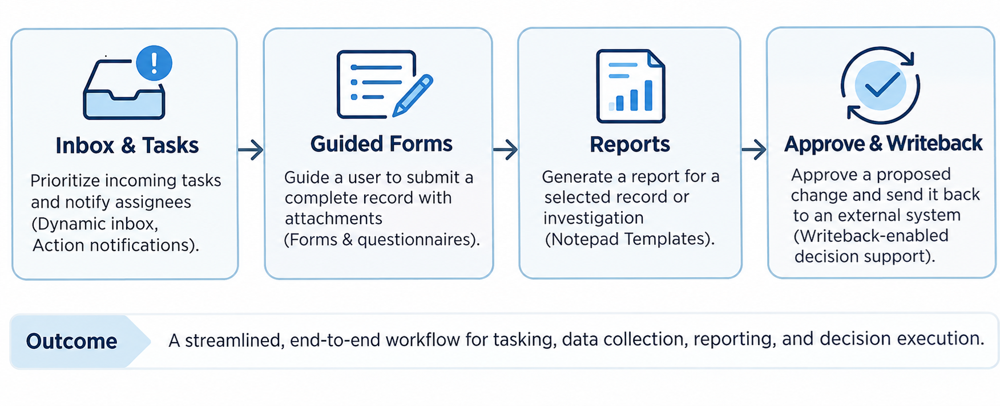 

 

---------------------------

 

#### **[4.2 Backend (Equator)](/pal_4.2_a2_equator/)** (v1 26.1124)

Ingest, transform, store, represent, link, and change data. The core of any data processing app:
- Pipelines.
- Ontology (joins, objects, links, Actions).
- Functions. 

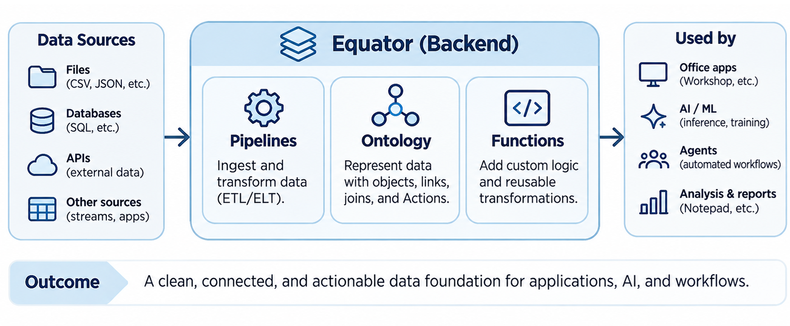 

 

---------------------------

 

#### **[4.3 Haystack needles](/pal_4.3_a3_haystacks/)** (v1 26.1124)

Filtering out data from a large dataset (similar to the QS0 and QS1). Find relevant records, relationships, events, or anomalies.

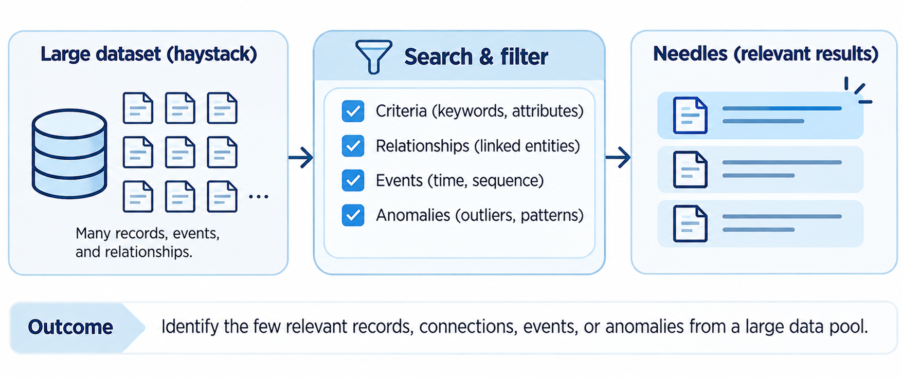 

 

---------------------------

 

#### **[4.4a Inference (AI)](/pal_4.4a_a4a_ai_inference/)** (v1 26.1124)

Apply an existing model.

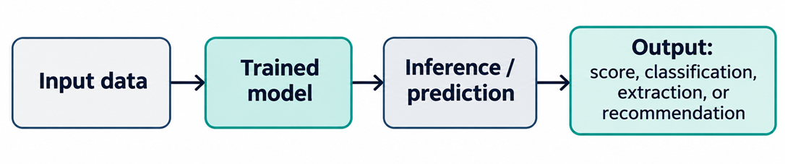 

 

---------------------------

 

#### **[4.4b Training (AI)](/pal_4.4b_a4b_ai_training/)** (v1 26.1124)

Train an existing model (using Foundry tools).

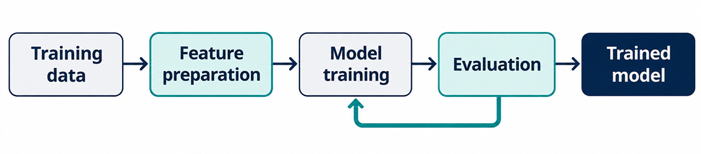 

 

---------------------------

 

#### **[4.5 Governance](/pal_4.5_a5_governance/)** (v1 26.1124)

Control access and changes; inspect evidence and recover safely.

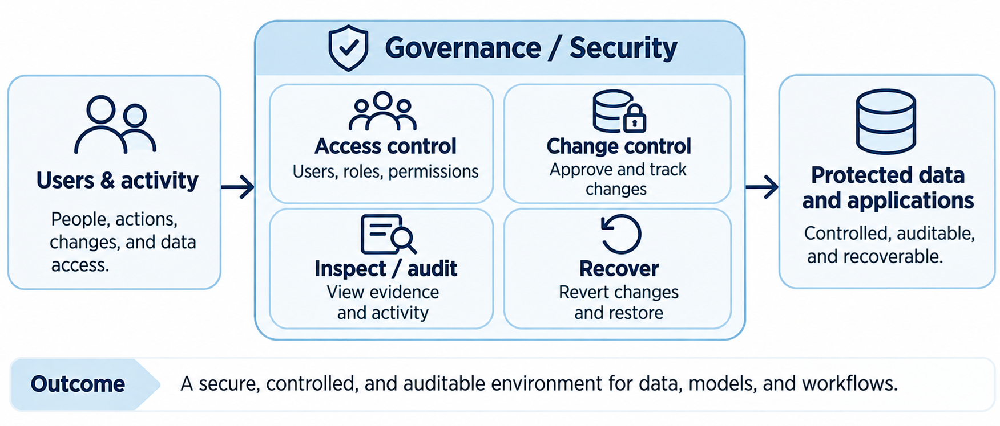 

 

---------------------------

 

#### **[4.6 Agentic](/pal_4.6_a6_agentic/)** (v1 26.1124)

Interactive, event-triggered, or continuously hosted workflows, including model-directed tool use.

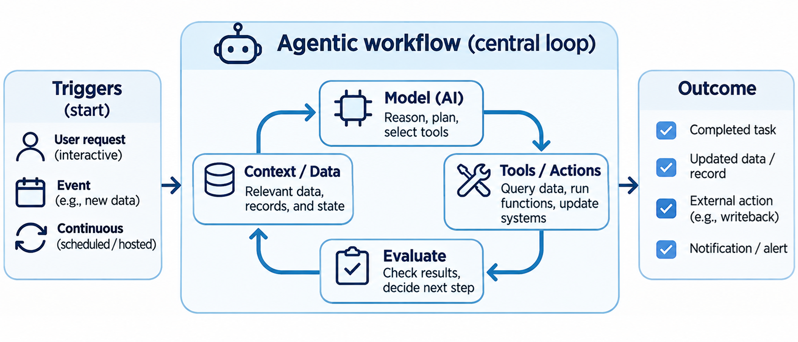 

 

---------------------------

 

#### **[4.7 Planning list](/pal_3.6_target_apps/)** (v1 26.1123)

The master planning list of all deep dives. 

 

  

----------------------------------------
--------------------
--------------------
--------------------
--------------------
--------------------

 

## **[5 Project/Doc sources](/pal_project_doc_sources/)**

- **5.1 ZAI doc sources (docx, gdrive, this site, etc)** 
- **5.2 PAL project/doc sources** _palantir.com/docs/foundry (this section provides an overview of Palantir Foundry docs)_ 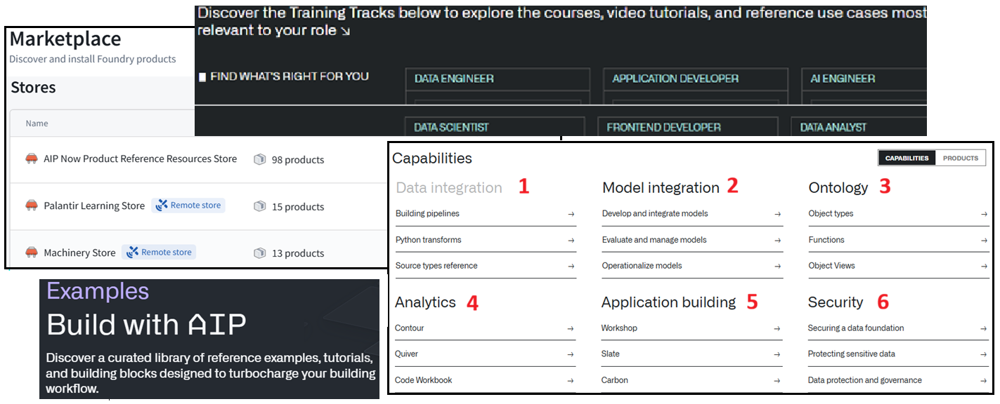 

 

-------------------------------
-------------------------------
-------------------------------
-------------------------------
-------------------------------
-------------------------------

  

26.1125 (0814, v1 26.0702)

