<!-- was  (2b.4)  //// 2.2 Getting started demos (speedruns, marketplace, DIY) -->

<br>

[← 3c Enterprise](/pal/)

<br>

<!-- **TL;DR**? Then skip to **[Demo D3 "Speedrun -- Your First Agentic AIP Workflow"](/3c.3_pal_agentic_ai/)**, a great example of the direction this part of ZiptieAI is heading. 

#### _This is currently (26.0914) **the Main focus of (1) ZAI "3c Enterprise" and (2) ZAI in general**_:

- See also **[2.2x CONCEPTS (DEEP DIVE) -- ZAI demos](/3c.2_pal_demo_CONCEPTS/)**
-->


This page describes

- the **ZAI versions of 7 Palantir Foundry hands-on demos (mainly "speedruns")** and
<!--- **1 original ZAI demo** (created with the help of FDE/GPT) -->

The target audience

- **hands-on learners**. Those like myself who want minimal text/diagrams and maximum useful info for getting hands-on experience.

<!-- The goal

- **Demo the Foundry core concept "ALPHA"/sovereignty** (that Alex Karp has been talking about a lot recently).
- **Demo other Foundry concepts** (data protection, etc; my own take)
- **Maximize ALPHA/sovereignty / Data protection** (within performance/cost/complexity limitations)

These concepts extend to non-Palantir AI dev:

- The value of Foundry is
  - **Foundry forces compliance with safe AI practices**. Foundry makes you think about the requirements for enterprise AI.
  - **Palantir leadership (such as Alex Karp) are very verbal about some very real problems with AI in the enterprise**. They are the only ones exposing the real issues, the hype (while minimizing their own marketing hype).
- The drawbacks of Foundry are
  - **Overly complicated demos** that dont stay laser-focused on the topics Alex talks about or on the main point of the demo.
  - **UI, terminology, and docs that leave you in confusion**.

Future goals

- Create **a set of "minimalized" ZAI Foundry demos** that demo key concepts (especially ALPHA).
- Create **a set of "minimalized" ZAI demos (not Foundry-based)**. I love working with Foundry, but
  - I am not sure I can make a job out of it.
  - The required mental overhead for working in Foundry is not insignificant.
  - Foundry is specialized and (from what I have read) expensive.
  - The lessons learned can be applied to AI projects not built in Foundry. -->

See also (these pages are very outdated ... I will update later)

- **[PAL demo strategy](/3c.aaa_pal_strategy_demos/)**.
- **[Important info about doing these demos](/3c.2.0_info_about_demos/)**. The advantages of website tutorials over Youtube videos (at least for beginners) and the critical importance of FDE (Foundry's built-in AI chat tool).

<br>

-----

<br>

### **TOC**

<!-- ```
xxxxxxxxxxxxxxxx**CONCEPTS**
- **C1) Transforms, Analytics and actions (applications) [1]**
- **C2) data protection [2]**
- **C3) AI external [3]**
- **C4) ALPHA (sovereignty) [4]**
- **C5) Internal AI models [5]**
- **C6) Maximize ALPHA/sovereignty / Data protection** (within performance/cost/complexity limitations)
```  -->

**HANDS-ON DEMOS (WIP)**

- **DEMOS 1) NO AI**. These demos show that you dont need AI to do analysis (this is the safest option for sovereignty if viable).
<!--  - (1) DIY9 (from ZAI/FDE/GPT) (NO AI) -->
  - **D1** (from PAL) (NO AI)
- **DEMOS 2) Data protection (NONE)**. NONE = There are so far no specific demos for this functionality. But Data Protection is always there.
- **DEMOS 3) AIP external (Agentic 1) (no automation; sovereignty risk via AI calls)**. You are using external LLMs. Processing occurs whenever data changes (there is no central loop running).
  - **D2** (from PAL)
- **DEMOS 4) Automation (Agentic 2) (AI external; major sovereignty risk via automated AI calls)**. You have automation which watches for data changes and then invokes actions (and AI). Major sovereignty risks.
  - **D3**
<!--  - (4b) D3b — Protecting agents that use external AI models (TODO)-->
- **DEMOS 5) ALPHA -- Mining (how frontier models steal your "alpha")**. This demo is primitive and uses black box Foundry functionality ("mining"), but Frontier model labs are certainly experts at such techniques.
  - **D5**. This demo "mines" (extracts the alpha of) the workflows based on example data.
<!--  - (5b) D5b (FUTURE) (C5c): Demos for Maximize ALPHA/sovereignty / Data protectio (within performance/cost/complexity limitations)-->
- **DEMOS 6) AIP internal (Agentic 3)**. The best solution. Calls to AI are only to internal models. These demos show how to create and deploy your own model using Foundry.
- **Other demos**. Duplicate or unimportant demos (or demos I could not get to work).
  - **D4**: Palantir ontology function “speedrun” (quick start) (26.0717).
  - **D6**: Deep Dive: Building Your First APPLICATION (xxxPipeline???) (26.0719).
  - **D7**: Deep Dive: Building Your First Pipeline (26.0720).
  - **DD19**: Deep Dive: transform_data_w_code_repos (26.0805).


<br>

---------
---
---
---
---

<br>

# **DEMOS 1) NO AI**

Foundry’s core value proposition predates generative AI. It integrates data from different systems, represents entities and relationships through the Ontology, and helps users discover patterns, anomalies, connections, and business processes that are difficult to see in isolated datasets. In these demos, the LLM is an optional analytical assistant; the underlying data integration, Ontology, analysis, applications, and Actions remain useful without it.

Palantir emerged in the post-9/11 period with the broader objective of helping organizations connect signals across fragmented data and identify unusual patterns relevant to security and intelligence. The same architecture is now applied to commercial and operational problems.

---


<br>

### **D1 (from PAL) (NO AI)**

SEE ALSO: **[1.1 D1 = "Speedrun -- Your First End-to-End Workflow" (26.0818)](/3c.1_pal_foundry/)**.

- **The action is called from the UI**
- **Classification of the demo:**
  - No analysis, just pipeline transforms and ontology action.
  - **[2] Data protection** (access to the action is controlled.
- Other aspects of this demo:
  - **D1 is far too complicated** for what it demonstrates (it is also the first demo on the PAL site).
  - **You create the demo from scratch by following the demo instructions** (whose H1/H2 headers are not numbered on the PAL site; this significantly complicates the demo).
  - ZAI splits the demos into 3 phases (this makes the demo much easier to finish and understand).
  - **NO AI.**

_D1 Main workflow diagram (simplified) (for details about this workflow see **[D1 workflow chats](/pal_1.3_workflow_chats/)**)_<br>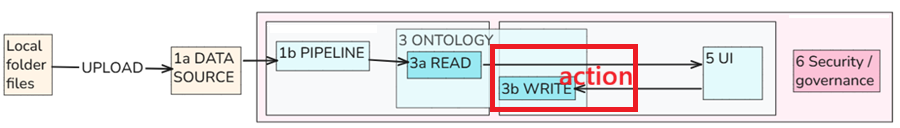<br>

_Action defition_<br>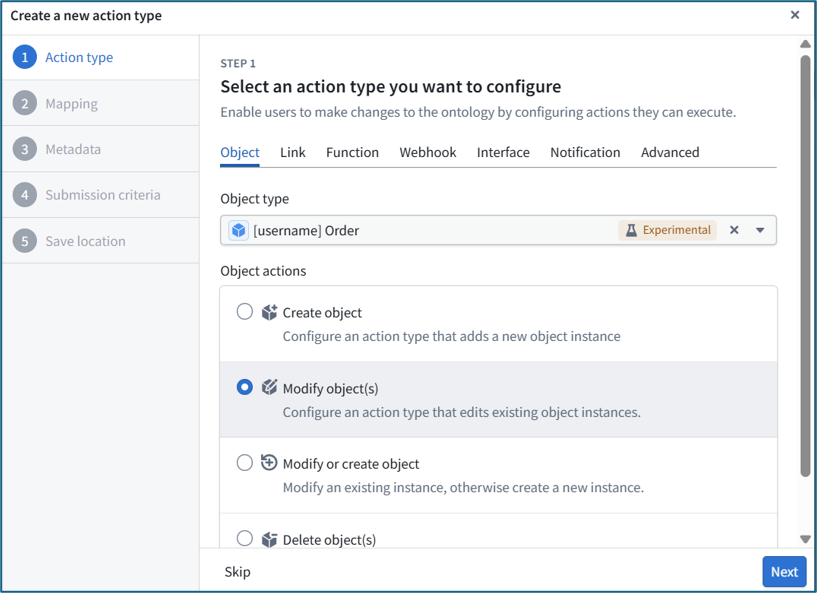

_Action reference in the UI_<br>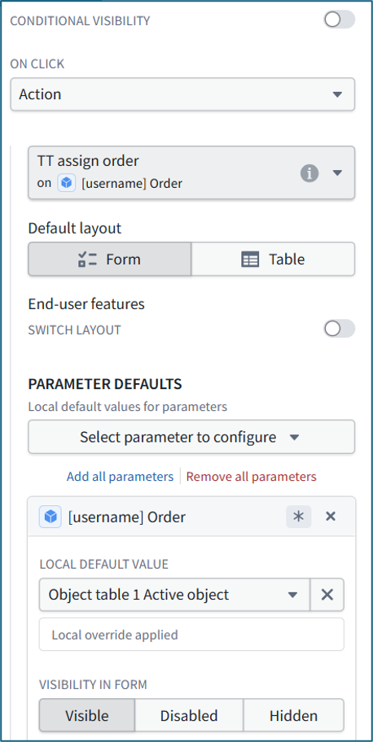

_Upper left: Orignal order. Upper right: After reassigning to different employee. Below: Changes saved to data._<br>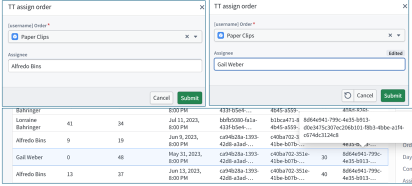

<br>


---
---
---
---
---


<br>

# **DEMOS 2) Data protection (no demos yet)**

<br>

---
---
---
---
---


<br>

# **DEMOS 3) Agentic 1 (AI external / no automation) (sovereignty risk via AI calls)**

<br>

---

<br>

### **D2 (from PAL)**

Your first app with AI. This demo was way too complicated. You can save a lot of time by following the ZAI version of the demo (and skip part 3 of 3 that has absolutely nothing to do with AI, but requires a lot of effort).0

See also: **[1.2 D2 (WIP) = "Speedrun -- Your First AIP Workflow" (26.0828)](/3c.2_pal_aip/)**.

In this demo you use ai 3 times (and each time a different model)

- 1 Summarize text chunk
- 2 Create embedding of summary (embedding)
- 3 Send selected text chunks to LLM to answer question (RAG)

NOTE: Selecting the text chunks using the embedding does not involve AI. The comparison is done in AIP_logic.

<!-- > <br>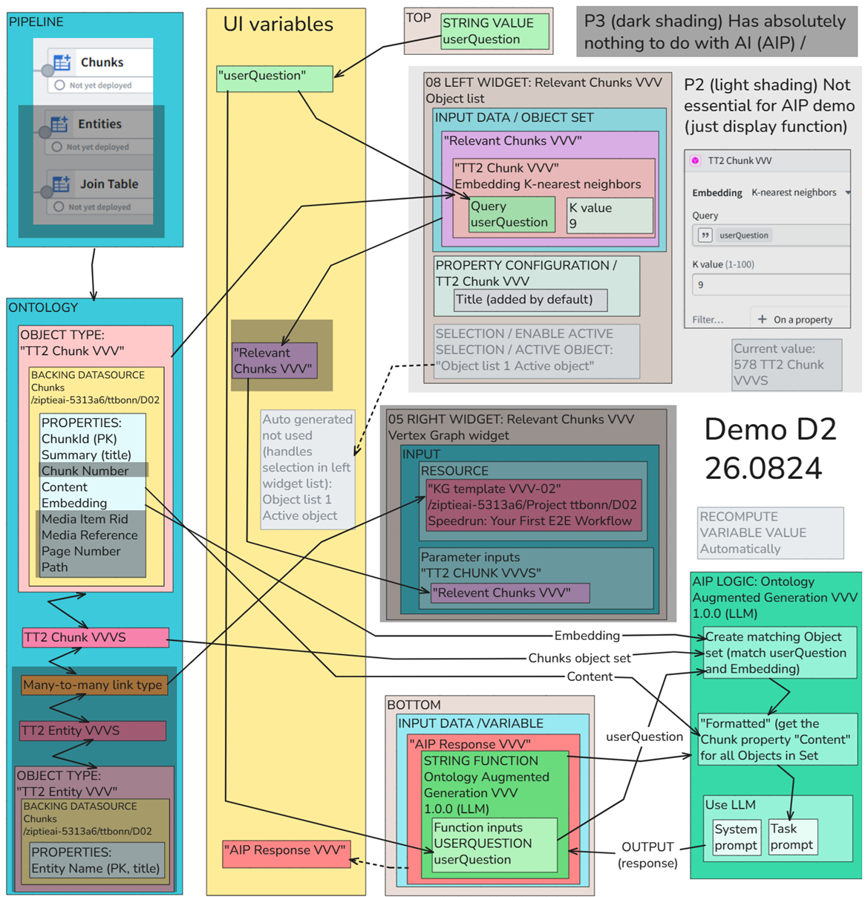 -->

_D2 (AI external (3) / no automation)_<br>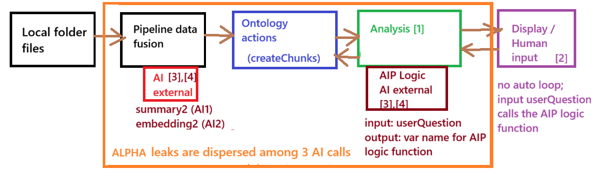

Diagram below shows more detail:

- Use AI (external models) to clean up extracted chunks of text from PDFs, to extract text keywords ("entities" in the demo) from the chunk, to match a question to chunks via embeddings (machine language representation of the question/chunks meanings (not keywords)), make a RAG call with the question/chunks to answer the question.
- About half of the demo has nothing to do with AI (the ZAI version splits the demo into 3 phases; phase 3 is the no-AI part; you can skip it).

_Demo D2 first AIP workflow (ZAI) diagram (26.0828) (3 different AI models are used)_<br>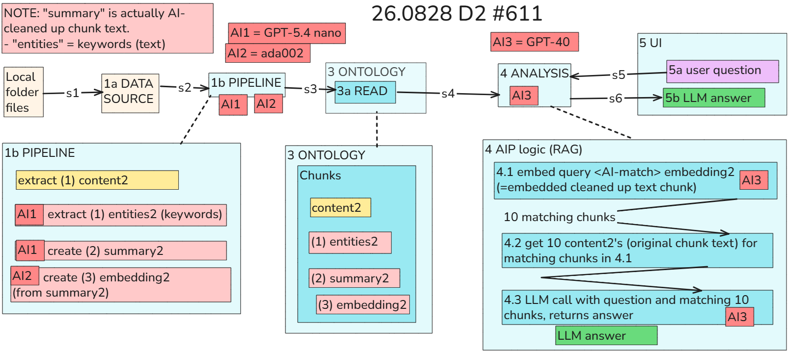

This is the diagram you really need when doing the demo. A diagram of the configuration steps for demo D2 (I spent days on my initial attempts to recreate D2 without this diagram; with this diagram its fairly simple; its even simpler if you do it in 3 separate phases as described in the latest version of the docx and if you simply ignore the shaded out parts of the demo).

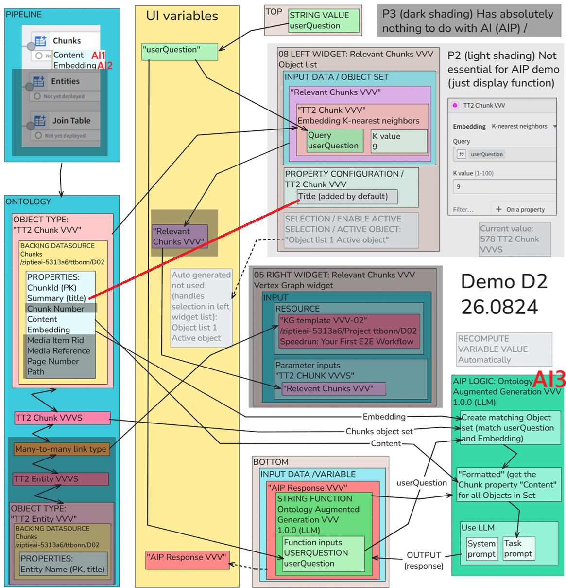

<br>

---
---
---
---
---


<br>

# **DEMOS 4) Agentic 2 (AI external + automation) (major sovereignty risk via automated AI calls)**

<br>

----

<br>

### **(4) D3**

See also: **[1.3 D3 (WIP) = "Speedrun: Your First Agentic AIP Workflow" (26.0902)](/3c.3_pal_agentic_ai/)**.

This demo builds the first **autonomous operational agent** in this sequence.

- **(1) A new Patient is added** through the UI and written to the Ontology.
- **(2) Automate detects** that the Patient entered the monitored object set.
- **(3)(4a) AIP Logic evaluates** the Patient against the selected Clinical Trial.
- **(3)(4b) The governed Action automatically writes** the initial eligibility decision and reasoning.
- **(5) Staff review the result** and may manually adjust the eligibility decision through the UI. This last step is important: Automation makes the initial operational decision, but staff retain oversight and can override it through a governed Action.

_D3 xxx_<br>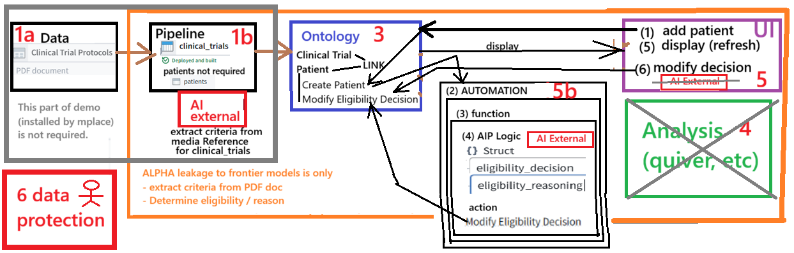

_D3 xxx_<br>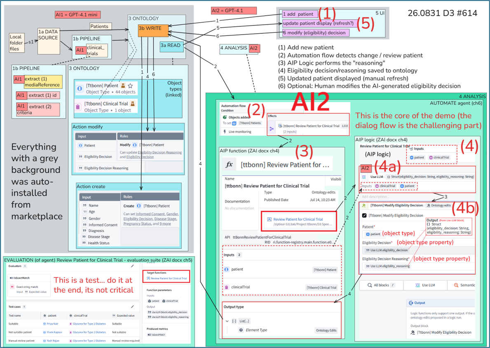

_D3 xxx_<br>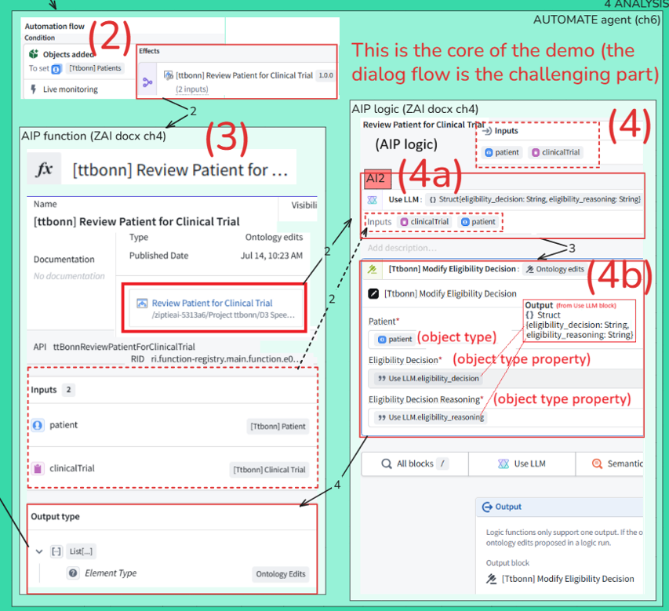

_D3 xxx_<br>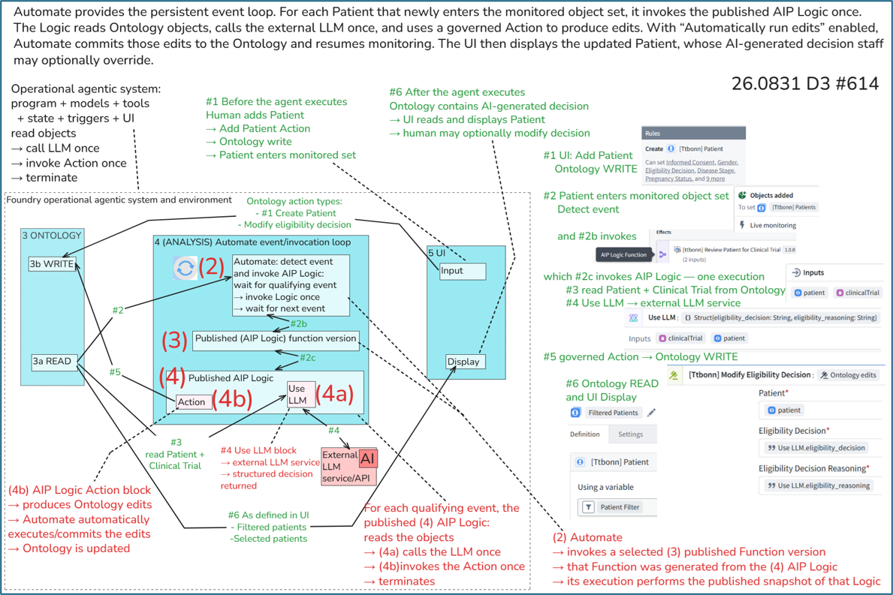

<br>

----

<br>

#### **[Both D2 and D3 send enterprise data to external LLMs—why does Palantir call D3 the first “agentic” demo?](/3c.2c_pal_zai_take_on_foundry_agent/)** (26.0902)

_Follow the above header link for details. See also the complete **[chat](/3c.2_pal_initial_demos_AGENT_CHAT/)** with FDE/GPT._

**My own simple explanation** (refer to diagram below)

- Demo D2 made calls to external LLM. That is (in my opinion)
  - an AI agent
  - that shares internal data with an external LLM.
- However, D3 (the next demo) does several things that D2 did not:
  - (3)(4) Foundry AIP_Logic (a no-code function definition) calls an LLM like D2, but it also modifies the ontology (core objects)
  - (2) Foundry Automation (event-driven automation service) provides a main loop that automatically processes (in D3 this means calling API_logic) any incoming onotology data changes.

_[3] Demo D3 Foundry agent_<br>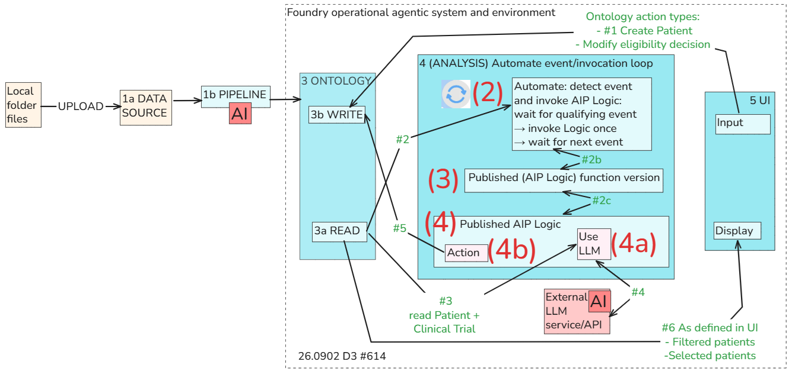


<br>

---
---
---
---
---


<br>  

# **DEMOS 5) ALPHA (Mining)**

<br>

-------

<br>

### **[(5) D5 (TO-UPDATE): Speedrun: Mining Your First Business Process (26.0718)](/3c.5_pal_biz_process_mining/)**

FDE: The demo starts with claims, customers, and claim-history logs. After ingesting these datasets into Foundry, the data is modeled as Ontology objects such as Customers and Claims. Machinery then uses the process logs to reconstruct how claims move through the business process over time. Once the process map is built, you can inspect where claims get stuck, identify why some remain unresolved, and embed the process view into an interactive application.

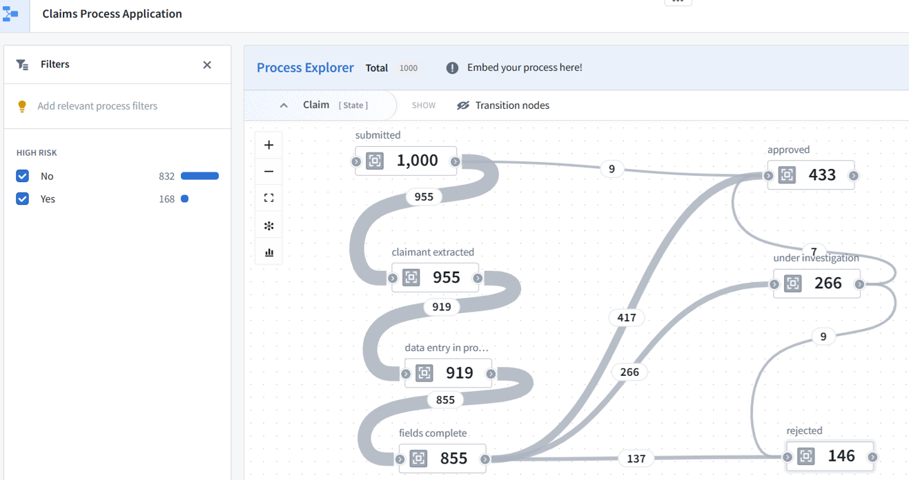


<br>

---
---
---
---
---


<br>

# **DEMOS 6) Agentic 3 (AI internal)**

<br>

---
---
---
---
---

<br>

# **Other demos**

Duplicate or unimportant demos (or demos I could not get to work).

<br>

----

<br>

### **[D4: Palantir ontology function "speedrun" (quick start) (26.0717)](/3c.4_pal_ontology_function/)**.
  - At the end of this page is _good demo of how FDE/GPT5.5 fixed a problem with the demo_.
  - **[#615\_.docx](https://drive.google.com/drive/folders/1-Adawag9uA8_bq-hDF-nOuPYaRLz1eEO)**
  - **[Speedrun](https://learn.palantir.com/speedrun-your-first-ontology-function/2131538)**

<br>

----

<br>

### **[D6: Deep Dive: Building Your First APPLICATION (xxxPipeline???) (26.0719)](/3c.6_pal_6_first_app/)**.
  - **Some of this failed**. FDE/GPT/OPUS could not fix.
  - Outdated (2+ years) demo? MAKE THE DEMOS SIMPLER AND KEEP THEM UPDATED.
  - **[#617\_.docx](https://drive.google.com/drive/folders/1-Adawag9uA8_bq-hDF-nOuPYaRLz1eEO)**
  - **[Speedrun](https://learn.palantir.com/deep-dive-building-your-first-application)**

<br>

----

<br>

### **[D7: Deep Dive: Building Your First Pipeline (26.0720)](/3c.7_pal_7_first_pipeline/)**.
  - **[#618\_.docx](https://drive.google.com/drive/folders/1-Adawag9uA8_bq-hDF-nOuPYaRLz1eEO)**
  - **[Speedrun](https://learn.palantir.com/deep-dive-building-your-first-pipeline)**

<br>

----

<br>

### **[DD19: Deep Dive: transform_data_w_code_repos (26.0805)](/3c.19_pal_19_transform_data_git/)**.
  - **[#627\_.docx](https://drive.google.com/drive/folders/1-Adawag9uA8_bq-hDF-nOuPYaRLz1eEO)**


<br>

----

<br>


26.1122 (0915, v1 26.0725)

<br>

<!-- ==========================================================================================

# ==========================================================================================

==========================================================================================
-->

<!-- 


# **Yes—the structure and core conceptual progression are sound.**

It moves logically through:

```
Sovereignty motivation
→ understand model integration
→ deploy an existing model
→ train a custom model
→ operationalize inference
→ add governed RAG
→ consider fine-tuning
→ govern and monitor models
→ use an internal model in the protected D3 agent
```

Specific structural strengths:

- **2.0** explains why internal models matter.
- **D8a–D8g** decompose an otherwise oversized model-integration topic.
- RAG and fine-tuning are correctly treated as separate concepts.
- Governance follows deployment and adaptation.
- **D3c works well as the capstone**, integrating the model work with the earlier agent and security work.
- The existing D8 deep dive can initially serve as the umbrella/starting demo; overlaps can be separated later.

The only broad concept to revisit later is the exact meaning of **internal**, **local**, and **sovereign**—they are related but not automatically equivalent. Likewise, the interpretation of Karp’s claims should eventually be distinguished from what can be independently demonstrated. Neither issue requires changing the current structure.

<br>

# (1) the ZiptieAI webpage for D8 (my original ) is below.

i have been working on this demo past few days...
the source for the demo is not a speedrun, but the PAL website..
so there a lot of jumping around, differrent options, very difficult to follow....

so what you have given me is basically a straight path through the whole topic?
and after i get back from xxx we can work together to match up the website docs with your path?

### 1. D8 structure

**Yes.** The D8a–D8g sequence I suggested is a coherent, straight learning path through the larger subject. It is a proposed curriculum, not a claim that Palantir’s current Model Studio pages already present the material that way.

Your existing D8 work maps into that path reasonably well:

| Current D8 material        | Proposed path                       |
| -------------------------- | ----------------------------------- |
| D8.1 Goal                  | Overall orientation                 |
| D8.2 Model Studio          | D8a: model-integration concepts     |
| D8.3 Project               | Setup shared by later demos         |
| D8.4 Train in Model Studio | D8c: custom-model training          |
| D8.5 Train in Jupyter      | D8c: alternative training approach  |
| D8.6 Inference app         | D8d: deployment and live inference  |
| D8.7 Summary               | Transition to operational inference |

Your present demo already covers a substantial vertical slice:

```text
Understand infrastructure
→ create project
→ train model
→ deploy model
→ call model from application
```

The later proposed demos add topics that the current D8 does not fully cover:

- starting from an existing model;
- batch and streaming inference;
- internal LLMs;
- governed RAG;
- model adaptation/fine-tuning;
- model governance and monitoring;
- integration into the protected D3 agent.

After you return, we can map the Palantir pages and your existing screenshots onto that sequence, identify overlaps and gaps, and decide whether to split the current D8 document into D8a, D8b, D8c, and so forth. There is no need to restructure it before your trip.

<br>

# 2. Account lifespan

The information you found is reassuring, but I would distinguish the two claims:

- **Developer Tier lifespan:** the claim that it is available indefinitely appears to mean there is no ordinary fixed 30- or 60-day trial expiration.
- **User inactivity:** after approximately 30 days without login, the user may be marked inactive and security tokens disabled. If the official policy applies to your tenant, an interactive login should reactivate the user rather than requiring the account to be recreated.

Therefore, after xxx away, the likely sequence is:

```text
No login for more than 30 days
→ user marked inactive
→ existing account/resources remain
→ next successful login reactivates user
```

The Reddit source is not authoritative, and program terms can change, so it is not an absolute guarantee. However, your account already remaining available for approximately two months is consistent with it being a Developer/Learning tier rather than a short fixed-duration trial.

Before leaving:

- retain your DOCX files, Markdown, and screenshots locally;
- make sure you have working MFA and recovery access;
- record the Foundry organization and login method;
- pause any Automations you do not want running during your absence;
- do not attempt to access the account over a connection you consider unsafe.

On the evidence available, **five weeks of inactivity is more likely to cause a reversible inactive status than deletion of your account and projects**.


The user can:

**1a.** Manually review or modify an existing Patient’s eligibility decision through a governed Action; or
**1b.** Add a new Patient, causing that Patient to enter the object set monitored by Automate.

The agent is the complete event-driven system:

**2. Automate** observes the Ontology and supplies the recurring control loop. When a Patient enters the monitored object set, it invokes the published AIP Logic for that Patient and the configured Clinical Trial.

**3. AIP Logic** reads the Patient and Clinical Trial objects and uses an LLM to determine the eligibility decision and reasoning.

**4. A governed Action** writes the decision and reasoning back to the Patient object. Because the automation is configured to **automatically run edits**, no human is required to initiate or approve each case.

**5. The UI** displays the updated Patient state, potentially after a manual refresh.

In compact form:

```text
Patient enters monitored set
→ Automate triggers
→ AIP Logic reasons
→ Governed Action commits edits
→ Updated Patient appears in the UI
```


Exactly. The chronology is:

1. **A new Patient is added** through the UI and written to the Ontology.
2. **Automate detects** that the Patient entered the monitored object set.
3. **AIP Logic evaluates** the Patient against the selected Clinical Trial.
4. **The governed Action automatically writes** the initial eligibility decision and reasoning.
5. **Staff review the result** and may manually adjust the eligibility decision through the UI.


```text
Add Patient
→ automatic assessment
→ automatic Ontology update
→ staff review
→ optional manual correction
```

-->

<!-- With ZAI versions of the docs with added heading numbering, step numbering, concepts (especially conceptual diagrams), and error corrections.
Created/updated/published (to ZAI) from tagged docx files (using GPT). -->

<!-- *Demo D2 first AIP workflow diagram (WIP)*<br>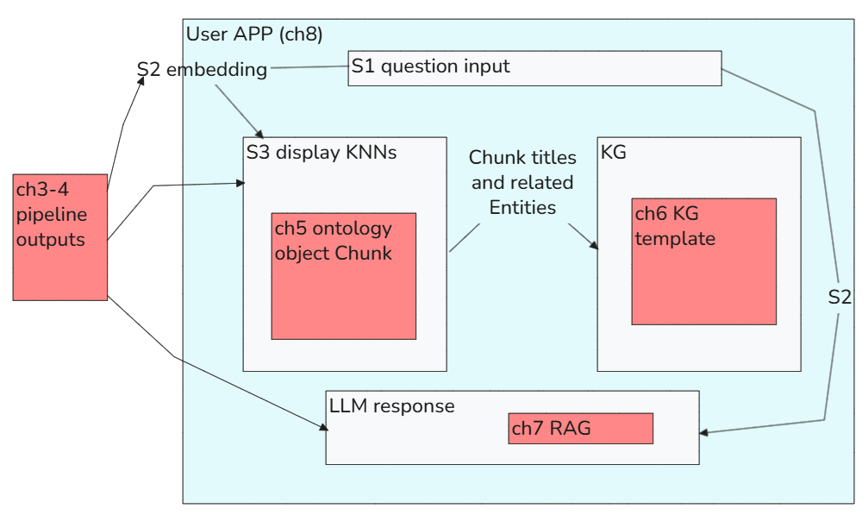

*Demo D2 first AIP workflow diagram (ZAI enhanced version of original speedrun diagram)*<br>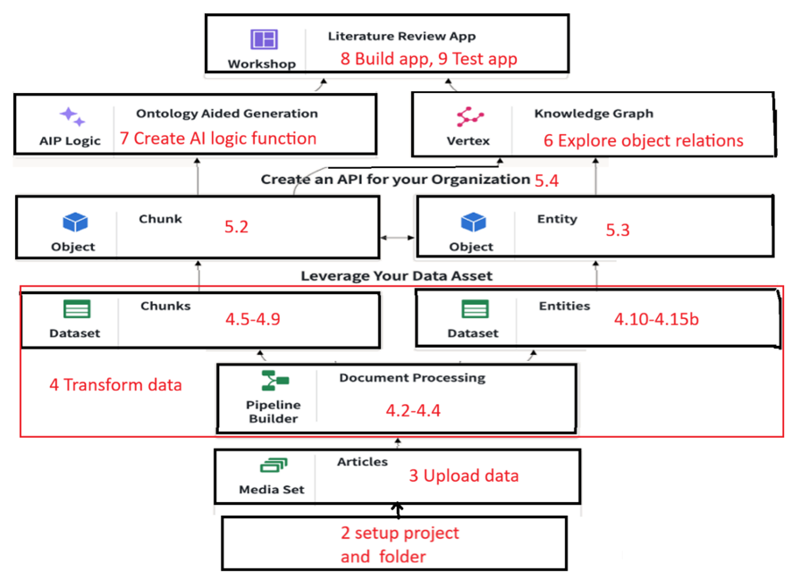

*Demo D2 first AIP workflow diagram (this diagram is wrong... FDE gave a fake answer rather than admitting it did not know)*<br>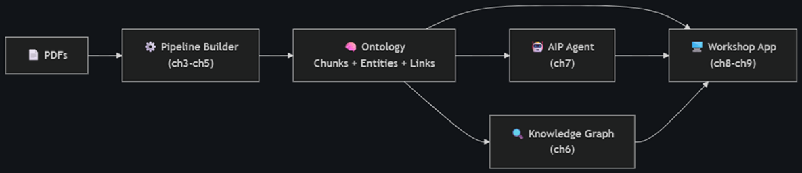
-->

<!-- #### **[1.3 D3 (WIP) = "Speedrun: Your First Agentic AIP Workflow" (26.0829)](/3c.3_pal_agentic_ai/)**
This is the First agent in Foundry (for a draft WIP discussion of what exactly an agent is in Foundry, see **[3c.2_pal_D3_notes_26.0828](/3c.2_pal_D3_notes_26.0828/)**).


The diagram below summarizes the workflow
- (1) An patient object is (1a) Modified or (1b) Added. *Note: This is how the objects are added in this demo... but the demo works no matter how the object is modified/added*.
  - FDE correction (my mistake): With the demonstrated Objects added to set condition and no filters, modifying an existing Patient does not trigger the automation. The trigger is a new Patient entering the monitored object set. A modification would trigger it only if filters were added and the modification caused the Patient to newly enter that set.
- (2-4) The agent updates the ontology.
- (5) The updates are displayed to the user (I think refresh is required).

**Agent details:** FDE: The agent is the complete event-driven system. With edits configured to run automatically, no human is required to initiate or approve each case.
- 2 Automate observes the Ontology and provides the recurring control loop;
- 3 AIP Logic performs the reasoning; and a
- 4 governed Action writes the resulting decision back to the Ontology.
-->

<!-- #### **Demo videos vs docx's**

Ontologize.com has a lot of top Youtube videos for learning Foundry. However, in the **[Ontologize video](https://youtu.be/6kXdjW4KnHc?t=69) for the first PAL demo** "Speedrun: Your First End-to-End Workflow" they say *"...we're going to build a fully end-to-end workflow. **This course is not going to go into all the detailed ins and outs of each step**. This is about the big picture and to give you a taste of how everything fits together."*

I spent days getting that demo working because of a few small errors. You need those details. **ZAI is about mastering the (1) the Foundry UI and (2) the details of each demo**. When you first start out, (1) is the most difficult (its an excellent UI, but requires some initial study). And the eventual goal is **a thread of videos** (based on PAL demos, but with ZAI docx docs and modified workflows). **Details are everything. ZAI numbers docx's, demos, headings and steps. And every screenshots (WIP).**

Ontologize has another great **[video](https://www.youtube.com/watch?v=TTYHAtQ4ROw)** "Speedrun: Mining your First Business Process **(update)**" . Note that word "update". Videos are great, but they are hard to update and fix. ZAI demos are not. The text/pics on this website are extracted from docx master files by a very efficient process where GPT does all the heavy lifting. This makes quick total updates quite possible. For a video thats a major process. And the ZAI docx source files have lots of tech and historical notes.


#### **Understanding how to use FDE to debug is CRUCIAL**

Without FDE, you will get stuck. With FDE skills, you fix anything. FOR EXAMPLE: Look at the ZAI docx for that mining video (**[#616](https://drive.google.com/drive/folders/1-Adawag9uA8_bq-hDF-nOuPYaRLz1eEO)**) at the end of ch6 section 6.2 step 3 is the heading "ERROR". The following shows that error text/screeshots. What apparently happened was a timing error. Foundry does things in the background, and sometimes something is not finished (but it NOT obvious). That can easily cost you hours of debugging. Understanding those errors and how to debug them (with FDE) should the real focus of any initial demos.

<br>

----------------------------

**ERROR**. Failed to load aggregation result. Here are the details of the error:

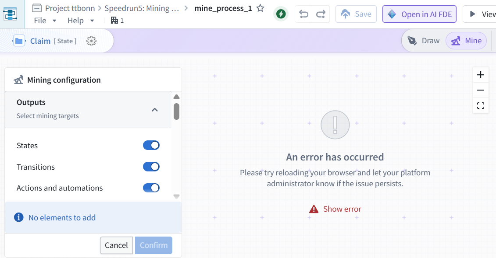

<!-- 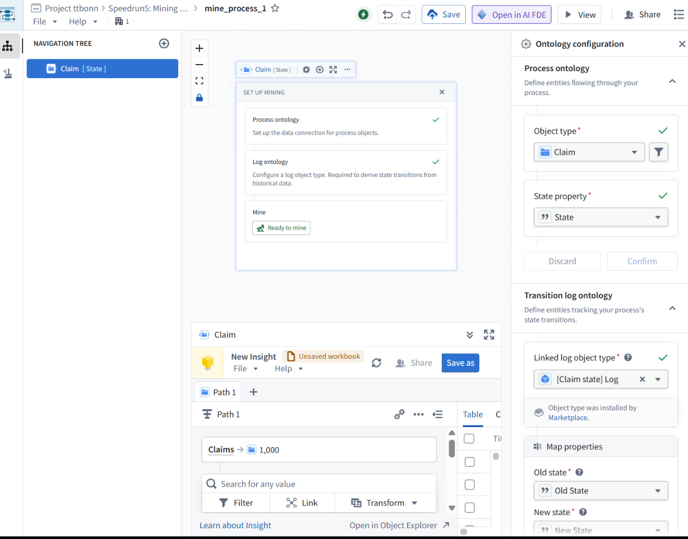 ->

then FDE/GPT did some stuff (SEE GPT CONVERSATION 26.0718_1035)

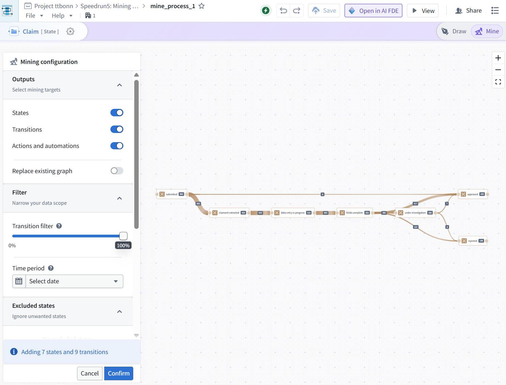

<!-- 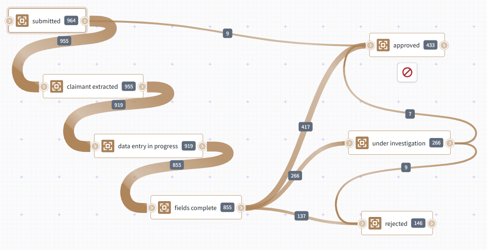 ->

**ME: i clicked "ready to mine" again.. and seems it worked.. did you fix something?**

**FDE: No --- I did not change or fix anything** in the resource. I only
inspected the saved Machinery graph and the underlying Ontology/log
data. What likely happened is that the earlier **"Failed to load aggregation result" was a transient loading / aggregation / browser-state issue, and when you clicked Ready to mine again the aggregation succeeded**.

Now that it worked, do these steps before refreshing:

-   Click Confirm in the Mining configuration panel.
    -   Your screen says: Adding 7 states and 9 transitions.
    -   Until you click Confirm, those mined elements may not be added to the graph.
-   After the graph updates, click the top Save button for mine_process_1.
-   **Wait until the save completes / the Save button no longer indicates unsaved changes**.
-   Then it should be safe to refresh or reopen.

Your saved Machinery resource is still:
- mine_process_1
So the important point is: **Ready to mine only previews/adds mined results; Confirm + Save is what makes them persist in the document.**

----------------------------

-->

<!--

  <br>*The gist of Palantir haystack needle search: A crystal ball (called a "palantir" ("seeing stone") in Lord of the Rings)* <br><br><br>


But you need to have an idea of the big picture direction for any project. The (eventual) goal of the DIY demos is to show how to team up with FDE to work effectively in Foundry (and to a limited extent AIP/[PAL Pilot](https://www.palantir.com/docs/foundry/pilot/getting-started/)).<br>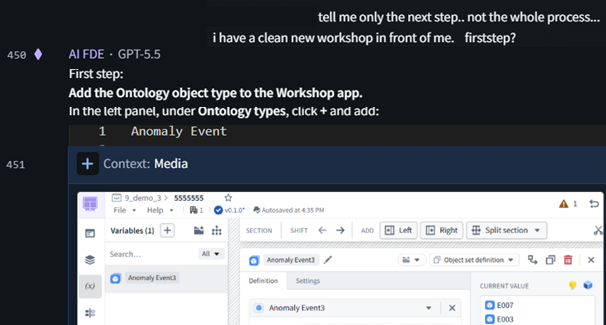<br>

Afterwards I created this simple diagram to make sure I could miss those "rabbit holes" in the future (with uniquely numbered steps and variables; they don't have to be perfect, just something you can trace). <br> 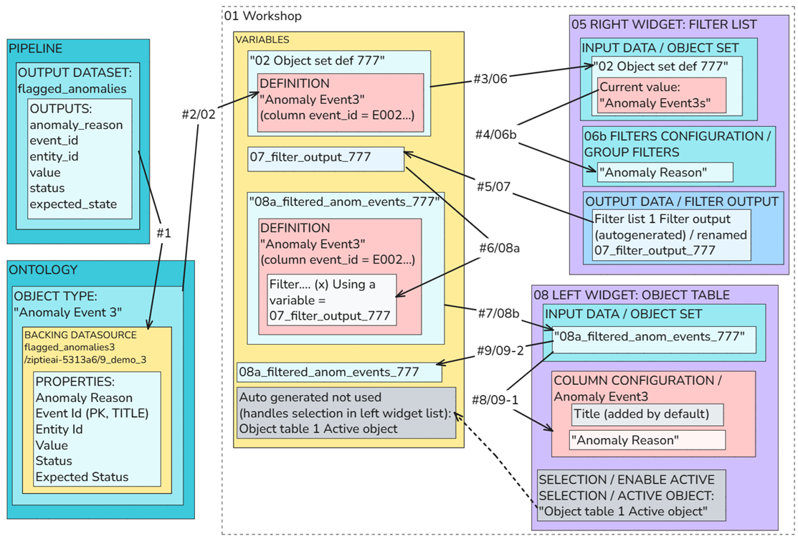

-->

<!--

- But how exactly did they implement the HN algorithms? That's of practical interest currently because
    - (1) those **HN techniques are being used in all business segments** (not just military and intelligence) and
    - (2) **you can learn the details hands-on yourself for free with no assistance**by getting a PAL trial license (I have only a trial license and I am working alone).


    The goal of this page is to explain (via demos) the gist of a portion of the Palantir (PAL) toolset (there are not many competitors to PAL right now, but there will be in the near future, and they will follow a lot of the PAL methodologies). How to use that toolset to create HN apps. -->

<!--  If I had had such a diagram for the step-by-step demos I had done earlier, I would have understood better what I had been doing. When you get your first Workshop running, spend extra time tracing through all the connections. Experiment. Do this for other tools.
-->

<!--
*(MAIN DIAGRAM: 620/D9/xx)*.

  - **Use AI (AIP/FDE) to do demos from scratch** (not following PAL demos or PAL docs; I might get inspiration from those demos, but I just use AIP/FDE to execute; in the future PAL Pilot would do this).
  - **D9 (demo set 9) = "haystack needle" demos**. I believe this was Palantir's original focus when founded:
    - Finding some small indication in a sea of data
    - Without/with AI.
  - Coming soon: Other AIP/FDE/Pilot demos.
 - **[PAL Pilot](https://www.palantir.com/docs/foundry/pilot/getting-started/)** (in beta now) will probably be an "FDE/AIP combo" that can "see" the dialogs and lead you by the hand through complicated setups.<br>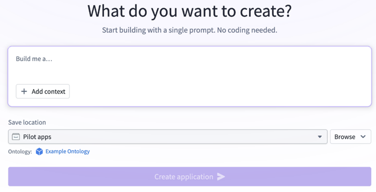<br><br>
   - **[8 (3c.3b) Pilot real-world projects](/3c.3b_pal_pilot/) (NEAR FUTURE?)** .-->

<!--
<br>
<br>
<br>


---------------------------------------
---------------------------------------
---------------------------------------
---------------------------------------
---------------------------------------

<br>
<br>
<br>

# **OLD STUFF ==============================**

The goal of this page is not to duplicate the content of these docx's
- Palantir **["AIP workflow speedrun"](https://learn.palantir.com/speedrun-your-e2e-aip-workflow)** or
- My main lab notes docx **[#611vvv\_aip\_qs\_.docx](https://drive.google.com/drive/folders/1-Adawag9uA8_bq-hDF-nOuPYaRLz1eEO)** (this docx contains only the changes from \#611) or
- **[#611\_pal\_aip\_v06ccc-02\_.docx](https://drive.google.com/drive/folders/1-Adawag9uA8_bq-hDF-nOuPYaRLz1eEO)**. \#613 (a reorg of the speedrun) failed, so I took the first successful demo in \#611 and reworked my way through it from finish to start (I replaced ch8 UI first, then ch6 Knowledge Graph, ..., and finally the pipeline). **BINGO** (it all worked). *To me the easiest demo would be to do things in that order; take a working demo and modifying it, starting at the finish, and drilling down to the start*.

Rather its meant as a commentary (WIP) about some of the details of the speedrun and my own take on the core concepts.

There are also a few other lab notes docx's of interest:
- **[#613\_pal\_aip\_REORG\_TEST\_.docx](https://drive.google.com/drive/folders/1-Adawag9uA8_bq-hDF-nOuPYaRLz1eEO)**. Attempted reorg test. Ran into error for the KG Vertex graph that I could not solve. I think the problem was in the pipeline (I changed the variable names and probably made a mistake; I tried debugging the backend code with FDE/OPUS/GPT, but no luck).
- **[#611bbb\_pal\_aip\_v03\_NOTES\_.docx](https://drive.google.com/drive/folders/1-Adawag9uA8_bq-hDF-nOuPYaRLz1eEO)**. Tons of notes.
- **[#610\_pal\_foundry\_.docx](https://drive.google.com/drive/folders/1-Adawag9uA8_bq-hDF-nOuPYaRLz1eEO)**. Foundry was the prerequisite of this demo.

<br>


### **AIP QS (my version of Speedrun)**

- [3c.2.0 PAL AIP notes](/3c.2.0_pal_aip_notes/)
- [Ch1 Concepts](/3c.2.1_pal_aip_qs_ch1_concepts/)


**Remaining chapters to add**
- 2 Set Up Project and Folder
- 3 Upload Data
- 4 Transform Data
- 5 Configure Ontology
- 6 Explore Object Relations = CREATE "KG" Chunks<>Entities links
- 7 Create AIP Logic Function ("ontology aided generation")
- 8 Build App


<br>

*Final app* <br>
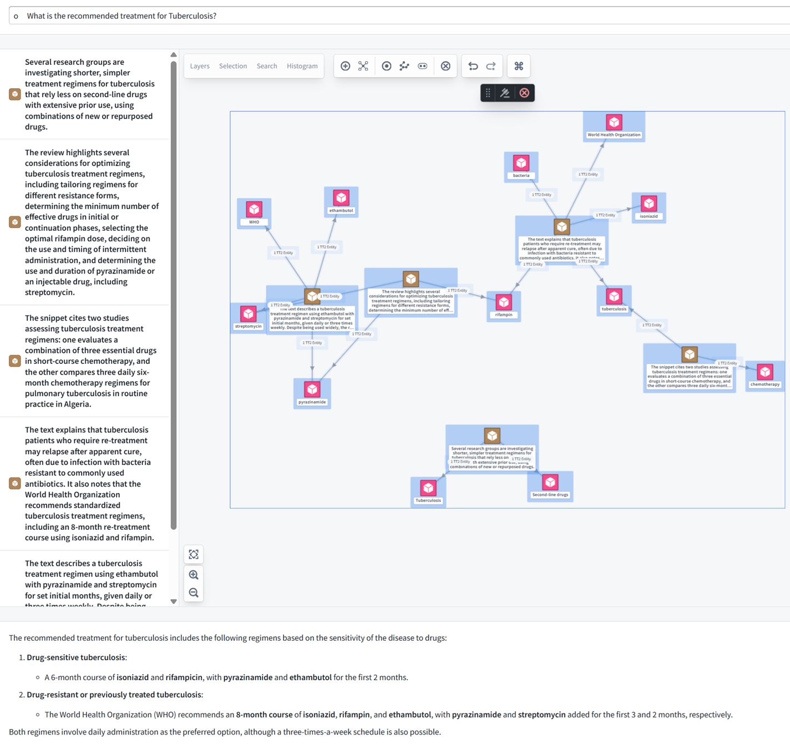
-->
