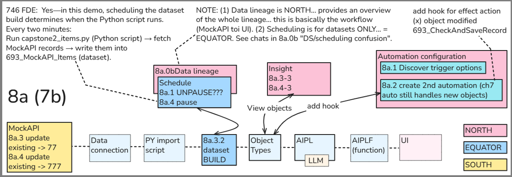
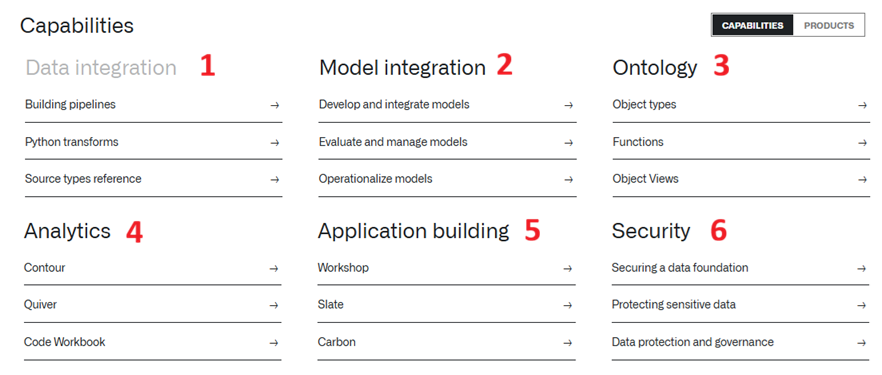

 

**This Enterprise section focuses on Palantir Foundry** (reorganized 26.1120). 
- Foundry is an **excellent enterprise framework** (with integrated AI) with lots of demos.
- Foundry offers a **generous free trial version**. 

To learn Foundry:
- Use Foundry's **FDE** AI assistant constantly.
- Follow the **ZAI learning path** (consider using **[ZAI MS Word docx's](https://drive.google.com/drive/folders/1-Adawag9uA8_bq-hDF-nOuPYaRLz1eEO)** as a template for your own study notes). 
- **Repeat, repeat, repeat**. It takes weeks to master the basics (UI, workflows, terminology, core concepts, etc). **ZAI substantially minimizes this learning curve**.

 

------------------

 

#### **TOC**

<!-- _**To get started ASAP with Enterprise AI programming using Foundry**, sign up to Foundry (2), then do the ZAI tutorials (3) start to finish (while referring often to the core concepts (1))._ -->

- **1 Concepts** (rewritten 26.1117)
- **2 Foundry free tier sign up** 
- **3 Core ZAI hands-on tutorials** (do these start to finish)
- **4 ZAI versions of Foundry demos** 
- **5 Project/doc sources** (Foundry and ZAI)

 

--------------------
--------------------
--------------------
--------------------
--------------------
--------------------

 

## **[1 Concepts](/pal_concepts_all/)** (rewritten 26.1117)

General concepts:
- Foundry is a **modern enterprise platform** for data integration, ontology, analytics, applications, **AI assistance**, and governance.
- Foundry represents the **logical culmination of ZiptieAI**.
- Foundry takes a **very practical no-nonsense approach to AI in the enterprise** (Foundry was a market leader over 20 years ago, long before AI).
- Palantir offers a **generous Foundry free trial**.
- Foundry's **built-in AI assistant (FDE)** makes hands-on self-study practical.

Click on the heading above for programming concepts. 

 

--------------------
--------------------
--------------------
--------------------
--------------------
--------------------

 

## **2 Foundry free tier sign up**

I did not record how I signed up, and its not a process I can repeat. But I can tell you the following:
  - **You must be in a country that PAL supports** (thats only a few countries).
  - **You can NOT use a VPN**.
  - **You must have a passport or some picture ID of good enough quality for facial recognition verification**. My passport is almost 10 years old, but it still worked.
  - **You need a camera on your PC to take a pic of yourself. PAL will compare your ID and the pic.**
  - I think you need a **mobile phone number** (and email).

 

 

--------------------
--------------------
--------------------
--------------------
--------------------
--------------------

 

## **3 Core ZAI hands-on tutorials** (2)

These tutorials are the most effective method to learn core Foundry skills:

- **3.1 FDE (and other prerequisite skills) (26.1120)**. 
- **3.2 Foundry QS0: Detect/analyze haystack needles (start with Foundry example) (26.1119)**. 
  - Quick realistic real-world demo (finding matching intelligence records in a large set of data) **without AI** (Palantir's original mission; Palantir was founded 25 years ago, long before AI). 
  - Intros haystack datasets, pipeline (that detects needles), and objects/maps/UI for display of needles.     
- **3.3 Foundry QS1: Detect/analyze haystack needles (start from scratch) (26.1113)**. 
  - A non-realistic demo that focuses on mechanical details. 
  - Intros AI, actions, automation/scheduling, and governance. 
- **3.4 Foundry deep dive (DD) (WIP)**. 
  - Intended as simple intro to all of the Foundry functionality/tools that were not introduced in QS0/QS1. Goal is the piecemeal intro of the missing pieces. 
  - After this, you can continue in section 4 doing (ZAI versions of) Palantir Foundry speedruns, demos, examples, etc.
- **3.5 (WIP) DIY (do-it-yourself) demos** (26.1121)

 

--------------------

 

#### **[3.1 FDE (and other prerequisite skills) (26.1120)](/pal_fde/)** (2.0)

_**[Single source docx #685](https://drive.google.com/drive/folders/1-Adawag9uA8_bq-hDF-nOuPYaRLz1eEO)** (WIP) for FDE webpages (markdown and PNG's are extracted by ChatGPT)._

- Knowing how to use FDE (Forward Deployed Engineer, Foundry's excellent AI assistant) is the most important skill you will learn. 
- However, its also critical to understand FDE's limits: **[My first 2 attempts to create a QS (my mistakes are instructive)](/pal_2_failed_tutorials/)**. I relied too much on FDE AI. Both tutorials worked, but the result was not something to use as a tutorial. Human intelligence and AI make a great team. But the human has to be in control. You need to reach a minimal level of expertise with Foundry so that you are always in control. Thats why you still ZAI to guide you through the basics.
- There are also several other things to be aware of before you start creating Foundry apps. 

_The FDE error that you will run into sooner or later (a show stopper; without FDE you are going nowhere)_  

_Its important to master the UI_ 

 

--------------------

 

#### **[3.2 Foundry QS0: Detect/analyze haystack needles (start with Foundry example) (26.1119)](/pal_qs0/)** (2.1)

_**[Single source docx #686](https://drive.google.com/drive/folders/1-Adawag9uA8_bq-hDF-nOuPYaRLz1eEO)** for QS0 webpages (markdown and PNG's are extracted by ChatGPT)._

In QS0 you install a Foundry "needle in the haystack" real-world Example, then rebuild it yourself.  
- The haystack: a collection of data records imported into Foundry.
- The needle: any record whose text or numeric properties match criteria expressed in a user prompt.

QS0 uses a real world example, but is a simpler demo than the next QS1 (that focuses on the mechanics of Foundry):
- Ch1: First steps (sign up/in, FDE)
- Ch2: PAL Example (real-world) install. The large and complex (haystack) dataset demonstrates the power of PySpark.
- Ch3/4: Pipeline (no-code) filters out the chaff (everything but the needles). Input 2 raw datasets (haystack, 5K rows) and outputs (needle, 4 rows) dataset.
- Ch5: Very basic ontology (a single object type, no actions, no links). 
- Ch6. Display the needle dataset in the Maps tool.
- Ch7. Create a custom UI to display the needle dataset (display only; no actions in QS0).

 

--------------------

 

#### **[3.3 Foundry QS1: Detect/analyze haystack needles (start from scratch) (26.1113)](/pal_693_qs/)** (2.2)

_**[Single source docx #693](https://drive.google.com/drive/folders/1-Adawag9uA8_bq-hDF-nOuPYaRLz1eEO)** for QS1 webpages (markdown and PNG's are extracted by ChatGPT)._

QS1 is also a “needle in the haystack” demo (using Foundry to identify records that match user-defined criteria), but
- Ch1: MockAPI (very simple external datasource that you control).
- Ch2/3/4: AI. MockAPI records are very few and simple. But the messy human language content is not simple for a computer without AI. This is core reason AI is used in Foundry.
- Ch5/6: Actions. AI calls actions to create ontology objects.
- Ch7/8/8a: Automation (scheduling dataset updates and updating objects).
- Ch8b: Governance (access control, monitoring (especially of AI), etc).

How QS1 differs from QS0: 
- Focuses on Foundry mechanics and workflows (a small dataset, not a real-world search demo).
- Python scripts replace the pipeline.
- Actions, AI (AIPL and functions), automation and governance.

_Automation (Foundry checks for updates in the external data source)_ 

_Example workflow diagram_ 

 

---------------------------

 

#### **[3.4 Foundry deep dive (DD) (26.1117 WIP)](/pal_693_dd/)** (2.2a)

The goal of QS0 and QS1 was to intro the basics with a simple goal — find the “needle in the haystack”. **The goal of DD is to introduce the general "mechanics" of how Foundry works**. The plan is to reference official PAL speedruns, demos, and examples in the DD.

_Foundry deep dive master diagram_ 

 

---------------------------

 

#### **[3.5 (WIP) DIY (do-it-yourself) demos](/3.5_diy/)** (v1 26.1122)

The official demo supplies inspiration; DIY demos isolate and teach the mechanism.  

- Section 4.3 catalogs the official Palantir demos.
- This section will contain demos 
  - inspired by those official demos
  - but created from scratch
  - and are minimized in scope and complexity as much as possible (while still demonstrating the target concepts)

<!-- - Selection of 4.3 demos will be based on
  - What new app or technique does it introduce?
  - Where does it fit in the NORTH-EQUATOR-SOUTH diagram?
  - Can we reuse familiar data and objects?
  - What is the smallest exercise with a clearly verifiable result? -->

There is current only 1 demo of this type (started from and built with the sole assistance of FDE).
- **[#620\_pal\_DIY9\_aip-fde_demo\_hn\_](https://drive.google.com/drive/folders/1-Adawag9uA8_bq-hDF-nOuPYaRLz1eEO)**. _DIY9 UI_  _Diagram of UI connections_  

<!-- 
FDE: Your sequence makes sense:

Review 4.3: use the Palantir demo catalog as a source of capabilities and inspiration—not a checklist you must complete.
Choose 3.5 exercises: together, identify capabilities not yet covered and design small, generic build-and-test demos.
For each candidate, we can ask:

What new app or technique does it introduce?
Where does it fit in your NES diagram?
Can we reuse familiar data and objects?
What is the smallest exercise with a clearly verifiable result?
The official demo supplies inspiration; your DIY demo isolates and teaches the mechanism. 
   You can still document selected official demos in section 4 when their complete scenario is worth exploring.
-->

 

--------------------
--------------------
--------------------
--------------------
--------------------
--------------------

 

## **4 ZAI versions of Foundry demos** (2b)

**The second set of ZAI tutorials are based on Palantir demos:**

- **4.1 ZAI versions of the core ~8 Foundry getting started demos**. The core demos (speedruns) meant for beginners. (2b.4)
- **4.2 ZAI versions of PAL Examples (installable)**. Real-world demos. ZiptieAI uses one of these demos as the very first demo for beginners. (2b.5)
- **4.3 PAL demos master list** (added 26.1121)

 

--------------------

 

#### **[4.1 ZAI versions of the core ~8 Foundry getting started demos](/3c.2_pal_initial_demos/)** (2b.4)

_Main diagram for demo D3 (Core workflow + Automation + AI external)_  

 

--------------------

 

#### **[4.2 ZAI versions of PAL Examples (installable)](/3c.1b_pal_examples/)** (2b.5) 

FULL-FEATURED BUSINESS APP (WITH INSTALLER). I originally planned to focus on examples These are complete demos that auto-install. The big advantage is that you start out with a (usually) working version that you can modify piece by piece. Examples are complete (usually more complicated) and have an installer that allows you to start with a (usually) working version that you can modify. ZAI adds a few extra steps:

- Install a second (experimental) example
- Modify that example at your own pace 

For example **E11: Palantir Foundry example “Integrate GeoSpatial data with Gaia” (26.0728).** The ZAI docx for this example shows how to (1) install the excellent PAL example and then (2) replicate that example (reusing only the original example data; you recreate everything else).

 _Geospatial example: Input 2 sets of intelligence data (ELINT and ATR GEOINT), find ~3 million matching entries, sift through the 3 million to find 4 entries of interest, display the 4 entries on a map._  

 

--------------------

 

#### **[4.3 PAL demos master list](/pal_demo_list/)** (V1 26.1121)

- I created this list 4 months ago.
- This list has a hyper-linked TOC to all demos.
- They are organized by the PAL-defined Foundry user roles.
- I merely made much easier to search (and include in prompts to AI).

 

----------------------------------------
--------------------
--------------------
--------------------
--------------------
--------------------

 

## **[5 Project/Doc sources](/pal_project_doc_sources/)** (3)

- **5.1 ZAI doc sources (docx, gdrive, this site, etc)** (3.1)
- **5.2 PAL project/doc sources** (3.2)

_palantir.com/docs/foundry (this section provides an overview of Palantir Foundry docs)_  

 

-------------------------------
-------------------------------
-------------------------------
-------------------------------
-------------------------------
-------------------------------

 

26.1121 (0814, v1 26.0702)
