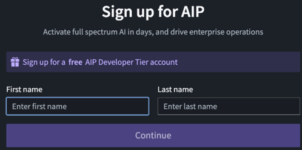
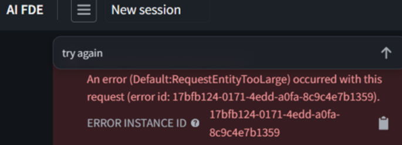
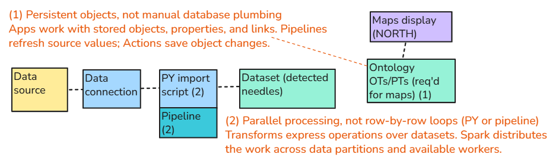
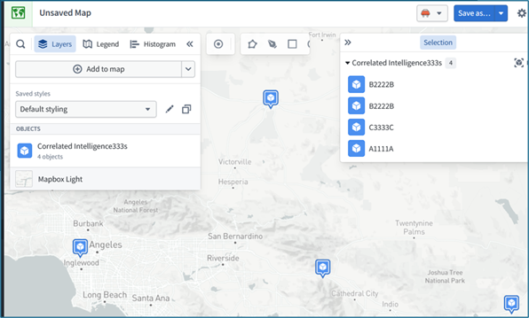
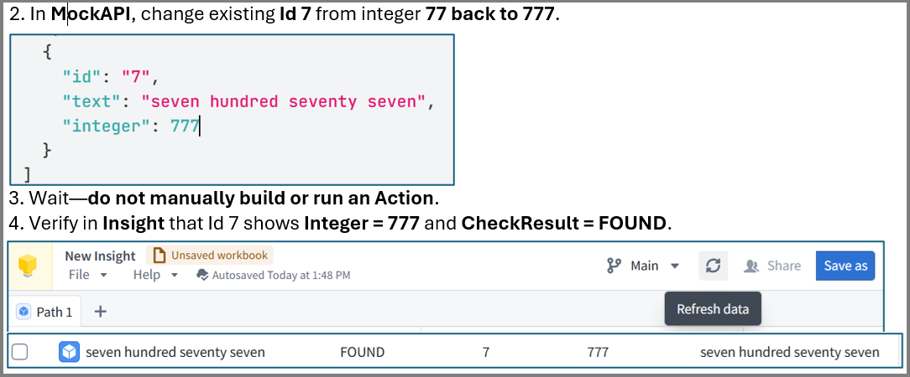
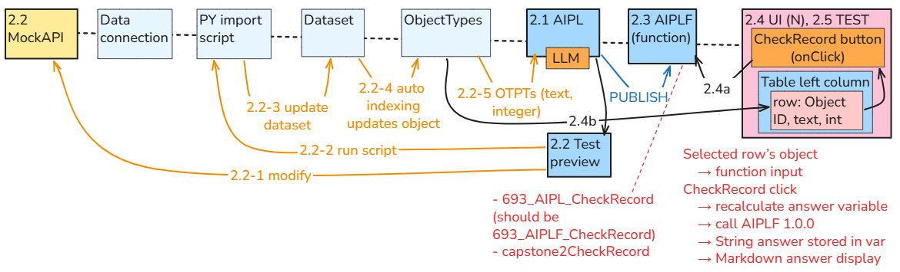
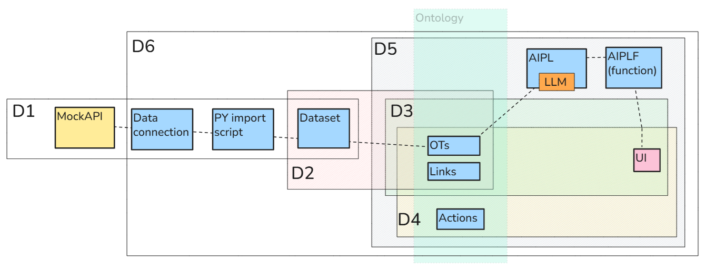
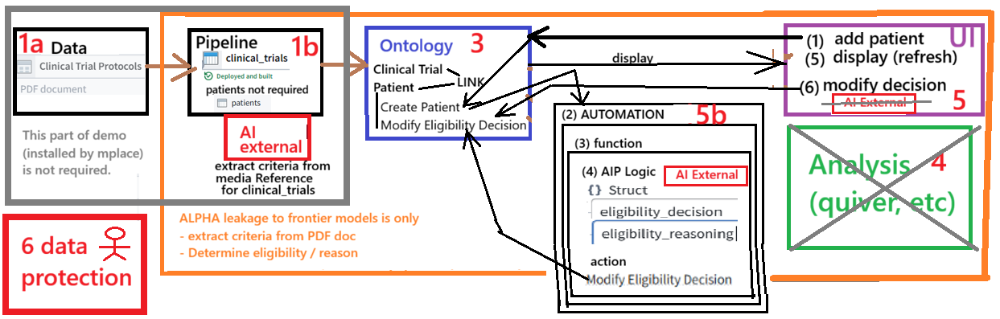

 

**This Enterprise section focuses on Palantir Foundry** (reorganized 26.1120; headings renumbered).

 

------------------

 

#### **TOC**

_**To get started ASAP with Enterprise AI programming using Foundry**, sign up to Foundry (2), then do the ZAI tutorials (3) start to finish (while referring often to the core concepts (1))._

- **1 Concepts** (rewritten 26.1117)
- **2 Foundry free tier sign up** 
- **3 Core ZAI hands-on tutorials** (do these start to finish)
- **4 ZAI versions of Foundry demos** 
- **5 Project/doc sources** (Foundry and ZAI)

 

--------------------
--------------------
--------------------
--------------------
--------------------
--------------------

 

## **[1 Concepts](/pal_concepts_all/)** (rewritten 26.1117)

For the **Core application programming concepts** click on the title link above.

**General concepts**
- Foundry is a modern enterprise platform for data integration, ontology, analytics, applications, **AI assistance**, and governance.
- Foundry represents the **logical culmination of ZiptieAI: (2) neural networks → (2b) models → (3) agents → (3b) workflows** (and finally) **→ (3c) enterprise platforms**.
- Foundry takes a **very practical no-nonsense approach to AI in the enterprise**. Foundry was a market leader over 20 years ago (long before AI).
- Palantir offers a **generous Foundry free trial**.
- Foundry's **built-in AI assistant (FDE) makes hands-on self-study practical**.

 

--------------------
--------------------
--------------------
--------------------
--------------------
--------------------

 

## **2 Foundry free tier sign up**

I did not record how I signed up, and its not a process I can repeat. But I can tell you the following:
  - **You must be in a country that PAL supports** (thats only a few countries).
  - **You can NOT use a VPN**.
  - **You must have a passport or some picture ID of good enough quality for facial recognition verification**. My passport is almost 10 years old, but it still worked.
  - **You need a camera on your PC to take a pic of yourself. PAL will compare your ID and the pic.**
  - I think you need a **mobile phone number** (and email).

 

 

--------------------
--------------------
--------------------
--------------------
--------------------
--------------------

 

## **3 Core ZAI hands-on tutorials (do these start to finish)** (2)

**The first set of ZAI tutorials focuses on you learning core skills hands-on** (just go through these from start to finish):

- **3.1 FDE (and other prerequisite skills) (26.1120)** (2.0)
- **3.2 Foundry QS0: Detect/analyze haystack needles (start with Foundry example) (26.1119)** (2.1)  
- **3.3 Foundry QS1: Detect/analyze haystack needles (start from scratch) (26.1113)** (2.2)
- **3.4 Foundry deep dive (DD) (WIP)** (2.2a)

 

--------------------

 

#### **[3.1 FDE (and other prerequisite skills) (26.1120)](/pal_fde/)** (2.0)

_**[Single source docx #685](https://drive.google.com/drive/folders/1-Adawag9uA8_bq-hDF-nOuPYaRLz1eEO)** (WIP) for FDE webpages (markdown and PNG's are extracted by ChatGPT)._

Knowing how to use FDE (Forward Deployed Engineer, Foundry's excellent AI assistant) is the most important skill you will learn. But there are also several other things to be aware of before you start creating Foundry apps. 

_The FDE error that you will run into sooner or later (a show stopper; without FDE you are going nowhere)_  

 

--------------------

 

#### **[3.2 Foundry QS0: Detect/analyze haystack needles (start with Foundry example) (26.1119)](/pal_qs0/)** (2.1)

_**[Single source docx #686](https://drive.google.com/drive/folders/1-Adawag9uA8_bq-hDF-nOuPYaRLz1eEO)** for QS0 webpages (markdown and PNG's are extracted by ChatGPT)._

In QS0 you install a Foundry "needle in the haystack" real-world Example, then rebuild it yourself.  
- The haystack: a collection of data records imported into Foundry.
- The needle: any record whose text or numeric properties match criteria expressed in a user prompt.

QS0 uses a real world example, but is a simpler demo than the next QS1 (that focuses on the mechanics of Foundry):
- No AI.
- No functions.
- Uses pipeline for creating datasets (QS1 uses Python). 
- The large and complex dataset demonstrates the power of PySpark (QS1 uses very simple data from a MockAPI test site).

 

--------------------

 

#### **[3.3 Foundry QS1: Detect/analyze haystack needles (start from scratch) (26.1113)](/pal_693_qs/)** (2.2)

_**[Single source docx #693](https://drive.google.com/drive/folders/1-Adawag9uA8_bq-hDF-nOuPYaRLz1eEO)** for QS1 webpages (markdown and PNG's are extracted by ChatGPT)._

QS1 is also a “needle in the haystack” demo (using Foundry to identify records that match user-defined criteria), but
- Differs from QS0: Uses Python scripts (instead of pipeline), AIPL (AI) and functions, and governance.
- The tutorial uses a small dataset to make the mechanics visible. It introduces the workflow — not a demonstration of large-scale search performance.- AI’s role: interpret those criteria and evaluate each record supplied to the workflow.
- The complete workflow: import records, display them, evaluate matches, save the results, and automate processing when records arrive or change.

_Example workflow diagram (verified by FDE) for ch2_ 

_NOTE: [2.1 My first 2 failed attempts to create a tutorial (my mistakes are instructive)](/pal_2_failed_tutorials/). I relied too much on FDE AI. Both tutorials worked, but the result was not something to use as a tutorial. At first I thought things were going good. But for a human reader the AI-generated structure and explanations were not good enough. FDE did, however, catch any small logic error in a document. Human intelligence and AI make a great team. But the human has to be in control. You need to reach a minimal level of expertise with Foundry so that you are always in control._

 

---------------------------

 

#### **[3.4 Foundry deep dive (DD) (26.1117 WIP)](/pal_693_dd/)** (2.2a)

QS0 and QS1 had one focused goal — find the “needle in the haystack” — using simple and short demos.

The goal of this DD is to cover the topics (hands-on) in the QS's in more detail and cover topics that were not in the QS's. The plan is to reference official PAL speedruns, demos, and examples in the DD.

The **Deep Dive (DD)** focuses on much more:
  - a broad, hands-on introduction to Foundry’s apps and techniques, not exhaustive depth in each one.
  - a wider tour of Foundry, with small, mechanistic exercises that show what each capability does, which app configures it, and how to verify it.
  - EQUATOR-SOUTH-NORTH
    - D1–D6 provide the EQUATOR backbone. 
    - SOUTH extensions introduce different sources and ingestion techniques; 
    - NORTH extensions introduce different analysis and interaction tools.
  - The guiding rule for DD is:
    - Introduce each app or technique through a small working example, connected to familiar data and mechanisms
    - That gives readers both breadth of exposure and a mental map of where each capability fits—without turning every introduction into a complicated project.

Below is the "master" diagram for the initial version of D1-D6.

_Foundry deep dive master diagram (ZAI original diagram verified by FDE)_ 

 

--------------------
--------------------
--------------------
--------------------
--------------------
--------------------

 

## **4 ZAI versions of Foundry demos** (2b)

**The second set of ZAI tutorials are based on Palantir demos:**

- **4.1 ZAI versions of the core ~8 Foundry getting started demos**. The core demos (speedruns) meant for beginners. (2b.4)
- **4.2 ZAI versions of PAL Examples (installable)**. Real-world demos. ZiptieAI uses one of these demos as the very first demo for beginners. (2b.5)

 

--------------------

 

#### **[4.1 ZAI versions of the core ~8 Foundry getting started demos](/3c.2_pal_initial_demos/)** (2b.4)

_Main diagram for demo D3 (Core workflow + Automation + AI external)_  

 

--------------------

 

#### **[4.2 ZAI versions of PAL Examples (installable)](/3c.1b_pal_examples/)** (2b.5) 

FULL-FEATURED BUSINESS APP (WITH INSTALLER). I originally planned to focus on examples These are complete demos that auto-install. The big advantage is that you start out with a (usually) working version that you can modify piece by piece. Examples are complete (usually more complicated) and have an installer that allows you to start with a (usually) working version that you can modify. ZAI adds a few extra steps:

- Install a second (experimental) example
- Modify that example at your own pace 

For example **E11: Palantir Foundry example “Integrate GeoSpatial data with Gaia” (26.0728).** The ZAI docx for this example shows how to (1) install the excellent PAL example and then (2) replicate that example (reusing only the original example data; you recreate everything else).

 _Geospatial example: Input 2 sets of intelligence data (ELINT and ATR GEOINT), find ~3 million matching entries, sift through the 3 million to find 4 entries of interest, display the 4 entries on a map._  

 

----------------------------------------
--------------------
--------------------
--------------------
--------------------
--------------------

 

## **[5 Project/Doc sources](/pal_project_doc_sources/)** (3)

- **5.1 ZAI doc sources (docx, gdrive, this site, etc)** (3.1)
- **5.2 PAL project/doc sources** (3.2)

_palantir.com/docs/foundry (this section provides an overview of Palantir Foundry docs)_  

 

-------------------------------
-------------------------------
-------------------------------
-------------------------------
-------------------------------
-------------------------------

 

26.1120 (0814, v1 26.0702)
