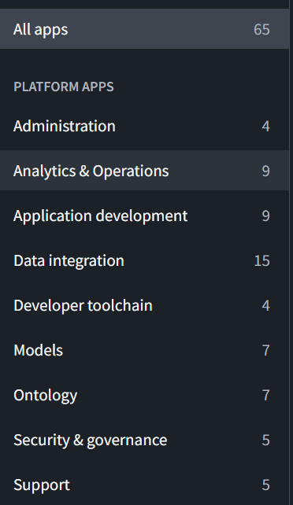
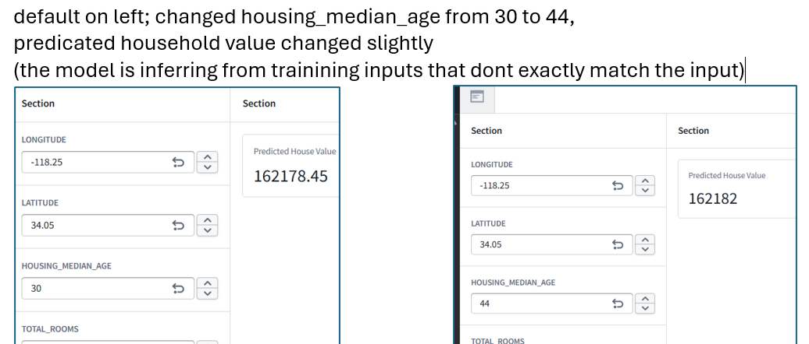

 

**This Enterprise section focuses on Palantir Foundry** (reorganized 26.1120). 
- Foundry is an **excellent enterprise framework** (with integrated AI) with lots of demos.
- Foundry offers a **generous free trial version**. 

 

------------------

 

<!-- 
**Your goal** (even if you don't know it yet) 
- is **not to master Foundry** (working without docs or assistance is old-style pre-AI), 
- but rather **to learn**
  - **what Foundry can do** and
  - **how Foundry can do it**
- so that you 
  - **know what problems Foundry can solve** and
  - **can work with FDE** (Foundry's AI tool) to get the job done (even for problems you dont fully understand).
  
**Knowing the needs of your enterprise** takes priority over programming expertise (welcome to the AI age).

 

------------------

   -->

To learn Foundry:
- **Sign up for Foundry** as described in section 2. 
- Follow the section **3 ZAI quick starts** learning path. For the first week focus on 2 skillsets:
  - **Using FDE**
  - **Navigating the applications and dialogs**. It takes weeks to master the basics (UI, workflows, terminology, core concepts, etc). **ZAI substantially minimizes the learning curve**.
- Then do the section **4 Deep dives**.

 

------------------

 

#### **TOC**

<!-- _**To get started ASAP with Enterprise AI programming using Foundry**, sign up to Foundry (2), then do the ZAI tutorials (3) start to finish (while referring often to the core concepts (1))._ -->

- **1 Concepts** (rewritten 26.1117)
- **2 Foundry free tier sign up** 
- **3 ZAI quick starts (Foundry basics)** (2)
- **4 ZAI deep dives (DD's)** (2b)
- **5 Project/doc sources** (Foundry and ZAI)

  

--------------------
--------------------
--------------------
--------------------
--------------------
--------------------

 

## **[1 Concepts](/pal_concepts_all/)** (rewritten 26.1117)

The **ZAI take on Ontology** (the most talked about aspect of Foundry):
- **Pipelines convert input data into clean datasets**. 
- **Clean datasets "back" (are the input data for) the ontology** 
- **Ontology contains persistent Object types, action types, and link types** (analogous to backend persistent objects).
- **Ontology has an "API"** that is analogous to a **REST API**.
- The **Ontology API can be called by existing tools or a UI** that you create.

General concepts:
- Foundry represents the **logical culmination of ZiptieAI**.
- Foundry is a **modern enterprise platform** for data integration, ontology, analytics, applications, **AI assistance**, and governance.
- Foundry takes a **very practical no-nonsense approach to AI in the enterprise** (Foundry was a market leader over 20 years ago, long before AI).
- Palantir offers a **generous Foundry free trial**.
- Foundry's **built-in AI assistant (FDE)** makes hands-on self-study practical.

Click on the heading above for more detailed concepts. 

  

--------------------
--------------------
--------------------
--------------------
--------------------
--------------------

 

## **2 Foundry free tier sign up**

I did not record how I signed up, and its not a process I can repeat. But I can tell you the following:
  - **You must be in a country that PAL supports** (thats only a few countries).
  - **You can NOT use a VPN**.
  - **You must have a passport or some picture ID of good enough quality for facial recognition verification**. My passport is almost 10 years old, but it still worked.
  - **You need a camera on your PC to take a pic of yourself. PAL will compare your ID and the pic.**
  - I think you need a **mobile phone number** (and email).

 

  

--------------------
--------------------
--------------------
--------------------
--------------------
--------------------

 

## **3 ZAI quick starts (Foundry basics)** (2)

In Palantir docs
- The initial demos (D1, D2, etc) were called "speedruns". These were actually deep dives.
- There were no quick starts.  

_Tutorials in the past needed to provide all the details to learn a new SW tool. Things have changed in the AI age. You will work with FDE to do these demos. All you really need from the docs are (1) what prompts to ask and (2) conceptual explanations. And the prompts in ZAI tutorials are sometimes not text, but screenshots. FDE and I would often have long discussions with a very specific pattern: (1) FDE tells me what to do, (2) I post a screenshot of the results (no text), and repeat. In the future, Foundry will probably be able to see your screen (you wont have to paste screenshots) and you will have audio chats. Foundry might even do all keyboard and mouse work._

_What the above means is that the goal of these tutorials is more about high level knowledge. Enterprise app programming has moved to yet another higher level of abstraction._

These tutorials are the most effective method to learn core Foundry skills (consider using the **[MS Word docx](https://drive.google.com/drive/folders/1-Adawag9uA8_bq-hDF-nOuPYaRLz1eEO)** files as a template for your own lab notes):

- **3.1 Corequisites (primarily FDE)** (26.1120). Topics to at least be aware of while you are doing the tutorials.
- **3.2 QS0: Detect/analyze haystack needles 1 (install a Foundry example)** (26.1119) (QS0 was originally QS2). 
  - Quick demo of a **realistic real-world demo whose technical details you probably don't understand** (finding matching intelligence records in a large set of data) and 
  - **You don't need to understand (fully) the technical details** thanks to FDE.
  - The **QS0 algorithm does not require AI** to get the job done (Palantir's original mission; Palantir was founded 25 years ago, before today’s generative-AI/LLM era). 
  - Intros haystack datasets, pipeline (that detects needles), and objects/maps/UI for display of needles.     
- **3.3 QS1: Detect/analyze haystack needles 2 (start from scratch)** (26.1113). 
  - A non-realistic demo that focuses on mechanical details. 
  - Intros AI, actions, automation/scheduling, and governance. 
- **3.4 QS3: Broaden your Foundry skills (WIP)**. QS3 will focus on 2 things:
  - More step by step directions for more Foundry functionality and algorithms (like the other two QS's).
  - Suggesting "inline" (while you are doing QS3) various topics to study in more depth (including topics in section 3.5 and 3.6).

 

--------------------

 

#### **[3.1 Corequisites (primarily FDE)](/pal_fde/)** (26.1120/2.0)

Knowing how to use FDE (Forward Deployed Engineer, Foundry's excellent AI assistant) is the most important skill you will learn. There also a few other things to keep in mind while working with Foudry.

_The FDE error that you will run into sooner or later (a show stopper; without FDE you are going nowhere)_  

_**[Single source docx #685](https://drive.google.com/drive/folders/1-Adawag9uA8_bq-hDF-nOuPYaRLz1eEO)** (WIP) for FDE webpages (markdown and PNG's are extracted by ChatGPT)._

 

--------------------

 

#### **[3.2 QS0: Detect/analyze haystack needles 1 (install a Foundry example)](/pal_qs0/)** (26.1119/2.1)

In QS0 (originally QS2) you install a Foundry "needle in the haystack" real-world Example, then rebuild it yourself.  
- The haystack: a collection of data records imported into Foundry.
- The needle: any record whose text or numeric properties match criteria expressed in a user prompt.

QS0 uses a real world example, but is a simpler demo than the next QS1 (that focuses on the mechanics of Foundry):
- Ch1: First steps (sign up/in, FDE)
- Ch2: PAL Example (real-world) install. The large and complex (haystack) dataset demonstrates the power of PySpark.
- Ch3/4: Pipeline (no-code) filters out the chaff (everything but the needles). Input 2 raw datasets (haystack, 5K rows) and outputs (needle, 4 rows) dataset.
- Ch5: Very basic ontology (a single object type, no actions, no links). 
- Ch6. Display the needle dataset in the Maps tool.
- Ch7. Create a custom UI to display the needle dataset (display only; no actions in QS0).

_**[Single source docx #686](https://drive.google.com/drive/folders/1-Adawag9uA8_bq-hDF-nOuPYaRLz1eEO)** for QS0 webpages (markdown and PNG's are extracted by ChatGPT)._

 

--------------------

 

#### **[3.3 QS1: Detect/analyze haystack needles 2 (start from scratch) (26.1113)](/pal_693_qs/)** (2.2)

QS1 is also a “needle in the haystack” demo (using Foundry to identify records that match user-defined criteria), but
- Ch1: MockAPI (very simple external datasource that you control).
- Ch2/3/4: AI. MockAPI records are very few and simple. But the messy human language content is not simple for a computer without AI. This is core reason AI is used in Foundry.
- Ch5/6: Actions. AI calls actions to create ontology objects.
- Ch7/8/8a: Automation (scheduling dataset updates and updating objects).
- Ch8b: Governance (access control, monitoring (especially of AI), etc).

How QS1 differs from QS0: 
- Focuses on Foundry mechanics and workflows (a small dataset, not a real-world search demo).
- Python scripts replace the pipeline.
- Actions, AI (AIPL and functions), automation and governance.

_Automation (Foundry checks for updates in the external data source)_ 

_Example workflow diagram_ 

_**[Single source docx #693](https://drive.google.com/drive/folders/1-Adawag9uA8_bq-hDF-nOuPYaRLz1eEO)** for QS1 webpages (markdown and PNG's are extracted by ChatGPT)._

 

---------------------------

 

#### **[3.4 QS3: Broaden your Foundry skills (WIP)](/pal_693_dd/)** (26.1117/2.2a)

**26.1124: A primary goal of QS3 is a small intro demo of the 7 Deep Dive types listed in section 4.**

QS0 and QS1 introduced Foundry through a focused goal: find the “needle in the haystack.” **QS3 broadens that foundation, accelerating your discovery of more Foundry apps**, capabilities, and techniques. Small, connected exercises retain the step-by-step Quick Start style, showing what each tool does, where it fits, and how to verify the result. The aim is broad introductory coverage—not exhaustive mastery of every tool.

_Foundry’s application landscape—approximately 65 apps in the environment shown._ 

<!-- 
_Foundry deep dive master diagram_  -->

  

--------------------
--------------------
--------------------
--------------------
--------------------
--------------------

 

## **4 ZAI deep dives (DD's)** (2b)

In Palantir docs
- The initial demos (D1, D2, etc) are called "speedruns".
- Examples are installable.
- There are also "deep dives". 

ZAI calls them all "deep dives" and organizes them (and ZAI originals) into the following categories:

- **A1 Office**
- **A2 Backend (EQUATOR)**
- **A3 Haystack needles**
- **A4a Inference (AI)**
- **A4b Training (AI)**
- **A5 Governance / security**
- **A6 Agentic (central loop)**

The following is the inventory of all tutorials (working list)
- **4.7 PLANNING LIST** 

<!-- - **4.3 ZAI versions of the core ~8 Foundry getting started demos**. The core demos (speedruns) meant for beginners. (2b.4)
- **4.4 ZAI versions of PAL Examples (installable)**. Real-world demos. ZiptieAI uses one of these demos as the very first demo for beginners. (2b.5) -->

 

---------------------------

 

#### **[pal_4.1_a1_office](/pal_4.1_a1_office/)** (v1 26.1124)

 

---------------------------

 

#### **[pal_4.2_a2_equator](/pal_4.2_a2_equator/)** (v1 26.1124)

 

---------------------------

 

#### **[pal_4.3_a3_haystacks](/pal_4.3_a3_haystacks/)** (v1 26.1124)

 

---------------------------

 

#### **[pal_4.4a_a4a_ai_inference](/pal_4.4a_a4a_ai_inference/)** (v1 26.1124)

 

---------------------------

 

#### **[pal_4.4b_a4b_ai_training](/pal_4.4b_a4b_ai_training/)** (v1 26.1124)

 

---------------------------

 

#### **[pal_4.5_a5_governance](/pal_4.5_a5_governance/)** (v1 26.1124)

 

---------------------------

 

#### **[pal_4.6_a6_agentic](/pal_4.6_a6_agentic/)** (v1 26.1124)

 

---------------------------

 

#### **[4.7 PLANNING LIST](/pal_3.6_target_apps/)** (v1 26.1123)

This section will focus on introducing target applications and how you would use Foundry + FDE to get the job done.

 

---------------------------

 

#### **[xxxxxxxxxxxxxxxx4.1 OK/WIP/FAILED LIST](/3.5_diy/)** (v1 26.1122)

<!-- The QS's (3.2-3.4) and the official demos (section 4) supply inspiration; -->

DD tutorials focus on learning the full set of Foundry capabilities you need to get real world projects done.

- Section 4.3 catalogs the official Palantir demos.
- This section will contain DD's 
  - inspired by those official demos
  - but created from scratch
  - and are minimized in scope and complexity as much as possible (while still demonstrating the target concepts)

<!-- - Selection of 4.3 demos will be based on
  - What new app or technique does it introduce?
  - Where does it fit in the NORTH-EQUATOR-SOUTH diagram?
  - Can we reuse familiar data and objects?
  - What is the smallest exercise with a clearly verifiable result? -->

There are current only 2 DD's of this type (started from and built with the sole assistance of FDE). Several TODO's.

- **[#620\_pal\_DIY9\_aip-fde_demo\_hn\_](https://drive.google.com/drive/folders/1-Adawag9uA8_bq-hDF-nOuPYaRLz1eEO)**. _DIY9 UI_ 
- **[#619\_pal\_D8\_model\_integration\_](https://drive.google.com/drive/folders/1-Adawag9uA8_bq-hDF-nOuPYaRLz1eEO)**. _D8 demo model trained in Foundry_  

  

----------------------------------------
--------------------
--------------------
--------------------
--------------------
--------------------

 

## **[5 Project/Doc sources](/pal_project_doc_sources/)** (3)

- **5.1 ZAI doc sources (docx, gdrive, this site, etc)** (3.1)
- **5.2 PAL project/doc sources** (3.2)

_palantir.com/docs/foundry (this section provides an overview of Palantir Foundry docs)_  

 

-------------------------------
-------------------------------
-------------------------------
-------------------------------
-------------------------------
-------------------------------

  

26.1124 (0814, v1 26.0702)
