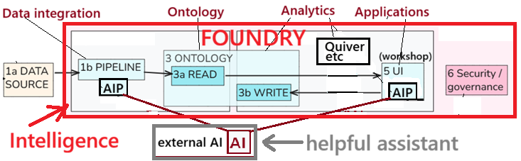

 

[← 3c Enterprise](/pal/)

 

## ME1: how to proceed to create 694-2?

(in this discussion, 694-1 = our current 694)

(Note that the numbering is backwards, 695 comes before 694)

- \(1\) For 694-2, i want to start with an ontology matching a finished 695 (the QS "quick start", the ontology that 694-1 started with).

- \(2\) but as you said, this would not be simple. we'd have to do one of the following

  - (2.1) "rip out" all the parts of the existing ontology that we want to add in 694-2 OR

  - (2.2) redo QS 695 to create new ontology object types for creating 694-2; but this would be a lot of trouble because

    - (2.2.1) I am already at the 60 object type limit; I'd have to first delete object types

    - (2.2.2) and then redo 695.

- \(3\) so what are the options? i see only one:

  - (3.1) option 1: do only the parts of 694-2 that can be done without messing up anything that we created for the existing 694-1.

- \(4\) option 1 is good because:

  - (4.1) i just want to prove that this way of doing things works.

  - (4.2) i want to reapply for a job at palantir; i can reapply starting today 1 nov 2026; therefore I want a 694-2 and 694-3 ASAP (to prove that my doc process actually works).

- \(5\) can you figure out what parts we skip (that means what \[FDExx\] prompts we skip?

  - (5.1) I am not asking you do this right now; I first want to finish getting the \[FDE\] prompts for the remaining CSxxx chapters.

- \(6\) lets renumber the \[FDExx\] steps to something like \[F001-23\] where

  - (6.1) "001" is a start to finish serial number for each \[FDE\] prompt

  - (6.2) "23" is the serial number of my original prompt (the FDE-generated serial number in our chat session dialog)

  - (6.3) NOTE that there are no instances of "\[F" in my docx (its unique); so we can shorten to "\[FDE".

- \(7\) getting this process correct is important, because i see us creating more of such tutorials (a future 693, 692, etc)

## FDE1: Yes. For your immediate goal, a selective replay is the right approach. 

We do not need to rebuild the QS or dismantle the working capstone to demonstrate that the prompt-based documentation process works.

### I understand the sequence as:

#### 695 — QS 

#### → 694-1 — original capstone 

#### → 694-2 — verified prompt replay 

#### → 694-3 — edited tutorial.

### 1. Define 694-2 as a selective replay

Its starting environment will **not** exactly match a freshly completed 695. State that explicitly:

This replay uses the existing completed capstone environment. Selected steps are repeated; existing components are inspected or reused where recreating them would disturb the working system.

That is a valid test of the documentation process, provided we distinguish **repeated implementation** from **inspection of an existing implementation**.

**No object-type deletion or Ontology reset is required for this plan.**

### 2. Finish drafting the prompts first

Agreed: **we will not decide which individual prompts to skip yet.**

First, finish the proposed prompts for:

- CS003

- CS004

- CS005

- CS006a–c

- CS007

Then assess the complete sequence against the current environment. That avoids making an early skip decision that breaks a later prerequisite.

### 3. Classify each prompt before replay

For each prompt, assign one disposition:

| **Disposition**   | **Meaning**                                                                 |
|-------------------|-----------------------------------------------------------------------------|
| **Replay**        | Perform the step without disturbing the existing implementation.            |
| **Adapt**         | Perform a modified version, such as creating a separately named Logic copy. |
| **Inspect/reuse** | Verify an existing component instead of recreating it.                      |
| **Skip**          | Omit it because it is unnecessary or would disturb the working environment. |

For **Skip**, record the reason and the existing state that satisfies the next step’s prerequisite. Skipping an operation must not leave the lesson’s dependency unexplained.

This should let us replay useful work without pretending we recreated everything.

### 4. Use stable, traceable prompt markers

Your proposed structure is good:

\[F001-10\]

Meaning:

- **001:** the prompt’s sequence number across the whole tutorial.

- **10:** the original reader-message number in this chat.

If you prefer to retain FDE, use:

\[FDE001-10\]

**My recommendation is the shorter \[F001-10\]**, since you have confirmed \[F is unique in your DOCX.

For screenshot-only groups with no separate text message:

\[F015-58,59\]

For a prompt associated with text message 18 and screenshots 16–17:

\[F004-18\]

Keep screenshot references separately in the editorial table.

**Assign the sequence numbers once, then freeze them.** If a prompt is later skipped, retain its ID in the working record. Add an inserted prompt as \[F015a-58\] rather than renumbering every subsequent prompt.

### 5. Keep one prompt register

A small table can coordinate the documents:

| **Prompt ID** | **Chapter** | **Original marker** | **Disposition** | **Replay result** |
|---------------|-------------|---------------------|-----------------|-------------------|
| \[F001-10\]   | CS001       | \[p10,9\]           | To assess       | Not tested        |
| \[F002-12\]   | CS001       | \[p12\]             | To assess       | Not tested        |

This becomes the reusable method for future tutorials—693, 692, and beyond.

**Recommended next move**

**Continue supplying the marked transcripts, starting with CS003.** I’ll draft the reader prompts as before. Once all chapters are covered, we can:

1.  Assign the new global IDs.

2.  Produce the replay/inspection/skip plan.

3.  Run a small, clearly bounded replay.

4.  Document its evidence in 694-2.

5.  Edit that verified material into 694-3.

### For your application, the strongest claim will be precise:

#### A demonstrated method for converting an actual AI-assisted build into traceable prompts, selectively replaying them, and producing a verified tutorial.

That is meaningful evidence without requiring a costly reconstruction of the entire Foundry environment.

<!-- 
_._ 
-->

 

---

 

26.1101 (v1 26.1101)
