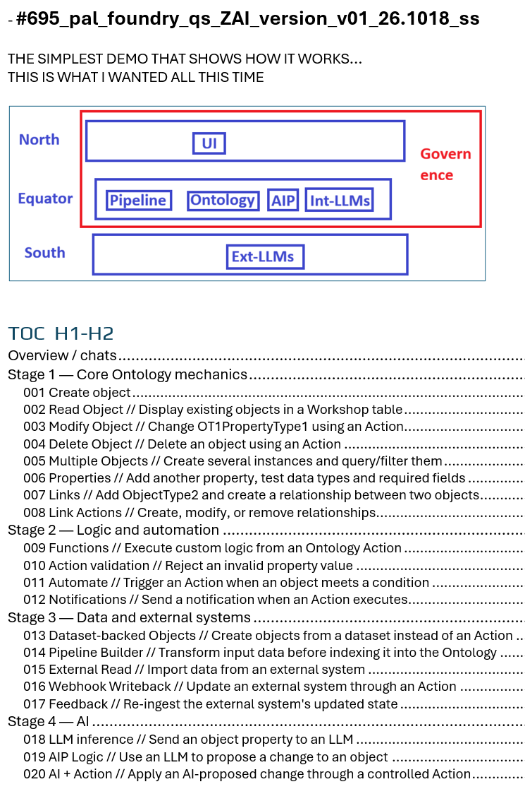
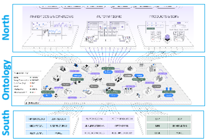
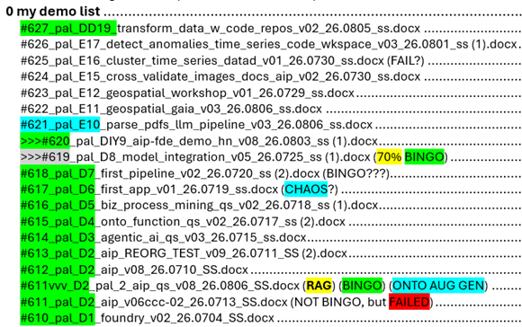
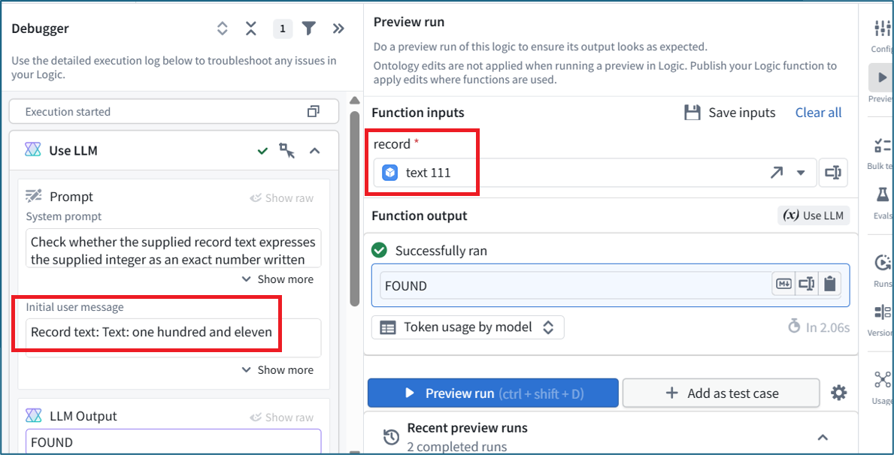

 

[← 3c Enterprise](/pal/)

 

#### **[2.0b Doc plan for ZAI QS (2.1) and Capstone (2.2) tutorials](/pal_2.x_doc_plan/)**

The basic idea (that I am testing on 26.1031-...) on the 2.2 demo is
1. Do the first hands-on demo (for 2.2 this is **694-1**) with FDE and document. This process is unpredictable and a bit chaotic, with debugging and discussion sections.
1. **Clean up 694-1**. Add H2 headings, add prompt/response serial # markers (the serial # is from FDE chat dialog; there were 700+ such markers in 694; I have to manually add these #'s because FDE can not see them in the chat). **Then ask FDE to create what it thinks the prompts should be for anyone wanting to replicate this tutorial (by simply prompting FDE)**. Here is an example prompt:
- [F4.04-213] I replaced the System prompt. Here are the prompt, Tools section, and Initial user message. Verify the configuration, then guide me through inserting the criteria input into the message using a variable chip—not plain text.
1. Then create file **694-2**. Try to replicate the tutorial using the "[F]" prompts. 
1. Finally **clean up 694-2**. This will be the final user tutorial docx (**use GPT to create markdown/png's for web publishing**).

NOTE: Just as Foundry requires a lot of preparation and organization to work with AI successfully, so does this system of creating docs with AI. But the result is **very useful, technically-accurate, and very maintainable tutorial docs.**

 

--------------------

 

#### **[2.1 ZAI quick start (QS) (WIP)](/3c.2_pal_initial_demo_ZAI/)**

A detailed QS that starts from 0, giving you core Foundry skills (and a real understanding of key Foundry concepts). Stays laser-focused on 
- the core mechanics of using Foundry
- how to navigate the UI and the terminology
- **using FDE (Foundry's built-in AI assistant)** 

_See also_
- _**[foundry_qs](/foundry_qs/)** (a test converting about 5% of the docx source file to markdown for display on this website)._
- _Docx **[#695](https://drive.google.com/drive/folders/1-Adawag9uA8_bq-hDF-nOuPYaRLz1eEO)** is my working version of this demo (open that doc; I will not be (for now) adding anything on this webpage)._ 

_(left) Foundry diagram (for the ZAI quick start; Ontology is a component in the "Equator") and (right) original_    

<!--
- There are 5 basic classifications for each addition to the demo:
  - [1] 3 Core Foundry analytics // without LLMs (D9, D5) (finding "needles in the haystack").
  - [2] 2a Data protection // and AI security (D3b, D3c) (_added 26.0905_).
  - [3] 1 External AI models (D1-D3).
  - [4] 2b Sovereignty (2b.1-2b.8).
  - [5] 2 Internal AI models (D8a-D8g).
- The progression of the StF project is not [1]-[5] above. Rather:
  - Do whatever comes next logically
  - Classify using[1]-[5]
when i started: I decided I'd just start doing demos and after a while I'd eventually figure out a learning path. \*thats what this is... a Start-to-Finish learning path.** SEE ALSO: rough draft (OUTDATED) learning plan **[#699_planning\_.docx](https://drive.google.com/drive/folders/1-Adawag9uA8_bq-hDF-nOuPYaRLz1eEO)\*\*   -->

 

--------------------

 

#### **[2.2 ZAI Foundry“capstone” project demo (was 2.3)](/pal_capstone/)**

Based on the demo project built in 2.1, you create a “Needle in the Haystack” demo. In this demo you specify what kind of “needle” you are looking for in a “haystack” of data, and the Foundry uses AI to find (almost a real world demo of one of Foundry’s most well known capabilities).

_Capstone demo **[#694](https://drive.google.com/drive/folders/1-Adawag9uA8_bq-hDF-nOuPYaRLz1eEO)** TOC 26.1030_ 

_See also_
- _Docx **[#694](https://drive.google.com/drive/folders/1-Adawag9uA8_bq-hDF-nOuPYaRLz1eEO)** is my working version of the capstone project demo._ 

 

---

 

26.1104 (v1 26.1104)
