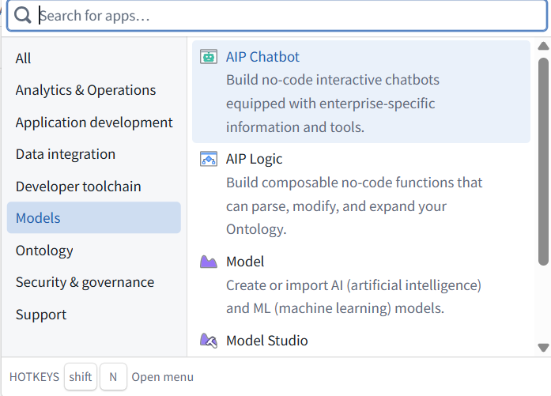

 

<!-- _xxxxxxxxx_   -->

| **15** | Predict a numeric result and compare predictions with actual outcomes | Supervised model training |

## ME: you gave me a list of 15 possible demos.
lets take those 15 one by one..
first
15 Predict a numeric result and compare predictions with actual outcomes Supervised model training

in 3.5 i added the #619 D8 demo (this was created from scratch with FDE help based on PAL website doc pages)
in 3.6 we add a realistic higher-level demo (or maybe several possible scenarios....
right now we are brainstorming) and explain why they need internal model.
this assumes the reader already did #619
mabye we need and internal demo because our task is simple.... we have a very specific dataset that we wanto to train on, and that data is very confidential.

 

### **FDE: Yes—this is a good distinction between the two sections:**

- **3.5 / #619:** how to train and use a model inside Foundry.
- **3.6 / ZAI_example:** a realistic prediction problem that uses those skills—and explains why a custom model is appropriate.

One clarification: **a simple task does not necessarily need a model**; a formula or rule may suffice. A trained model is useful when historical examples contain a predictive relationship that is difficult to specify explicitly.

Also distinguish: ############################################################
- **Custom model:** trained for your particular data and target.
- **Internally hosted model:** runs within your controlled environment.

Your scenario may call for **both**.

## Three possible scenarios

| Scenario | Predict | Why a custom model? | Why keep processing internal? |
|---|---|---|---|
| **Equipment test results** | A numeric quality measurement before the final test | The relationship depends on your equipment, materials, and operating conditions | Measurements and process settings reveal proprietary know-how |
| **Task completion time** | Minutes required to complete a newly submitted task | Your historical durations reflect your particular resources and procedures | Records may contain confidential operational or personnel information |
| **Material yield** | Usable output from a batch | Yield depends on interacting measurements and process settings | Recipes, settings, and production results are commercially sensitive |

## My first choice: predict an equipment test result

A focused example could be:

> **Can we predict a final quality score from earlier measurements, identify predictions that are unreliable, and compare predictions with actual test results?**

Use a synthetic dataset containing:
- Several numeric input measurements.
- The actual final quality score for historical records.
- A separate set of records reserved for evaluation.
- New records for prediction.

The demonstration would:

1. Train a regression model on historical records.
2. Compare its predictions with actual outcomes on **held-out records**.
3. Compare it with a simple baseline, such as always predicting the historical average.
4. Display prediction errors and highlight poor predictions.
5. Introduce new actual results and compare them with the earlier predictions.

### The confidentiality argument

> **The training data contains proprietary measurements and operating conditions. We therefore want training and inference to remain within our approved Foundry environment, under its access controls, rather than sending records to an external model service.**

That is a reason for the deployment choice—not a guarantee supplied merely by calling the model “internal.” We would verify the actual training/inference configuration.

**#619 teaches the model mechanics. This ZAI_example teaches when that model is useful, whether it performs better than a simple alternative, and why its data-processing location matters.**

 

-------------------------------

 

### FROM GOOGLE: 

Beyond HR data, five specific problem types shine with local AI because they involve high-volume text, strict privacy rules, or expensive repetitive processing that would rack up cloud API bills.

| 1. PII Redaction & Log Sanitization | Raw server logs, customer support transcripts, or bug dumps | Strips names, emails, and API keys locally before data ever touches a third-party cloud tool. |
| 2. Legal & Contract Triage | Hundreds of vendor NDAs, leases, or procurement agreements | Flags non-standard clauses across massive document batches without risking corporate IP leaks. |
| 3. Clinical & Medical Note Structuring | Patient intake forms, doctor notes, or lab summaries | Extracts symptoms, medications, and billing codes while keeping HIPAA-protected data air-gapped. |
| 4. Financial Transaction Categorization | Years of raw bank statements, receipts, and tax ledgers | Tags thousands of messy line items with zero per-token API fees and complete financial privacy. |
| 5. Proprietary Codebase Auditing | Internal Git repositories, legacy scripts, or security configs | Hunts for hardcoded secrets, dead code, or vulnerabilities without exposing trade-secret logic. |

Key Patterns to Look For

- Zero-Cost Bulk Loops: Local models excel when you need to run the exact same extraction prompt across 10,000 rows or files overnight.
- Air-Gapped Compliance: Any dataset governed by NDA, HIPAA, GDPR, or attorney-client privilege is an automatic candidate.
- Offline & Field Work: Local models work without an internet connection, making them ideal for analyzing sensor logs or field survey data on remote laptops.

If you tell me:
- Which problem type matches your goal
- Your hardware setup (RAM/GPU) or data format (CSV, PDFs, code files)

I can recommend the best local model size and write a starter workflow for you.

 

------------------------------

 

# FDE: **My first choice is #2: Legal & Contract Triage**, narrowed to one specific task:

> **Find vendor agreements containing clauses that differ from an organization’s approved terms, and send the flagged clauses for human review.**

### Why this is a strong Foundry example

It combines several capabilities around an understandable problem:

| Step | Foundry capability |
|---|---|
| Import synthetic agreements and approved terms | Document ingestion and extraction |
| Identify candidate clauses | Text processing, search, or semantic search |
| Compare clauses with approved terms | AI analysis |
| Save findings with document/page references | Ontology objects and links |
| Let a reviewer confirm or dismiss each finding | Workshop and Actions |
| Restrict access and retain review evidence | Governance and history |

**The result is more compelling than “AI summarizes a contract”:** the reader sees exactly what was flagged, the supporting text, and the reviewer’s decision. It should be presented as **review assistance, not legal advice**.

Start with perhaps **10 synthetic agreements and three clause types**, with deliberately planted deviations. No real confidential documents are necessary.

### Important distinction from #619

**This would usually use an existing language model—not train a new one.** It therefore fits as another **3.6 ZAI_example**, but not as the direct application of #619’s supervised numeric-prediction model.

For an example that specifically builds on **#619**, I would still choose **predicting an equipment quality score or material yield**.

### A caution about the Google text

Its use cases are useful, but several claims are too absolute:

- **Local inference is not zero-cost:** compute, hosting, and maintenance still cost money.
- **Private data does not automatically require air-gapping**, nor does local hosting alone establish HIPAA/GDPR compliance.
- **Foundry-hosted does not mean laptop-local or offline.**
- Whether data leaves an approved environment depends on the **actual model provider and deployment configuration**.

**Recommendation: keep model training/prediction as one example, and add contract-clause review as a separate, broader Foundry example.**

 

------------------------------

 

sounds good... where would i get the model? from huggingface (hf)?

 and what would be the one good demo that requires trained model? 
a simple model but a realistically useful application would be ideal.
something that you might not find in hf.
that really interests me because ZAI is AI focused, and is a lot about creating models.

## Where would the contract-review model come from?

**Hugging Face is one option, but not a requirement.**

- **Simplest Foundry route:** use an appropriate model already enabled in AIP.
- **If you need control over hosting:** select an open-weight instruction model from Hugging Face and deploy it through a supported hosting arrangement.
- **If you already have a model endpoint:** investigate Foundry’s bring-your-own-model integration.

Hugging Face provides model weights and related resources; **downloading a model does not by itself make it available to AIP**. Hosting, licensing, hardware, and integration still need to be addressed.

For the first contract-review example, I would **use an existing model without fine-tuning**. That keeps the focus on document evidence and human review.

## My recommendation for a custom-trained model

### **Predict how many minutes a processing job will take**

> **Given a new job’s input size and configuration, predict its completion time and flag jobs likely to miss a deadline.**

This is simple enough for a small regression model, yet genuinely useful. The jobs could process files, images, documents, or other records.

### Why train your own?

**The relationship depends on your particular software, hardware, configurations, and workload.** A general model from Hugging Face would not know how *your* processing system behaves.

You are not inventing a new algorithm. You are training standard regression software to learn **your system’s performance characteristics**.

### Example historical dataset

| Information available before execution | Actual outcome |
|---|---|
| Input size in MB | Duration in minutes |
| Number of files | |
| Processing operation | |
| Allocated CPU cores | |
| Available memory | |
| Queue depth at submission | |

Define the target carefully: **execution duration** and **submission-to-completion time, including queueing**, are different predictions. Start with execution duration.

### The demonstration

1. Create synthetic job-history data with realistic variation and noise.
2. Train a small model—start with linear regression, then compare a tree-based regressor.
3. Evaluate on held-out jobs against a simple baseline.
4. Predict durations for new jobs.
5. Display **predicted duration, actual duration, and error** in Foundry.
6. Flag jobs predicted to exceed a chosen time limit.
7. Change the workload or hardware profile and show where predictions become less reliable.

**Only use inputs known when the prediction is made**—not measurements collected after the job finishes.

### Why this is a good ZAI_example

- **AI/model creation is central**, not an optional decoration.
- It naturally builds on **#619**.
- It requires no industry expertise.
- It connects to your own question: **“Why does this build take so long?”**
- It demonstrates why a useful model may need to be **trained on private operational history**, rather than downloaded ready-made.

We can begin with synthetic data. **Predicting actual Foundry build times would be a later extension**, because we would first need to verify access to suitable job-history and configuration data.

**Suggested title: “Train a model to predict processing time and warn about likely overruns.”**

 

------------------------------

 

26.1123 (v1 26.1123)
