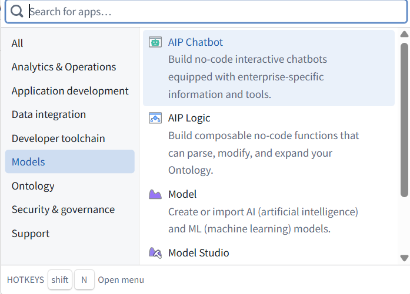

 

_xxxxxxxxx_  

**Understood. T1–T6 are Palantir’s role-based classifications, preserved in your inventory—not the organizing principle for ZAI_examples.** Your examples should be organized by **the problem being solved**.

You want **10–20 working, well-documented examples**, not exhaustive coverage or another course catalog. Here is a candidate set drawn from your inventory:

| # | Specific problem for a ZAI_example | Potential inspiration |
|---|---|---|
| **1** | Find records occurring near the same place and time | Geospatial/common operating picture |
| **2** | Detect unusual readings in timestamped measurements | Time-series anomaly detection |
| **3** | Extract specified fields from PDFs and flag missing information | PDF parsing |
| **4** | Search documents by meaning rather than exact words | Semantic search |
| **5** | Combine incoming files whose columns have different names and formats | Schema matching and validation |
| **6** | Find disagreements between a document and its accompanying image | Image/document cross-validation |
| **7** | Classify incoming records and send uncertain results for human review | AIP classification and feedback loops |
| **8** | Put incoming tasks into a prioritized inbox and notify their assignees | Dynamic inbox and Action notifications |
| **9** | Guide someone through submitting a complete record with attachments | Guided forms and questionnaires |
| **10** | Investigate how two records are connected through intermediate relationships | Vertex Graph |
| **11** | Generate a report for a selected record or investigation | Notepad Templates |
| **12** | Show where and when a changing measurement exceeded a threshold | Time series on a map |
| **13** | Approve a proposed change and send it back to an external system | Writeback-enabled decision support |
| **14** | Compare a proposed change with the current situation before committing | What-if scenarios |
| **15** | Predict a numeric result and compare predictions with actual outcomes | Supervised model training |

These are **candidate problem statements**, not claims that we have verified every source example or its availability.

### Documentation style

For each example, keep the durable core:

- **Problem and sample data**
- **Desired result**
- **Solution diagram**
- **Starting prompts for FDE**
- **Checkpoints and evidence that it worked**
- **Known limitations and prerequisites**

**Avoid prescribing every click.** Add screenshots or exact instructions only where they resolve a significant ambiguity.

That reduces dependence on changing dialogs while retaining enough structure to reproduce and verify the outcome. Some maintenance remains—data access, APIs, models, and application capabilities can change—but much less of the document is tied to screen layout.

**Your master list supplies inspiration. ZAI_examples supplies a small, maintained collection of concrete problems people can solve with Foundry and FDE.**

 

-------------------------------

 

### **[pal_3.6_15_model_train](/pal_3.6_15_model_train/)**

 

-------------------------------
-------------------------------
-------------------------------
-------------------------------
-------------------------------
-------------------------------
-------------------------------

  

26.1123 (v1 26.1123)
