<br>

#### **TOC**

```
- D1 basic #610bbb_pal_D1_foundry_original_
- D2 AIP #611www_pal_D2_aip_
- D3 automation #614_pal_agentic_ai_qs
- D4 functions #615_pal_onto_function_qs
- D6 basic #617_pal_D6_first_app_
- D7 basic #618_pal_D7_first_pipeline_

- DD19 #627_pal_DD19_transform_data_w_code_repos_
```

D3b
D3c
D5b

<br> 

------
------
------
------

<br>


# **[DD-2 D1-D7 (+DD19)](/3c.2_pal_initial_demos/)** (2b.4)

 ZAI versions of the core ~8 Foundry getting started demos

3c.2_pal_initial_demos/

_Main diagram for demo D3 (Core workflow + Automation + AI external)_<br>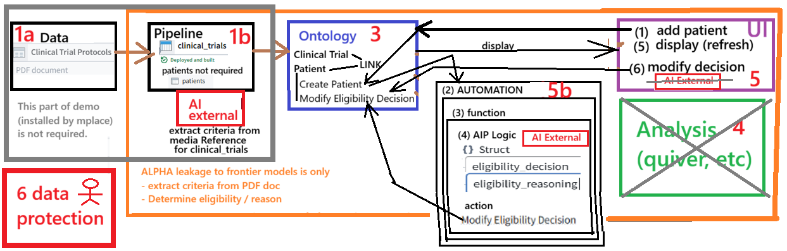<br>


From 3c.2_pal_initial_demos **[4.1 ZAI versions of the core ~8 Foundry getting started demos (rewritten 26.1122)](/3c.2_pal_initial_demos/)**


<br>


### **TOC**

<!-- ```
xxxxxxxxxxxxxxxx**CONCEPTS**
- **C1) Transforms, Analytics and actions (applications) [1]**
- **C2) data protection [2]**
- **C3) AI external [3]**
- **C4) ALPHA (sovereignty) [4]**
- **C5) Internal AI models [5]**
- **C6) Maximize ALPHA/sovereignty / Data protection** (within performance/cost/complexity limitations)
```  -->

**HANDS-ON DEMOS (WIP)**

- **DEMOS 1) NO AI**. These demos show that you dont need AI to do analysis (this is the safest option for sovereignty if viable).
<!--  - (1) DIY9 (from ZAI/FDE/GPT) (NO AI) -->
  - **D1** (from PAL) (NO AI)
- **DEMOS 2) Data protection (NONE)**. NONE = There are so far no specific demos for this functionality. But Data Protection is always there.
- **DEMOS 3) AIP external (Agentic 1) (no automation; sovereignty risk via AI calls)**. You are using external LLMs. Processing occurs whenever data changes (there is no central loop running).
  - **D2** (from PAL)
- **DEMOS 4) Automation (Agentic 2) (AI external; major sovereignty risk via automated AI calls)**. You have automation which watches for data changes and then invokes actions (and AI). Major sovereignty risks.
  - **D3**
<!--  - (4b) D3b — Protecting agents that use external AI models (TODO)-->
- **DEMOS 5) ALPHA -- Mining (how frontier models steal your "alpha")**. This demo is primitive and uses black box Foundry functionality ("mining"), but Frontier model labs are certainly experts at such techniques.
  - **D5**. This demo "mines" (extracts the alpha of) the workflows based on example data.
<!--  - (5b) D5b (FUTURE) (C5c): Demos for Maximize ALPHA/sovereignty / Data protectio (within performance/cost/complexity limitations)-->
- **DEMOS 6) AIP internal (Agentic 3)**. The best solution. Calls to AI are only to internal models. These demos show how to create and deploy your own model using Foundry.
- **Other demos**. Duplicate or unimportant demos (or demos I could not get to work).
  - **D4**: Palantir ontology function “speedrun” (quick start) (26.0717).
  - **D6**: Deep Dive: Building Your First APPLICATION (xxxPipeline???) (26.0719).
  - **D7**: Deep Dive: Building Your First Pipeline (26.0720).
  - **DD19**: Deep Dive: transform_data_w_code_repos (26.0805).


<br>

---------
---
---
---
---

<br>

# **DEMOS 1) NO AI**

Foundry’s core value proposition predates generative AI. It integrates data from different systems, represents entities and relationships through the Ontology, and helps users discover patterns, anomalies, connections, and business processes that are difficult to see in isolated datasets. In these demos, the LLM is an optional analytical assistant; the underlying data integration, Ontology, analysis, applications, and Actions remain useful without it.

Palantir emerged in the post-9/11 period with the broader objective of helping organizations connect signals across fragmented data and identify unusual patterns relevant to security and intelligence. The same architecture is now applied to commercial and operational problems.

---


<br>

### **D1 (from PAL) (NO AI)**

SEE ALSO: **[1.1 D1 = "Speedrun -- Your First End-to-End Workflow" (26.0818)](/3c.1_pal_foundry/)**.

- **The action is called from the UI**
- **Classification of the demo:**
  - No analysis, just pipeline transforms and ontology action.
  - **[2] Data protection** (access to the action is controlled.
- Other aspects of this demo:
  - **D1 is far too complicated** for what it demonstrates (it is also the first demo on the PAL site).
  - **You create the demo from scratch by following the demo instructions** (whose H1/H2 headers are not numbered on the PAL site; this significantly complicates the demo).
  - ZAI splits the demos into 3 phases (this makes the demo much easier to finish and understand).
  - **NO AI.**

_D1 Main workflow diagram (simplified) (for details about this workflow see **[D1 workflow chats](/pal_1.3_workflow_chats/)**)_<br>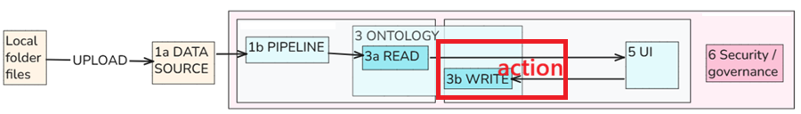<br>

_Action defition_<br>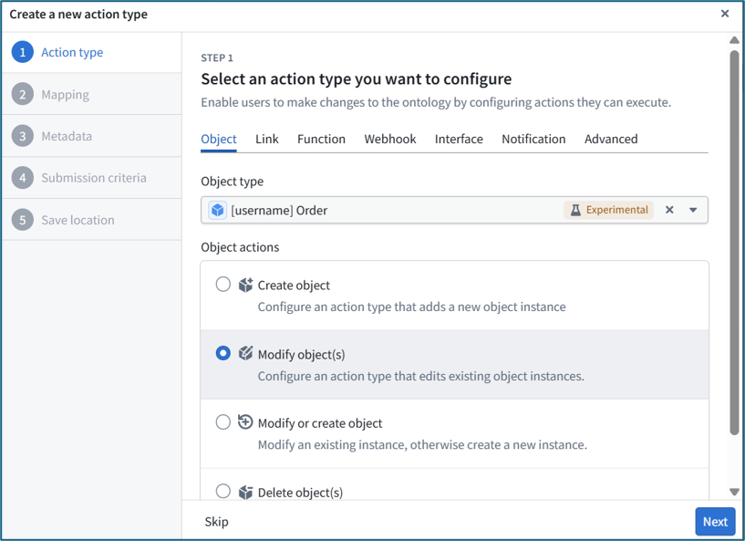

_Action reference in the UI_<br>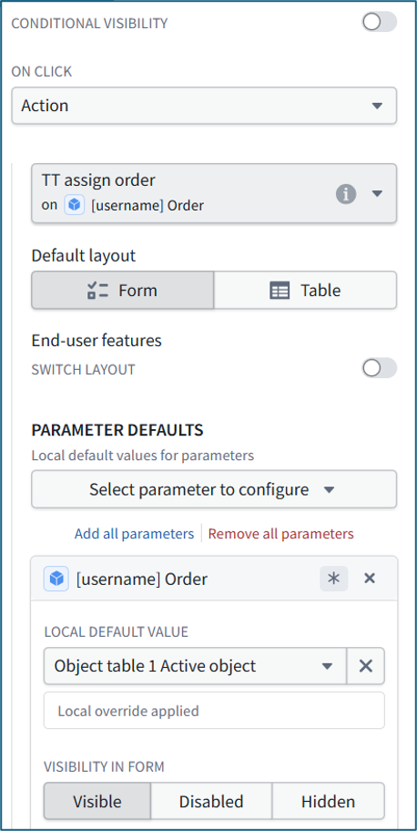

_Upper left: Orignal order. Upper right: After reassigning to different employee. Below: Changes saved to data._<br>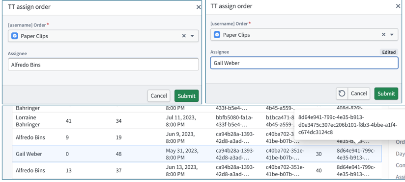

<br>


---
---
---
---
---


<br>

# **DEMOS 2) Data protection (no demos yet)**

<br>

---
---
---
---
---


<br>

# **DEMOS 3) Agentic 1 (AI external / no automation) (sovereignty risk via AI calls)**

<br>

---

<br>

### **D2 (from PAL)**

Your first app with AI. This demo was way too complicated. You can save a lot of time by following the ZAI version of the demo (and skip part 3 of 3 that has absolutely nothing to do with AI, but requires a lot of effort).0

See also: **[1.2 D2 (WIP) = "Speedrun -- Your First AIP Workflow" (26.0828)](/3c.2_pal_aip/)**.

In this demo you use ai 3 times (and each time a different model)

- 1 Summarize text chunk
- 2 Create embedding of summary (embedding)
- 3 Send selected text chunks to LLM to answer question (RAG)

NOTE: Selecting the text chunks using the embedding does not involve AI. The comparison is done in AIP_logic.

<!-- > <br>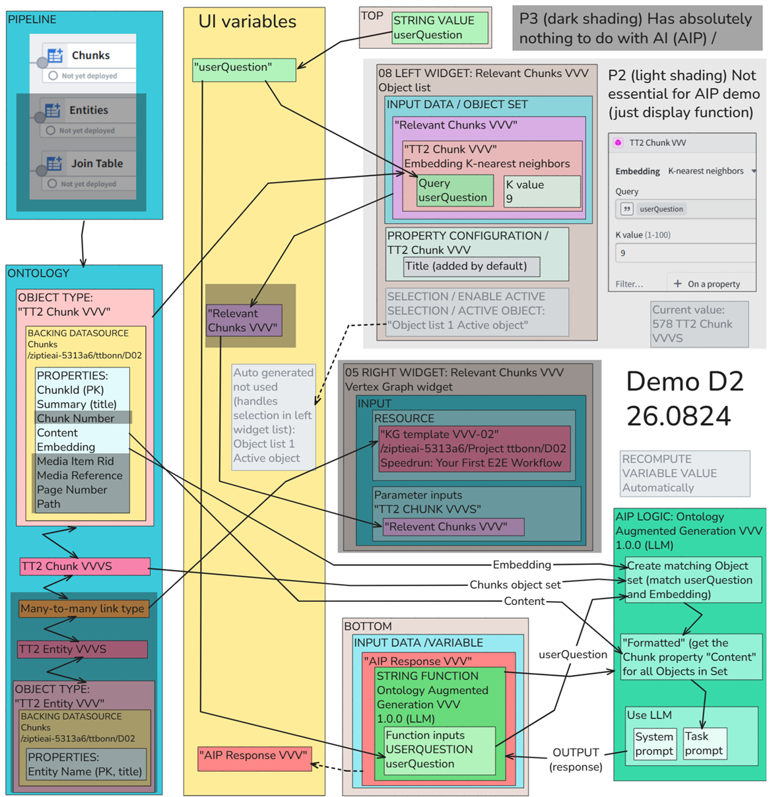 -->

_D2 (AI external (3) / no automation)_<br>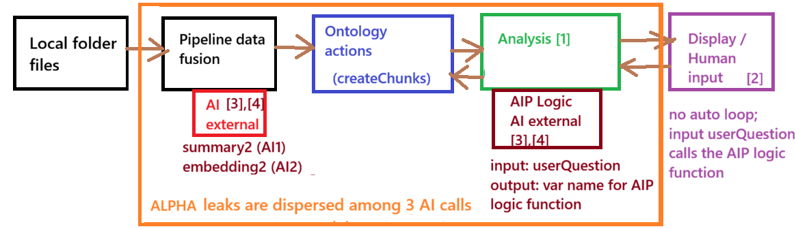

Diagram below shows more detail:

- Use AI (external models) to clean up extracted chunks of text from PDFs, to extract text keywords ("entities" in the demo) from the chunk, to match a question to chunks via embeddings (machine language representation of the question/chunks meanings (not keywords)), make a RAG call with the question/chunks to answer the question.
- About half of the demo has nothing to do with AI (the ZAI version splits the demo into 3 phases; phase 3 is the no-AI part; you can skip it).

_Demo D2 first AIP workflow (ZAI) diagram (26.0828) (3 different AI models are used)_<br>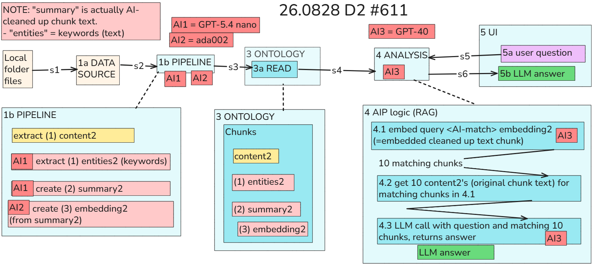

This is the diagram you really need when doing the demo. A diagram of the configuration steps for demo D2 (I spent days on my initial attempts to recreate D2 without this diagram; with this diagram its fairly simple; its even simpler if you do it in 3 separate phases as described in the latest version of the docx and if you simply ignore the shaded out parts of the demo).

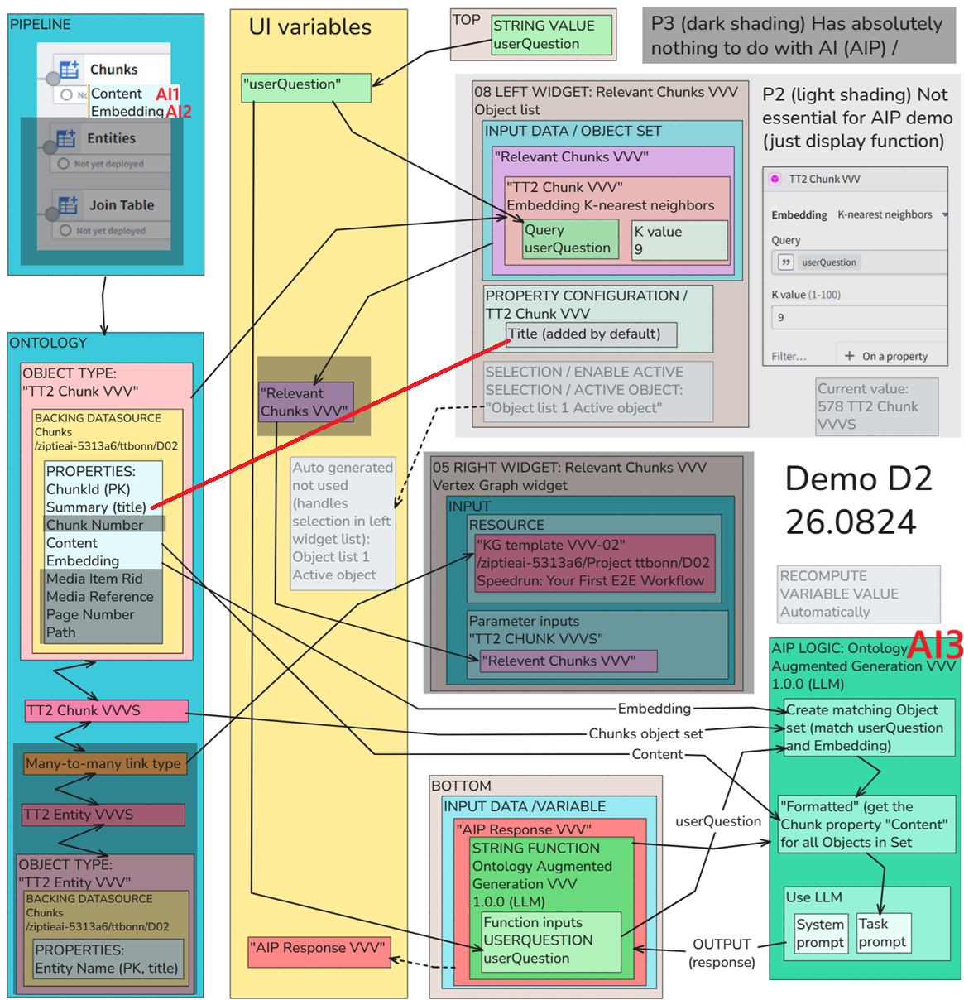

<br>

---
---
---
---
---


<br>

# **DEMOS 4) Agentic 2 (AI external + automation) (major sovereignty risk via automated AI calls)**

<br>

----

<br>

### **(4) D3**

See also: **[1.3 D3 (WIP) = "Speedrun: Your First Agentic AIP Workflow" (26.0902)](/3c.3_pal_agentic_ai/)**.

This demo builds the first **autonomous operational agent** in this sequence.

- **(1) A new Patient is added** through the UI and written to the Ontology.
- **(2) Automate detects** that the Patient entered the monitored object set.
- **(3)(4a) AIP Logic evaluates** the Patient against the selected Clinical Trial.
- **(3)(4b) The governed Action automatically writes** the initial eligibility decision and reasoning.
- **(5) Staff review the result** and may manually adjust the eligibility decision through the UI. This last step is important: Automation makes the initial operational decision, but staff retain oversight and can override it through a governed Action.

_D3 xxx_<br>

_D3 xxx_<br>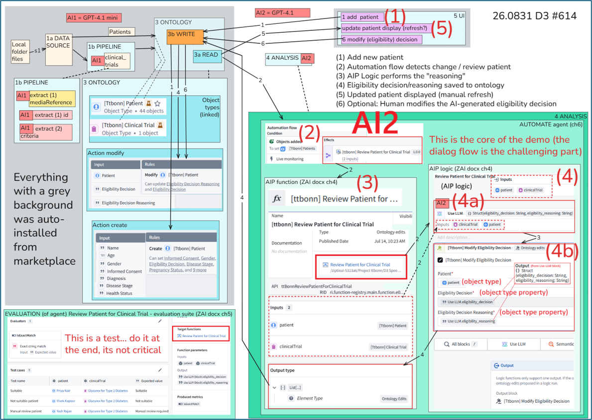

_D3 xxx_<br>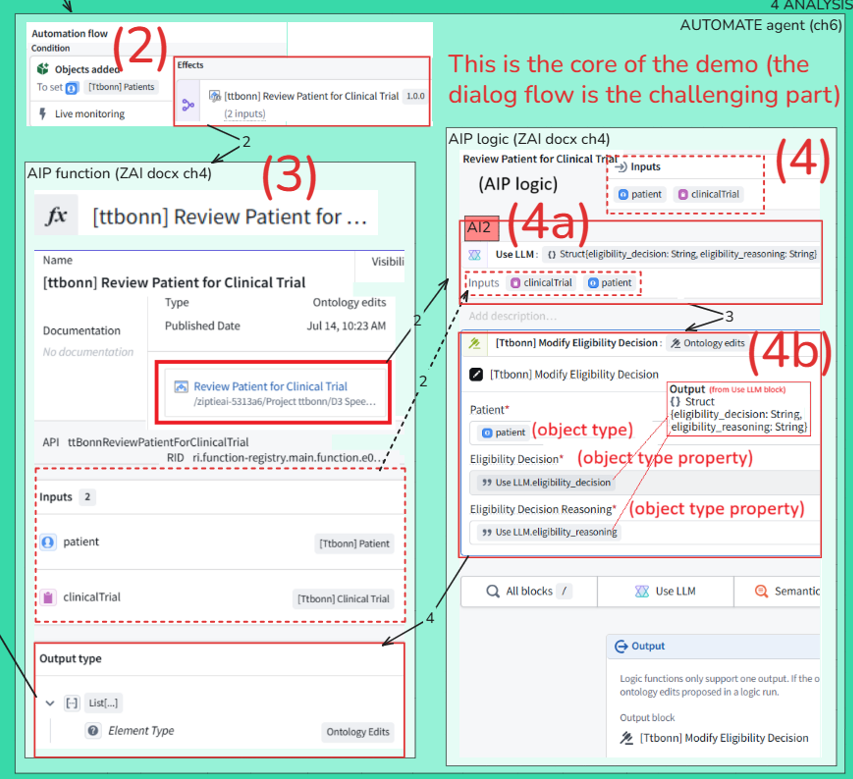

_D3 xxx_<br>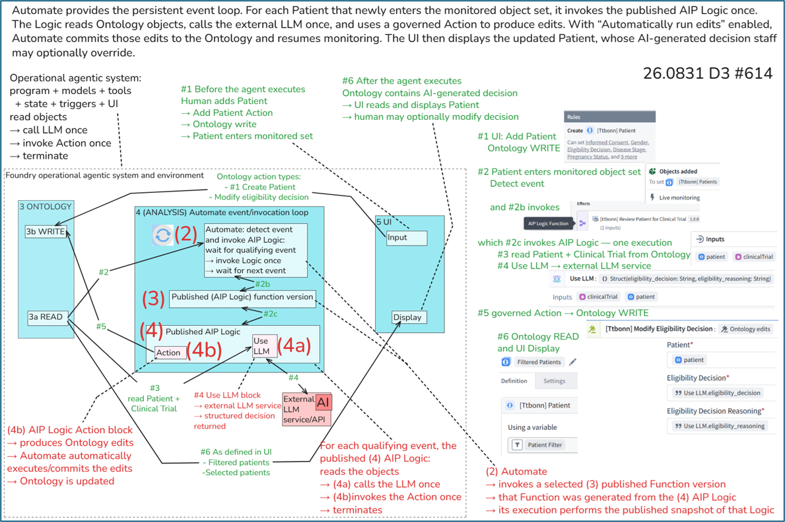

<br>

----

<br>

#### **[Both D2 and D3 send enterprise data to external LLMs—why does Palantir call D3 the first “agentic” demo?](/3c.2c_pal_zai_take_on_foundry_agent/)** (26.0902)

_Follow the above header link for details. See also the complete **[chat](/3c.2_pal_initial_demos_AGENT_CHAT/)** with FDE/GPT._

**My own simple explanation** (refer to diagram below)

- Demo D2 made calls to external LLM. That is (in my opinion)
  - an AI agent
  - that shares internal data with an external LLM.
- However, D3 (the next demo) does several things that D2 did not:
  - (3)(4) Foundry AIP_Logic (a no-code function definition) calls an LLM like D2, but it also modifies the ontology (core objects)
  - (2) Foundry Automation (event-driven automation service) provides a main loop that automatically processes (in D3 this means calling API_logic) any incoming onotology data changes.

_[3] Demo D3 Foundry agent_<br>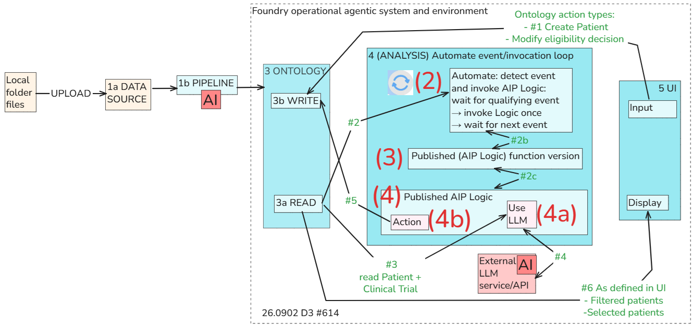


<br>

---
---
---
---
---


<br>  

# **DEMOS 5) ALPHA (Mining)**

<br>

-------

<br>

### **[(5) D5 (TO-UPDATE): Speedrun: Mining Your First Business Process (26.0718)](/3c.5_pal_biz_process_mining/)**

FDE: The demo starts with claims, customers, and claim-history logs. After ingesting these datasets into Foundry, the data is modeled as Ontology objects such as Customers and Claims. Machinery then uses the process logs to reconstruct how claims move through the business process over time. Once the process map is built, you can inspect where claims get stuck, identify why some remain unresolved, and embed the process view into an interactive application.

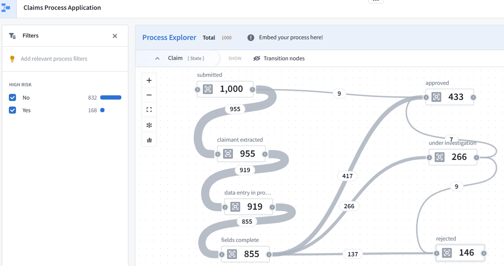


<br>

---
---
---
---
---


<br>

# **DEMOS 6) Agentic 3 (AI internal)**

<br>

---
---
---
---
---

<br>

# **Other demos**

Duplicate or unimportant demos (or demos I could not get to work).

<br>

----

<br>

### **[D4: Palantir ontology function "speedrun" (quick start) (26.0717)](/3c.4_pal_ontology_function/)**.
  - At the end of this page is _good demo of how FDE/GPT5.5 fixed a problem with the demo_.
  - **[#615\_.docx](https://drive.google.com/drive/folders/1-Adawag9uA8_bq-hDF-nOuPYaRLz1eEO)**
  - **[Speedrun](https://learn.palantir.com/speedrun-your-first-ontology-function/2131538)**

<br>

----

<br>

### **[D6: Deep Dive: Building Your First APPLICATION (xxxPipeline???) (26.0719)](/3c.6_pal_6_first_app/)**.
  - **Some of this failed**. FDE/GPT/OPUS could not fix.
  - Outdated (2+ years) demo? MAKE THE DEMOS SIMPLER AND KEEP THEM UPDATED.
  - **[#617\_.docx](https://drive.google.com/drive/folders/1-Adawag9uA8_bq-hDF-nOuPYaRLz1eEO)**
  - **[Speedrun](https://learn.palantir.com/deep-dive-building-your-first-application)**

<br>

----

<br>

### **[D7: Deep Dive: Building Your First Pipeline (26.0720)](/3c.7_pal_7_first_pipeline/)**.
  - **[#618\_.docx](https://drive.google.com/drive/folders/1-Adawag9uA8_bq-hDF-nOuPYaRLz1eEO)**
  - **[Speedrun](https://learn.palantir.com/deep-dive-building-your-first-pipeline)**

<br>

----

<br>

### **[DD19: Deep Dive: transform_data_w_code_repos (26.0805)](/3c.19_pal_19_transform_data_git/)**.
  - **[#627\_.docx](https://drive.google.com/drive/folders/1-Adawag9uA8_bq-hDF-nOuPYaRLz1eEO)**


##########################################################################################


### **[D3b (TODO) — Protecting agents that use external AI models](/3c.2_pal_D2b_ai_monitor/)**

Extend D3 with controls for both sides of the agent boundary: the enterprise data sent to an external LLM and the Ontology changes produced from its response. Proposed topics include sensitive-data detection, minimization and redaction, approved model access, prompt-injection defenses, output validation, constrained Actions, human approval, automation-loop safety, evaluation, monitoring, and rollback.

The objective is to determine which risks Foundry controls actually mitigate and which risks remain with the external model provider.

D3b is specifically about adding safety controls to the external-model D3 agent:

- controlling data sent to the model;
- detecting or minimizing sensitive content;
- validating model responses;
- constraining Actions;
- adding approval, monitoring, and rollback.

It should be referenced from the external-model section, but its primary home is now 2a Data Protection and AI Security.

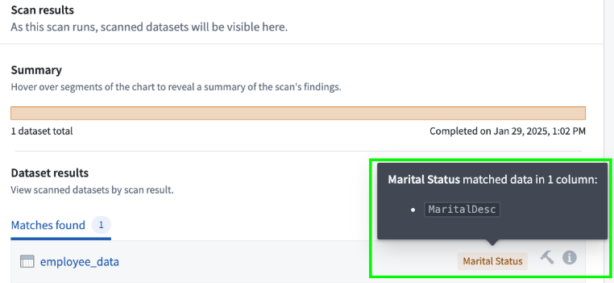


### **[D3c (TODO) — Rebuild the protected D3 agent with an internal AI model](/3c.8_pal_D2c_D8/)**

<!-- 2a.2 (2.8) (was 2.2)  -->

Replace D3b’s external LLM with an approved model deployed within the organization’s controlled environment. Optionally add RAG over governed internal sources, then compare external and internal implementations for confidentiality, accuracy, latency, cost, access control, deployment, and operational maintenance.

An internal model can reduce third-party data egress, but it does not eliminate prompt injection, excessive data access, unreliable outputs, or unsafe agent Actions. The D3b controls therefore remain relevant.

D3c sits at the intersection of:

- internal models;
- agent security;
- data egress;
- governed Actions.

Because it is explicitly a protected D3 agent, placing it after D3b in the security section creates a useful comparison:

<br>

### **D5b (TODO): Demos for Maximize ALPHA/sovereignty / Data protection** (within performance/cost/complexity limitations)

**(FUTURE)** Comparative demos that hold the business task constant while changing who controls the model, data, RAG system, application, and operational decisions. These experiments examine data egress, model replaceability, provider dependency, continuity, and whether the organization retains control of its proprietary knowledge, Ontology, workflows, Actions, and outcomes.

The distinction can be demonstrated clearly:

- **Secure but not sovereign**. A well-protected vendor system that the vendor ultimately controls.

- **Sovereign but insecure**. A completely self-hosted system with weak permissions and poor security.

- **Secure and sovereign**. A company-controlled system with strong protection and governance.

Topics include

- internal versus external models;
- data and model location;
- ownership of the application and Ontology;
- provider dependency;
- model replaceability;
- RAG and memory placement;
- operational continuity;
- control of outcomes and customer relationships.

The chat in the title link above describes a set of future demos (FDE generated list):

- 1 Define and measure sovereignty
- 2 External model with provider-controlled application
- 3 Foundry-controlled application with external model
- 4 Replace the external model with an internal model
- 5 Compare external, internal and provider-hosted RAG
- 6 Model-provider outage and model replacement
- 7 Agent Action, approval and decision sovereignty
- 8 Final sovereignty scorecard

<br>


<br> 

------

<br>

26.1124 (v1 26.1124)
