<br>

#### **TOC**

- **L-1   LIST 1 (A1-A4)** 
- **L-2   [LIST2 (T1-T6)](/pal_demo_list/)**


- **DD-1  DD-1 DIY (DIY9 + D8)** 
- **DD-2  [DD-2 D1-D7 (+DD19)](/3c.2_pal_initial_demos/)** 
- **DD-3  [DD-3 Train model (#619)](/pal_3.6_15_model_train/)**
- **DD-4  [DD-4 Exx](/3c.1b_pal_examples/)** 


<br> <br><br><br><br>
------
------
------
------
------
------
------
------
------
<br>


# **LIST 1 (A1-A6)** 


- **A1 Office**
- **A2 Backend (EQUATOR)**
- **A3 Haystack needles**
- **A4a Inference (AI)**
- **A4b Training (AI)**
- **A5 Governance / security**
- **A6 Agentic (central loop)**


<br>

---------------

<br>

### **A1 Office**


|**Example** | **#** | **Specific problem for a ZAI_example** | **Potential inspiration** |
|--- | 5 | Combine incoming files whose columns have different names and formats | Schema matching and validation |
|--- | 8 | Put incoming tasks into a prioritized inbox and notify their assignees | Dynamic inbox and Action notifications |
|--- | 9 | Guide someone through submitting a complete record with attachments | Guided forms and questionnaires |
|--- | 10 | Investigate how two records are connected through intermediate relationships | Vertex Graph |
|--- | 11 | Generate a report for a selected record or investigation | Notepad Templates |
|--- | 13 | Approve a proposed change and send it back to an external system | Writeback-enabled decision support |
|--- | 14 | Compare a proposed change with the current situation before committing | What-if scenarios |

```
- D5 mining #616_pal_D5_biz_process_mining_qs
```


<br>

---------------

<br>


### **A2 Backend (ontology)**

```
- D1 basic #610bbb_pal_D1_foundry_original_
- D2 AIP #611www_pal_D2_aip_
- D3 automation #614_pal_agentic_ai_qs
- D4 functions #615_pal_onto_function_qs
- D6 basic #617_pal_D6_first_app_
- D7 basic #618_pal_D7_first_pipeline_

- DD19 #627_pal_DD19_transform_data_w_code_repos_
```

<br>

---------------

<br>


### **A3 Haystack needles**

- HN #620_pal_DIY9_aip-fde_demo_hn  #620_pal_9_aip-fde_demo_hn_

|**Example** | **#** | **Specific problem for a ZAI_example** | **Potential inspiration** |
|E11 | 1 | Find records occurring near the same place and time | Geospatial/common operating picture |
|E12 | 1 | (FAIL) E12: Build a common operating picture with geospatial data  |  |
|E17 | 12 | Show where and when a changing measurement exceeded a threshold | Time series on a map |


<br>

---------------

<br>


### **A4a Inference (AI)**


|**Example** | **#** | **Specific problem for a ZAI_example** | **Potential inspiration** |
|--- | 7 | Classify incoming records and send uncertain results for human review | AIP classification and feedback loops |
|--- | 4 | Search documents by meaning rather than exact words | Semantic search |
|E10 | 3 | Extract specified fields from PDFs and flag missing information | PDF parsing |
|E14 | --- |RAG |---|
|E15 | 6 | (FAIL) Find disagreements between a document and its accompanying image | Image/document cross-validation |
|E13 | --- |(TODO) Cipher visual obfuscation |---|


<br>

---------------

<br>


### **A4b Training (AI)**

|**Example** | **#** | **Specific problem for a ZAI_example** | **Potential inspiration** |
|E17 | 2 | (TRAIN) Detect unusual readings in timestamped measurements | Time-series anomaly detection |
| #619 | 15 | Predict a numeric result and compare predictions with actual outcomes | Supervised model training |

```
- D8 train model #619_pal_D8_model_integration_
```


<br>

---------------

<br>


### **A5 Governance / security**

```
- #628_pal_D1b_data_security_
```

<br>

---------------

<br>


### **A6 Agentic (central loop)**

|**Example** | **#** | **Specific problem for a ZAI_example** | **Potential inspiration** |
|E18 | --- |chat bot |---|

```
**Yes—that makes an excellent three-demo series**, using the **same small task and tools** so the execution differences are clear.

| Demo | What starts it | What it demonstrates |
|---|---|---|
| **1. Interactive agent** | A user message in Chatbot Studio | Model-directed tool use during a conversation |
| **2. Event-driven agent** | An Automate condition or schedule | Unattended AI processing when work arrives |
| **3. Persistent worker agent** | Deployment of custom code in a Compute Module | An ongoing process that waits for work, processes it, and repeats |

These are **three hosting/trigger patterns**, not an exhaustive list of ways to create agents.

For each, we’d verify **start → receive work → choose operations → produce a result → inspect execution → stop safely**. Before the third, we’d confirm Compute Modules are available and suitable in your environment.

**Same problem, three execution patterns** fits your mechanistic teaching approach very well.
```

<br>

---------------------------------------
---------------------------------------
---------------------------------------

<br>

### **(4.2 Examples list)**

|**Example** | **description** |
|E10 | Parse PDFs with LLMs in Pipeline Builder | 
|E11 | Palantir Foundry example “Integrate GeoSpatial data with Gaia”  |  
|E12 | (FAIL) E12: Build a common operating picture with geospatial data |  
|E13 | (TODO) Protect sensitive images using visual obfuscation in Cipher |
|E14 | Evaluate Retrieval-Augmented Generation (RAG) methods |
|E15 | (FAIL) Cross-validate Images and Documents using AIP |  
|E17 | Detect anomalies in time series data with Code Workspaces |  
|E18 | E18_build_w_aip_chatbot_studio |


<br> <br><br><br><br><br><br><br><br><br><br><br><br><br><br><br><br><br><br><br><br><br><br><br>
------
------
------
------
------
------
------
------
------
<br>


# **[LIST2 (T1-T6)](/pal_demo_list/)** (V1 26.1121)

- I created this list 4 months ago.
- This list has a hyper-linked TOC to all demos.
- They are organized by the PAL-defined Foundry user roles.
- I merely made much easier to search (and include in prompts to AI).


<br> <br><br><br><br><br><br><br><br><br><br><br><br><br><br><br><br><br><br><br><br><br><br><br>
------
------
------
------
------
------
------
------
------
<br>


# **DD-1 DIY (DIY9 + D8)** 

title: 3.5 DIY (v1 26.1122)
permalink: /3.5_diy/

### **TOC**

**HANDS-ON DEMOS**

- **1 NO AI**. These demos show that you dont need AI to do analysis (this is the safest option for sovereignty if viable).
  - **DIY9** (from ZAI/FDE/GPT) (NO AI)
- **2 Data protection (NONE)**. NONE = There are so far no specific demos for this functionality. But Data Protection is always there.
  - **MONITORING WITH AI ANALYSIS 26.1122**
- **3 AIP external (Agentic 1) (no automation; sovereignty risk via AI calls)**. You are using external LLMs. Processing occurs whenever data changes (there is no central loop running).
- **4 Automation (Agentic 2) (AI external; major sovereignty risk via automated AI calls)**. You have automation which watches for data changes and then invokes actions (and AI). Major sovereignty risks.
  - **D3b (TODO)** — Protecting agents that use external AI models (TODO)
- **5 ALPHA -- Mining (how frontier models steal your "alpha")**. This demo is primitive and uses black box Foundry functionality ("mining"), but Frontier model labs are certainly experts at such techniques.
  - **D5b (TODO)** (C5c): Demos for Maximize ALPHA/sovereignty / Data protectio (within performance/cost/complexity limitations)
- **6 AIP internal (Agentic 3)**. The best solution. Calls to AI are only to internal models. These demos show how to create and deploy your own model using Foundry.
  - **D3c (TODO)**
  - **D8 THE MAIN AI INTERNAL DEMO (BEFORE LAX)** 
  - **D8a (TODO)**

<br>

<!--

- **DEMOS 1) NO AI**. These demos show that you dont need AI to do analysis (this is the safest option for sovereignty if viable).
  - (1) DIY9 (from ZAI/FDE/GPT) (NO AI)
  - (2) D1 (from PAL) (NO AI)
<!--  - (1) DIY9 (from ZAI/FDE/GPT) (NO AI) --
  - **D1** (from PAL) (NO AI)
- **DEMOS 2) Data protection (NONE)**. NONE = There are so far no specific demos for this functionality. But Data Protection is always there.
- **DEMOS 3) AIP external (Agentic 1) (no automation; sovereignty risk via AI calls)**. You are using external LLMs. Processing occurs whenever data changes (there is no central loop running).
  - (3) D2 (from PAL)
  - **D2** (from PAL)
- **DEMOS 4) Automation (Agentic 2) (AI external; major sovereignty risk via automated AI calls)**. You have automation which watches for data changes and then invokes actions (and AI). Major sovereignty risks.
  - (4) D3
  - (4b) D3b — Protecting agents that use external AI models (TODO)
  - **D3**
<!--  - (4b) D3b — Protecting agents that use external AI models (TODO)--
- **DEMOS 5) ALPHA -- Mining (how frontier models steal your "alpha")**. This demo is primitive and uses black box Foundry functionality ("mining"), but Frontier model labs are certainly experts at such techniques.
  - (5) D5. This demo "mines" (extracts the alpha of) the workflows based on example data.
  - (5b) D5b (FUTURE) (C5c): Demos for Maximize ALPHA/sovereignty / Data protectio (within performance/cost/complexity limitations)
  - **D5**. This demo "mines" (extracts the alpha of) the workflows based on example data.
<!--  - (5b) D5b (FUTURE) (C5c): Demos for Maximize ALPHA/sovereignty / Data protectio (within performance/cost/complexity limitations)--
- **DEMOS 6) AIP internal (Agentic 3)**. The best solution. Calls to AI are only to internal models. These demos show how to create and deploy your own model using Foundry.
  - (6) D3c
  - (7) D8a
- **Other demos**. Duplicate or unimportant demos (or demos I could not get to work).
  - **D4**: Palantir ontology function “speedrun” (quick start) (26.0717).
  - **D6**: Deep Dive: Building Your First APPLICATION (xxxPipeline???) (26.0719).
  - **D7**: Deep Dive: Building Your First Pipeline (26.0720).
  - **DD19**: Deep Dive: transform_data_w_code_repos (26.0805).
-->

---
---
---

<br>

# **1 NO AI**

Foundry’s core value proposition predates generative AI. It integrates data from different systems, represents entities and relationships through the Ontology, and helps users discover patterns, anomalies, connections, and business processes that are difficult to see in isolated datasets. In these demos, the LLM is an optional analytical assistant; the underlying data integration, Ontology, analysis, applications, and Actions remain useful without it.

Palantir emerged in the post-9/11 period with the broader objective of helping organizations connect signals across fragmented data and identify unusual patterns relevant to security and intelligence. The same architecture is now applied to commercial and operational problems.

<br>

---


<br>

### **DIY9 (from ZAI/FDE/GPT) (NO AI)**

DIY = do it yourself. Create your own demo.

SEE ALSO: **[3.1 D9 (TO-UPDATE, DIY) = Haystack needle demo](/3c.xxx_pal_HN_01_non_ai/)**.

- **All of the analysis is in the UI**
  - UI right widget: You select multiple property column VALUES for a single object type property (**this is an object type property value selector; it has nothing to do with filtering**).
  - UI left widget: Displays objects whose property column values match selected property values.
- **Classification of the demo:**
  - **[1] Analytics** (objects displayed based on selected object type property values)
  - **[2] Data protection** (this is not something you setup; but Foundry controls restricts access to data for enterprise staff)
- Other aspects of this (very simple) demo:
  - **DIY = Do it yourself. I did this from scratch by chatting with FDE/GPT.** This is a very important aspect of this demo, showing that this is possible.
  - **NO AI**.

_Functional overview (maybe I should not have crossed out governance; it is very important and always active, but you did not have to set it up)_<br>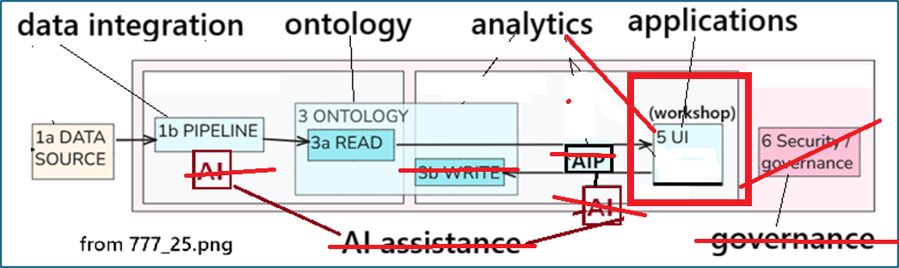

_A simple diagram of the UI config (the PAL demos do not have such diagrams)_<br>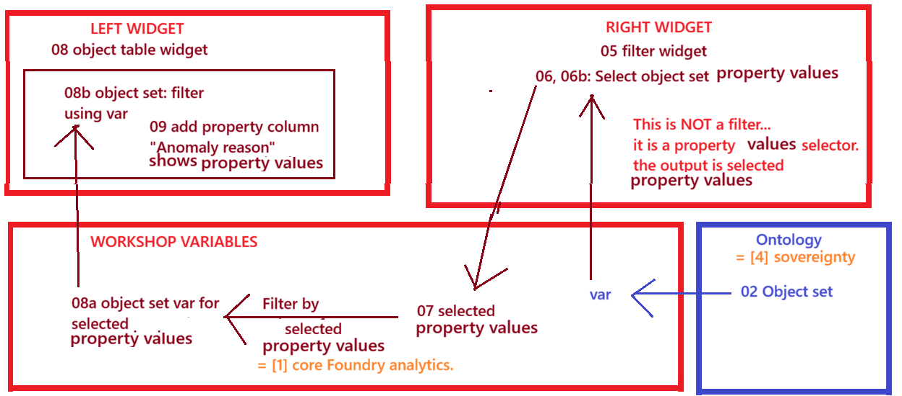

_Resulting UI_<br>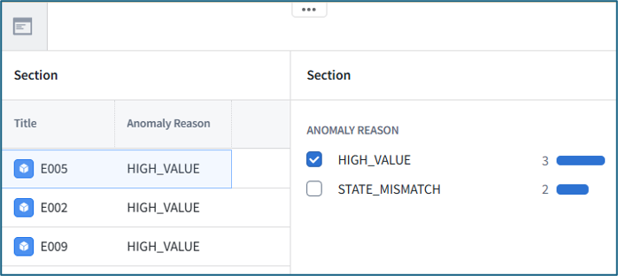

<br>

---
---
---
---
---

<br>


# **2 Data protection (no demos yet)**

<br>

---
---
---
---
---

<br>

### 856 **MONITORING WITH AI ANALYSIS** 26.1122 chat

#### ME can AI be used to monitor , alert about suspicious activity....
or is it all fixed logic?

#### FDE Both are possible. Foundry monitoring can use fixed rules, AI analysis, or a combination.

**Both are possible.** Foundry monitoring can use fixed rules, AI analysis, or a combination.

| Approach | Example |
|---|---|
| **Fixed rules** | Warn after repeated failures, an unusual volume of submissions, or an attempted operation outside allowed hours |
| **AI analysis** | Review available activity records, summarize unusual patterns, and explain why they deserve investigation |
| **Combined** | A rule detects a candidate incident → AI adds context → a person receives an alert and reviews it |

**It is not automatic merely because AI is enabled.** We would need to identify accessible activity/audit records, build the detection workflow, and configure notifications. We have not yet verified those data sources or integrations in your environment.

For security, I would keep **permission enforcement deterministic**—like the group condition we just tested—and use AI to assist investigation, not decide whether someone may bypass a restriction.

A small **3.5 Deep Dive** could demonstrate:

**Activity records → suspicious-pattern detection → AI explanation → alert → human review**

Our current D6 demonstrates **preventing unauthorized submission**, not monitoring attempted misuse. Those are separate capabilities.

<br>

---

<br>


# **3 Agentic 1 (AI external / no automation) (sovereignty risk via AI calls)**


<br>

---
---
---
---
---

<br>

# **4 Agentic 2 (AI external + automation) (major sovereignty risk via automated AI calls)**

<br>

---

<br>

### **[D3b (TODO) — Protecting agents that use external AI models](/3c.2_pal_D2b_ai_monitor/)**

Extend D3 with controls for both sides of the agent boundary: the enterprise data sent to an external LLM and the Ontology changes produced from its response. Proposed topics include sensitive-data detection, minimization and redaction, approved model access, prompt-injection defenses, output validation, constrained Actions, human approval, automation-loop safety, evaluation, monitoring, and rollback.

The objective is to determine which risks Foundry controls actually mitigate and which risks remain with the external model provider.

D3b is specifically about adding safety controls to the external-model D3 agent:

- controlling data sent to the model;
- detecting or minimizing sensitive content;
- validating model responses;
- constraining Actions;
- adding approval, monitoring, and rollback.

It should be referenced from the external-model section, but its primary home is now 2a Data Protection and AI Security.

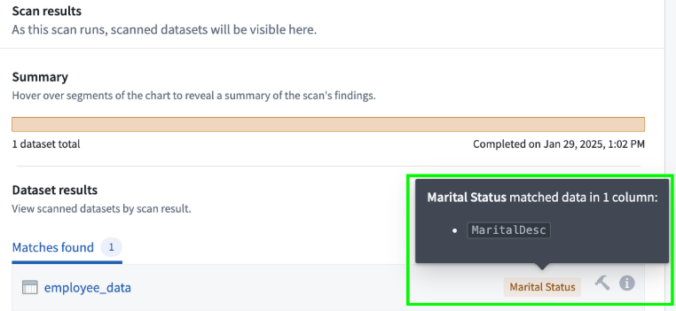

<br>

---
---
---
---
---

<br>

# **5 ALPHA (Mining)**

<br>

---

<br>

### **D5b (TODO): Demos for Maximize ALPHA/sovereignty / Data protection** (within performance/cost/complexity limitations)

**(FUTURE)** Comparative demos that hold the business task constant while changing who controls the model, data, RAG system, application, and operational decisions. These experiments examine data egress, model replaceability, provider dependency, continuity, and whether the organization retains control of its proprietary knowledge, Ontology, workflows, Actions, and outcomes.

The distinction can be demonstrated clearly:

- **Secure but not sovereign**. A well-protected vendor system that the vendor ultimately controls.

- **Sovereign but insecure**. A completely self-hosted system with weak permissions and poor security.

- **Secure and sovereign**. A company-controlled system with strong protection and governance.

Topics include

- internal versus external models;
- data and model location;
- ownership of the application and Ontology;
- provider dependency;
- model replaceability;
- RAG and memory placement;
- operational continuity;
- control of outcomes and customer relationships.

The chat in the title link above describes a set of future demos (FDE generated list):

- 1 Define and measure sovereignty
- 2 External model with provider-controlled application
- 3 Foundry-controlled application with external model
- 4 Replace the external model with an internal model
- 5 Compare external, internal and provider-hosted RAG
- 6 Model-provider outage and model replacement
- 7 Agent Action, approval and decision sovereignty
- 8 Final sovereignty scorecard

<br>

---
---
---
---
---

<br>

# **6 Agentic 3 (AI internal)**

<br>

---

<br>

### **[D3c (TODO) — Rebuild the protected D3 agent with an internal AI model](/3c.8_pal_D2c_D8/)**

<!-- 2a.2 (2.8) (was 2.2)  -->

Replace D3b’s external LLM with an approved model deployed within the organization’s controlled environment. Optionally add RAG over governed internal sources, then compare external and internal implementations for confidentiality, accuracy, latency, cost, access control, deployment, and operational maintenance.

An internal model can reduce third-party data egress, but it does not eliminate prompt injection, excessive data access, unreliable outputs, or unsafe agent Actions. The D3b controls therefore remain relevant.

D3c sits at the intersection of:

- internal models;
- agent security;
- data egress;
- governed Actions.

Because it is explicitly a protected D3 agent, placing it after D3b in the security section creates a useful comparison:

<br>

------------

<br>

### **[D8 (WIP) — Deep Dive: Model integration (26.0905)](/3c.8_pal_8_model_integration/)**

Demo D8 explores how a traditional machine-learning model can be trained, deployed, and used for inference inside Palantir Foundry. The demo first examines Foundry’s Model Studio and model-management workflow, then creates a project and trains models using two approaches: Model Studio and a Jupyter notebook. Finally, the trained model is deployed and connected to an interactive application for inference. The demo therefore follows much of the model lifecycle: data → training → model → deployment → inference → application.

_Training of the internal model_<br>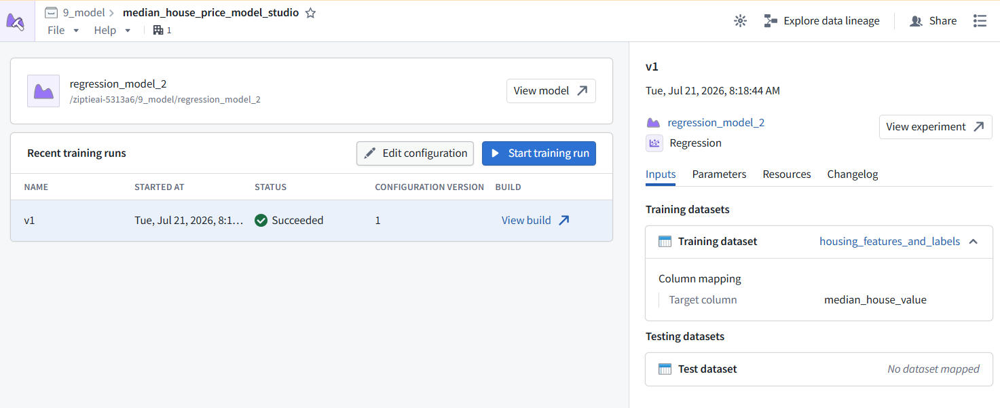

<br>

------------

<br>

### **[D8a (TODO) (FDE VERSION) Understanding models in Foundry (26.1122)](/3c.8_pal_8a_model_integration/)**


Identify the model resources, deployment options, input/output contracts, and differences among external APIs, imported models, internally hosted models, and custom-trained models.

Topics:

- model versus model endpoint;
- external versus internally deployed;
- pre-trained versus custom-trained;
- batch versus live inference;
- model versions and dependencies.


<br> <br><br><br><br><br><br><br><br><br><br><br><br><br><br><br><br><br><br><br><br><br><br><br>
------
------
------
------
------
------
------
------
------
<br>


# **[DD-2 D1-D7 (+DD19)](/3c.2_pal_initial_demos/)** (2b.4)

 ZAI versions of the core ~8 Foundry getting started demos

3c.2_pal_initial_demos/

_Main diagram for demo D3 (Core workflow + Automation + AI external)_<br>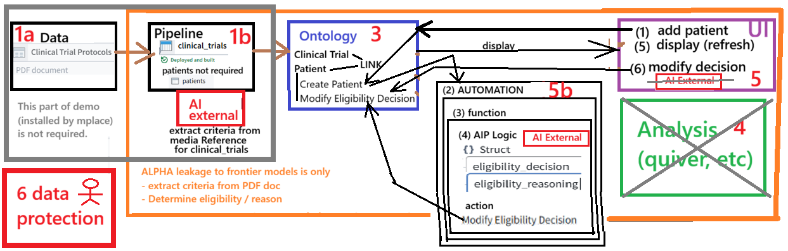<br>


From 3c.2_pal_initial_demos **[4.1 ZAI versions of the core ~8 Foundry getting started demos (rewritten 26.1122)](/3c.2_pal_initial_demos/)**


<br>


### **TOC**

<!-- ```
xxxxxxxxxxxxxxxx**CONCEPTS**
- **C1) Transforms, Analytics and actions (applications) [1]**
- **C2) data protection [2]**
- **C3) AI external [3]**
- **C4) ALPHA (sovereignty) [4]**
- **C5) Internal AI models [5]**
- **C6) Maximize ALPHA/sovereignty / Data protection** (within performance/cost/complexity limitations)
```  -->

**HANDS-ON DEMOS (WIP)**

- **DEMOS 1) NO AI**. These demos show that you dont need AI to do analysis (this is the safest option for sovereignty if viable).
<!--  - (1) DIY9 (from ZAI/FDE/GPT) (NO AI) -->
  - **D1** (from PAL) (NO AI)
- **DEMOS 2) Data protection (NONE)**. NONE = There are so far no specific demos for this functionality. But Data Protection is always there.
- **DEMOS 3) AIP external (Agentic 1) (no automation; sovereignty risk via AI calls)**. You are using external LLMs. Processing occurs whenever data changes (there is no central loop running).
  - **D2** (from PAL)
- **DEMOS 4) Automation (Agentic 2) (AI external; major sovereignty risk via automated AI calls)**. You have automation which watches for data changes and then invokes actions (and AI). Major sovereignty risks.
  - **D3**
<!--  - (4b) D3b — Protecting agents that use external AI models (TODO)-->
- **DEMOS 5) ALPHA -- Mining (how frontier models steal your "alpha")**. This demo is primitive and uses black box Foundry functionality ("mining"), but Frontier model labs are certainly experts at such techniques.
  - **D5**. This demo "mines" (extracts the alpha of) the workflows based on example data.
<!--  - (5b) D5b (FUTURE) (C5c): Demos for Maximize ALPHA/sovereignty / Data protectio (within performance/cost/complexity limitations)-->
- **DEMOS 6) AIP internal (Agentic 3)**. The best solution. Calls to AI are only to internal models. These demos show how to create and deploy your own model using Foundry.
- **Other demos**. Duplicate or unimportant demos (or demos I could not get to work).
  - **D4**: Palantir ontology function “speedrun” (quick start) (26.0717).
  - **D6**: Deep Dive: Building Your First APPLICATION (xxxPipeline???) (26.0719).
  - **D7**: Deep Dive: Building Your First Pipeline (26.0720).
  - **DD19**: Deep Dive: transform_data_w_code_repos (26.0805).


<br>

---------
---
---
---
---

<br>

# **DEMOS 1) NO AI**

Foundry’s core value proposition predates generative AI. It integrates data from different systems, represents entities and relationships through the Ontology, and helps users discover patterns, anomalies, connections, and business processes that are difficult to see in isolated datasets. In these demos, the LLM is an optional analytical assistant; the underlying data integration, Ontology, analysis, applications, and Actions remain useful without it.

Palantir emerged in the post-9/11 period with the broader objective of helping organizations connect signals across fragmented data and identify unusual patterns relevant to security and intelligence. The same architecture is now applied to commercial and operational problems.

---


<br>

### **D1 (from PAL) (NO AI)**

SEE ALSO: **[1.1 D1 = "Speedrun -- Your First End-to-End Workflow" (26.0818)](/3c.1_pal_foundry/)**.

- **The action is called from the UI**
- **Classification of the demo:**
  - No analysis, just pipeline transforms and ontology action.
  - **[2] Data protection** (access to the action is controlled.
- Other aspects of this demo:
  - **D1 is far too complicated** for what it demonstrates (it is also the first demo on the PAL site).
  - **You create the demo from scratch by following the demo instructions** (whose H1/H2 headers are not numbered on the PAL site; this significantly complicates the demo).
  - ZAI splits the demos into 3 phases (this makes the demo much easier to finish and understand).
  - **NO AI.**

_D1 Main workflow diagram (simplified) (for details about this workflow see **[D1 workflow chats](/pal_1.3_workflow_chats/)**)_<br>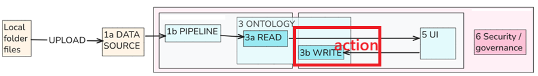<br>

_Action defition_<br>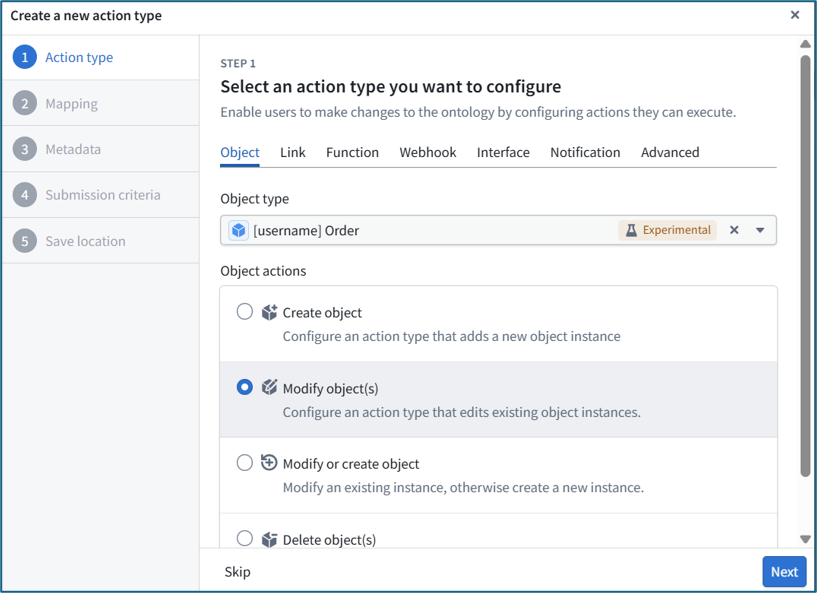

_Action reference in the UI_<br>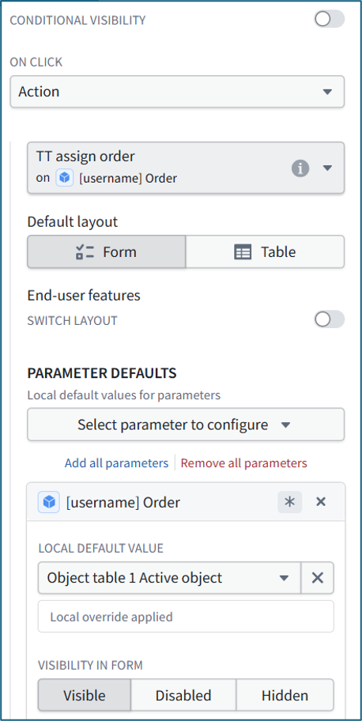

_Upper left: Orignal order. Upper right: After reassigning to different employee. Below: Changes saved to data._<br>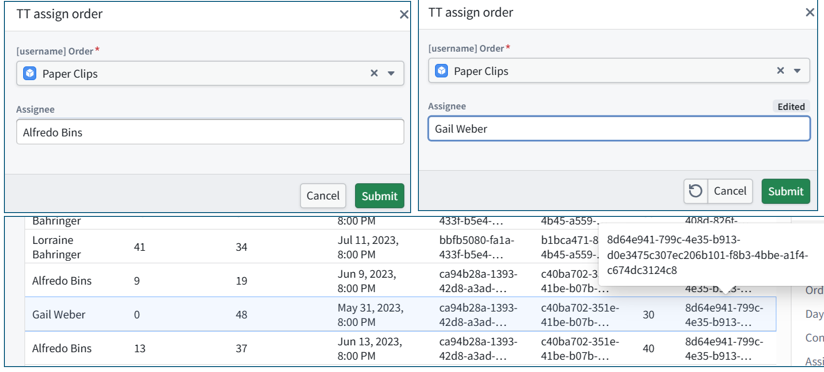

<br>


---
---
---
---
---


<br>

# **DEMOS 2) Data protection (no demos yet)**

<br>

---
---
---
---
---


<br>

# **DEMOS 3) Agentic 1 (AI external / no automation) (sovereignty risk via AI calls)**

<br>

---

<br>

### **D2 (from PAL)**

Your first app with AI. This demo was way too complicated. You can save a lot of time by following the ZAI version of the demo (and skip part 3 of 3 that has absolutely nothing to do with AI, but requires a lot of effort).0

See also: **[1.2 D2 (WIP) = "Speedrun -- Your First AIP Workflow" (26.0828)](/3c.2_pal_aip/)**.

In this demo you use ai 3 times (and each time a different model)

- 1 Summarize text chunk
- 2 Create embedding of summary (embedding)
- 3 Send selected text chunks to LLM to answer question (RAG)

NOTE: Selecting the text chunks using the embedding does not involve AI. The comparison is done in AIP_logic.

<!-- > <br>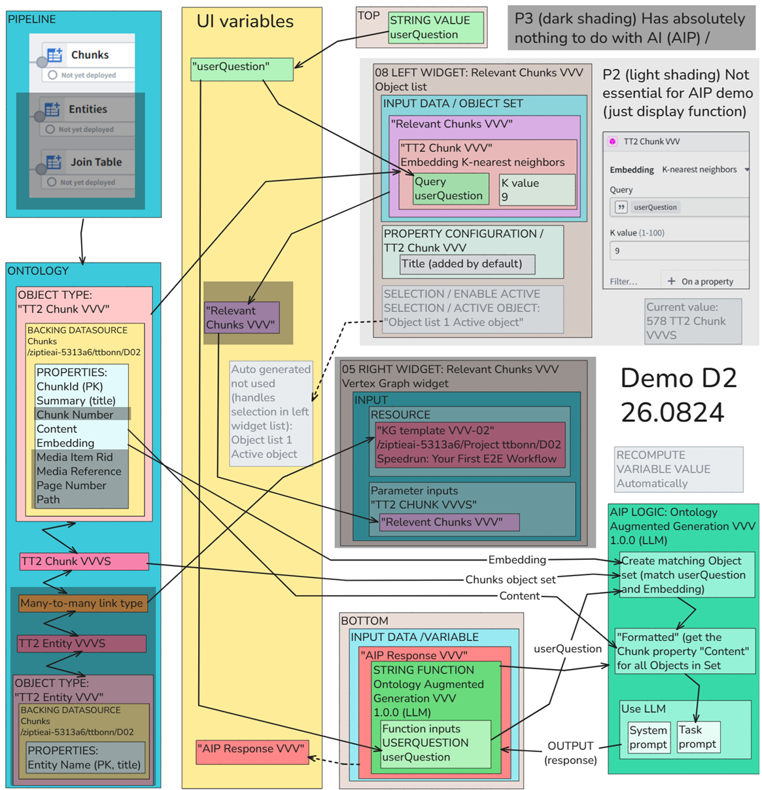 -->

_D2 (AI external (3) / no automation)_<br>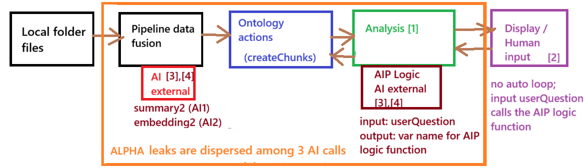

Diagram below shows more detail:

- Use AI (external models) to clean up extracted chunks of text from PDFs, to extract text keywords ("entities" in the demo) from the chunk, to match a question to chunks via embeddings (machine language representation of the question/chunks meanings (not keywords)), make a RAG call with the question/chunks to answer the question.
- About half of the demo has nothing to do with AI (the ZAI version splits the demo into 3 phases; phase 3 is the no-AI part; you can skip it).

_Demo D2 first AIP workflow (ZAI) diagram (26.0828) (3 different AI models are used)_<br>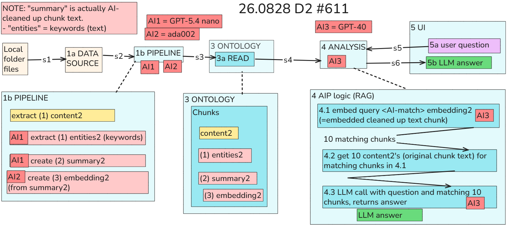

This is the diagram you really need when doing the demo. A diagram of the configuration steps for demo D2 (I spent days on my initial attempts to recreate D2 without this diagram; with this diagram its fairly simple; its even simpler if you do it in 3 separate phases as described in the latest version of the docx and if you simply ignore the shaded out parts of the demo).

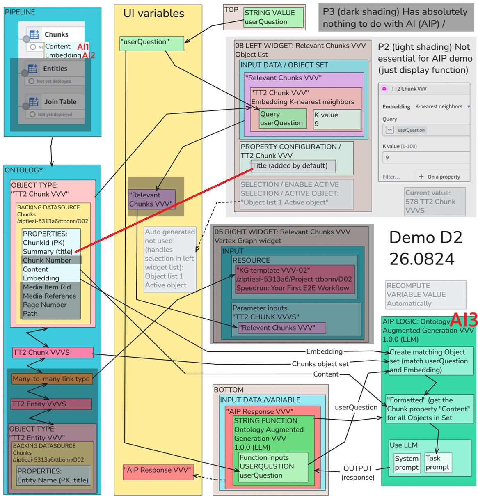

<br>

---
---
---
---
---


<br>

# **DEMOS 4) Agentic 2 (AI external + automation) (major sovereignty risk via automated AI calls)**

<br>

----

<br>

### **(4) D3**

See also: **[1.3 D3 (WIP) = "Speedrun: Your First Agentic AIP Workflow" (26.0902)](/3c.3_pal_agentic_ai/)**.

This demo builds the first **autonomous operational agent** in this sequence.

- **(1) A new Patient is added** through the UI and written to the Ontology.
- **(2) Automate detects** that the Patient entered the monitored object set.
- **(3)(4a) AIP Logic evaluates** the Patient against the selected Clinical Trial.
- **(3)(4b) The governed Action automatically writes** the initial eligibility decision and reasoning.
- **(5) Staff review the result** and may manually adjust the eligibility decision through the UI. This last step is important: Automation makes the initial operational decision, but staff retain oversight and can override it through a governed Action.

_D3 xxx_<br>

_D3 xxx_<br>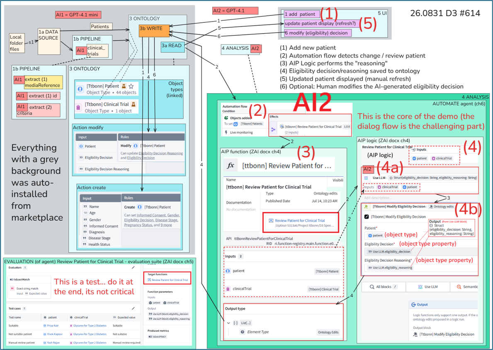

_D3 xxx_<br>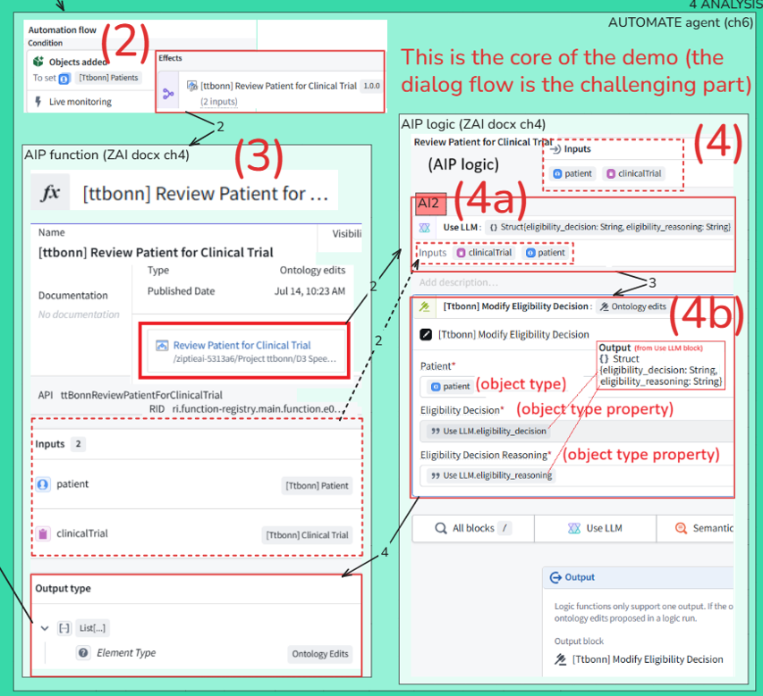

_D3 xxx_<br>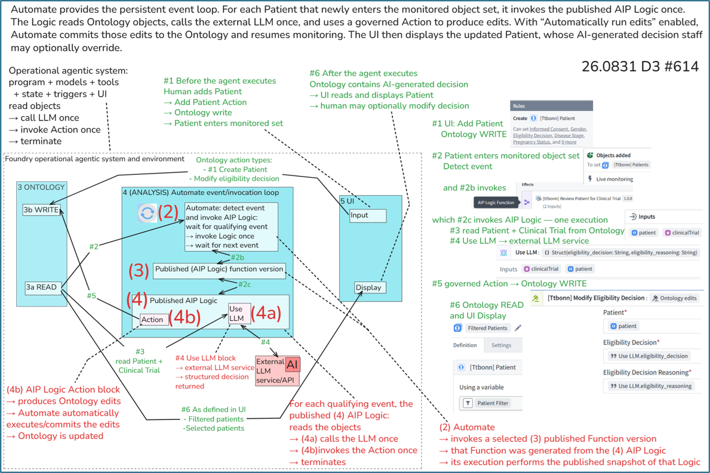

<br>

----

<br>

#### **[Both D2 and D3 send enterprise data to external LLMs—why does Palantir call D3 the first “agentic” demo?](/3c.2c_pal_zai_take_on_foundry_agent/)** (26.0902)

_Follow the above header link for details. See also the complete **[chat](/3c.2_pal_initial_demos_AGENT_CHAT/)** with FDE/GPT._

**My own simple explanation** (refer to diagram below)

- Demo D2 made calls to external LLM. That is (in my opinion)
  - an AI agent
  - that shares internal data with an external LLM.
- However, D3 (the next demo) does several things that D2 did not:
  - (3)(4) Foundry AIP_Logic (a no-code function definition) calls an LLM like D2, but it also modifies the ontology (core objects)
  - (2) Foundry Automation (event-driven automation service) provides a main loop that automatically processes (in D3 this means calling API_logic) any incoming onotology data changes.

_[3] Demo D3 Foundry agent_<br>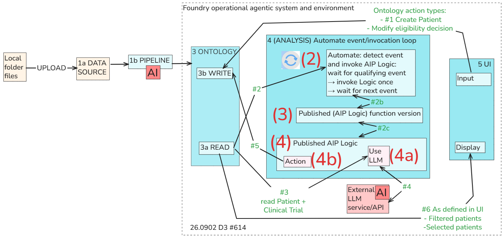


<br>

---
---
---
---
---


<br>  

# **DEMOS 5) ALPHA (Mining)**

<br>

-------

<br>

### **[(5) D5 (TO-UPDATE): Speedrun: Mining Your First Business Process (26.0718)](/3c.5_pal_biz_process_mining/)**

FDE: The demo starts with claims, customers, and claim-history logs. After ingesting these datasets into Foundry, the data is modeled as Ontology objects such as Customers and Claims. Machinery then uses the process logs to reconstruct how claims move through the business process over time. Once the process map is built, you can inspect where claims get stuck, identify why some remain unresolved, and embed the process view into an interactive application.

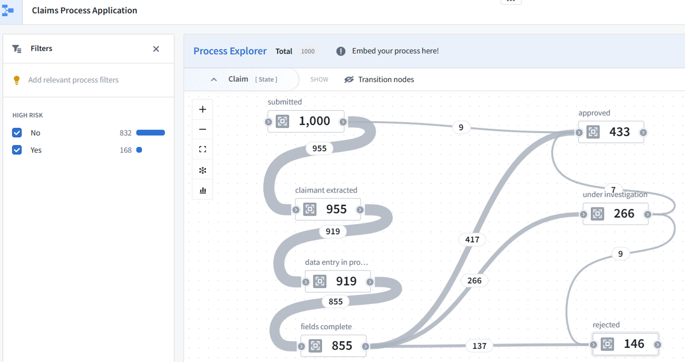


<br>

---
---
---
---
---


<br>

# **DEMOS 6) Agentic 3 (AI internal)**

<br>

---
---
---
---
---

<br>

# **Other demos**

Duplicate or unimportant demos (or demos I could not get to work).

<br>

----

<br>

### **[D4: Palantir ontology function "speedrun" (quick start) (26.0717)](/3c.4_pal_ontology_function/)**.
  - At the end of this page is _good demo of how FDE/GPT5.5 fixed a problem with the demo_.
  - **[#615\_.docx](https://drive.google.com/drive/folders/1-Adawag9uA8_bq-hDF-nOuPYaRLz1eEO)**
  - **[Speedrun](https://learn.palantir.com/speedrun-your-first-ontology-function/2131538)**

<br>

----

<br>

### **[D6: Deep Dive: Building Your First APPLICATION (xxxPipeline???) (26.0719)](/3c.6_pal_6_first_app/)**.
  - **Some of this failed**. FDE/GPT/OPUS could not fix.
  - Outdated (2+ years) demo? MAKE THE DEMOS SIMPLER AND KEEP THEM UPDATED.
  - **[#617\_.docx](https://drive.google.com/drive/folders/1-Adawag9uA8_bq-hDF-nOuPYaRLz1eEO)**
  - **[Speedrun](https://learn.palantir.com/deep-dive-building-your-first-application)**

<br>

----

<br>

### **[D7: Deep Dive: Building Your First Pipeline (26.0720)](/3c.7_pal_7_first_pipeline/)**.
  - **[#618\_.docx](https://drive.google.com/drive/folders/1-Adawag9uA8_bq-hDF-nOuPYaRLz1eEO)**
  - **[Speedrun](https://learn.palantir.com/deep-dive-building-your-first-pipeline)**

<br>

----

<br>

### **[DD19: Deep Dive: transform_data_w_code_repos (26.0805)](/3c.19_pal_19_transform_data_git/)**.
  - **[#627\_.docx](https://drive.google.com/drive/folders/1-Adawag9uA8_bq-hDF-nOuPYaRLz1eEO)**


<br> <br><br><br><br><br><br><br><br><br><br><br><br><br><br><br><br><br><br><br><br><br><br><br>
------
------
------
------
------
------
------
------
------
<br>


# **[DD-3 Train model (#619)](/pal_3.6_15_model_train/)**

pal_3.6_15_model_train (#619) 

<!-- _xxxxxxxxx_<br>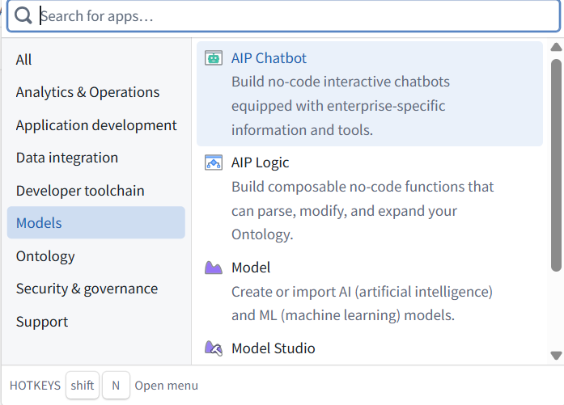<br> -->


**Understood. T1–T6 are Palantir’s role-based classifications, preserved in your inventory—not the organizing principle for ZAI_examples.** Your examples should be organized by **the problem being solved**.

You want **10–20 working, well-documented examples**, not exhaustive coverage or another course catalog. Here is a candidate set drawn from your inventory:

<br>

-------------------------------

<br>


These are **candidate problem statements**, not claims that we have verified every source example or its availability.

### Documentation style

For each example, keep the durable core:

- **Problem and sample data**
- **Desired result**
- **Solution diagram**
- **Starting prompts for FDE**
- **Checkpoints and evidence that it worked**
- **Known limitations and prerequisites**

**Avoid prescribing every click.** Add screenshots or exact instructions only where they resolve a significant ambiguity.

That reduces dependence on changing dialogs while retaining enough structure to reproduce and verify the outcome. Some maintenance remains—data access, APIs, models, and application capabilities can change—but much less of the document is tied to screen layout.

**Your master list supplies inspiration. ZAI_examples supplies a small, maintained collection of concrete problems people can solve with Foundry and FDE.**


<br> 

------

<br>

**Yes—the important distinction is what the tutorial starts from, not whether Palantir labels it an “Example.”**

- **3.5:** “How do I use this Foundry capability?”
- **3.6:** “How do I solve this specific problem using Foundry?”

Your tables are a useful working cross-reference: **problem → existing example → material to reuse or investigate**. Keeping the existing E-numbers also preserves the connection to your documents.

A few notes for later—not reasons to reorganize everything today:

1. **Some material can support both sections.**  
   Geo-markers are a 3.5 capability; locating correlated events on a map is a 3.6 application.

2. **“Complex AI” does not necessarily describe every A3 entry.**  
   Time-series anomalies can be detected statistically, numeric prediction can use a small model, and Cipher obfuscation is primarily data protection. Your categories can remain provisional; they need not dictate the implementation.

3. **The failed examples are worth revisiting diagnostically.**  
   For E12 and E15, first identify whether the blocker was unavailable functionality, changed instructions, configuration, or the example’s own complexity. Then decide whether to repair the original or extract a smaller ZAI_example.

4. **E17 under both applications is reasonable**, provided “time series on a map” is marked as a possible extension rather than something already verified in E17.

**This is enough structure for now.** You have a manageable problem list and traceable source material. The next useful work is reviewing selected examples—not perfecting the taxonomy.

<br> 

------

<br>


the problem with the palantir docs is there is no list where all the examples, demos, etc etc are listed (and numbered).
my D2 #620 nuumbering is the only thing close to a serial #.
you need a list. 
add comments to each in the list, but GIVE ME A LIST!!!

and it needs to be in order of increasing complexity. 
you add comments to each entry about who should want to do it.
but just give me a list! so that I dont have to search around.

so 3.5, 3.6 will be that.
3.5 lists of detailed examples, demos. 
3.6 will not be  repeat.
it maybe repeat kind of , but it wont be detailed or step by step..
more of hte busienss side. 

<br> 

------

<br>

**Understood. The list itself is essential—not just a catalog to search or a taxonomy to debate.** I was overemphasizing classification.

You want:

- **Stable IDs** so every tutorial can be referenced unambiguously.
- **One ordered list per section**, progressing from simpler to more complex.
- **Short comments beside each entry:** what it teaches, who would benefit, prerequisites, and known issues.
- **Existing document/example numbers retained** so your notes remain traceable.
- No requirement to navigate six role-based tracks to discover what is available.

### 3.5 — Detailed capability tutorials
The numbered, ordered list of practical Foundry exercises: configuration, implementation, testing, and results.

### 3.6 — Target applications
The numbered, ordered list of specific business problems: why solve them, what Foundry contributes, the proposed workflow, and the demonstrated outcome—**without repeating the detailed instructions**.

A 3.6 application can reference several 3.5 tutorials for its implementation.

**The organizing principle is a visible learning sequence with annotations—not categories that hide the entries.** Your IDs identify the material; its position in the list indicates the suggested learning order.


<br> <br><br><br><br><br><br><br><br><br><br><br><br><br><br><br><br><br><br><br><br><br><br><br>
------
------
------
------
------
------
------
------
------
<br>


# **[DD-4 Exx](/3c.1b_pal_examples/)** (2b.5) 

4.4 ZAI versions of PAL Examples (installable)

title: 4.2 ZAI versions of PAL Examples (installable)
permalink: /3c.1b_pal_examples/

FULL-FEATURED BUSINESS APP (WITH INSTALLER). I originally planned to focus on examples These are complete demos that auto-install. The big advantage is that you start out with a (usually) working version that you can modify piece by piece. Examples are complete (usually more complicated) and have an installer that allows you to start with a (usually) working version that you can modify. ZAI adds a few extra steps:

- Install a second (experimental) example
- Modify that example at your own pace<br>

For example **E11: Palantir Foundry example “Integrate GeoSpatial data with Gaia” (26.0728).** The ZAI docx for this example shows how to (1) install the excellent PAL example and then (2) replicate that example (reusing only the original example data; you recreate everything else).

 _Geospatial example: Input 2 sets of intelligence data (ELINT and ATR GEOINT), find ~3 million matching entries, sift through the 3 million to find 4 entries of interest, display the 4 entries on a map._<br>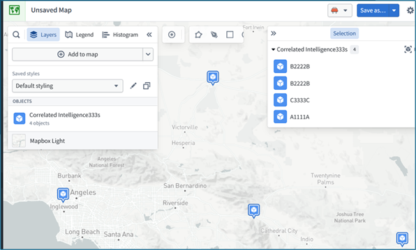<br>

<br><br>


**TOC**:

- 1 Why start with PAL/ZAI examples
- 2 Workflows
- 3 List of **working** examples
- 4 List of **failed/TODO** examples

<br>

# **1 Why start with PAL/ZAI examples**

<!--
This is the best way to become proficient with PAL Foundry as quick as possible:
  - Install a PAL example (just install and run). Use this as a reference installation.
  - Install a second PAL example to use as your own project.
  - Rebuild your example from the top down (while comparing your build with the PAL reference example and consulting **[my docx documentation](https://drive.google.com/drive/folders/1-Adawag9uA8_bq-hDF-nOuPYaRLz1eEO)**). Its usually much easier to start out modifying the view (the "top", such as PAL Maps, Workshop, etc) than modifying the pipeline (the "bottom" that inputs the raw data sources).
  - After rebuilding what you can, then study the details or make modifications (ask PAL's excellent FDE AI help for assistance).
  - Repeat the above process for other examples.
  - I document (in docx files) all the details you need to avoid typical mistakes.

*PAL example (left, center) and ZAI (ZiptieAI) build (right)*<br>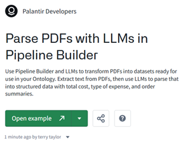  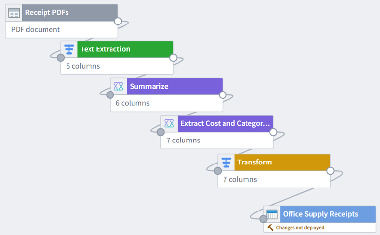  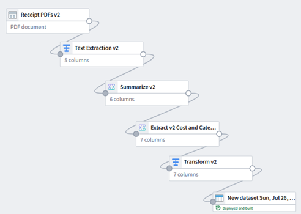<br>

**Note that this is also how real projects are developed**: *Not sure about this*, but maybe
- You first think about the result you (or your customers) want (pipeline output, UI output, etc). You start thinking about your project at the top.
- UI output requires onotology.
- Then you need to figure out how what datasets and how to build a pipeline that will provide ontology input.

<br> -->

I started with PAL (Foundry) in early July 2026.

(1) At first I wanted to do the PAL **examples**. But could not do them because I needed basic experience with PAL projects/folders, dialogs, terminology, etc. The examples did hot have these details (the examples are not for beginners).

(2) So I did the **demos**. The demos were excellent, but

- You had to create everything from start to finish. Invariably you'd make a few small mistakes, and it did not work. And as beginner, tracking down the error even with FDE was not easy.
- I got lost in all the new dialogs and terminology. It was too much.

<!-- - I was able to fix the problems thanks to FDE (and to a limited extend AIP). FDE is PAL's built in AI knowledge base that can even "see" screenshots posted into a chat. **It would have been nice if using FDE had been a central part of the demos**.  -->
<!-- - I found **no explanation about how to replicate them (build from scratch)**.
- I did **not understand that I could easily replace parts of the demo component chain from the top down**. This would allow me to modify small sections and verify.  -->

(3) But after a few weeks of demos, I finally installed an example, and then tried to duplicate it. I made 2 mistakes (because I did not have the details of how to set it up). It took me about half a day to fix those 2 errors. But I understood that **this is the way to learn Foundry**:

1. Install, run, and document (in your own docx file) the (reference) example.
2. Install again (test example), to a different directory.
3. Rebuild all the parts piece by piece, constantly comparing with the reference installation.

(4) **Other advantages**:

1. You make quick progress and dont get stuck so easily.
2. You get a lot of experience with FDE.
3. You can initially focus on the dialogs/tools, concepts, and terminology.
4. You quickly build up **your "own" portfolio of projects**.

(5) **Goals**

- A big goal is to organize a large set of examples into a conceptual whole. That will take a while. Right now I am in the discovery phase.
- I cant do some really interesting examples because they use AI models that my trial subscription does not allow. I still need to ask PAL if I can get access (I cant install because of the model problem, and I can not change the installation process).
- I am still "racing" to get as many examples working as possible while my PAL trial subscription still works.I will pay attention to incomplete text and grammar errors later (if my subscription ends, I can still work on those issues).

<br>

# **2 Workflows**

The basic workflow concepts is shown in the diagram below (not every example will be exactly like this):

- **PAL example 1**. Install and test a Palantir example.
- **ZAI example 1**. Install and test a **second PAL example that you will rebuild from the top down**.
- **ZAI example 2: Add ZAI View**.
  - Create a new (ZAI) view (follow ZAI instructions and compare to PAL example).
  - Connect ZAI view to the PAL Ontology (disconnect/delete PAL view) and test.
- **ZAI example 3: Add ZAI Ontology**.
  - Create a new (ZAI) ontology (follow ZAI instructions and compare to PAL example).
  - Connect ZAI Ontology to ZAI View and PAL pipeline (disconnect/delete PAL Ontology) and test.
- **ZAI example 4: Add ZAI Pipeline**.
  - Create a new (ZAI) pipeline (follow ZAI instructions and compare to PAL example).
  - Connect ZAI Pipeline to ZAI Ontology and PAL data sources (disconnect/delete PAL Ontology) and test.

_Typical example workflow (some examples may not have all components shown)_<br>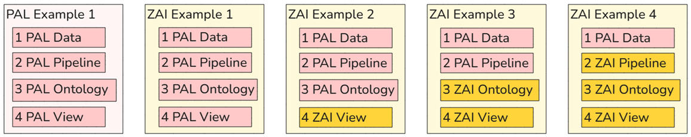

<br>

# **3 List of working examples**

**TOC**

- E10
- E11
- E17
- E14 (26.1014)
- E18 (moved 26.1015)

<br>

#### **[E10: Parse PDFs with LLMs in Pipeline Builder (26.0727)](/3c.1b_pal_f_example_first/)**

- A very basic app that uses AI to summarize content of PDF files.<br>_E10 output_<br>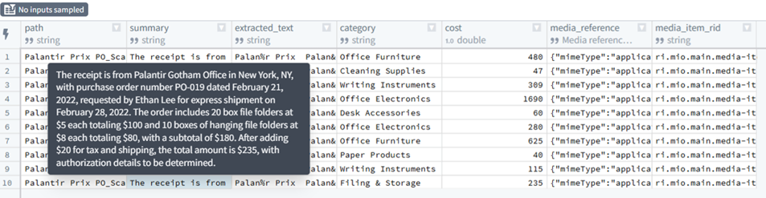
- Docx for this example: **[#621\_.docx](https://drive.google.com/drive/folders/1-Adawag9uA8_bq-hDF-nOuPYaRLz1eEO)**.

- **Example main diagram**. Shows the main workflow; red squares highlight those items implemented for demo D19 (this is a a very rought first draft that will change greatly as I figure out the details).<br>_(MAIN_E10.png)_<br>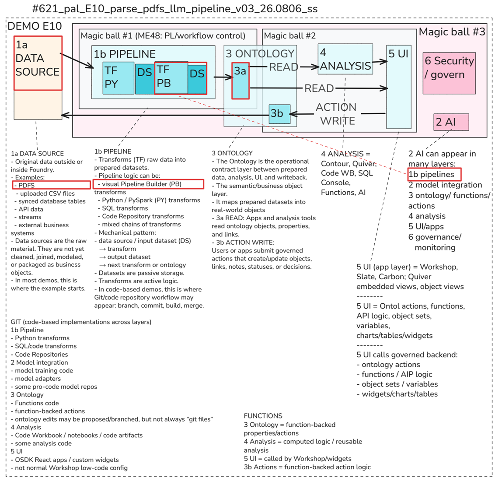

<!-- - Just data and pipeline, but also uses AI.<br>*E10*<br>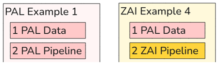 -->

<br>

#### **[E11: Palantir Foundry example "Integrate GeoSpatial data with Gaia" (26.0728)](/3c.1b_pal_E11_geospatial/)**.

- Very interesting app.
  - Inputs 2 sets of intelligence data (ELINT and ATR GEOINT).
  - Finds ~3 million matching entries.
  - Sifts through the 3 million to find 4 entries of interest.
  - Displays the 4 entries on a map.<br>_E11 output_<br>
- Docx for this example: **[#622\_.docx](https://drive.google.com/drive/folders/1-Adawag9uA8_bq-hDF-nOuPYaRLz1eEO)**.
- Example main diagram for E11 (example 11): shows the main workflow; orange squares highlight those items included in example install.<br>_(MAIN_E11.png)_<br>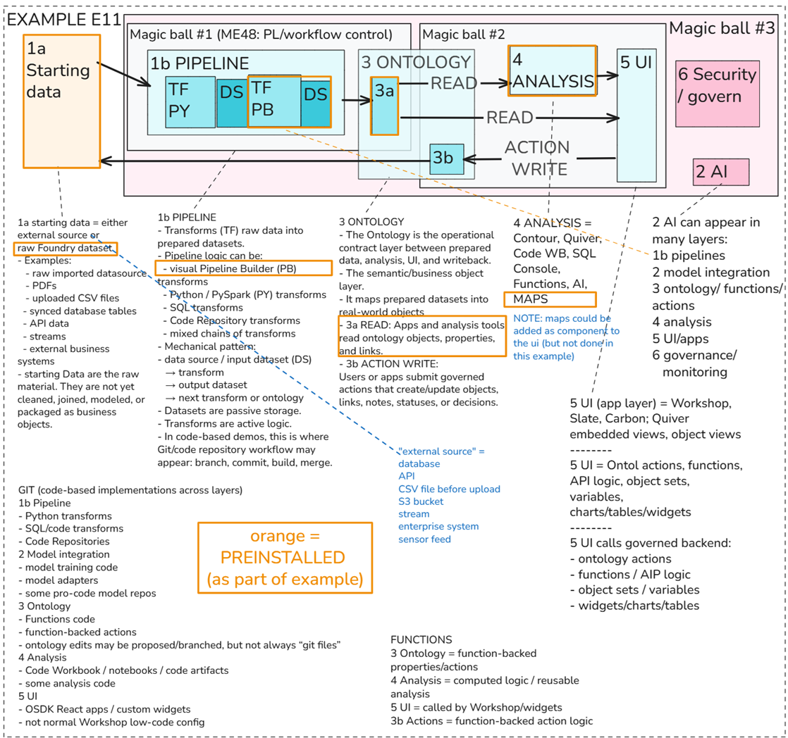

<!-- - Uses PAL maps for view. You only rebuild ontology and pipeline (much more complex than E10). <br>*E11*<br>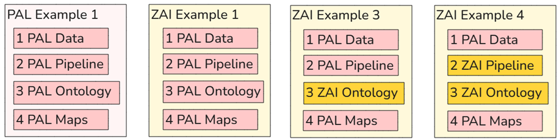 -->

<br>

#### **[E17: Detect anomalies in time series data with Code Workspaces (26.0731)](/3c.1b_pal_E17_anomalies_time_series/)**.

- Complicated demo, but quite interesting.
  - Code for model to detect time series anomalies.
  - Quiver for display data.
  - Requires quite a bit of manual action to process data.<br>_E17 output (the green boxes show my modifications to the input data)_<br>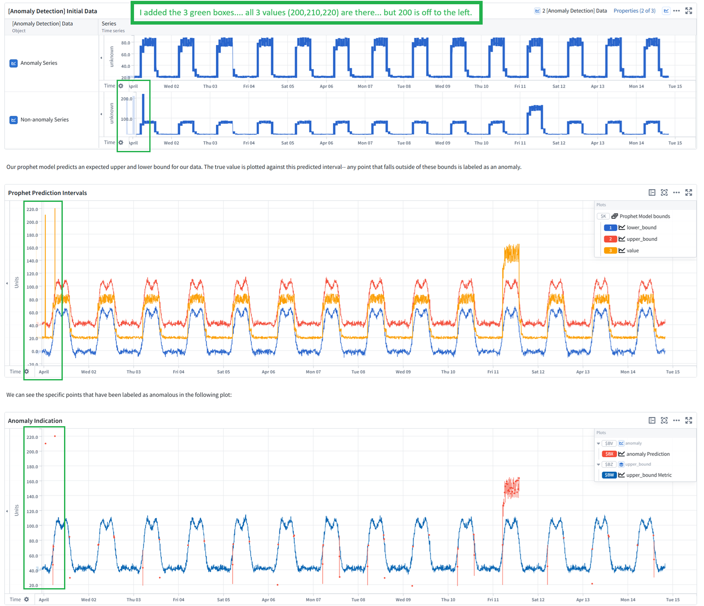
- Docx for this example: **[#626\_.docx](https://drive.google.com/drive/folders/1-Adawag9uA8_bq-hDF-nOuPYaRLz1eEO)**.

_Example (left, center) and my own build (right) (3c.1b)_<br>  <br>

_Workflow diagrams for examples are usually a bit more complicted than for demos._<br>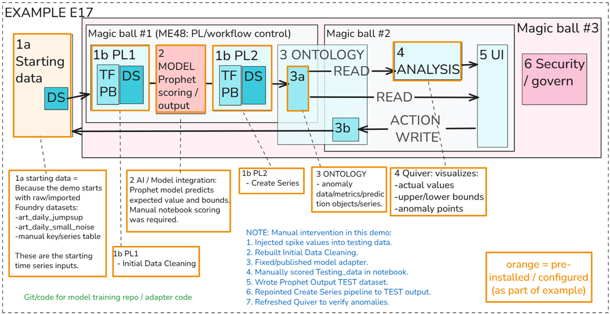<br>

<br>


#### **E14: Evaluate Retrieval-Augmented Generation (RAG) methods** (26.1014)

- #629
- https://ziptieai.usw-17.palantirfoundry.com/workspace/now/platform/7997a708-4d1e-4efb-bfca-882dc172b4e8
- _E14_<br>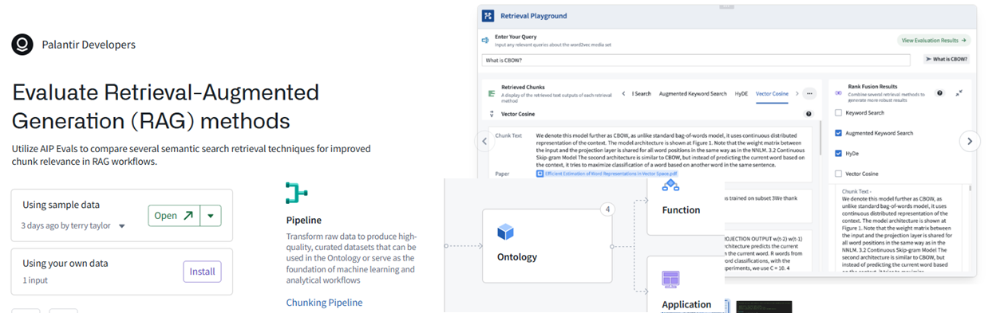
- _E14_<br>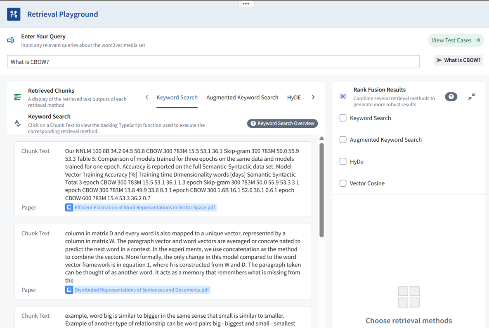

<br>


#### **E18: E18_build_w_aip_chatbot_studio**

- #???
- https://ziptieai.usw-17.palantirfoundry.com/workspace/compass/view/ri.compass.main.folder.5684e562-8ccd-4c8d-934a-3b50d8861dd7
- _E18_<br>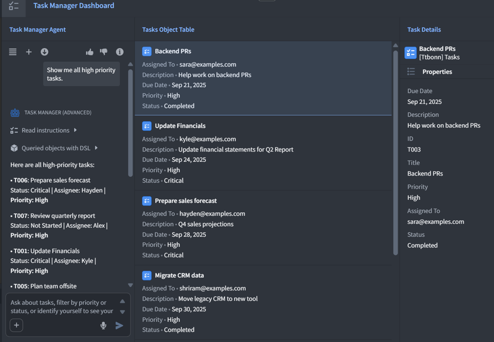

<br>


# **4a List of TODO examples**

<br>

#### **E13: Protect sensitive images using visual obfuscation in Cipher**.

- no Docx??
- https://ziptieai.usw-17.palantirfoundry.com/workspace/now/platform/b88675ed-e8f9-4bc9-b75b-aa446930d07b
- _E13_<br>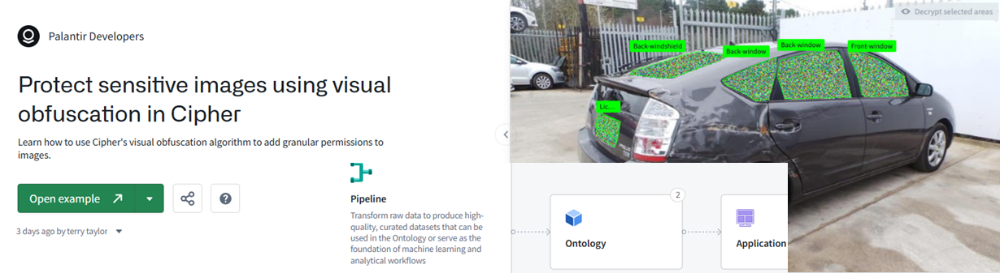

<br>

# **4b List of failed/xxxx examples**

<br>

#### **[xxxx (TOO COMPLEX) E12: Build a common operating picture with geospatial data (26.0729)](/3c.1b_pal_E12_geospatial_workshop/)**.

- Docx for this example: **[#623\_.docx](https://drive.google.com/drive/folders/1-Adawag9uA8_bq-hDF-nOuPYaRLz1eEO)**.
- https://ziptieai.usw-17.palantirfoundry.com/workspace/now/platform/266edc4b-05f6-46ed-b724-65aa8453ce02
- **(FOR NOW PASS ON THIS... TOO COMPLICATED (WORKSHOP))**<br>_E12_<br>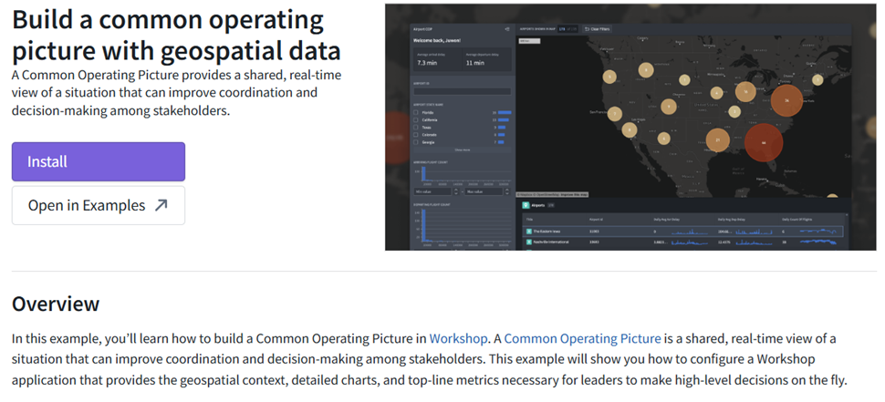

<br>

#### **xxxx FAIL ### E15: Cross-validate Images and Documents using AIP**.

- #624_pal_E15_cross_validate_images_docs_aip_v02_26.0730_ss
- https://ziptieai.usw-17.palantirfoundry.com/workspace/now/platform/e99a7898-6dc2-4394-a5ec-a583a2d87568
- _E15_<br>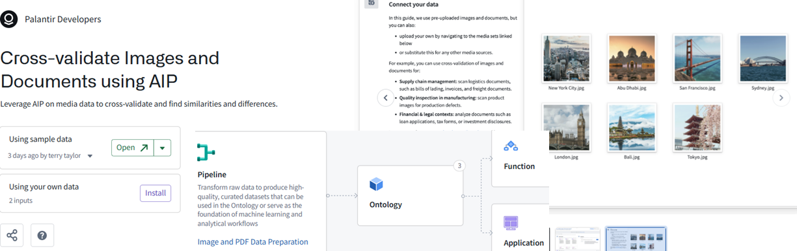

<br>

#### **xxxx E16: Basic Pyspark Transform references**

<br>

#### **xxxx #625_pal_E16_cluster_time_series_datad_v01_26.0730_ss**

- junk, fails during install.

<br><br><br><br><br><br>

---

---

---

---

---

<br>

### **NOTES**

The following is a chat with PAL's built-in FDE chat assistant.

#### **ME: if i can (1) install examples that work, test them, analyze, then (2a) delete a part and try to create the missing part myself or (2b) just delete everything but the data and replicate everything....**

then (3) why do the demos at all? (4) why doesnt palantir simply start a new user with examples??? one of the first demos i did.. it took me 2 days to get everything right. i was overwhelmed by all the new stuff, the dialogs.

#### **FDE (PAL HELP CHAT): I think your approach is actually the better learning method.**

The official demos often assume you already understand Foundry vocabulary:

```text
dataset
pipeline
object type
ontology
media set
deploy
preview
sampling
Workshop variable
action
```

For a new user, that is too much at once.

#### Why examples are useful

Installed examples give you a **known-good reference**:

```text
working pipeline
working ontology
working app
working data
```

Then you can learn by controlled damage:

1. Break one part.
2. Rebuild that part.
3. Compare against the working version.
4. Repeat.

That is much better than starting from blank with 20 unfamiliar screens.

#### Why Palantir still has walkthroughs

Walkthroughs are meant to teach the intended workflow, but they often skip the “beginner friction”:

- what each icon means,
- what is a node vs dataset vs object type,
- when preview is just preview,
- why deploy means build,
- why `/column_name` matters,
- why sampling changes row count,
- why an Ontology object and a dataset can have the same display name.

Those missing micro-details are exactly what confused you.

#### Best learning pattern

For you, I would use this pattern:

```text
Install example
→ run/verify it works
→ inspect each resource
→ duplicate/recreate with same data
→ intentionally change one thing
→ add Ontology
→ add Workshop
→ add Automate
```

That turns examples into a “lab bench” instead of a vague tutorial.

So yes — Palantir probably should onboard new users with small working examples first, then ask them to modify/replicate them step by step.


<br> 

------

<br>

26.1123 (v1 26.1123)
