<!-- 4.3 Haystack needles -->
[← 4.2 Backend / Equator](/pal_4.2_a2_equator/) / [↑ 3c Enterprise](/pal/) / [→ 4.4a AI inference](/pal_4.4a_a4a_ai_inference/)

<br>

Haystack needles: Find needles (a few relevant records, relationships, events, or anomalies) in a haystack (a massive amount of data). 

#### **TOC**


```
- HN #620_pal_DIY9_aip-fde_demo_hn  #620_pal_9_aip-fde_demo_hn_
- D5 mining #616_pal_D5_biz_process_mining_qs
```

|**Example** | **#** | **Specific problem for a ZAI_example** | **Potential inspiration** |
|E11 | 1 | Find records occurring near the same place and time | Geospatial/common operating picture |
|E12 | 1 | (FAIL) E12: Build a common operating picture with geospatial data  |  |
|E17 | 12 | Show where and when a changing measurement exceeded a threshold | Time series on a map |


- **[#620\_pal\_DIY9\_aip-fde_demo\_hn\_](https://drive.google.com/drive/folders/1-Adawag9uA8_bq-hDF-nOuPYaRLz1eEO)**.<br>_DIY9 UI_<br>


### **DIY9 (from ZAI/FDE/GPT) (NO AI)**

DIY = do it yourself. Create your own demo.

SEE ALSO: **[3.1 D9 (TO-UPDATE, DIY) = Haystack needle demo](/3c.xxx_pal_HN_01_non_ai/)**.

- **All of the analysis is in the UI**
  - UI right widget: You select multiple property column VALUES for a single object type property (**this is an object type property value selector; it has nothing to do with filtering**).
  - UI left widget: Displays objects whose property column values match selected property values.
- **Classification of the demo:**
  - **[1] Analytics** (objects displayed based on selected object type property values)
  - **[2] Data protection** (this is not something you setup; but Foundry controls restricts access to data for enterprise staff)
- Other aspects of this (very simple) demo:
  - **DIY = Do it yourself. I did this from scratch by chatting with FDE/GPT.** This is a very important aspect of this demo, showing that this is possible.
  - **NO AI**.

_Functional overview (maybe I should not have crossed out governance; it is very important and always active, but you did not have to set it up)_<br>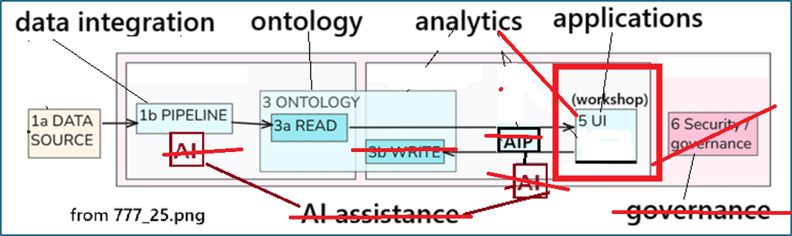

_A simple diagram of the UI config (the PAL demos do not have such diagrams)_<br>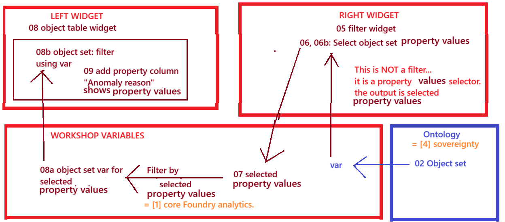

_Resulting UI_<br>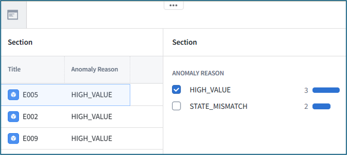


#### **[E11: Palantir Foundry example "Integrate GeoSpatial data with Gaia" (26.0728)](/3c.1b_pal_E11_geospatial/)**.

- Very interesting app.
  - Inputs 2 sets of intelligence data (ELINT and ATR GEOINT).
  - Finds ~3 million matching entries.
  - Sifts through the 3 million to find 4 entries of interest.
  - Displays the 4 entries on a map.<br>_E11 output_<br>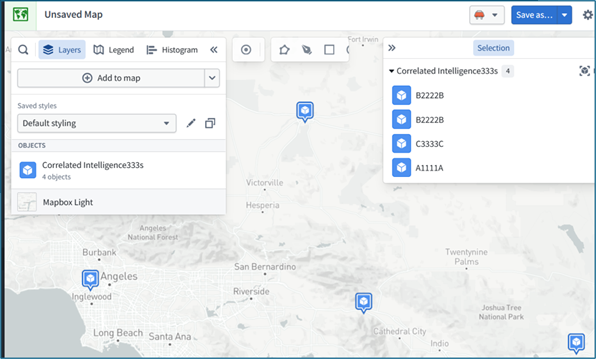
- Docx for this example: **[#622\_.docx](https://drive.google.com/drive/folders/1-Adawag9uA8_bq-hDF-nOuPYaRLz1eEO)**.
- Example main diagram for E11 (example 11): shows the main workflow; orange squares highlight those items included in example install.<br>_(MAIN_E11.png)_<br>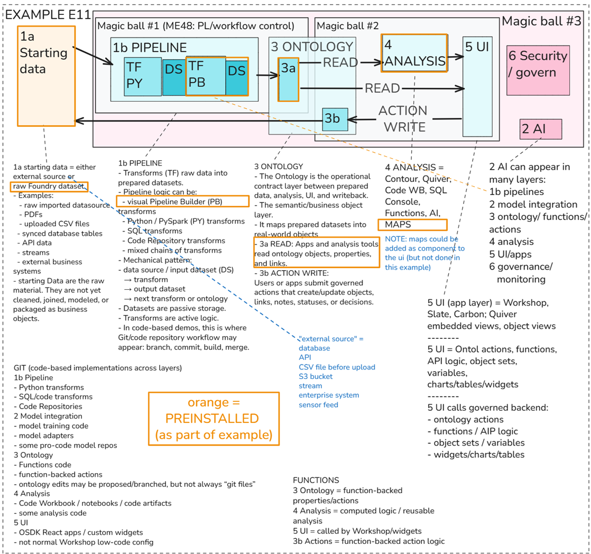

<!-- - Uses PAL maps for view. You only rebuild ontology and pipeline (much more complex than E10). <br>*E11*<br>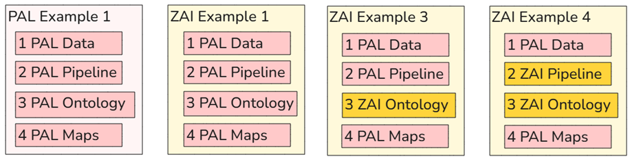 -->

<br>

#### **[E17: Detect anomalies in time series data with Code Workspaces (26.0731)](/3c.1b_pal_E17_anomalies_time_series/)**.

- Complicated demo, but quite interesting.
  - Code for model to detect time series anomalies.
  - Quiver for display data.
  - Requires quite a bit of manual action to process data.<br>_E17 output (the green boxes show my modifications to the input data)_<br>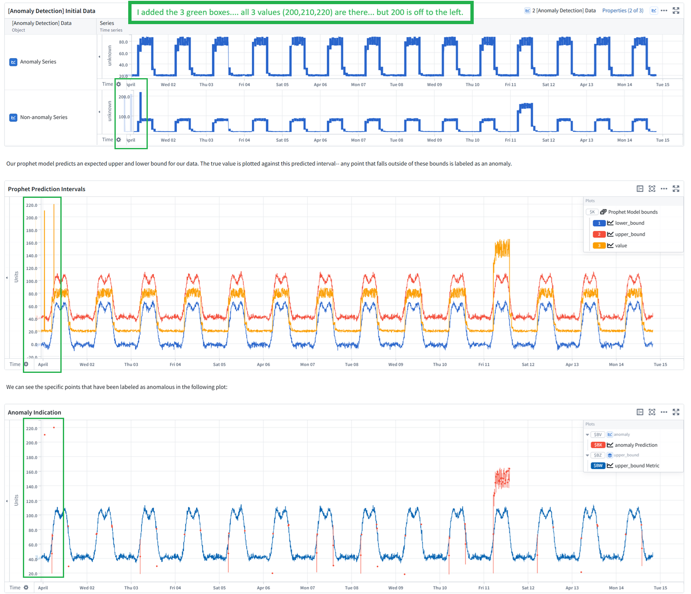
- Docx for this example: **[#626\_.docx](https://drive.google.com/drive/folders/1-Adawag9uA8_bq-hDF-nOuPYaRLz1eEO)**.

_Example (left, center) and my own build (right) (3c.1b)_<br>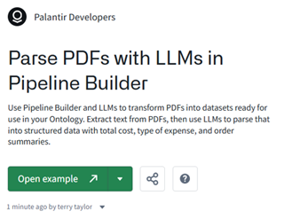 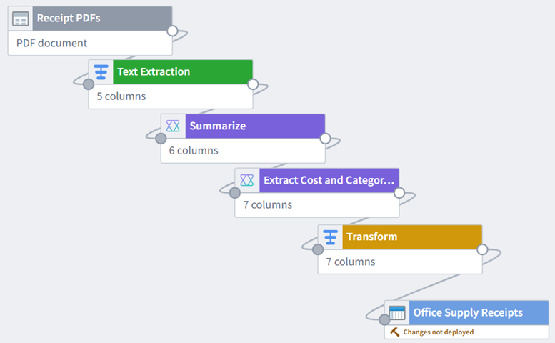 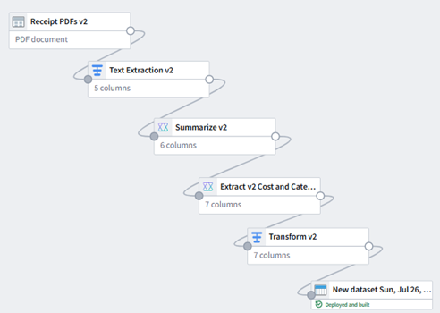<br>

_Workflow diagrams for examples are usually a bit more complicted than for demos._<br>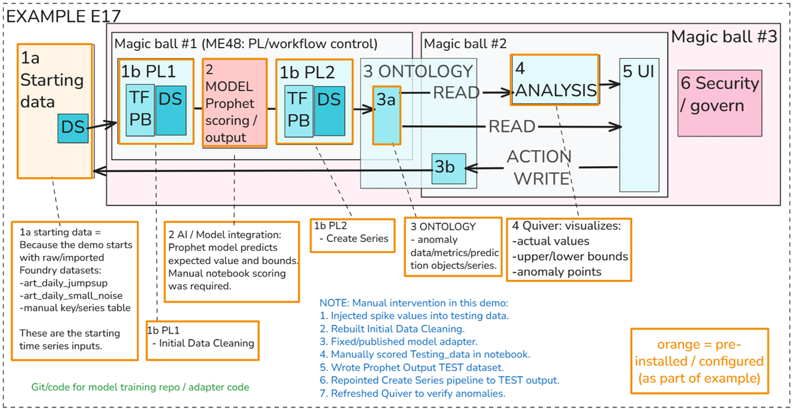<br>

<br>


#### **[xxxx (TOO COMPLEX) E12: Build a common operating picture with geospatial data (26.0729)](/3c.1b_pal_E12_geospatial_workshop/)**.

- Docx for this example: **[#623\_.docx](https://drive.google.com/drive/folders/1-Adawag9uA8_bq-hDF-nOuPYaRLz1eEO)**.
- https://ziptieai.usw-17.palantirfoundry.com/workspace/now/platform/266edc4b-05f6-46ed-b724-65aa8453ce02
- **(FOR NOW PASS ON THIS... TOO COMPLICATED (WORKSHOP))**<br>_E12_<br>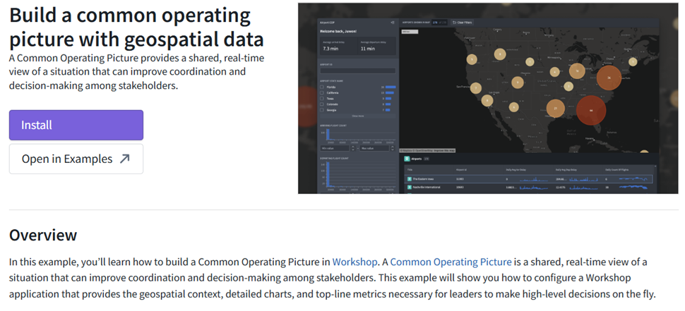

<br>

<br> 

------

<br>

26.1124 (v1 26.1124)
