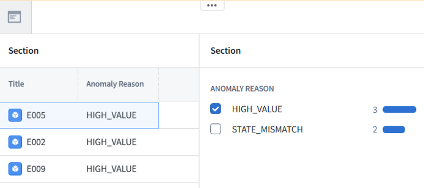

<br>

#### **TOC**


```
- HN #620_pal_DIY9_aip-fde_demo_hn  #620_pal_9_aip-fde_demo_hn_
- D5 mining #616_pal_D5_biz_process_mining_qs
```

|**Example** | **#** | **Specific problem for a ZAI_example** | **Potential inspiration** |
|E11 | 1 | Find records occurring near the same place and time | Geospatial/common operating picture |
|E12 | 1 | (FAIL) E12: Build a common operating picture with geospatial data  |  |
|E17 | 12 | Show where and when a changing measurement exceeded a threshold | Time series on a map |


- **[#620\_pal\_DIY9\_aip-fde_demo\_hn\_](https://drive.google.com/drive/folders/1-Adawag9uA8_bq-hDF-nOuPYaRLz1eEO)**.<br>_DIY9 UI_<br>


<br> 

------

<br>

26.1124 (v1 26.1124)
