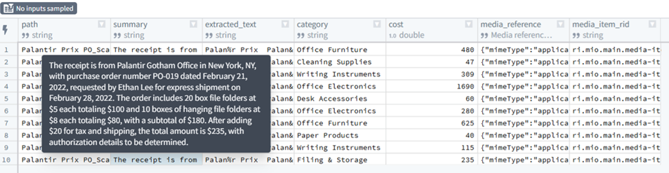
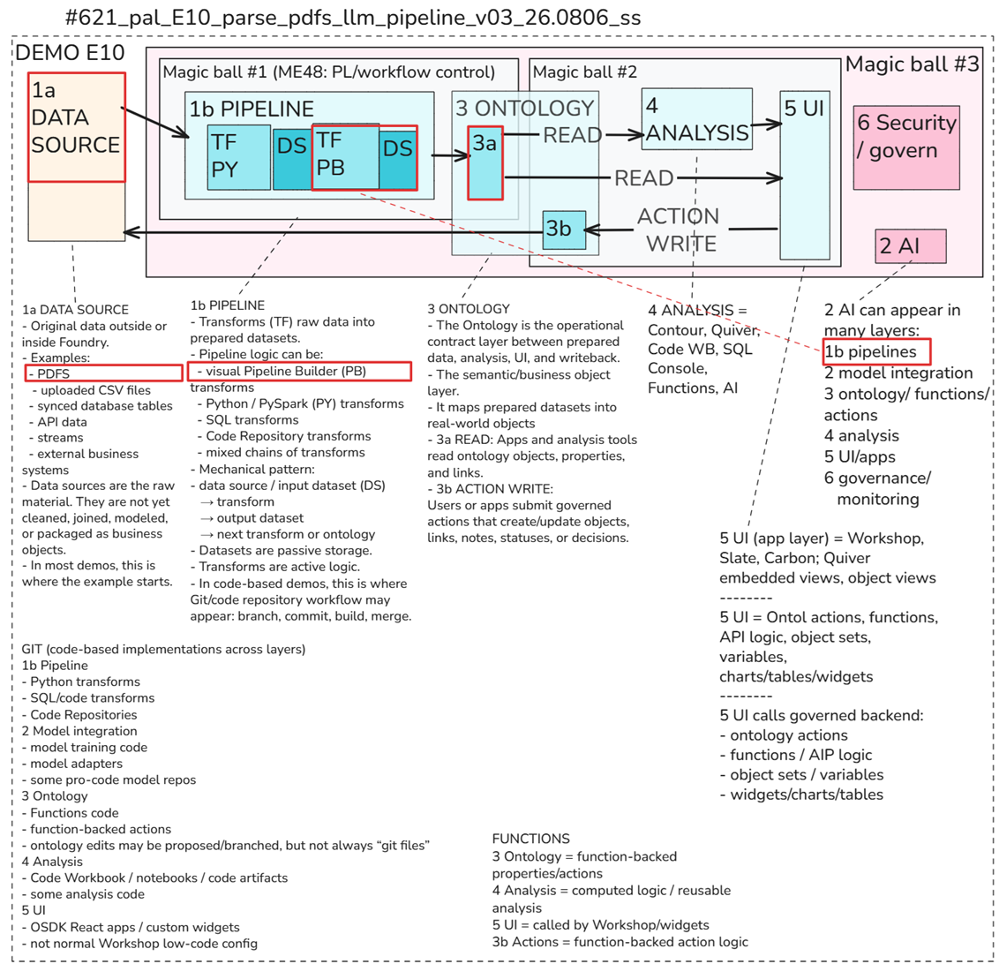
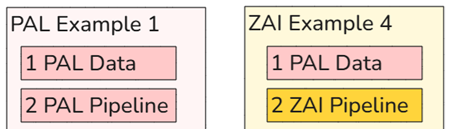
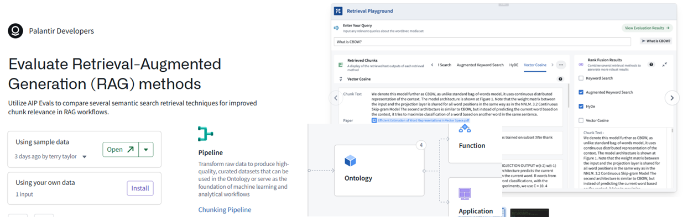
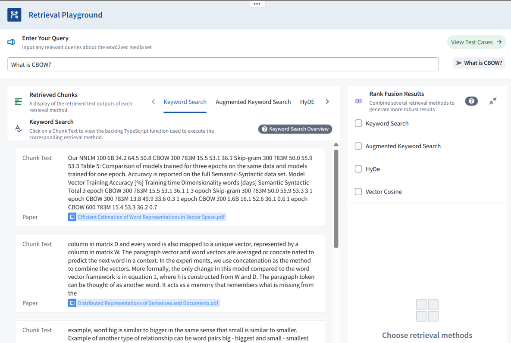
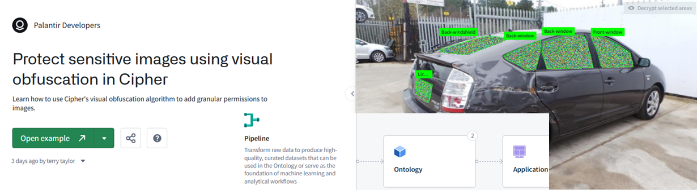
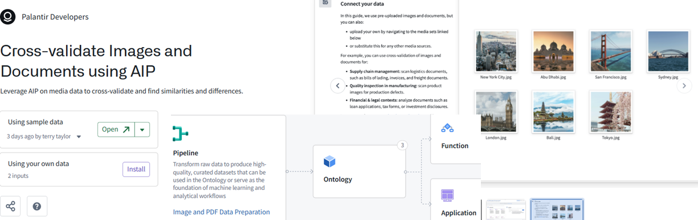

 

AI inference

#### **TOC**

|**Example** | **#** | **Specific problem for a ZAI_example** | **Potential inspiration** |
|--- | 7 | Classify incoming records and send uncertain results for human review | AIP classification and feedback loops |
|--- | 4 | Search documents by meaning rather than exact words | Semantic search |
|E10 | 3 | Extract specified fields from PDFs and flag missing information | PDF parsing |
|E14 | --- |RAG |---|
|E15 | 6 | (FAIL) Find disagreements between a document and its accompanying image | Image/document cross-validation |
|E13 | --- |(TODO) Cipher visual obfuscation |---|

 
 
 

### **900 No—AIPL/AIPLF is one route, not the only route.**

LLMs can be called through:
- **AIP Logic**
- **Pipeline transforms**, including Pipeline Builder and Python
- **Code-based Functions**
- **Agents/chatbots**
- **Built-in AI features**, such as AI FDE and AIP Assist

And **they are not limited to pipelines and UIs**. For example, an automation can trigger an Action that calls an LLM-backed function, without anyone using a UI.

For your diagram, think:

> **LLMs are model services that different Foundry workflows can invoke—not a mandatory AIPL → AIPLF → UI chain.**

ME: OK, so AIPL/code, in the UI via AIPLF or code, .....
FDE, AI assist.
thats about it.

 
 
 

#### **[E10: Parse PDFs with LLMs in Pipeline Builder (26.0727)](/3c.1b_pal_f_example_first/)**

- A very basic app that uses AI to summarize content of PDF files. _E10 output_ 
- Docx for this example: **[#621\_.docx](https://drive.google.com/drive/folders/1-Adawag9uA8_bq-hDF-nOuPYaRLz1eEO)**.

- **Example main diagram**. Shows the main workflow; red squares highlight those items implemented for demo D19 (this is a a very rought first draft that will change greatly as I figure out the details). _(MAIN_E10.png)_ 

<!-- - Just data and pipeline, but also uses AI. *E10*  -->

 

#### **E14: Evaluate Retrieval-Augmented Generation (RAG) methods** (26.1014)

- #629
- https://ziptieai.usw-17.palantirfoundry.com/workspace/now/platform/7997a708-4d1e-4efb-bfca-882dc172b4e8
- _E14_ 
- _E14_ 

 

#### **E13: Protect sensitive images using visual obfuscation in Cipher**.

- no Docx??
- https://ziptieai.usw-17.palantirfoundry.com/workspace/now/platform/b88675ed-e8f9-4bc9-b75b-aa446930d07b
- _E13_ 

 

# **4b List of failed/xxxx examples**

 

#### **xxxx FAIL ### E15: Cross-validate Images and Documents using AIP**.

- #624_pal_E15_cross_validate_images_docs_aip_v02_26.0730_ss
- https://ziptieai.usw-17.palantirfoundry.com/workspace/now/platform/e99a7898-6dc2-4394-a5ec-a583a2d87568
- _E15_ 

 

  

------

 

26.1124 (v1 26.1124)
