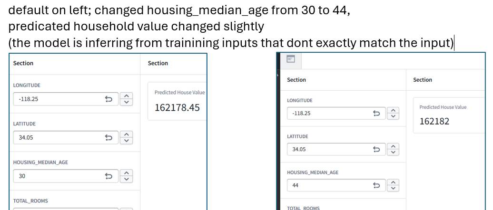
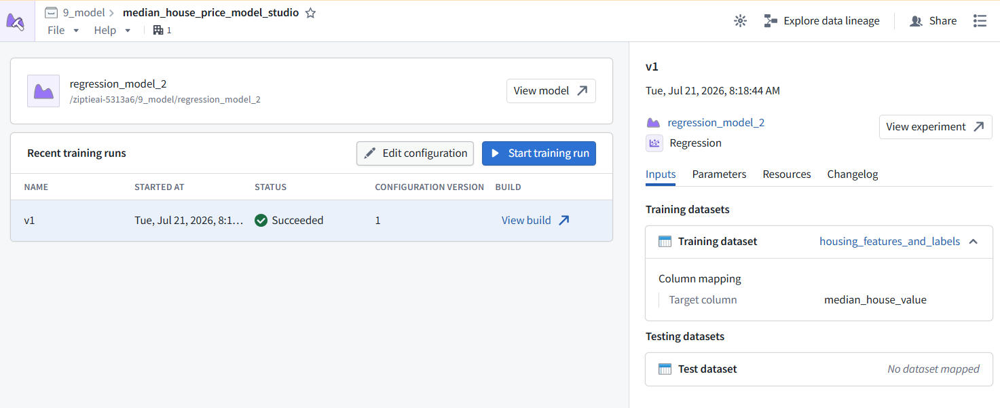

<br>

#### **TOC**


|**Example** | **#** | **Specific problem for a ZAI_example** | **Potential inspiration** |
|E17 | 2 | (TRAIN) Detect unusual readings in timestamped measurements | Time-series anomaly detection |
| #619 | 15 | Predict a numeric result and compare predictions with actual outcomes | Supervised model training |

```
- D8 train model #619_pal_D8_model_integration_
```

- **[#619\_pal\_D8\_model\_integration\_](https://drive.google.com/drive/folders/1-Adawag9uA8_bq-hDF-nOuPYaRLz1eEO)**.<br>_D8 demo model trained in Foundry_<br><br>


<br> 

------

<br>


### **[D8 (WIP) — Deep Dive: Model integration (26.0905)](/3c.8_pal_8_model_integration/)**

Demo D8 explores how a traditional machine-learning model can be trained, deployed, and used for inference inside Palantir Foundry. The demo first examines Foundry’s Model Studio and model-management workflow, then creates a project and trains models using two approaches: Model Studio and a Jupyter notebook. Finally, the trained model is deployed and connected to an interactive application for inference. The demo therefore follows much of the model lifecycle: data → training → model → deployment → inference → application.

_Training of the internal model_<br>

<br>


# **[DD-3 D8 Train model (#619)](/pal_3.6_15_model_train/)**

pal_3.6_15_model_train (#619) 


**Understood. T1–T6 are Palantir’s role-based classifications, preserved in your inventory—not the organizing principle for ZAI_examples.** Your examples should be organized by **the problem being solved**.

You want **10–20 working, well-documented examples**, not exhaustive coverage or another course catalog. Here is a candidate set drawn from your inventory:

<br>

<br> 

------

<br>

### **[D8a (TODO) (FDE VERSION) Understanding models in Foundry (26.1122)](/3c.8_pal_8a_model_integration/)**


Identify the model resources, deployment options, input/output contracts, and differences among external APIs, imported models, internally hosted models, and custom-trained models.

Topics:

- model versus model endpoint;
- external versus internally deployed;
- pre-trained versus custom-trained;
- batch versus live inference;
- model versions and dependencies.


<br> 

------

<br>

26.1124 (v1 26.1124)
