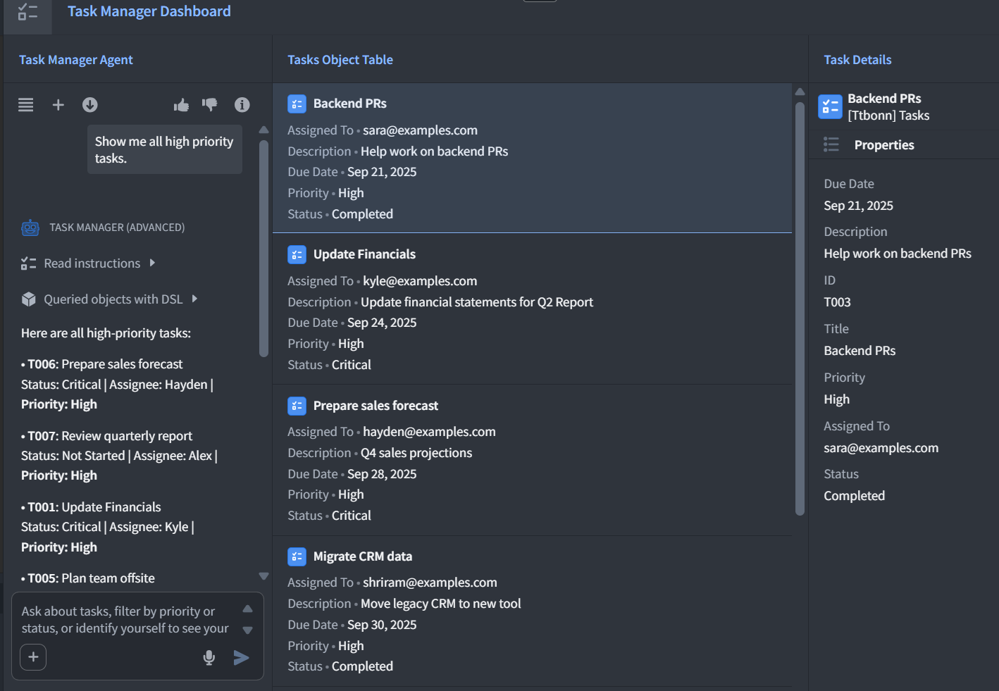

<br>

Agentic execution: interactive, event-triggered, or continuously hosted workflows, including model-directed tool use.

#### **TOC**


#### **E18: E18_build_w_aip_chatbot_studio**

- #???
- https://ziptieai.usw-17.palantirfoundry.com/workspace/compass/view/ri.compass.main.folder.5684e562-8ccd-4c8d-934a-3b50d8861dd7
- _E18_<br>

<br>


|**Example** | **#** | **Specific problem for a ZAI_example** | **Potential inspiration** |
|E18 | --- |chat bot |---|

```
**Yes—that makes an excellent three-demo series**, using the **same small task and tools** so the execution differences are clear.

| Demo | What starts it | What it demonstrates |
|---|---|---|
| **1. Interactive agent** | A user message in Chatbot Studio | Model-directed tool use during a conversation |
| **2. Event-driven agent** | An Automate condition or schedule | Unattended AI processing when work arrives |
| **3. Persistent worker agent** | Deployment of custom code in a Compute Module | An ongoing process that waits for work, processes it, and repeats |

These are **three hosting/trigger patterns**, not an exhaustive list of ways to create agents.

For each, we’d verify **start → receive work → choose operations → produce a result → inspect execution → stop safely**. Before the third, we’d confirm Compute Modules are available and suitable in your environment.

**Same problem, three execution patterns** fits your mechanistic teaching approach very well.
```


<br> 

------

<br>

26.1124 (v1 26.1124)
