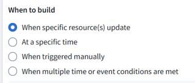
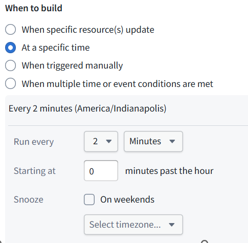
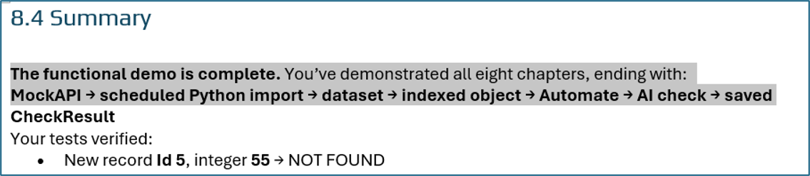

 

[← 3c Enterprise](/pal/)

 

FDE/GPT has amazing abilites.  
- I cant imagine learning Foundry by myself without FDE. 
- FDE particularly shines for programming tasks.
- But limitations become apparent when dealing with concepts. After completeing the basic 693 tutorial test, I started reviewing the chapter titles (generated by FDE). They all needed to be rewritten. 

My chat with FDE about cleaning up the H1 headings is below. Long conversation. In the end, all of my corrections were right, with one mistake. 

-------------------------------

  

#### ME1: why is it called "backed directly by this dataset"....  
seems should be "generated from this dataset"

**“Generated from this dataset” is clearer for explaining how the objects first appear.** But “backed by” describes their ongoing connection to the data.

In your demo:

Dataset rows supply **Id, Text, and Integer**.

When the dataset changes, indexing updates those object properties.

**CheckResult** is stored separately as an Ontology edit—it is not a column in that dataset.

So this is not a one-time generation of independent objects.

For the tutorial, I’d write:

**Foundry creates and updates the objects from this dataset.** Each row represents one object, identified by its Id. Foundry calls this the object type’s *backing dataset*.

“**Directly**” simply means you mapped this dataset to the object type without another transformation dataset in between.

  

#### ME2: then "source dataset"

Yes—**“source dataset”** is clearer for your tutorial.

**693_MockAPI_Items is the source dataset for Capstone2Record. Foundry creates and updates the objects’ Id, Text, and Integer properties from its rows.**

When introducing the Foundry UI term, add:

Foundry calls this the *backing dataset*.

**CheckResult** is different: it is saved through Actions, not supplied by the source dataset.

  

#### ME3: the title is "1.4 Make the records available as objects"  
seems like better title would be "1.4 create objects from dataset"

Yes—**“1.4 Create objects from the dataset”** is better. It says plainly what the reader will do, rather than describing the outcome indirectly.

  

#### ME4: so the title "1.3 Fetch the records and verify the stored data"  
could be "1.3 Py script fetches MockAPI records (using data connection) and store in dataset"

Yes—that makes the mechanism explicit. I’d phrase it:

**1.3 Fetch MockAPI records through the data connection and store them in a dataset using Python**

  

#### ME5: "1.2 Create data connection to (external) MockAPI" ?????????

Yes—**1.2 Create a data connection to MockAPI** is clear.

But in this demo you **reused an existing connection**, so the accurate title is:

**1.2 Configure the data connection to MockAPI**

  

#### ME6: these are my chapter titles

1 Display external (MockAPI) records in UI (Workshop) 6  
2 Create AIPLF to detect matching digits in object text/integer properties / UI to display result 25  
3 Modify AIPL prompt to detect matching letter only text and integer digits (UI displays result) 44  
4 Enter AI matching criteria via UI 55  
5 Add object action/property to save text (will be used in ch6) 66  
6 Create text save action in AIPLF / Create action to call AIPLF (for use in ch7) 81  
7 Add automation ("(new) object added to set" inits automation) 94  
8 Add automation "when resources update" (scheduled check) 107

These make the mechanisms clearer. I’d tighten the wording and correct Chapter 8: it uses a **time-based build schedule**, not a “when resources update” trigger.

**Fetch MockAPI records and display them in a Workshop UI**

**Create and publish an AIP Logic function to match integer digits in object text; display the result in Workshop**

**Modify the AI prompt to match numbers written as words**

**Enter AI matching criteria through the Workshop UI**

**Add a CheckResult property and an Action to save supplied text**

**Call the saving Action from AIP Logic; create an Action to run the check-and-save function**

**Create an automation to check and save answers when new objects are added**

**Schedule the MockAPI import to fetch records every two minutes**

For **Chapter 6**, the saving Action already exists from Chapter 5—you add a **call to it**, rather than create it again.

For **Chapter 8**, the schedule fetches the records; the **Chapter 7 automation** checks newly added objects. It does not recheck existing objects when their properties change.

  

#### ME7: "Create and publish an AIP Logic function to match integer digits in object text; display the result in Workshop"

"integer digits in object text"... you dont mention the 2 properties

**2. Create and publish an AIP Logic function to check whether the digits of the object’s Integer property appear in its Text property; display the result in Workshop**

  

#### ME8: ch5 you dont say why you do this

**5. Add a CheckResult property and an Action to save supplied text, preparing to store AI answers in Chapter 6**

  

#### ME9: Can give me your evaluation of my version, but this time only note obvious mistakes

Only two obvious mistakes:

**Chapter 6: “Create text save action in AIPLF”** — you **call the existing saving Action** from AIP Logic; you do not create it there.

**Chapter 8: “when resources update”** — your trigger is **“At a specific time,” every two minutes**. It schedules the import; the Chapter 7 automation then checks newly added objects.

The other titles have no obvious factual mistakes.

  

#### ME10: "workshop"... all of Foundry is a workshop

Yes—**Workshop** sounds like a description of the whole working environment, but in Foundry it is the name of one specific **UI-building application**.

For your tutorial, introduce it as:

**Workshop (Foundry’s UI builder)**

Then use **“UI”** or **“Workshop UI”** afterward. This keeps the purpose clear while preserving the product name readers need to find on screen.

  

#### ME11: "Chapter 6: “Create text save action in AIPLF” — you call the existing saving Action from AIP Logic; you do not create it there."  
my meaning here is the action is referenced in aiplf.

Understood—you mean **adding a reference to the saving Action inside AIP Logic**. In that sense, your title has no factual mistake; my reading was too literal.

To make that meaning explicit:

**6. Add a text-save Action call in AIPLF / Create an Action to call AIPLF (for use in Ch7)**

  

#### ME12: thats a very good correction. the problem is the vagueness of english language grammar.... my original formulation was ambiguous.

about  
"Chapter 8: “when resources update” — your trigger is “At a specific time,” every two minutes. It schedules the import; the Chapter 7 automation then checks newly added objects."

i thought it also checks updated objects?

**It fetches updates to existing records, but it does not rerun the AI check on them.** Those are separate steps:

| Step | New record | Existing record updated |

| --- | --- | --- |

| Scheduled import fetches MockAPI data | Yes | Yes |

| Indexing creates or updates the object | Yes | Yes |

| Chapter 7 automation runs the AI check | Yes | No |

We saw this in your test: changing **Id 5** from **55 → 555** updated its **Integer** property, but **CheckResult** remained NOT FOUND. Adding **Id 6** with **666** triggered a new check and saved FOUND.

Your automation’s condition is **“Objects added to set.”** Because the set contains all Capstone2Records, updating an existing object does not add it to that set again.

So Chapter 8 **automatically fetches new and changed records**, while Chapter 7 **automatically checks only newly added objects**.

  

#### ME13: so that is somethign that is missing from the demo. logically existing records that were updated should be run thru the ai check again.

**Yes—that is a missing part of the demo****.** If the data used by the AI changes, its saved answer should be recalculated. Otherwise **CheckResult can become stale**, as your Id 5 test demonstrated.

The intended behavior should be:

**New object:** run the AI check.

**Existing object’s Text or Integer changes:** rerun the AI check.

**CheckResult changes:** **do not** rerun the check—that could create a loop.

We should extend **Chapter 7** to cover changes to **Text and Integer**, then repeat your **55 → 555** test in Chapter 8 and verify that the saved answer changes from NOT FOUND to FOUND.

My earlier statement that the demo was complete was too broad: it covered new records, but missed this update case.

  

#### ME14: so the real error is that this limitation is not mentioned.

**Yes. Your title wasn’t the main issue—the demo’s limitation was not made explicit.**

We should have stated:

*The scheduled import fetches new and updated records, but the AI automation checks only newly added objects. Changes to existing objects’ Text or Integer properties do not trigger a recheck, so CheckResult may become stale.*

That limitation should have been explained when configuring Chapter 7 and repeated in the final summary—not discovered through your own test.

  

#### ME15: so my original was correct  
"8 Add automation "when resources update" (scheduled check) "

**Your intended meaning was correct:** automatically fetch source changes on a schedule. The missing limitation was that updated objects were not rechecked by AI.

But **“when resources update”** is also an actual Foundry trigger option, and it is **not the option we selected**. We selected **“At a specific time.”** So your title is understandable, but quoting that phrase could direct readers to the wrong UI option.

A minimal correction is:

**8 Add scheduled fetching of new and updated MockAPI records**

Then explicitly note that the AI currently checks **new objects only**.

  

#### ME16: yes you are right.... i saw the first screenshot....but failed to see the later screenshot (#2) (i did this right before going to bed).

**good catch.. thanks!**

 

 

You’re welcome! Yes—the first screenshot showed the default; the second showed what we actually configured.

So the title can be:

**8 Schedule the MockAPI import to run every two minutes**

With a separate limitation note: **updated records are fetched, but only newly added objects trigger the AI check.**

  

#### ME17: this is the better version  
"Schedule the MockAPI import to run every two minutes (Automation will check new objects)"

**8 Schedule the MockAPI import to run every two minutes (automation checks new objects)**

Yes—this clearly distinguishes the scheduled import from the automation that checks new objects.

  

#### ME18: So i added this chapter (actually its just a foot note)

"9 One small thing we missed

The functional demo is ALMOST complete.  
You’ve demonstrated all eight chapters, ending with:  
MockAPI → scheduled Python import → dataset → indexed object → Automate → AI check → saved

There is just one thing yet to do.  
The scheduled import fetches new and updated records, but the AI automation checks only newly added objects. Changes to existing objects’ Text or Integer properties do not trigger a recheck, so CheckResult may become stale.  
"

Yes—this accurately states the limitation and makes the unfinished work explicit.

Only one small correction: end the flow with **“saved CheckResult”**, rather than just **“saved.”**

You could also finish with the concrete remaining task:

To complete the behavior, rerun the AI check when an existing object’s Text or Integer changes—but not when CheckResult changes, to avoid a loop.

  

#### ME19: thanks.... when i copied the text "CheckResult" was on a new line and i missed it.

Your abilities to notice such errors is impressive... and my ability to write so that a human reader can actaully understand what we are doing is equally impressive. together we make a great team..

 

FDE: We do make a good team. You keep the explanation grounded in **what a reader needs to understand and do**; I help check the mechanics and consistency.

And in this case, your original already included **CheckResult**—the line break fooled us. No correction was needed there.

 

---

 

26.1104 (v1 26.1104)
