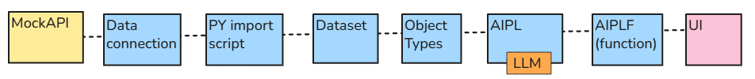

 

[← 3c Enterprise](/pal/) 

<!--  

_xxxxxxxxxxxxx_  -->

 

QS0 and QS1 had one focused goal — find the “needle in the haystack” — using simple and short demos. The goal of this DD is to cover the topics (hands-on) in the QS's in more detail and cover topics that were not in the QS's. 

<!-- The plan is to reference official PAL speedruns, demos, and examples in the DD. -->

This **Deep Dive (DD)** focuses on much more:
  - a broad, hands-on introduction to Foundry’s apps and techniques, not exhaustive depth in each one.
  - a wider tour of Foundry, with small, mechanistic exercises that show what each capability does, which app configures it, and how to verify it.
  - EQUATOR-SOUTH-NORTH
    - D1–D6 provide the EQUATOR backbone. 
    - SOUTH extensions introduce different sources and ingestion techniques; 
    - NORTH extensions introduce different analysis and interaction tools.
  - The guiding rule for DD is:
    - Introduce each app or technique through a small working example, connected to familiar data and mechanisms
    - That gives readers both breadth of exposure and a mental map of where each capability fits—without turning every introduction into a complicated project.

Below is the "master" diagram for the initial version of D1-D6.
-	D1: Import and transform data _(**[#692\_pal\_foundry\_d1\_data\_xforms\_.docx](https://drive.google.com/drive/folders/1-Adawag9uA8_bq-hDF-nOuPYaRLz1eEO)**)_
-	D2: Create object types and links from datasets _(**[#691\_pal\_foundry\_d2\_linked\_objects\_.docx](https://drive.google.com/drive/folders/1-Adawag9uA8_bq-hDF-nOuPYaRLz1eEO)**)_
-	D3: Interact with linked objects through the UI _(**[#690\_pal\_foundry\_d3\_ui\_.docx](https://drive.google.com/drive/folders/1-Adawag9uA8_bq-hDF-nOuPYaRLz1eEO)**)_
-	D4: Use Actions to change objects through the UI _(**[#689\_pal\_foundry\_d4\_actions\_.docx](https://drive.google.com/drive/folders/1-Adawag9uA8_bq-hDF-nOuPYaRLz1eEO)**)_
-	D5: Combine objects, AI, Actions, and human review _(**[#688\_pal\_foundry\_d5\_ai\_human\_.docx](https://drive.google.com/drive/folders/1-Adawag9uA8_bq-hDF-nOuPYaRLz1eEO)**)_
-	D6: Operate and govern the overall workflow _(**[#687\_pal\_foundry\_d6\_governance\_.docx](https://drive.google.com/drive/folders/1-Adawag9uA8_bq-hDF-nOuPYaRLz1eEO)**)_

_Foundry deep dive master diagram (ZAI original diagram verified by FDE)_ 

 

---

 

26.1123 (v1 26.1120)
