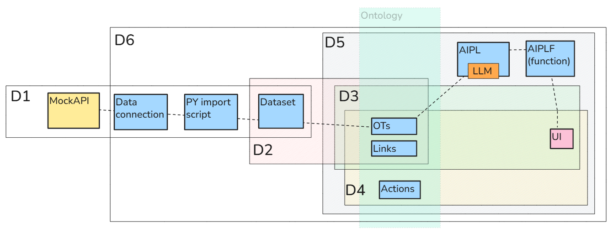

 

[← 3c Enterprise](/pal/) 

<!--  

_xxxxxxxxxxxxx_  -->

 

_See the 26.1124 chat after the diagram below._

QS0 and QS1 had one focused goal — find the “needle in the haystack” — using simple and short demos. The goal of this DD is to cover the topics (hands-on) in the QS's in more detail and cover topics that were not in the QS's. 

<!-- The plan is to reference official PAL speedruns, demos, and examples in the DD. -->

This **Deep Dive (DD)** focuses on much more:
  - a broad, hands-on introduction to Foundry’s apps and techniques, not exhaustive depth in each one.
  - a wider tour of Foundry, with small, mechanistic exercises that show what each capability does, which app configures it, and how to verify it.
  - EQUATOR-SOUTH-NORTH
    - D1–D6 provide the EQUATOR backbone. 
    - SOUTH extensions introduce different sources and ingestion techniques; 
    - NORTH extensions introduce different analysis and interaction tools.
  - The guiding rule for DD is:
    - Introduce each app or technique through a small working example, connected to familiar data and mechanisms
    - That gives readers both breadth of exposure and a mental map of where each capability fits—without turning every introduction into a complicated project.

Below is the "master" diagram for the initial version of D1-D6.
-	D1: Import and transform data _(**[#692\_pal\_foundry\_d1\_data\_xforms\_.docx](https://drive.google.com/drive/folders/1-Adawag9uA8_bq-hDF-nOuPYaRLz1eEO)**)_
-	D2: Create object types and links from datasets _(**[#691\_pal\_foundry\_d2\_linked\_objects\_.docx](https://drive.google.com/drive/folders/1-Adawag9uA8_bq-hDF-nOuPYaRLz1eEO)**)_
-	D3: Interact with linked objects through the UI _(**[#690\_pal\_foundry\_d3\_ui\_.docx](https://drive.google.com/drive/folders/1-Adawag9uA8_bq-hDF-nOuPYaRLz1eEO)**)_
-	D4: Use Actions to change objects through the UI _(**[#689\_pal\_foundry\_d4\_actions\_.docx](https://drive.google.com/drive/folders/1-Adawag9uA8_bq-hDF-nOuPYaRLz1eEO)**)_
-	D5: Combine objects, AI, Actions, and human review _(**[#688\_pal\_foundry\_d5\_ai\_human\_.docx](https://drive.google.com/drive/folders/1-Adawag9uA8_bq-hDF-nOuPYaRLz1eEO)**)_
-	D6: Operate and govern the overall workflow _(**[#687\_pal\_foundry\_d6\_governance\_.docx](https://drive.google.com/drive/folders/1-Adawag9uA8_bq-hDF-nOuPYaRLz1eEO)**)_

_Foundry deep dive master diagram (ZAI original diagram verified by FDE)_ 

 

---
---
---
---
---

 

# **944 ME1: question (1) --------------------------------**

below is text for qs1 (2nd qs) and qs3. 

qs1 uses ai, automation and governance. actions... 
many differences from qs0.

The problem i see with qs2 
- does not seem to intro much new. 

question (2)  ---------------------------------------------

is it possible to add to qs3 genuinely new stuff? 

- maybe demos of more north apps

-  but what is really interesting: 
    - maybe SOUTH datasources and AI stuff? might include
          -  4.4a Inference (AI) (v1 26.1124)
               LOCAL MODEL.
         -  4.4b Training (AI) (v1 26.1124)
              Train an existing model (using Foundry tools).

     -  4.6 Agentic (v1 26.1124)
         Interactive, event-triggered, or continuously hosted workflows, including model-directed tool use.

=========================

QS1 is also a “needle in the haystack” demo (using Foundry to identify records that match user-defined criteria), but

- Ch1: MockAPI (very simple external datasource that you control).
- Ch2/3/4: AI. MockAPI records are very few and simple. But the messy human language content is not simple for a computer without AI. This is core reason AI is used in Foundry.
- Ch5/6: Actions. AI calls actions to create ontology objects.
- Ch7/8/8a: Automation (scheduling dataset updates and updating objects).
- Ch8b: Governance (access control, monitoring (especially of AI), etc).

How QS1 differs from QS0:

- Focuses on Foundry mechanics and workflows (a small dataset, not a real-world search demo).
- Python scripts replace the pipeline.
- Actions, AI (AIPL and functions), automation and governance.

=========================

3.4 QS3 -- Broaden your Foundry skills

← 3c Enterprise

QS0 and QS1 had one focused goal — find the “needle in the haystack” — using simple and short demos. The goal of this DD is to cover the topics (hands-on) in the QS’s in more detail and cover topics that were not in the QS’s.

This Deep Dive (DD) focuses on much more:

- a broad, hands-on introduction to Foundry’s apps and techniques, not exhaustive depth in each one.
- a wider tour of Foundry, with small, mechanistic exercises that show what each capability does, which app configures it, and how to verify it.
- EQUATOR-SOUTH-NORTH
   - D1–D6 provide the EQUATOR backbone.
   - SOUTH extensions introduce different sources and ingestion techniques;
   - NORTH extensions introduce different analysis and interaction tools.
- The guiding rule for DD is:
    - Introduce each app or technique through a small working example, connected to familiar data and mechanisms
    - That gives readers both breadth of exposure and a mental map of where each capability fits—without turning every introduction into a complicated project.

Below is the “master” diagram for the initial version of D1-D6.

D1: Import and transform data (#692_pal_foundry_d1_data_xforms_.docx)
D2: Create object types and links from datasets (#691_pal_foundry_d2_linked_objects_.docx)
D3: Interact with linked objects through the UI (#690_pal_foundry_d3_ui_.docx)
D4: Use Actions to change objects through the UI (#689_pal_foundry_d4_actions_.docx)
D5: Combine objects, AI, Actions, and human review (#688_pal_foundry_d5_ai_human_.docx)
D6: Operate and govern the overall workflow (#687_pal_foundry_d6_governance_.docx)

 

---

 

## **FDE: Yes—your concern is justified.** 
**D1–D6 deepen the mechanics, but they do not yet deliver the breadth promised by “Broaden your Foundry skills.”** I assume “QS2” in question 1 means the current **QS3/D1–D6 series**.

## 1. What D1–D6 genuinely added

They are not redundant, but much of their value is **clearer understanding**, rather than entirely new capabilities.

| Module | Main addition beyond QS1 |
|---|---|
| **D1** | Cleaning, validation, rejected rows, joins, calculations, and enforced data-quality checks |
| **D2** | Two object types, explicit links, and navigation in both directions |
| **D3** | Selection-driven widgets, linked object sets, filtering, and aggregation |
| **D4** | Clear separation of dataset-backed values and saved object edits |
| **D5** | AI suggestions separated from human decisions and committed values |
| **D6** | Branch/proposal/merge workflow and a controlled two-user authorization test |

**Keep these as QS3’s foundation. Now add exercises that introduce genuinely different capabilities.**

Two wording corrections in your QS1 description:
- **Python scripts replace Pipeline Builder**, not “the pipeline”—Python transforms still form a pipeline.
- Our demonstrated Actions **modified existing objects**; they did not necessarily create new ones.

## 2. Recommended QS3 additions

I would prioritize the following—not another variation of the existing AI/Action chain.

| Proposed module | Small exercise | What is genuinely new |
|---|---|---|
| **D7: Analyze datasets and objects** | Answer a few questions over our existing data using **Contour**, then **Quiver** | North-side analysis beyond Workshop; dataset analysis versus object analysis |
| **D8: Add a different external source** | Import a small table from **Postgres**, if suitable infrastructure is available | A database connection and sync, rather than our custom MockAPI fetch |
| **D9: Train and use a small model** | Train a regression model on synthetic processing-job history; compare predicted and actual durations | Training, held-out evaluation, model versions, and inference |
| **D10: Run an open-weight model under controlled hosting** | Run a small extraction/classification task with a model hosted in an approved environment | Model hosting and integration—not merely selecting another AIP model |
| **D11: Build an interactive tool-using agent** | Ask an agent to find an Item and inspect its Group; examine the tool trace | Model-selected operations rather than a fixed AIPL sequence |
| **D12: Run the agent unattended** | Trigger the same task when work arrives; optionally extend it to a persistent worker | Event-driven agent execution and, separately, persistent hosting |

These are candidates; **D8, D10, and persistent hosting require an availability check before we commit to the tutorial**.

## 3. Clarify the two model topics

### “Local model”

We need to decide what **local** means:

- On your laptop?
- Hosted within your Foundry environment?
- Hosted on your own infrastructure and accessed from Foundry?

Those are different deployments. For QS3, I would initially target:

> **Run an open-weight model in an approved, controlled hosting environment and call it from Foundry.**

A separate Deep Dive can cover hardware, serving, scaling, and offline deployment.

### “Train an existing model”

There are also two distinct lessons:

- **Fit a standard model**, such as a tree-based regressor, to your dataset.
- **Fine-tune a pretrained model**, such as an image classifier or language model.

**Start with fitting a small regression model.** That teaches the complete training/evaluation/inference lifecycle without introducing the complexity of LLM fine-tuning. Fine-tuning can follow as a DD.

## 4. My suggested next move

**Start with model training**, because it most directly addresses your AI focus and adds a capability absent from QS1 and D1–D6. Use **#619** as a reference, but make the QS3 exercise smaller and explicitly bounded.

Then:
1. **North analysis tools**
2. **A different South source**
3. **Interactive agent**
4. **Unattended agent**
5. **Controlled model hosting**, once its prerequisites are established

Finally, remove the old **“This Deep Dive”** wording from the QS3 page. Its promise could be:

> **QS3 builds on QS0 and QS1, first making the core mechanisms explicit, then branching into new analysis tools, data sources, model training, and agent execution. Each capability is introduced through a small working exercise, with detailed extensions collected in the Deep Dives.**

**That makes D1–D6 the starting platform—not the full extent of QS3.**

 

---

 

# **946 ME2: yes, qs2 meant qs3.** 

for internal LLM i meant inside Foundry. hosted there. 

i see the LLM inference, training, local, remote and various types of agents as a big deal. i like your ideas.  

one question: can we import a Huggingface model into Foundry?

 

---

 

## **FDE2: Yes—Foundry supports importing Hugging Face model files** 

**and running the model inside Foundry.** That is different from calling Hugging Face’s hosted inference API.

### The basic path

**Hugging Face model files → Foundry storage → load in Python → run inference on Foundry compute**

The documented import options are:
- **Upload the model files as a raw-file dataset**, then load them from that dataset.
- **Download them from Python through explicitly configured network access** to Hugging Face. Foundry does not allow arbitrary internet access by default. :citation[Import a Hugging Face model / Hugging Face]{path="foundry/integrate-models/import-huggingface-models" section="Hugging Face"}

### Three separate milestones

| Milestone | What it means |
|---|---|
| **Import** | The weights, tokenizer, and configuration files are stored in Foundry |
| **Run** | Foundry compute loads the model and performs inference |
| **Serve/integrate** | Other workflows can invoke it through a defined model interface or service |

**Importing does not automatically put the model in AIP Logic’s model dropdown.** That integration is a separate step.

For an LLM, we must check **license, model compatibility, memory/GPU requirements, and the hosting capabilities available in your enrollment**.

### A good QS3 exercise

> **Import a small open-weight instruction model, run a prompt inside Foundry, and verify that inference uses the imported model.**

Start with **inference, not training or fine-tuning**. Once that works, expose it to another workflow; fine-tuning can follow as a separate exercise.

One documentation caveat: Palantir’s older **“Import an open source model”** functionality is deprecated, and its reference language-model adapters are no longer actively maintained. We should use a currently supported route rather than follow that old wizard. :citation[Import a Hugging Face model / Hugging Face]{path="foundry/integrate-models/import-huggingface-models" section="Hugging Face"}

**This is genuinely new coverage for QS3: bringing model weights into Foundry and executing them there—not merely choosing an existing AIP model.**

 

---

 

26.1124 (v1 26.1120)
