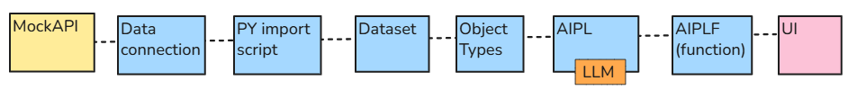
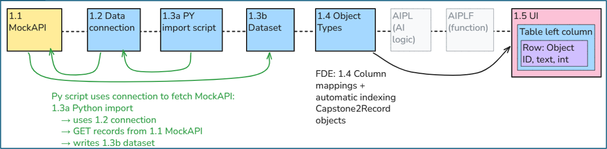
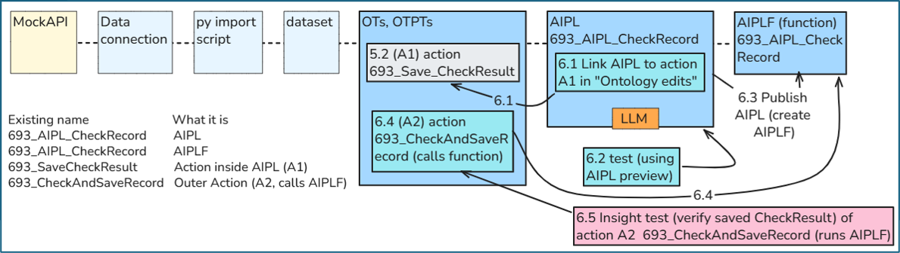
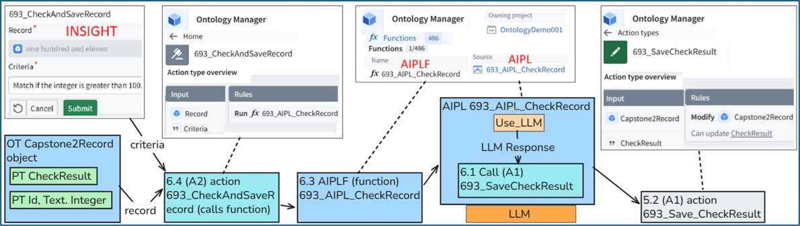
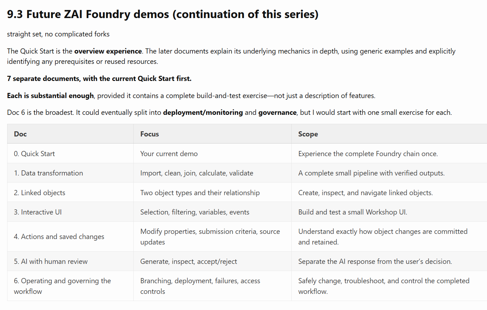

 

[← 3c Enterprise](/pal/) 

 

#### For the **latest QS version see [docx #693](https://drive.google.com/drive/folders/1-Adawag9uA8_bq-hDF-nOuPYaRLz1eEO)**.

 

<!-- - The main goal of this QS is accuracy and usefulness (that means constant updates). 
- Constant updates is best assured with markdown/PNG's (pics) extracted from the 693 docx source file by GPT.
- The PNG sizing is difficult for GPT to get right (GPT does adjust the width of the PNG based on text in the PNG; the result is an improvement, but I need to "hardcode" the width (in my docx file) to get things right).

**Why start learning Foundry with this QS**. I learned Foundry by doing the excellent speedruns (tutorials) from Palantir. These are perfect for enterprise software development professionals who are the traditional first-time users of Foundry (and who often become forward deployed engineers (FDE)). But I believe Foundry will soon become a standard tool for application development for a much broader market. Thats why I wrote (with the invaluable help of Foundry's excellent FDE AI assistant) this Foundry QS that makes it easier for non-specialists to learn Foundry basics. I believe the number of such potential users will increase dramatically in the near future.

-->

**Why start learning Foundry with this QS?** I learned Foundry by working through Palantir’s excellent Speedruns (tutorials). I found them well suited to people already experienced in enterprise software development. But I believe Foundry will become an application-development tool for a much broader audience. That is why I wrote this Quick Start — with invaluable help from Foundry’s AI FDE assistant — to make the fundamentals easier for non-specialists to understand. It uses small examples, explicit directions, and diagrams to explain the mechanics and help readers build with confidence.

 

**This QS shows how to build a "small" Foundry workflow** that 
- imports external data (from MockAPI), 
- displays it as objects (the ontology), 
- uses an LLM to process their properties, 
- saves the LLM response
- automates fetching/processing 
- tests basic governance controls 

Variations of the basic data flow chain (below) appear throughout this QS.

<!-- **Why learn how to do this... with Foundry?** Because in the modern enterprise, this is part of the core workflows for analyzing incoming data and, in particular, for using AI to analyze. Safely, reliably. 

**Why use this QS to get started?** Because this QS is very detailed and focuses on the mechanics of Foundry tools. The absolute simplest demos (with accurate instructions) to learn (without human assistance) how to use a very powerful toolset. -->

 

#### **TOC**
- **[What this QS offers beginners](/pal_693_qs_0a_best_demo/)**
- **[Short overview of all chapters (TOC)](/pal_693_qs_0a2_config_dias/)**
- **[0 First steps (Foundry sign up, FDE, project/folder, applications)](/pal_693_qs_0b_first_steps/)**
- **[1 Fetch MockAPI records and display in UI ("Workshop")](/pal_693_qs_1_mockapi/)**
- **[2 Create (1) AIPLF to detect matching digits in object text/integer properties / (2) UI to display result](/pal_693_qs_2_ailpf/)**
- **[3 Modify AIPL prompt to detect matching letter-only-text and integer-digits (display result in UI)](/pal_693_qs_3_aipl_prompt/)**
- **[4 Enter AI matching criteria (configure only AIPL+F and UI)](/pal_693_qs_4_criteria/)**
- **[5 Add an object property and Action to save the LLM response (used in Chapter 6)](/pal_693_qs_5_property_action/)**
- **[6 Add a text-save action (A1) call in AIPL / create AIPLF / create action (A2) to call AIPLF (use in Ch7)](/pal_693_qs_6_a1_a2/)**
  - **[pal_693_qs_0a2bbb_a2_aiplf_a1](/pal_693_qs_0a2bbb_a2_aiplf_a1/)**
- **[7 Add automation: "(new) object added to set" inits automation](/pal_693_qs_7_automation/)**
- **[7-2 Data lineage / scheduling confusion (chat)](/pal_693_qs_7-2_DL-S-confusion/)**
- **[8 Schedule (Data Lineage)](/pal_693_qs_8_schedule/)**
- **[8a (7b) Add processing of updated objects to automation](/pal_693_qs_8a_automate_updated/)**
- **[8b (8a) Governance](/pal_693_qs_8b_governance/)**
- **[9 (WIP) Continuing your Foundry education (where to go from here)](/pal_693_qs_9_where_next/)**
- **[10 (appendix) Generating webpage markdown+png's from the docx master](/pal_693_qs_10_docx_gen/)**

 

---

 

Note the following: 
- This QS is a work in progress (WIP).
- My working source file is an MS.Word docx. Conversion from docx to markdown requires that I keep the format of the docx as simple as possible (a docx internally is absolute chaos if you are not careful). The ideal solution would be for the LLM (GPT in this case) to look at the docx visual output and reproduce that. But for now GPT must look at the (binary) docx file (there are non binary representations, RTF?, but probably same complexity problems). So the formatting sometimes is quite crude. But the focus is up-to-date accurate info, not fancy formatting.
- Some of the variable names used need to be changed (to avoid confusion).
- Text is minimal because
  - The initial focus was on the screenshots and workflows. 
  - It only makes sense to fill out the text if a few people start to take an interest in the QS. Otherwise it will remain simply my personal learning project. And for my personal learning the focus is on creating more demos.
  - What a student really needs are the prompts to ask FDE while doing the demo. A QS focused on prompts. The reader can ask FDE for an explanation of the details. That would take a lot of effort, and negate the value of adding detailed text. 

<!-- #### **Workflow diagram examples**
ssss
_Workflow diagram for ch1_ 

_Workflow diagram for ch6_ 

_Workflow diagram (perspective 2) for ch6_ 

  

#### **Notes**

The FDE-generated text is factual, but for a human reader at times difficult to understand. After finishing the demo setup and test, I redid the H1 headings (it was a **[long discussion with FDE](/pal_693_ch_title_chats/)**, but basically all of my corrections were needed and correct except for one mistake). 

I also created diagrams to summarize the setup workflows. FDE can "see" these diagrams and is quite good at making useful suggestions or catching errors. 

-->

 

---

 

FDE chats:
- **[Chat about H1 headings](/pal_693_ch_title_chats/)**. 
- **[Chat about chapter 5 and the Use_LLM dialog](/pal_693_UseLLM_chat/)**.

 

---

 

_Possible **[future tutorials](/pal_693_qs_9_where_next/)** (same style as the QS)_ 

 

---

 

26.1112 (v1 26.1104)

<!-- 
- The priority is to prevent screenshots from appearing too large on the webpage.
- Examine the text size inside EACH screenshot individually.
- Adjust the width="xx%" in each  tag so the displayed screenshot text approximately matches normal webpage body text.
- Use 16px as the initial webpage text-size reference.
- Prefer slightly smaller screenshots rather than oversized ones.
- Do NOT use a fixed width percentage for all images.
- Do NOT resize the PNG files; adjust only the HTML width percentage.
- Preserve aspect ratios. Avoid unnecessary upscaling.

Image width override:
•	If width=35 (or any other number) appears immediately before an image in the DOCX, use that number as the HTML image width percentage (width="35%").
•	This overrides all automatic image-sizing rules. Do not inspect or recalculate the width.
•	Do not include the width=35 instruction itself in the generated Markdown.
•	If no width instruction is present, apply the normal image-sizing rules.

-->
