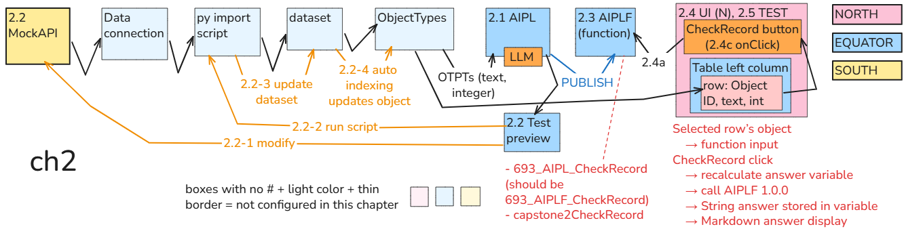
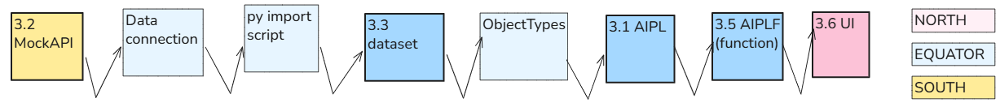
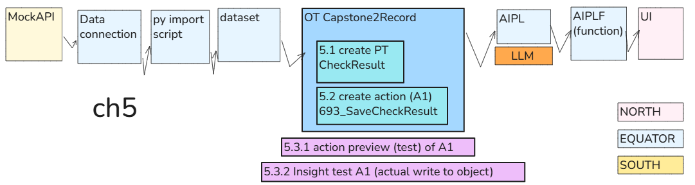
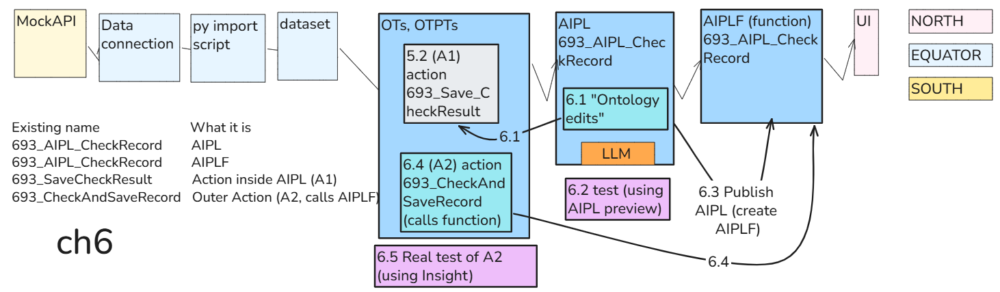
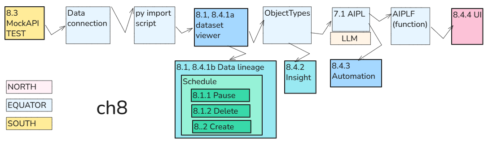

 

[← 3c Foundry QS](/pal_693_qs/)

 

_26.1106 17:12 (converted from docx source file to markdown+PNGs by ChatGPT)_

 

### **Workflow diagrams**

Below are the core diagrams for each chapter.

- The boxes are Foundry applications and tools.
- The box numbers are the section numbers of this demo.
- The boxes with bold text and a bold box are the apps/tools used in the chapter.

North/Ontology/South: Foundry docs have diagrams with

- **North.** User-facing applications and interactions.
- **Ontology**. Foundry’s core.
- **South**. External systems.

I made my own version of that main diagram (shown below for each chapter).

- **North.** User-facing applications and interactions  (Workshop UI, etc)
- **Equator**. Foundry’s integration, data, Ontology, and logic layer. I put far more into this layer than just Ontology.
- **South**. External systems outside Foundry (MockAPI).

 

#### **ch1**

 

#### **ch2**

 

#### **ch3**

 

#### **ch4**

 

#### **ch5**

 

#### **ch6**

 

#### **ch7**

 

#### **ch8**

<!-- 
+++++++++++++++++++++++++++++++++++++++++++

_26.1106 08:28 (converted from docx to md by GPT)_

 

### **Step-by-step directions with a laser-focus on core Workflows/concepts**

This quick start is laser-focused on 2 things:

- Detailed directions for learning hands-on the **core workflows** (with minimal text and diagrams).
- Extracting the core concepts along the way.
The demos are not "real-world". They focus strictly on teaching how Foundry works. Step by step. I created such a demo because I need such a demo and could not find one.

 

### **Accurate, numbered, up-to-date instructions**

1 My core doc source (working docs) are MS.Word docs. I can easily update them.

2 I use GPT to convert the docx file to webpages (markdown + pics).

This simple doc workflow allows me to update my webpages easily.

I might make a video in the future, but that video would be short (the core details are always on the webpage).

- The video does not get out of date so easily.
- Fewer errors get into the video.
- I could redo the vidoe easily if needed.

 

### **Workflow diagrams**

Below are the core diagrams for each chapter.

- The boxes are Foundry applications and tools.
- The box numbers are the section numbers of this demo.
- The boxes with bold text and a bold box are the apps/tools used in the chapter.
North/Ontology/South: Foundry docs have diagrams with

- **North.** User-facing applications and interactions.
- **Ontology**. Foundry’s core.
- **South**. External systems.
I made my own version of that main diagram (shown below for each chapter).

- **North.**** **User-facing applications and interactions  (Workshop UI, etc)
- **Equator**. Foundry’s integration, data, Ontology, and logic layer. I put far more into this layer than just Ontology.
- **South**. External systems outside Foundry (MockAPI).

 

#### **ch1**

 

#### **ch2**

 

#### **ch3**

 

#### **ch4**

 

#### **ch5**

 

#### **ch6**

 

#### **ch7**

 

#### **ch8**

-->
