<br>


[← 3c Foundry QS](/pal_693_qs/)


<br>

_26.1110 16:24 (converted from docx source file to markdown+PNGs by ChatGPT)_


**TOC**

- **[About the diagrams](#section-about-the-diagrams)**
- **[Ch0 First steps (Foundry sign up, FDE, project/folder, applications)](#section-0)**
- **[Ch1 Fetch MockAPI records and display in UI ("Workshop")](#section-1)**
- **[Ch2 Create (1) AIPLF to detect matching digits in object text/integer properties / (2) UI to display result](#section-2)**
- **[Ch3 Modify AIPL prompt to detect matching letter-only-text and integer-digits (display result in UI)](#section-3)**
- **[Ch4 Enter AI matching criteria (configure only AIPL+F and UI)](#section-4)**
- **[Ch5 Add an object property and Action to save the LLM response (use in Ch6)](#section-5)**
- **[Ch6 Add an AIPL call for text-save action (A1/Ch5) / "wrap" with AIPLF / create "wrapper" action (A2) for AIPLF (for Ch7)](#section-6)**
- **[Ch7 Add automation: "(new) object added to set" inits automation](#section-7)**
- **[Ch8 Schedule (Data Lineage)](#section-8)**
- **[Ch8a (7b) (WIP) Add processing of updated objects to automation](#section-8a)**
- **[Ch8b (8a) Governance](#section-8b)**
  - **[8b.1 Security policy](#section-8b-1)**
  - **[8b.2 Action access](#section-8b-2)**
  - **[8b.3 Inspect Action config/execution history](#section-8b-3)**
  - **[8b.4b Hypothetical "Control which data may be sent to LLMs" config/workflow](#section-8b-4b)**
- **[Ch9 (WIP) Continuing your Foundry education (where to go from here)](#section-9)**


This chapter provides a short overview (text + diagrams) of each remaining chapter.


<br>

<a id="section-about-the-diagrams"></a>

### **About the diagrams**


As an example, take the diagram for Ch3.


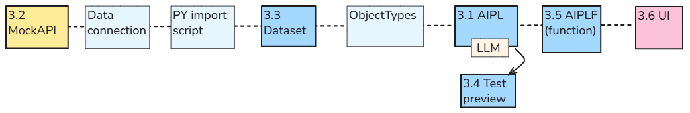


- The boxes represent applications, tools, and resources such as datasets, object types, and functions.
- The box numbers are the section numbers of this demo.
- **Your configuration/testing tasks are show in bold ****boxes with bold ****numbered ****text**.
- **The horizontal chain provides workflow context. Numbered, bold-bordered boxes identify this chapter’s configuration and testing steps.**


This demo using background color to classify Foundry apps into 3 groups.


- **North.** User-facing applications and interactions  (Workshop UI, etc)
- **Equator**. Foundry’s integration, data, Ontology, and logic layer. This quick start puts far more into this layer than just Ontology.
- **South**. External systems outside Foundry (MockAPI).


The following shows the color coding


  - 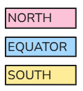

  

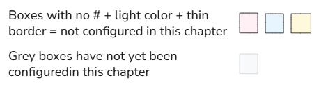


This is variation of the original Foundry diagram (https://www.palantir.com/docs/foundry/architecture-center/ontology-system )that had the following classifications:


- **North.** User-facing applications and interactions.
- **Ontology** (only Ontology).
- **South**. External systems. 

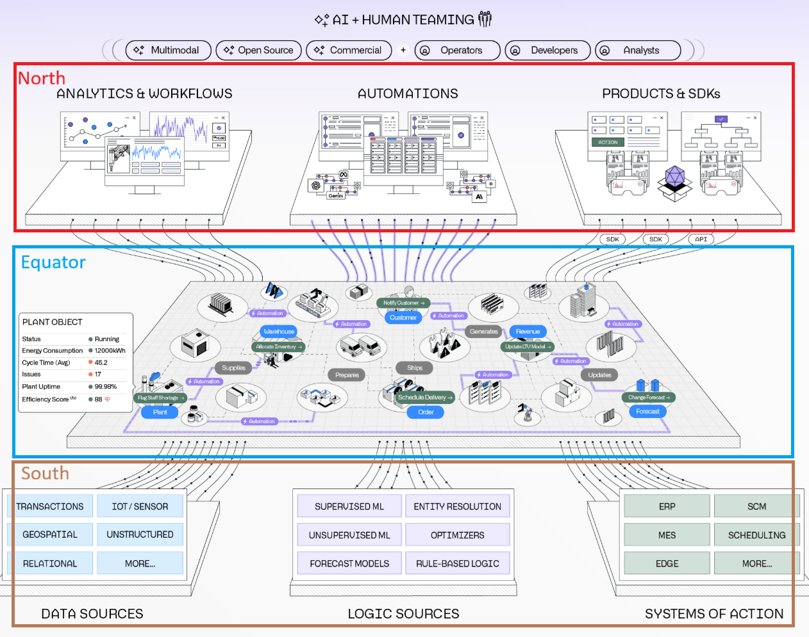


<br>

<a id="section-0"></a>

### **Ch0 First steps (Foundry sign up, FDE, project/folder, applications)**


The diagram below shows the first steps. See Ch0 for details.


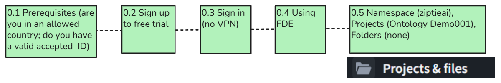


<br>

<a id="section-1"></a>

### **Ch1 Fetch MockAPI records and display in UI ("Workshop")**


**Summary**


Bring in a few records from MockAPI and display the record text and numbers in a table.


No AI.


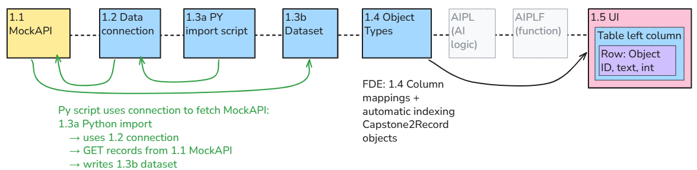


**Configuration  (numbered steps in diagram above)**


- 1.1 MockAPI — three source records
- 1.2 Connection allowing Foundry to read MockAPI (1.2 is connection configuration, not another set of data records. The import uses that connection to fetch the records.)
- 1.3a PY script for importing to the dataset.
- 1.3b Stored dataset (693_MockAPI_Items).
- 1.4 Create object types (ontology) from the dataset.
- 1.5 UI table displays those objects. UI Column-to-property mappings + automatic indexing (Capstone2Record: three objects)


**Workflow (TODO)**


<br>

<a id="section-2"></a>

### **Ch2 Create (1) AIPLF to detect matching digits in object text/integer properties / (2) UI to display result**


**Summary**


Select a record in the table, press a button, and display the AI’s answer. **Leave the record unchanged.** Ordinary code could perform this check without AI. We use AI here to learn the connection mechanics with an answer that is easy to verify. Chapter 3 will change what the AI checks.


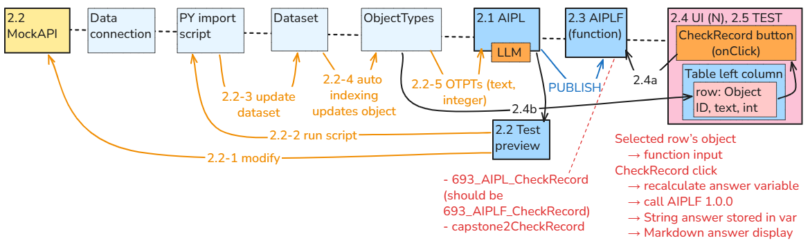


**Configuration/verification (numbered steps in diagram above)**


- 2.1 Create AIPL (AI platform logic, allowing safe controlled access to AI). 

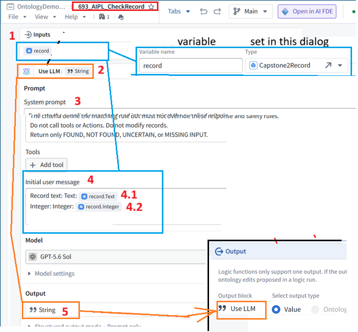
- 2.2 Do a test preview of AIPL access to object types.
- 2.2-1 Modify a record in MockAPI.
- 2.2-2 Run the PY script to import from MockAPI.
- 2.2-3 Update the dataset.
- 2.2-4 Import dataset contents into the ontology (create objects).
- 2.2-5 AIPL now has access to the object (index, text, integer properties).
- 2.3 Publish AIPL (create an AIPLF: a function "wrapper" around AIPL).
- 2.4 In the UI
- 2.4a Add the “Check record” button for calling the AIPLF. Add the click event for the button.
- 2.4b Add a table that displays rows of objects.


**Workflow**


Select the record in UI


```json
  {
  "id": "1",
  "text": "Reference 111 received",
  "integer": 111
  }
```


click on button


calls AIPLF

  which calls AIPL,  
  which retrieves the ontology record,  
  AIPL calls AI model to generate  FOUND  

FOUND is returned back up that chain and displayed in UI


<br>

<a id="section-3"></a>

### **Ch3 Modify AIPL prompt to detect matching letter-only-text and integer-digits (display result in UI)**


**Summary**


You change the prompt in AIPL (AIPL structure/connectiosn DO NOT CHANGE... see diagram for ch3 above).


that requires a lot of modifications in the data chain.


(new MockAPI record to test, new build to dataset, AIPLF (must reference new AIPL version), and UI (must ref new AIPLF version)


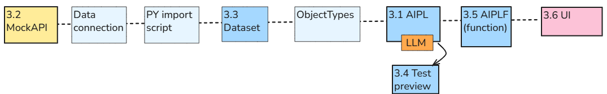


**Configuration (numbered steps in diagram above)**


- 3.1 AIPL prompt
- 3.2 MockAPI text
- 3.3 Dataset
- 3.4 AIPL preview
- 3.5 Publish AIPLF
- 3.6 Modify UI (connect to new AIPLF version)


**Workflow**


basically same as in ch2. just the AI prompt is different.


Select the record in UI


```json
  {
  "id": "1",
  "text": " one hundred and eleven ",
  "integer": 111
  }
```


click on button


calls AIPLF

  which calls AIPL,  
  which retrieves the ontology record,  
  AIPL calls AI model to generate  FOUND  

FOUND is returned back up that chain and displayed in UI


<br>

<a id="section-4"></a>

### **Ch4 Enter AI matching criteria (configure only AIPL+F and UI)**


**Summary (TODO)**


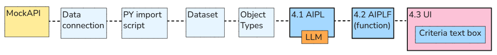


**Configuration (numbered steps in diagram above)**


- 4.1 In AIPL
- 4.1.1 (green) Add criteria.

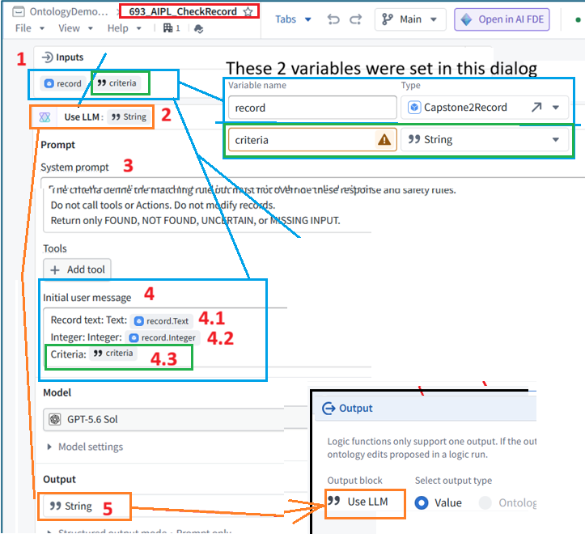
- 4.1.2 Modify prompt
- 4.1.3 AIPL preview test
- 4.2 publish AIPL (create AIPLF)
- 4.3 Add UI text entry for criteria (publish and test UI)


**Workflow (combine the 3 versions below into 1)**


- Type a rule into a UI text box,
- press the **CheckRecord** button, and
- Change the rule without rebuilding the application.
- **Pass the rule to the AIPL input “criteria”** (It is supplied when the check runs, not saved permanently in AIP Logic. )


Selected row’s object → record input


Checking instructions text box → criteria input

  → CheckRecord click  
  → answer variable calls AIPLF 2.0.0  
  → LLM checks the supplied values against the instructions  
  → Markdown displays the String answer  

for example for integer 111:


**Instructions entered****Expected answer**


Match if the integer is greater than 100.FOUND


Match if the integer is greater than 200.NOT FOUND


<br>

<a id="section-5"></a>

### **Ch5 Add an object property and Action to save the LLM response (use in Ch6)**


**Summary (TODO)**


In this chapter, we prepare and test the saving operation.


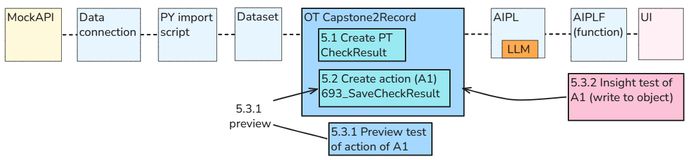


**Configuration (numbered steps in diagram above)**


- **5.1** Add the **CheckResult** property to the **Capstone2Record** object type.
- **5.2** Create the **693_SaveCheckResult** Action to save a String in **CheckResult**.
- **5.3** Test the Action using manually entered test text.


**Workflow**


1. Select an object + enter test text
2. AI checks a selected **Capstone2Record object** using the supplied criteria.
3. The **LLM text response** (FOUND, NOT FOUND, etc.) is saved in that object’s **CheckResult** property using **693_SaveCheckResult**.


<br>

<a id="section-6"></a>

### **Ch6 Add an AIPL call for text-save action (A1/Ch5) / "wrap" with AIPLF / create "wrapper" action (A2) for AIPLF (for Ch7)**


**Summary**


- Add text save action 693_SaveCheckResult (A1) to AIPL.
- Test AIPL.
- Create function AIPLF.
- Create the AIPLF "wrapper" action 693_CheckAndSaveRecord (A2) (call to run AIPLF).
- Test action A2 (in Insight).


For a chat about the details of why you need to do this, see https://ziptieai.com/pal_693_qs_0a2bbb_a2_aiplf_a1/ .


Configuration diagram (shows the MockAPI to UI chain... UI not shown).


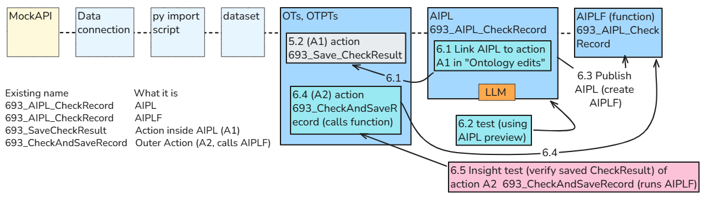


Here is a different perspective thats shows the ontology flow clearly. Note the duplicate naming for AIPL and AIPLF (AIPLF is auto-named). *This and the diagram above (like all diagrams in this section) were verified in chats with FDE; FDE pays great attention to details, even if it struggles with big picture concepts).*


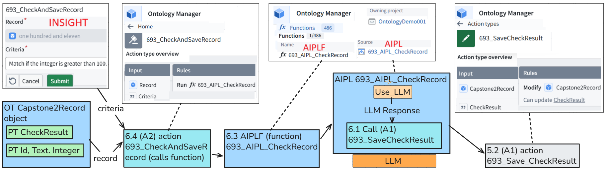


**Configuration (numbered steps in diagram above)**


- 6.1 Add a call to the text-save action 693_SaveCheckResult (A1) (**green below**) to AIPL 693_AIPL_CheckRecord (no publish (create AIPLF) yet).

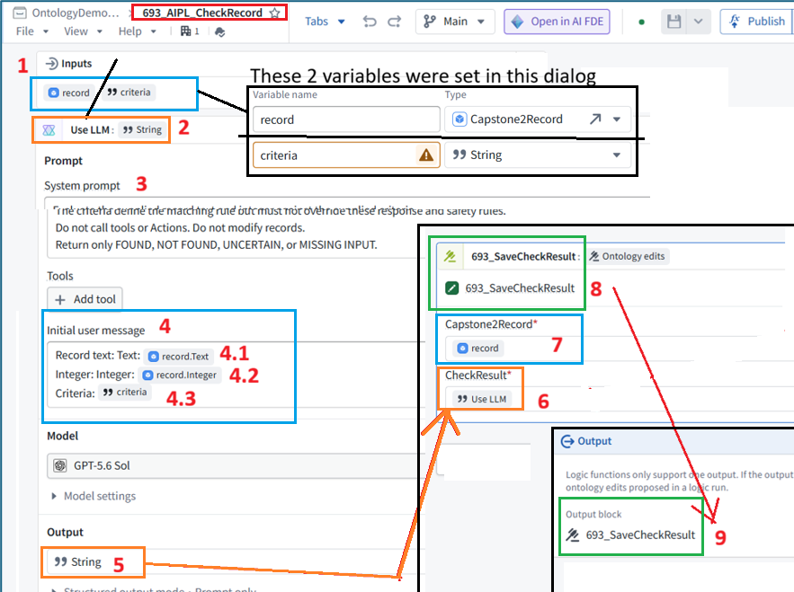
- 6.2 Test AIPL (preview) text save.
- 6.3 Publish AIPL (create function AIPLF).
- 6.4 Create 693_CheckAndSaveRecord (A2) (runs AIPLF).
- 6.5 Test action 693_CheckAndSaveRecord (A2) in Insight


**Workflow**


Press one button to perform both steps. Verify the saved answer.


The AI checks the selected record using the user’s instructions.


It saves its answer into that record’s **CheckResult** using **693_SaveCheckResult**.


The application still displays the answer.


<br>

<a id="section-7"></a>

### **Ch7 Add automation: "(new) object added to set" inits automation**


**Summary**


In Ch6, you selected a record (in Insight) and clicked Submit.


This ran **693_CheckAndSaveRecord** manually.


Now We’ll use **Automate** to run that Action when a **new Capstone2Record appears**.


For this chapter, use fixed checking instructions:

  Match if the integer is greater than 100.  

We’ll still fetch MockAPI records **manually**. Scheduling the fetch comes in Chapter 8.


*Note: FDE agrees with this diagram. But even if there are some errors in this diagram (its possible), the diagram will still give you the right mental model to understand the mechanics of basic automation. *


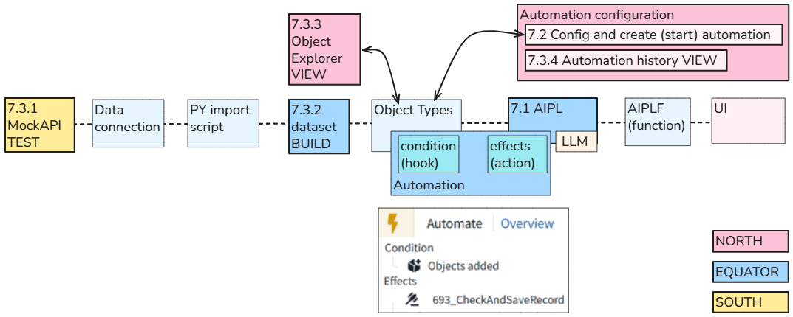


**Configuration**


7.2 Automation represents the Automate configuration screen (North).


**Workflow**


- Add a record in MockAPI and manually fetch the latest data (with manual dataset build).**Manual fetch → new object → automatic AI check → saved CheckResult**
- Verify that the new record is checked and its answer saved without pressing the checking button.You manually fetched the records, but did **not** manually run the check.


<br>

<a id="section-8"></a>

### **Ch8 Schedule (Data Lineage)**


**Summary**


Schedule the Python import to fetch MockAPI records into **693_MockAPI_Items (dataset) every two minutes**.


**NOTE: Limitation:** the import fetches new and updated records, but the Chapter 7 automation processes **only newly added objects**. Updating an existing object does not trigger another AI operation.


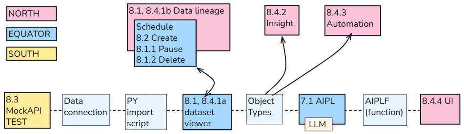


**Configuration**


- Delete the old build schedule, **if one exists**.
- Create a new build schedule.


**Workflow**


1. In **MockAPI**, add an item with a **new, unused Id**, preserving the existing items.
2. Wait for the scheduled import. **Do not manually click Build or run an Action.**
3. Trace the result:
   - **Dataset viewer → 693_MockAPI_Items (dataset):** verify the new row.
   - **Data Lineage → build schedule → Metrics & History:** verify a successful scheduled build.
   - **Insight → Capstone2Record objects:** verify the new object and its saved **CheckResult**.
   - **Automate → 693_AIPL_CR_Automation (automation) → history:** verify successful execution for the new object.
   - **Workshop → 693_RecordViewer (your UI):** verify the new object appears in the table.
4. In **Data Lineage**, **pause the build schedule** after testing.


<br>

<a id="section-8a"></a>

### **Ch8a (7b) (WIP) Add processing of updated objects to automation**


Note: This was 7b. I need to update diagrams.


The Chapter 7 automation processes **only newly added objects**. Updating an existing object does not trigger another AI operation. modify in 7b so that automation processes updated objects.


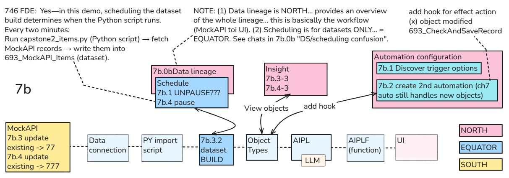


<br>

<a id="section-8b"></a>

### **Ch8b (8a) Governance**


Note: This was 8a. I need to update diagrams.


<br>

<a id="section-8b-1"></a>

#### **8b.1 Security policy**


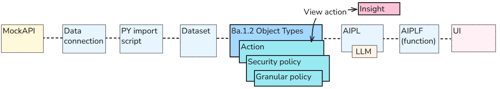


<br>

<a id="section-8b-2"></a>

#### **8b.2 Action access**


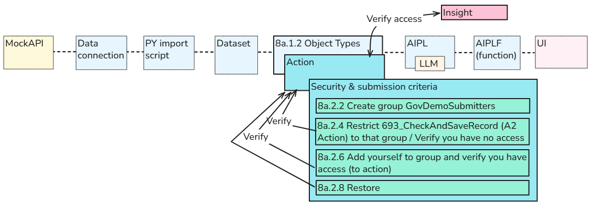


<br>

<a id="section-8b-3"></a>

#### **8b.3 Inspect Action config/execution history**


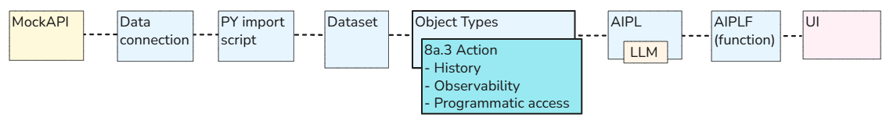


<br>

<a id="section-8b-4b"></a>

#### **8b.4b Hypothetical "Control which data may be sent to LLMs" config/workflow**


**Summary**


Note:  A trial user does not have access to this functionality. So this section simply describes the hypothetical (untested) config/workflow proposed by FDE.


**Configuration / workflos**


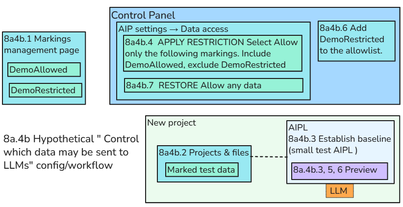


<br>

<a id="section-9"></a>

### **Ch9 (WIP) Continuing your Foundry education (where to go from here)**


There will be some kind of diagram for this section in the near future. The following shows the current proposed sections.


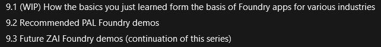
