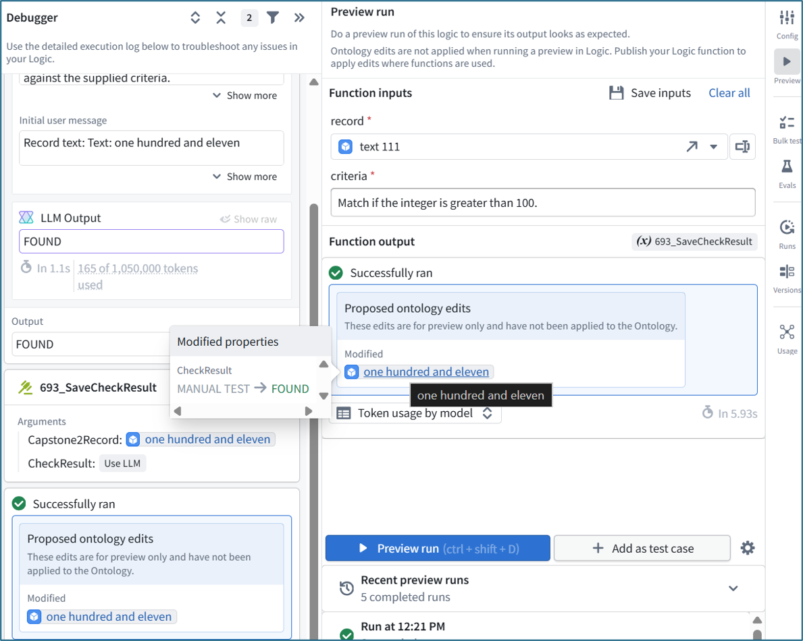
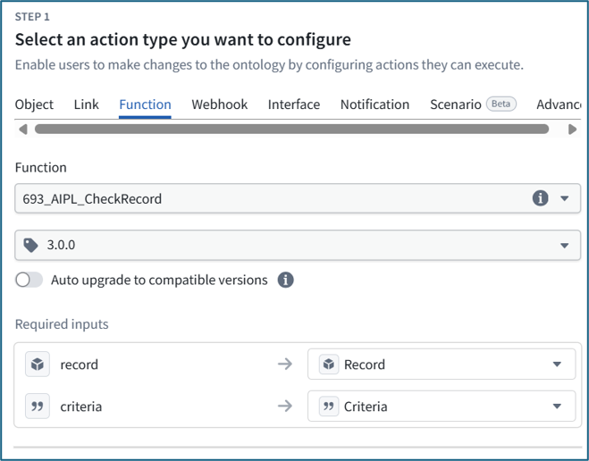
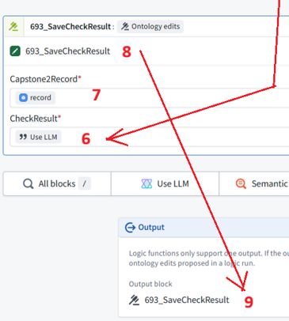

 

[← 3c Foundry QS](/pal_693_qs/)

 

_26.1108 05:34 (converted from docx source file to markdown+PNGs by ChatGPT)_

 

## **a1/a2/aiplf**

**TOC**

- **[1 final chat and summary](#section-1-final-chat-and-summary)**
  - **[FDE 494](#section-fde-494-2)**
  - **[ME 495](#section-me-495-2)**
  - **[FDE 496](#section-fde-496-2)**
- **[THE FULL SET OF CHATS (for just 26.1108 morning; I had several chats over the past week)](#section-the-full-set-of-chats-for-just-26-1108-morning-i-had-several-chats-over-the-past-week)**
  - **[ME 474](#section-me-474)**
  - **[FDE 475](#section-fde-475)**
  - **[ME 476](#section-me-476)**
  - **[FDE 477](#section-fde-477)**
  - **[ME 478](#section-me-478)**
  - **[FDE 479](#section-fde-479)**
  - **[ME 480](#section-me-480)**
  - **[FDE 481](#section-fde-481)**
  - **[ME 482](#section-me-482)**
  - **[FDE 483](#section-fde-483)**
  - **[ME 484](#section-me-484)**
  - **[FDE 485](#section-fde-485)**
  - **[ME 486](#section-me-486)**
  - **[ME 487](#section-me-487)**
  - **[ME 488](#section-me-488)**
  - **[ME 489](#section-me-489)**
  - **[FDE 490](#section-fde-490)**
  - **[ME 491](#section-me-491)**
  - **[FDE 492](#section-fde-492)**
  - **[ME 493](#section-me-493)**
  - **[FDE 494](#section-fde-494-2)**
  - **[ME 495](#section-me-495-2)**
  - **[FDE 496](#section-fde-496-2)**

 

### **1 final chat and summary**

It took me over an hour of conversation with FDE to finally get to the gist of why this demo has 

- action A2

    - wrapping AIPLF

          - which wraps AIPL

                - which wraps a1.

A1 can not commit because there is a rule that if the action is wrapped inside a AIPL/F, it can not "commit" a change (the change is only proposed). It took me hours of chats over a week to finally get the straight answer. FDE is great, but if something is not written in the docs and FDE can not use RAG to ingest it, then it takes a while for FDE's built in logic to process things.

below are the final prompts/responses of the chat (this is only the chat of 26.1108... I attempted to get this out of FDE several times earlier). 

 

#### **FDE 494**

You’re right. **“Save” and “commit” meant the same thing here**, and switching words obscured the distinction.

Consistent wording:

- **Submit A1 directly:** commits the property change.
- **Call A1 inside AIPL/F:** produces pending edits; does not commit them.
- **Submit A2, which calls AIPLF:** commits those edits.

 

#### **ME 495**

Thats all i needed. the 3 lines you wrote above. and the addition "this is a built in rule". Has this clear explanation appeared previously?

 

#### **FDE 496**

**The pieces appeared earlier, but not together in those three consistent lines with “this is a built-in rule.”** I should have presented it that way much sooner.

 

### **THE FULL SET OF CHATS (for just 26.1108 morning; I had several chats over the past week)**

 

#### **ME 474**

Why have A2 (AIPLF (AIPL (A1)))? A1 wrapped in AIPL/F wrapped in A2?

 

#### **FDE 475**

Because **A1 and A2 do different jobs**:

Part

   - Job in this demo

A1 — 693_SaveCheckResult

   - Defines the property change: save supplied text in CheckResult.

AIPL / published AIPLF

   - Gets the LLM response, then passes it and the selected object to A1. This produces proposed edits.

A2 — 693_CheckAndSaveRecord

   - Calls AIPLF and commits those edits. Insight and Automate run A2.

So the execution is:

**A2 → AIPLF runs the AIPL workflow → LLM response → A1 proposes the save → A2 commits it.**

**AIPL and AIPLF are not two nested execution layers:** AIPLF is the published function version of AIPL.

We used **A1** so you could first build and test saving text independently in Chapter 5. **A2** is required to commit the edits produced by the complete AI workflow.

 

#### **ME 476**

sorry, but is very confusing... what changes in the object between after A1 and befoer A2?

 

#### **FDE 477**

**Nothing changes in the saved object after A1 runs inside AIPLF.**

For example:

- **Before:** CheckResult contains MANUAL TEST.
- **A1 runs inside AIPLF:** proposes replacing it with FOUND. The saved property still contains MANUAL TEST.
- **A2 commits the edit:** CheckResult now contains FOUND.

A2 starts the whole operation and commits at the end—it is not a separate step you run afterward.

 

#### **ME 478**

why not commit in a1?

 

#### **FDE 479**

Because **Foundry does not commit an Action separately when it is called inside AIPL**. Its edits become part of the outer Action’s transaction.

- **Run A1 directly:** A1 saves the property.
- **Call A1 inside AIPL:** A1 proposes the edit; A2 commits it when the complete workflow succeeds.

This prevents an intermediate save from remaining if a later step in the workflow fails.

 

#### **ME 480**

This is very confusing... so there is a built in rule (this is a real rule) that in this case does not alllow a1 to commit the object (inpu to a1 is capston2record) but a2 can (input to a2 is capstone2record)

 

#### **FDE 481**

**Yes—that is a built-in execution rule.** The difference is **not** the input object; both receive the same Capstone2Record object.

The difference is **how the Action is run**:

- **A1 called inside AIPL:** produces proposed edits; cannot commit them.
- **A2 submitted from Insight or Automate:** runs the workflow and commits its edits.

**A1 can also commit when submitted directly**, as it did in Chapter 5. So A2 has no special privilege—the outermost submitted Action is the commit boundary.

 

#### **ME 482**

so a1 can not commit because its basically inside another action? or because its inside an AIPF/L?

 

#### **FDE 483**

**Because it is called inside AIPL—not simply because another Action surrounds it.**

Even in **AIPL Preview, where no A2 is running**, A1 only produces proposed edits.

- **A1 inside AIPL:** proposes edits.
- **A1 submitted directly:** commits edits.
- **A2 calling AIPLF:** commits the edits produced by that workflow.

 

#### **ME 484**

so that the rule. an action inside AIPL/F (which is called a TOOL) can not make object commits.

 

#### **FDE 485**

**Yes: an Action called inside AIPL/AIPLF proposes object edits; it does not commit them.**

One terminology distinction: **our A1 is an Action block**, not an LLM tool. It runs after **Use LLM**. An Action exposed as an LLM tool would also only propose edits in this context.

 

#### **ME 486**

 

#### **ME 487**

 

#### **ME 488**

 

#### **ME 489**

"To apply the function’s proposed edits, it must be called through an Action."
So if we called A1 just by itself, at hte top of the "loop", then the change woudl be committed.
but inside AIPL/F the action becomes an "ontology edit" (pic 3)
which means it requires anohter action that calls the AIPL/F (pic2).

 

#### **FDE 490**

**Yes—that is correct.**

- **Submit A1 directly:** it saves the supplied text in the object’s **CheckResult** property.
- **Call A1 inside AIPL/F:** it produces **proposed Ontology edits**, without committing them.
- **Submit A2, which calls AIPLF:** the proposed edits are committed.

One wording refinement: A1 does not *become* an Ontology edit. **It remains an Action; its output inside AIPL is proposed Ontology edits.**

 

#### **ME 491**

so why add the word "proposed" to the AI in pic 3??????????????????????????????

 

#### **FDE 492**

Thinking complete

**“Proposed” is my explanation—not part of A1’s name or the label in picture 3.** The UI says **“Ontology edits.”**

I added it to mean **edits not yet committed**. For your diagram, keep the exact UI label **“Ontology edits”** and explain once:

**These edits are saved only when A2 runs the AIPLF.**

 

#### **ME 493**

"Submit A1 directly: it saves the supplied text in the object’s CheckResult property.
Call A1 inside AIPL/F: it produces proposed Ontology edits, without committing them.
Submit A2, which calls AIPLF: the proposed edits are committed."

why in the first bullet you avoided hte word "commit"... here "save" = "commit". "proposed" = not commited, only pending.

 

#### **FDE 494**

You’re right. **“Save” and “commit” meant the same thing here**, and switching words obscured the distinction.

Consistent wording:

- **Submit A1 directly:** commits the property change.
- **Call A1 inside AIPL/F:** produces pending edits; does not commit them.
- **Submit A2, which calls AIPLF:** commits those edits.

 

#### **ME 495**

Thats all i needed. the 3 lines you wrote above. and the addition "this is a built in rule". Has this clear explanation appeared previously?

 

#### **FDE 496**

**The pieces appeared earlier, but not together in those three consistent lines with “this is a built-in rule.”** I should have presented it that way much sooner.

