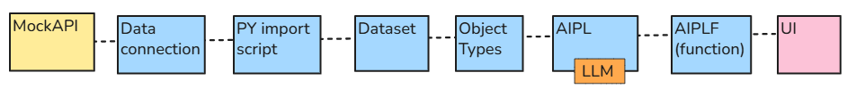

 

[↑ 3c Foundry QS](/pal_693_qs/)

[→ Short overview of all chapters (TOC)](/pal_693_qs_0a2_config_dias/)

_26.1111 07:59 (converted from docx source file to markdown+PNGs by ChatGPT)_

 

This QS provides what you need to learn Foundry basics as quickly as possible (several days).  The basics in this QS require a bit of effort and training to master. But you need to understand them before trying "real-world" demos.

**TOC**

- **[The Foundry app built (from scratch) in this QS](#section-0a-2)**
- **[Step-by-step directions with a laser-focus on core workflows/concepts (never getting stuck)](#section-0a-3)**
- **[The current QS version shows you what we (FDE and I) did](#section-0a-4)**
- **[Constant updates](#section-0a-5)**
- **[About the heading numbering](#section-0a-6)**
- **[Future Youtube videos](#section-0a-7)**
- **[The origins of this QS](#section-0a-1)**

 

### **The Foundry app built (from scratch) in this QS**

This QS shows how to build a "small" Foundry workflow that **imports external data, displays it as objects, uses an LLM to process their properties, and saves the LLM response**. Then automate the fetching and processing, and test basic governance controls. The basic data flow chain is show in the diagram below. You will be variations of this core backbone in almost all diagrams.

We use simple **Text** and **Integer** values so you can focus on Foundry’s mechanics rather than a business scenario.

**The main chain**

- **MockAPI:** holds the external records that Foundry will fetch.
- **Data connection:** gives the Python script approved access to MockAPI.
- **Python import script:** fetches the records and writes them into a dataset.
- **Dataset:** stores the imported rows inside Foundry.
- **Object type:** defines how those rows become **Capstone2Record objects**, with properties such as **Text** and **Integer**.
- **AIPL (AIP Logic workflow):** sends the selected object’s property values and your instructions to an LLM.
- **AIPLF (published function):** makes that AIPL workflow available for the UI or an Action to call.
- **UI (built in Workshop):** displays the objects and lets you select one, enter instructions, and request an LLM response.

**What we add afterward**

- **Actions:** commit the LLM response to the object’s **CheckResult** property.
- **Automations:** run the AI operation when objects are added or their monitored properties change.
- **Build schedule:** runs the Python import every two minutes.
- **Governance controls:** demonstrate who can see objects and submit Actions, and inspect execution history.

**By the end, you will have built and traced the complete path from an external record to a saved LLM response.**

 

### **Step-by-step directions with a laser-focus on core workflows/concepts (never getting stuck)**

Foundry is a very large application. Learning to navigate the configuration, workflows, dialogs is a challenge in and of itself. You will succeed at learning Foundry if you focus on learning the details, not on finishing lessons quickly (forget about the "quick" in QS).

But this QS will make this process as fast a possible. This QS is laser-focused on 3 things:

- Learning hands-on the **core configurations/workflows** (with minimal text and diagrams). The next chapter "config and workflows" provides overview diagrams and text for chapters 0-8a.
- **Detailed directions. step by step**.  Never getting stuck.
- **Understanding exactly what your are doing and why, the mechanics, the Foundry concepts**. Not struggling to understand a complex real-world demo, but the mechanics of a bare bones demo.

Foundry is an application that take a new approach to a new paradigm: Using an "ontology" and AI within an enterprise. You cant simply spend an hour on a demo and master the basics. It takes training. And you need master those trained concepts before trying to tackle real world problems.

 

### **The current QS version shows you what we (FDE and I) did**

But the goal is a QS that tells you how to work with FDE to replicate what we did. This means the prompts that you need to ask FDE. FDE is game changer. In the future you wont simply read a tutorial and try to replicate what the author did, but rather prompt your AI assistant to help you do the tutorial. But I was not an expert when I created this QS (which is actually a plus, since I understand quite well what a new user needs to learn Foundry), and so in its current form, the QS focuses on what I did. There were many complicated chats with FDE (FDE is not intelligent, and its a very back and forth process you yourself dont know exactly what prompts to ask), and converting those chats into a clean description of what we needed to do from the beginning was not a simple process.

 

### **Constant updates**

Creating the original QS content in MS.Word allows me to focus on configuring Foundry and getting the details down on paper. The docx is easy to reorganize and update. However, the process I use to convert to markdown and PNG's is still not perfect. And at some point when the content stabilizes, I may abandon this conversion process and work directly in markdown.

But for now the webpage text/diagrams will be generated by ChatGPT from a single docx source file. The docx is converted to webpages (markdown + pics) by ChatGPT using a single (large) prompt. The resulting webpages are not perfect, but whenever a mistake is discovered, the docx is quickly updated. The next website update rewrites the entire contents of one or more chapters.

 

### **About the heading numbering**

All heading numbers in the docx were manually added. The main reason for this was so that FDE and I could easily remember specific parts of the QS (heading text changed quite often). Once the QS stabilizes, I will tell GPT to renumber all of the headings.

 

### **Future Youtube videos**

There might might Youtube video overviews of this (and hopefully other) demos. But these videos will

- Have a limited lifetime. When the video is outdated, it will be redone.
- Focus on high level explanations of what the webpage explains. The docx/webpages remain as the authoritative demo source.

 

### **The origins of this QS**

I (the author of this QS) worked alone with FDE (Fondry's built-in AI) to build this QS. Without human assistance. At the time I started this QS, I had just a few months experience with Foundry. I had done several Foundry demos (you can find my versions of those demos on the website), and the more I understood, the more I wanted to create Foundry docs that showed how to learn Foundry from a different perspective.

This QS is the first of a series of tutorials I plan to write over the next 6 months.  The first version of this QS I documented in MS.Word (docx file format). There was a lot of trial and error. FDE is an incredible tool, but it is AI, and AI is (despite everything you hear) not intelligent. To write anything original requires human intelligence to guide the AI. We (FDE and I) then wrote a follow-on (QS part 2) that worked, but did not go smoothly. The resulting QS-2 was too complicated, and did not demo the core concepts in the simplest way possible.

This is QS-3 (version 3). The third attempt. And the results were quite good. Not perfect, but good enough for publiication. Good enough so that you (the reader who wants to get started with Foundry) can follow the directions without getting stuck. And understand not only how to do something, but why.

The formatting of this QS (in particular the screenshots and diagram sizes) is still not perfect. I am still perfecting the process of prompting ChatGPT (GPT) to convert the docx into markdown and PNG (image) files.

