 

[← 3c Foundry QS](/pal_693_qs/)

_26.1111 07:59 (converted from docx source file to markdown+PNGs by ChatGPT)_

 

This chapter provides a short overview of each remaining chapter. Just click on the webpage heading link to go to that chapter.

**TOC**

- **[About the diagrams](#section-0b-1)**
- **[Ch0 First steps (Foundry sign up, FDE, project/folder, applications)](#section-0b-2)**
- **[Ch1 Fetch MockAPI records and display in UI ("Workshop")](#section-0b-3)**
- **[Ch2 Create (1) AIPLF to detect matching digits in object text/integer properties / (2) UI to display result](#section-0b-4)**
- **[Ch3 Modify AIPL prompt to detect matching letter-only-text and integer-digits (display result in UI)](#section-0b-5)**
- **[Ch4 Enter AI matching criteria (configure only AIPL+F and UI)](#section-0b-6)**
- **[Ch5 Add an object property and Action to save the LLM response (use in Ch6)](#section-0b-7)**
- **[Ch6 Add an AIPL call for text-save action (A1/Ch5) / "wrap" with AIPLF / create "wrapper" action (A2) for AIPLF (for Ch7)](#section-0b-8)**
- **[Ch7 Add automation: "(new) object added to set" inits automation](#section-0b-9)**
- **[Ch8 Schedule (Data Lineage)](#section-0b-10)**
- **[Ch8a (7b) (WIP) Add processing of updated objects to automation](#section-0b-11)**
- **[Ch8b (8a) Governance](#section-0b-12)**
  - **[8b.1 Security policy](#section-0b-13)**
  - **[8b.2 Action access](#section-0b-14)**
  - **[8b.3 Inspect Action config/execution history](#section-0b-15)**
  - **[8b.4b Hypothetical "Control which data may be sent to LLMs" config/workflow](#section-0b-16)**
- **[Ch9 (WIP) Continuing your Foundry education (where to go from here)](#section-0b-17)**

 

### **About the diagrams**

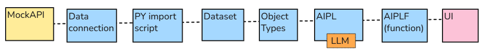

- The boxes represent applications, tools, and resources such as datasets, object types, and functions. The box numbers are the section numbers of this demo.
- **Your configuration/testing tasks are show in bold ****boxes with bold ****numbered ****text**.
- **The horizontal chain provides workflow context. Numbered, bold-bordered boxes identify this chapter’s configuration and testing steps.**** **

This demo uses background color to classify Foundry apps into 3 groups.

- **North.**** **User-facing applications and interactions  (Workshop UI, etc)
- **Equator**. Foundry’s integration, data, Ontology, and logic layer. This quick start puts far more into this layer than just Ontology.
- **South**. External systems outside Foundry (MockAPI).

The following shows the color coding

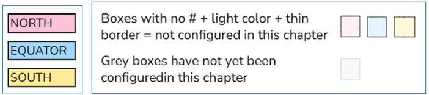

This is simplified version of the original Foundry diagram ( ) that had the following classifications:

- **North.** User-facing applications and interactions.
- **Ontology** (only Ontology).

**South**. External systems.   

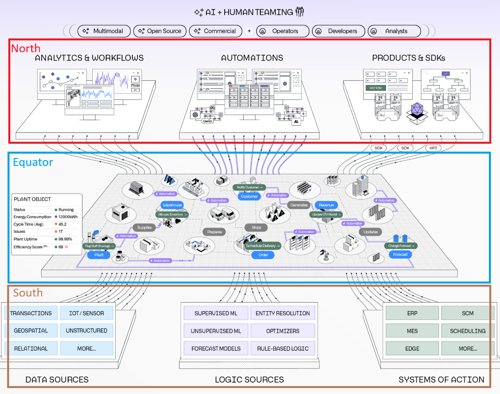

 

### **[Ch0 First steps (Foundry sign up, FDE, project/folder, applications)](/pal_693_qs_0b_first_steps/)**

The diagram below shows the first steps.

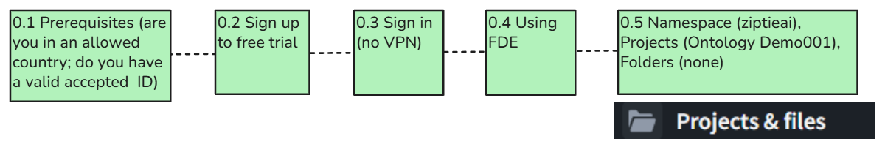

 

### **[Ch1 Fetch MockAPI records and display in UI ("Workshop")](/pal_693_qs_1_mockapi/)**

Bring in a few records from MockAPI and display the record text and numbers in a table. No AI.

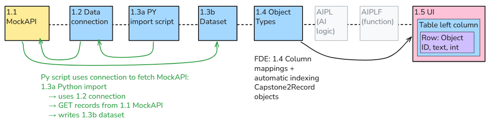

 

### **[Ch2 Create (1) AIPLF to detect matching digits in object text/integer properties / (2) UI to display result](/pal_693_qs_2_ailpf/)**

Select a record in the table, press a button, and display the AI’s answer. **Leave the record unchanged.**** **Ordinary code could perform this check without AI. We use AI here to learn the connection mechanics with an answer that is easy to verify. Chapter 3 will change what the AI checks.

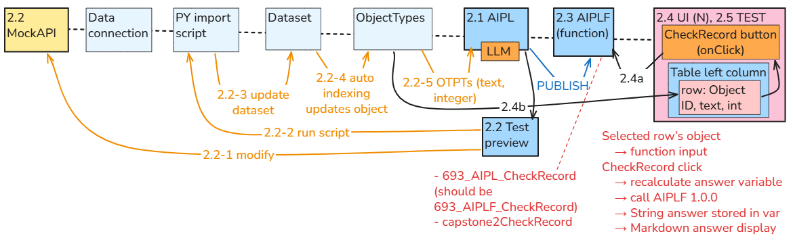

 

### **[Ch3 Modify AIPL prompt to detect matching letter-only-text and integer-digits (display result in UI)](/pal_693_qs_3_aipl_prompt/)**

You change the prompt in AIPL (AIPL structure/connectiosn DO NOT CHANGE... see diagram for ch3 above).

that requires a lot of modifications in the data chain.

(new MockAPI record to test, new build to dataset, AIPLF (must reference new AIPL version), and UI (must ref new AIPLF version)

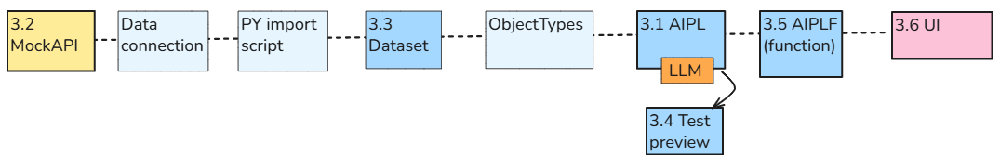

 

### **[Ch4 Enter AI matching criteria (configure only AIPL+F and UI)](/pal_693_qs_4_criteria/)**

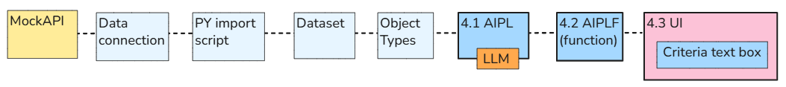

 

### **[Ch5 Add an object property and Action to save the LLM response (use in Ch6)](/pal_693_qs_5_property_action/)**

In this chapter, we prepare and test the saving operation.

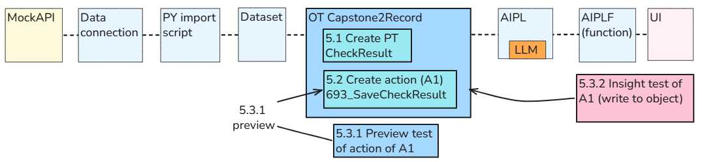

 

### **[Ch6 Add an AIPL call for text-save action (A1/Ch5) / "wrap" with AIPLF / create "wrapper" action (A2) for AIPLF (for Ch7)](/pal_693_qs_6_a1_a2/)**

Configuration diagram (shows the MockAPI to UI chain... UI not shown).

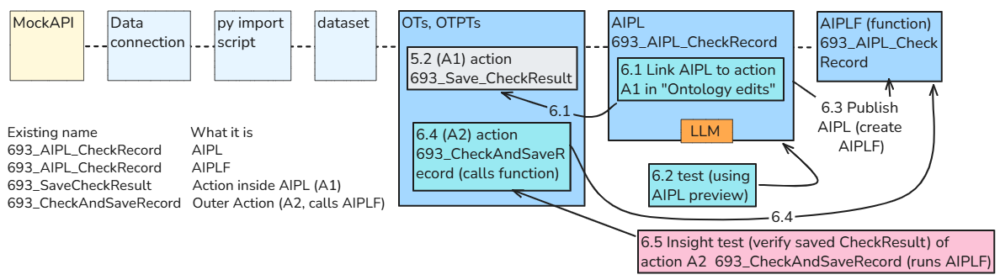

Here is a different perspective thats shows the ontology flow clearly.

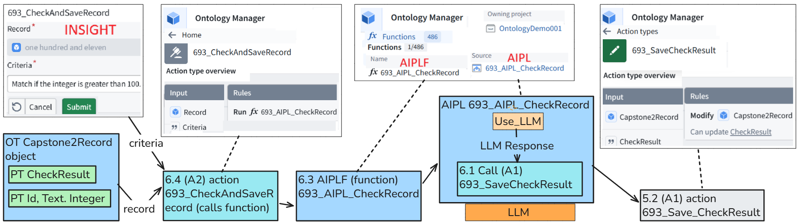

 

### **[Ch7 Add automation: "(new) object added to set" inits automation](/pal_693_qs_7_automation/)**

In Ch6, you selected a record (in Insight) and clicked Submit.

This ran **693_CheckAndSaveRecord** manually.

Now We’ll use **Automate** to run that Action when a **new Capstone2Record appears**.

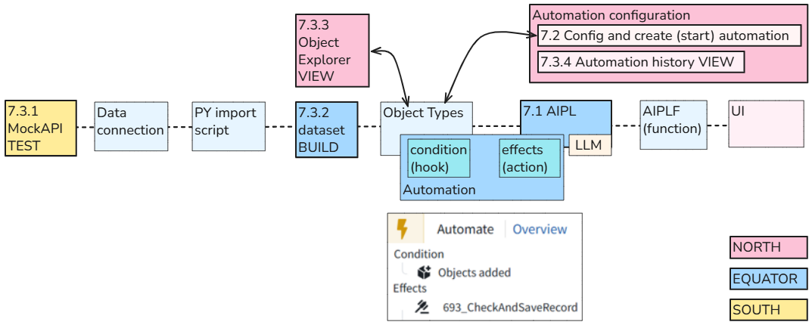

 

### **[Ch8 Schedule (Data Lineage)](/pal_693_qs_8_schedule/)**

Schedule the Python import to fetch MockAPI records into **693_MockAPI_Items**** (dataset)**** every two minutes**.

**NOTE: ****Limitation:** the import fetches new and updated records, but the Chapter 7 automation processes **only newly added objects**. Updating an existing object does not trigger another AI operation.

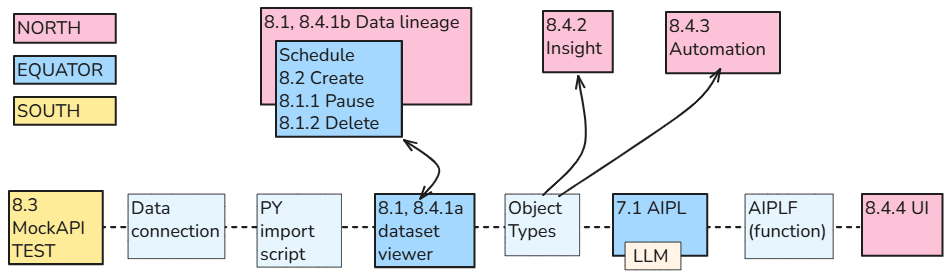

 

### **[Ch8a (7b) (WIP) Add processing of updated objects to automation](/pal_693_qs_8a_automate_updated/)**

(This was 7b. I need to update diagrams) The Chapter 7 automation processes **only newly added objects**. Updating an existing object does not trigger another AI operation. modify in 7b so that automation processes updated objects.

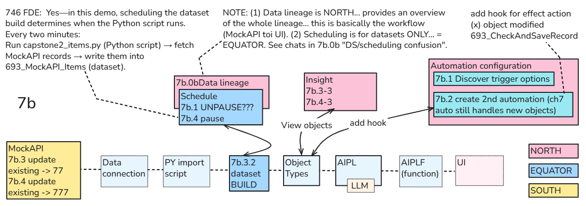

 

### **[Ch8b (8a) Governance](/pal_693_qs_8b_governance/)**

Note: This was 8a. I need to update diagrams.

 

#### **8b.1 Security policy**

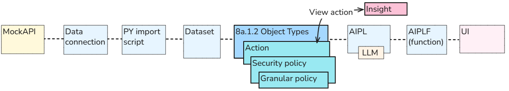

 

#### **8b.2 Action access**

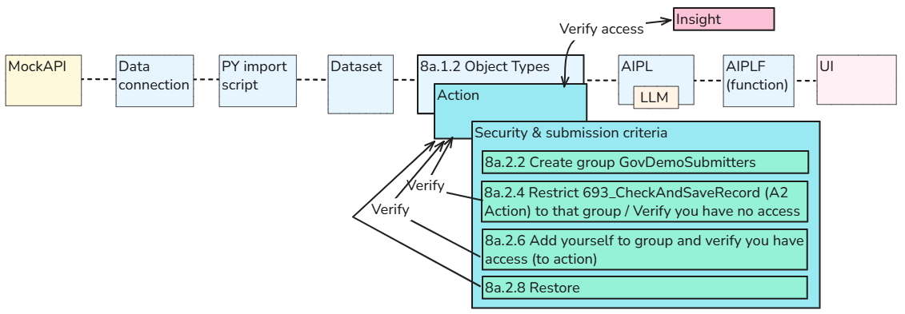

 

#### **8b.3 Inspect Action config/execution history**

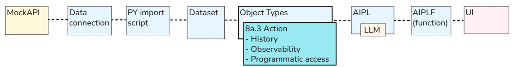

 

#### **8b.4b Hypothetical "Control which data may be sent to LLMs" config/workflow**

A trial user does not have access to this functionality. So this section simply describes the hypothetical (untested) config/workflow proposed by FDE.

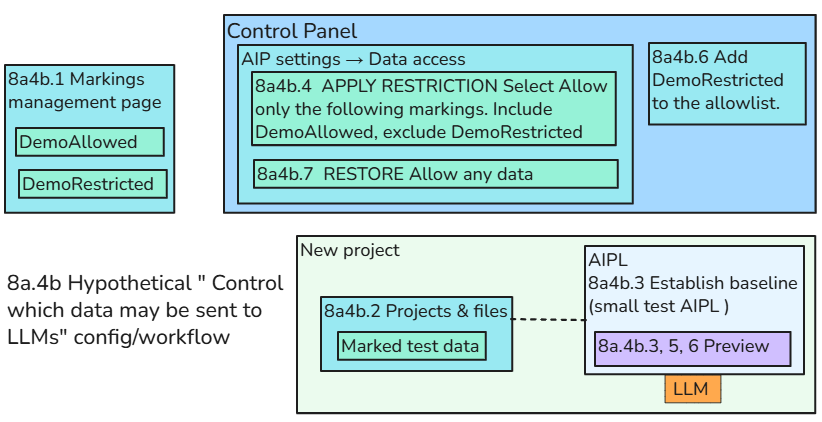

 

### **[Ch9 (WIP) Continuing your Foundry education (where to go from here)](/pal_693_qs_9_where_next/)**

There will be some kind of diagram for this section in the near future. The following shows the current proposed sections.

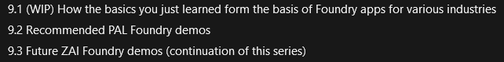
