 

[← 3c Foundry QS](/pal_693_qs/)

 

_26.1106 08:28 (converted from docx to md by GPT)_

 

## **0 First steps**

 

### **0.1 Foundry free tier sign up**

I did not record how I signed up, and its not a process I can repeat. But I can tell you the following:

**You must be in a country that PAL supports** (thats only a few countries).

**You can NOT use a VPN**.

**You must have a passport or some picture ID of good enough quality for facial recognition verification**. My passport is almost 10 years old, but it still worked.

**You need a camera on your PC to take a pic of yourself. PAL will compare your ID and the pic.**

I think you need a **mobile phone number** (and email).

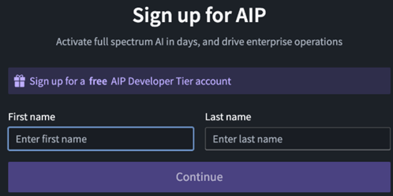

 

### **0.2 Sign in and first steps (FDE)**

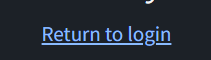

Click on login.

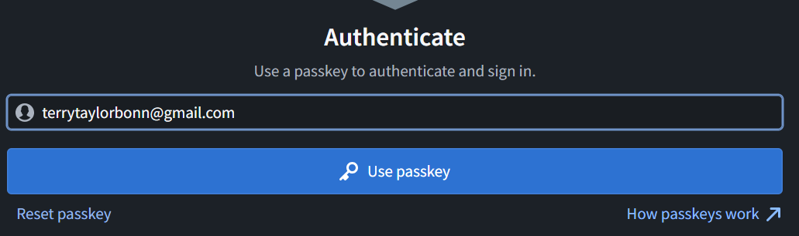

Enter your passkey PIN (for me this is just about 10 digits).

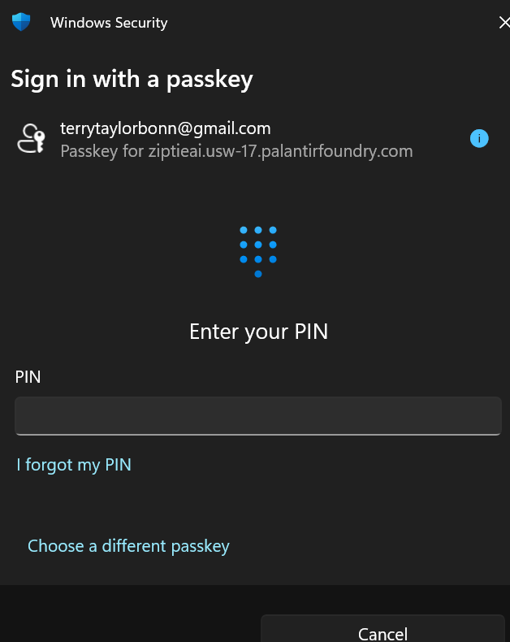

Note that you will be auto logged out about once every 24 hours. When you log back in, everything will be the same (no lost data).

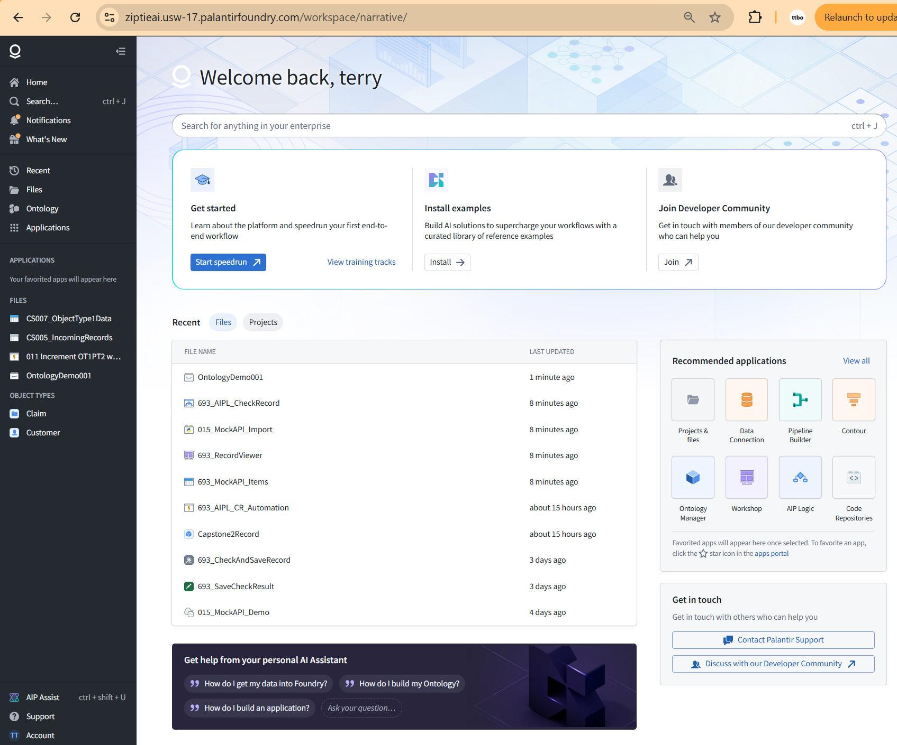

Click on "Start Speedrun". This opens up the first Foundry demo. "Your first end-to-end workflow". It says "in the next 60 minutes". I think it took me over a day. The biggest challenge was navigating the dialogs (Foundry has a lot of tools and they work exceptionally well, but it takes some effort to simply learn your way around).

Note that the tutorial chapters are not numbered. I copied the tutorial contents to an MS.Word file and numbered the H1-H3 headings. I then recorded what I did (screenshots, notes, etc). These demos are meant as real-world examples, and they are really good, but they dont appear to be updated recently. Also it not easy to get a good grip on the core workflow, because a lot of the focus is on the "real-worldness" aspect of the demo. Thats why I created this ZiptieAI demo.

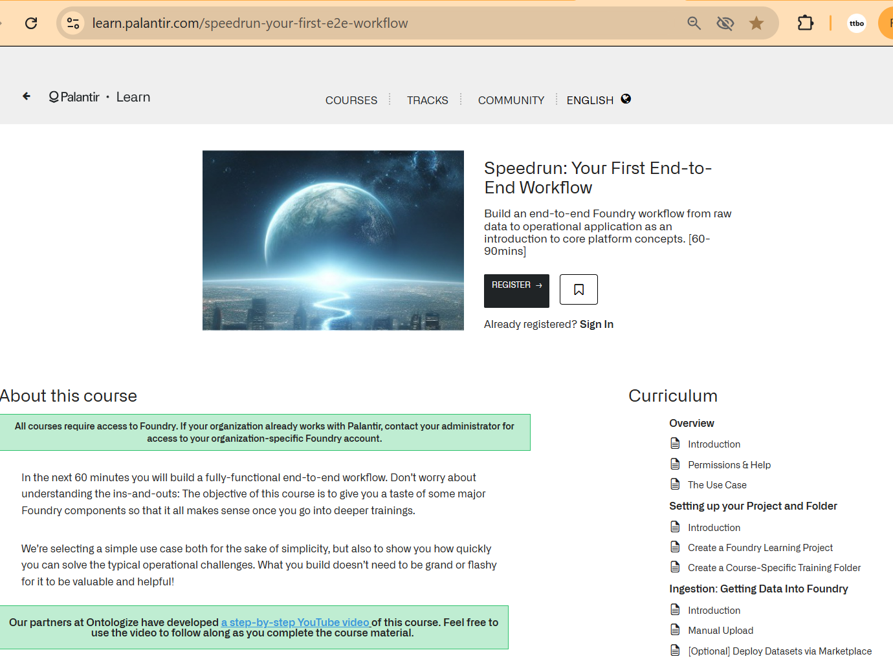

The training tracks have a lot demos. The examples are full demos with an installer. You can install them as a beginner (most will work), and you can use them. Replicating what they did is not that simple.

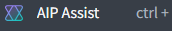

AIP assist seems to be more the first generation of AI help. Its bascially a search engine that seems to give you whatever is in the official docs. I never use AIP Assist.

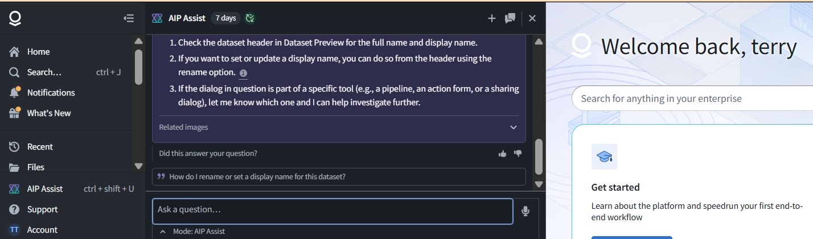

Note in the left panel "View All".

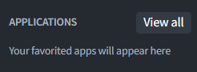

Click on "View all".

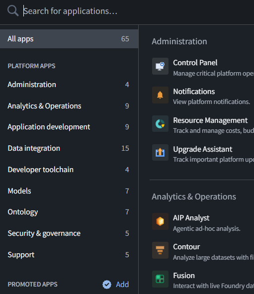

 

### **0.3 FDE**

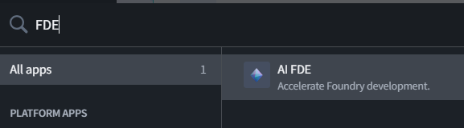

FDE is an awesome tool. Without it I could not have learned how to use Foundry by myself (I also think that unless you are a real expert in Foundry, you can't really use Foundry effectively without FDE; FDE is a game changer).

However, a few words of caution. Its easy to click on the buttons in red below if you are taking screenshots of FDE. "Summarize above" will nuke your chat history. That has happened to me several times, and it seems that FDE also loses a good deal of its memory about what your were doing. Be careful.  Also, I recommend not using FDE for anything but using Foundry. I have been using the trial version for 3 months now, and you can run up a very large context. But if you abuse your priveleges, I would Foundry might slow down or cut off your access.

**The blue square is for test and screenshot/file entry. The ability of FDE to see pasted screenshots of your Foundry UI is absolutely critical.**

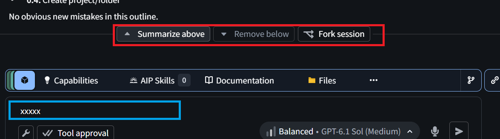

 

### **0.4 Create project/folder**

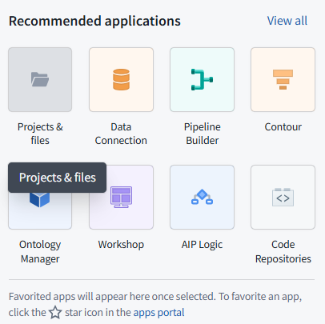

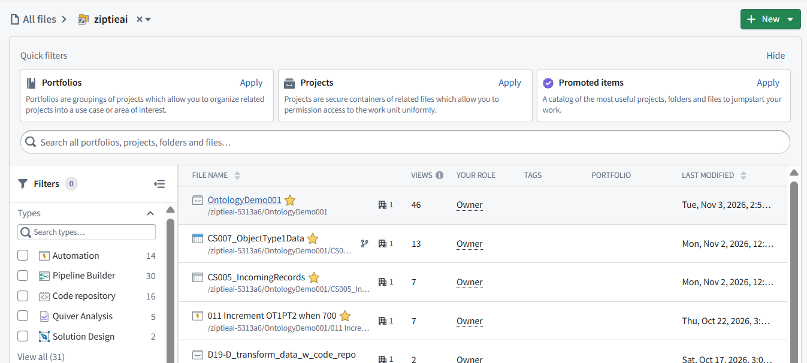

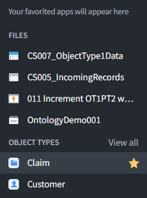

 

### **0.5 Things to watch out for (WIP)**

Earlier I mentioned about how you have to be careful not to nuke your chat history in FDE. This section mentions some others to things to watch out for.

 

#### **ME: 693_AIPL_CheckRecord is hte name of 2 different things**

 

**FDE: Yes—693_AIPL_CheckRecord is the name of two distinct things:**

**AIPL:** the editable workflow in AIP Logic.

**AIPLF:** the published, callable function, with a version such as **3.0.0**.

The name alone does not tell the reader which one is meant.

 

**FDE: The names hide the differences between editing, calling, proposing a save, and actually saving.**

My explanations compounded that by not consistently distinguishing them.

For this demo, the clearest reference is:

| Existing name | What it does |
| --- | --- |
| 693_AIPL_CheckRecord — AIPL | Editable workflow |
| 693_AIPL_CheckRecord — AIPLF 3.0.0 | Callable version of that workflow |
| 693_SaveCheckResult — Action inside AIPL | Proposes saving the LLM response |
| 693_CheckAndSaveRecord — outer Action | Calls AIPLF and commits the save |

We should keep the existing names but always add these identifying descriptions when the distinction matters.

 

**my version**

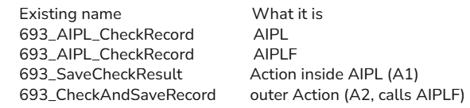

 

**Yes—this is simpler.**

Rename **“What it does”** to **“What it is”**, since that column identifies each item rather than explains its behavior.

| Existing name | What it is |
| --- | --- |
| 693_AIPL_CheckRecord | AIPL |
| 693_AIPL_CheckRecord | AIPLF |
| 693_SaveCheckResult | Action inside AIPL (A1) |
| 693_CheckAndSaveRecord | Outer Action (A2) |

 

#### **There are several Preview dialogs... only one is called "preview"**

