 

[← 3c Foundry QS](/pal_693_qs/)

_26.1111 14:35 (converted from docx source file to markdown by ChatGPT)_

 

The diagram below shows the first steps.

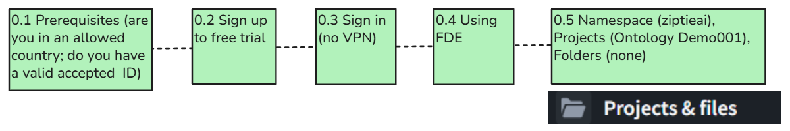

**TOC**

- **[0.1 Prerequisites](#section-0-1)**
- **[0.2 Foundry free tier sign up](#section-0-2)**
- **[0.3 Sign in and first steps](#section-0-3)**
- **[0.4 FDE](#section-0-4)**
- **[0.5 Create project/folder](#section-0-5)**

 

### **0.1 Prerequisites**

- **You must be in a country that PAL supports** (thats only a few countries). **Check access eligibility before investing time in this tutorial.** Palantir’s developer offering restricts access by country and requires identity verification. You may find it difficult to locate a definitive, current country list. Confirm eligibility through the current sign-up process or Palantir support.
- **You can NOT use a VPN**.
 

### **0.2 Foundry free tier sign up**

Sign up will be something like the following:

- **You must have a passport or some picture ID of good enough quality for facial recognition verification**.
- **You need a camera on your PC to take a pic of yourself. PAL will compare your ID and the pic.**
- **You might need a mobile**** phone number** (and email).

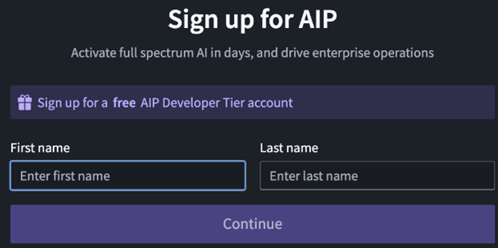

 

### **0.3 Sign in and first steps**

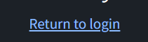

Click on login.

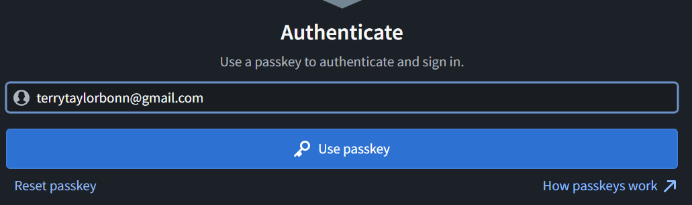

Enter your passkey PIN.

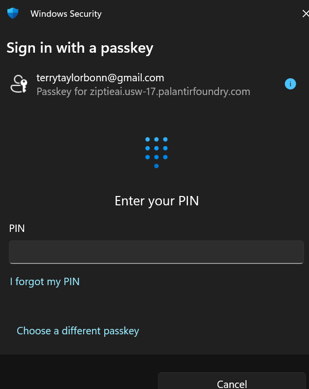

Note that you will be auto logged out about once every 24 hours. When you log back in, everything will be the same (no lost data).

The intial page.

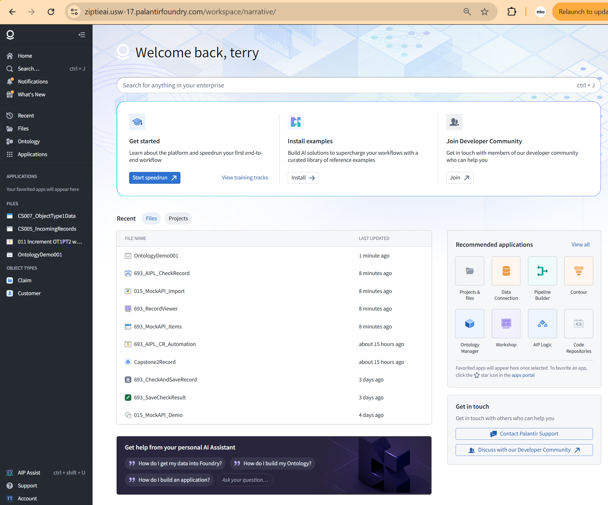

Click on "Start Speedrun". This opens up the first Foundry demo. "Your first end-to-end workflow". It says "in the next 60 minutes". It will probably take much longer. The biggest challenge mght be navigating the dialogs (Foundry has a lot of tools and they work exceptionally well, but it takes some effort to simply learn your way around).

Note that the tutorial chapters are not numbered. You might want to copy the tutorial contents to an MS.Word file and number the H1-H3 headings. You might then record your steps (screenshots, notes, etc). These demos are meant as real-world examples, and they are really good, but they dont appear to be updated recently.

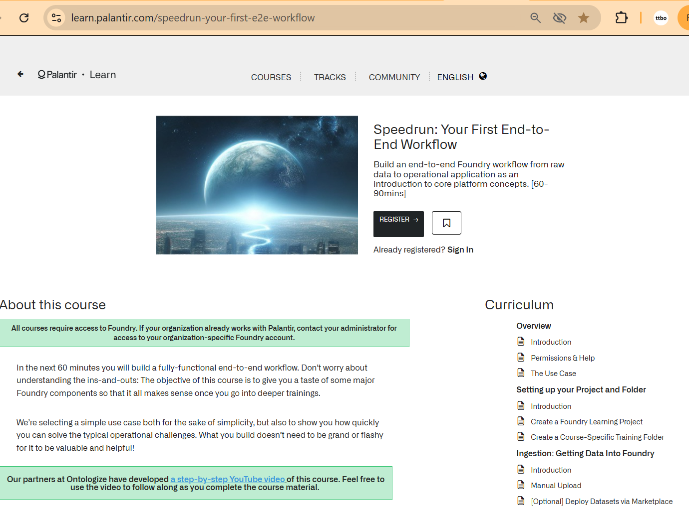

The training tracks have a lot demos. The examples are full demos with an installer. You can install them as a beginner (most will work), and you can use them. Replicating what they did is not that simple.

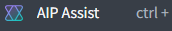

AIP assist seems to be the first generation of AI help. Its seems to be a search engine that uses the offical docs as sources. You probably wont use AIP Assist much.

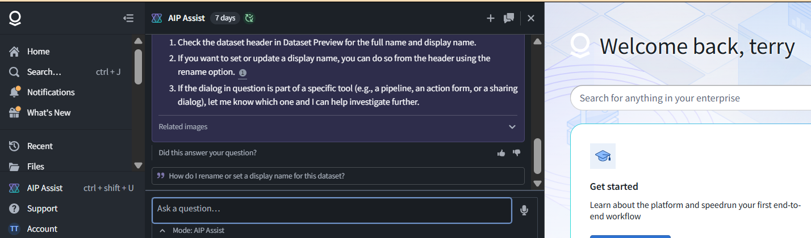

Note in the left panel "Applications / View All".

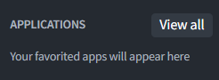

Click on "View all".  This shows the many excellent Foundry apps that you have access to.

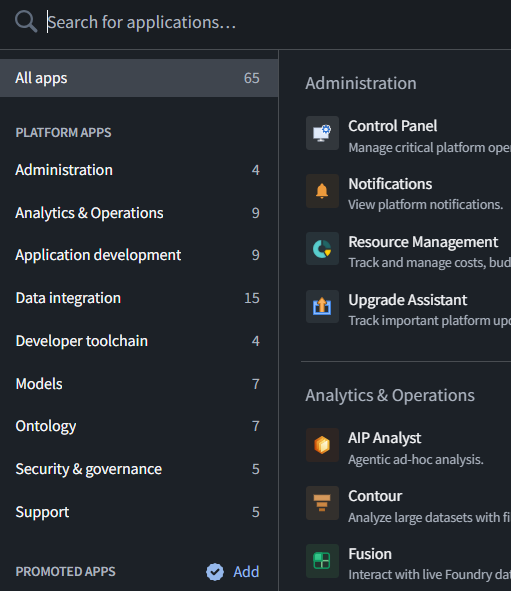

 

### **0.4 FDE**

FDE (forward deployed engineer) is the the most important app you will use.

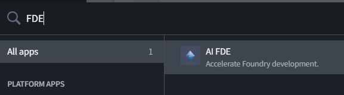

FDE is critical for learning Foundry by yourself (its probably also critical even for Foundry experts to use Foundry effectively; FDE is a game changer).

A few words of caution.

- Its easy to click on the buttons in red below if you are taking screenshots of FDE. "Summarize above" will nuke your chat history. That may cause FDE to lose a good deal of its memory about what your were doing.
- Do not using FDE for anything but using Foundry. You can use FDE for months and worth with a very large context. But it is for free, so its probably best to keep your usage to a minimum.

The blue square is for text and screenshot entry. The ability of FDE to "see" screenshots is a game changer.

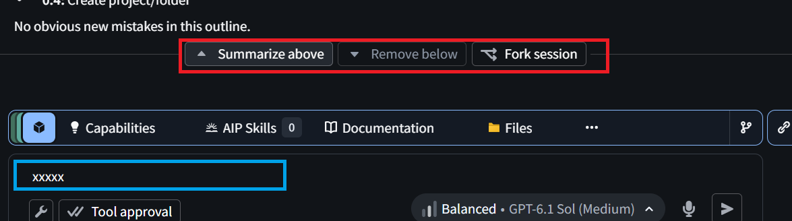

 

### **0.5 Create project/folder**

The following apps you will use quite often in this demo (with the exception of Pipeline Builder and Contour).

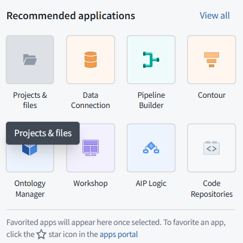

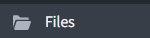

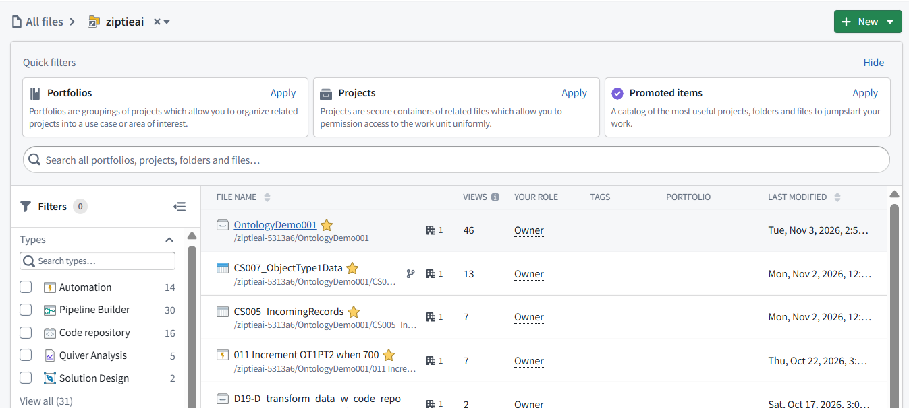

Note the gold stars. And item marked with a gold start will appear in the left panel of favorites.

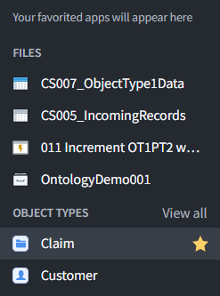
