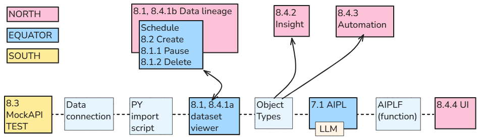
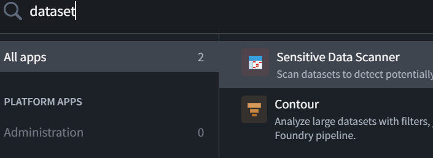

<br>


[← 3c Foundry QS](/pal_693_qs/)

26.1112 17:50

<br>

Below is the latest GPT dump of its internal rules for docx to markdown conversion.

<br>

-------
-------
-------
-------
-------

<br>


# ZiptieAI — DOCX → Jekyll Markdown + PNG Conversion Rules

**Version: 26.1112 — Updated through Chapters 8 and 8a**

## 1. General principles

1. The DOCX is the **single source of truth**.
2. Convert only the chapters requested.
3. Start each conversion directly from the supplied DOCX. Do not reuse previous Markdown conversions unless explicitly requested.
4. Preserve the original text exactly: wording, spelling, punctuation, capitalization, and order.
5. Do not rewrite, summarize, correct, or reorganize the content.
6. Preserve headings, paragraphs, bold, italics, code, tables, and images.
7. Do not modify the original DOCX.
8. Exclude content explicitly marked `DONT PUBLISH`.
9. Report ambiguous formatting rather than silently omitting or rearranging content.
10. The conversion must be reproducible and require as little manual correction as possible.

## 2. DOCX preparation

The user will simplify Word formatting before conversion.

1. Use ordinary Word paragraphs, separated by paragraph returns (`¶`).
2. Avoid manual line breaks within paragraphs.
3. Avoid Word's automatic numbered and bulleted lists.
4. Type numbered steps manually: `1.`, `2.`, `3.`, `3.1`, `3.2`, etc.
5. Type bullet items manually, beginning each paragraph with `- `.
6. Use Word heading styles for actual headings.
7. Continue using Word bold and italic formatting normally.
8. Put each screenshot in its intended position, with its width percentage immediately before it.
9. Do not introduce special conversion tags unless explicitly agreed upon.

**Important:** These are preparation guidelines, not reasons to discard content if the DOCX contains unexpected formatting.

## 3. Headings

Convert Word heading styles as follows:

| Word style | Markdown output |
|---|---|
| Heading 1 | `## **Heading text**` |
| Heading 2 | `### **Heading text**` |
| Heading 3 | `#### **Heading text**` |
| Heading 4 | `**Heading text**` |

Additional rules:

1. Preserve original heading numbers and wording.
2. Do not automatically renumber headings.
3. Add `<br>` before headings where needed for vertical spacing.
4. Insert blank lines between HTML elements, anchors, headings, and subsequent paragraphs.
5. Never merge a heading with the paragraph that follows it.
6. Do not introduce extra headings.

Example:

```md
<br>

<a id="section-8-0"></a>

### **8.0 What we will build**

**Summary.** Schedule the Python import...
```

## 4. Table of contents (TOC)

When the DOCX contains a paragraph consisting of `TOC`:

1. Replace it with a generated chapter TOC.
2. Insert the TOC at exactly that location.
3. Display `TOC` as ordinary bold text, not a Markdown heading.
4. Include Heading 2 and Heading 3 entries.
5. Preserve heading wording and numbering.
6. Use nested, clickable Markdown links.
7. Generate matching HTML anchors before the headings.
8. Keep each TOC entry on a separate line.
9. Leave blank lines before and after the TOC.

Example:

```md
**TOC**

- **[8.0 What we will build](#section-8-0)**
- **[8.1 Pause / Delete any existing old schedule](#section-8-1)**
```

Corresponding heading:

```md
<a id="section-8-1"></a>

### **8.1 Pause / Delete any existing old schedule**
```

Use explicit HTML anchors. Do not use `{#section-8-1}`.

## 5. Paragraphs and spacing

1. Every Word paragraph must remain a distinct logical Markdown paragraph or item.
2. Never concatenate unrelated Word paragraphs.
3. Preserve intentional paragraph breaks.
4. Insert blank lines between unrelated Markdown blocks.
5. Keep consecutive bullet items together without blank lines.
6. Keep code blocks intact.
7. Do not insert `<br>` inside lists or code blocks.
8. Do not merge headings, lists, paragraphs, or images.
9. Keep images on their own lines, separated from surrounding content.

Blank lines are especially important between:

- HTML anchors and Markdown headings.
- Headings and paragraphs.
- Paragraphs and lists.
- Lists and images.
- Images and subsequent text.
- Code blocks and surrounding text.

These rules improve both Jekyll rendering and VS Code syntax highlighting.

## 6. Bulleted lists

The user will manually type bullet markers in the DOCX.

**Rule: A paragraph beginning with `- ` is a bullet item.**

1. Convert each such paragraph into one Markdown bullet.
2. Preserve the original text after the marker.
3. Never combine separate bullet items into one paragraph.
4. Insert a blank line before and after the complete list.
5. Do not insert blank lines between consecutive bullet items.
6. Do not automatically create bullets from ordinary paragraphs.
7. Preserve inline bold and italic formatting inside list items.

**Critical validation: Prevent duplicate bullet markers.**

Incorrect:

```md
- - Do not trigger on CheckResult changes.
```

Correct:

```md
- Do not trigger on CheckResult changes.
```

Before delivery, search for bullet items whose content still begins with `- ` and remove the duplicate marker.

## 7. Manually numbered steps

The user will type numbered steps directly into the DOCX.

Examples:

`1. Create the schedule.`

`2. Test the schedule.`

`3. Trace the result.`

`3.1 Dataset viewer`

`3.2 Data Lineage`

Rules:

1. Preserve all manually typed numbers exactly.
2. Do not convert numbered steps into automatic Markdown numbered lists.
3. Do not automatically renumber them.
4. Keep each numbered step on its own line or paragraph.
5. Recognize subnumbers such as `3.1`, `3.2`, and `3.3` as children of `3`.
6. Indent subnumbered items slightly when practical.
7. Preserve the original sequence and text.
8. Do not join a numbered step with the following paragraph.

**Priority:** Correct numbering and separation are mandatory; indentation is desirable but secondary.

When indentation would interfere with Jekyll rendering, preserve the numbers as separate paragraphs rather than generating broken list formatting.

## 8. Bold formatting — critical validation

This has been a recurring conversion problem and must be checked systematically.

Convert Word bold text using Markdown `**` markers.

**Rules:**

1. Never place a space immediately after an opening `**`.
2. Never place a space immediately before a closing `**`.
3. Preserve spaces outside the bold markers.
4. Combine adjacent Word runs with identical formatting where appropriate.
5. Handle boundaries between bold and nonbold runs correctly.
6. Preserve punctuation and spaces in their original positions.
7. Never join two words while correcting bold formatting.
8. Never allow bold-formatting corrections to merge Markdown blocks.

Incorrect:

```md
**Summary. **Configure and test the saving operation.
```

Correct:

```md
**Summary.** Configure and test the saving operation.
```

Incorrect:

```md
Use Search** to select** Text and Integer only.
```

Correct:

```md
Use **Search** to select **Text and Integer only**.
```

### Mandatory final validation

Search the entire Markdown file for malformed bold spans.

Check that:

- Every opening `**` has a corresponding closing `**`.
- No bold span begins or ends with a space.
- No stray `**` markers appear in ordinary text.
- Headings, TOC links, image tags, and code blocks remain intact.

**Never run a broad bold-correction replacement across Markdown block boundaries.**

Corrections must be confined to the relevant inline text spans.

After correcting errors, validate the entire file again.

## 9. Italic formatting

1. Preserve Word italics using `*italic text*`.
2. Preserve combinations of bold and italic.
3. Keep spaces outside italic markers.
4. Do not introduce unmatched Markdown markers.
5. Do not modify code or URLs while correcting formatting.

## 10. Images — extraction

1. Extract images in their actual DOCX document order.
2. Preserve image content and resolution.
3. Convert images to PNG.
4. Do not crop, resize, or modify image pixels unless requested.
5. Number images sequentially for each chapter.
6. Use the naming convention specified by the user.
7. Do not skip or duplicate image numbers.
8. Keep each image at its original location relative to the text.

Example for Chapter 8:

`/assets/qs/8_01.png`

`/assets/qs/8_02.png`

Example for Chapter 8a:

`/assets/qs/8a_01.png`

`/assets/qs/8a_02.png`

The default asset directory is:

`/assets/qs/`

Unless explicitly instructed otherwise, package all chapter images.

## 11. Image widths

The DOCX contains numeric paragraphs immediately before images.

These numbers specify the image's webpage display width as a percentage.

For example:

`72`

means:

`width="72%"`

Rules:

1. Associate each width number with the correct image.
2. Use the exact percentage specified.
3. Remove the width-number paragraph from the generated Markdown.
4. Do not estimate or adjust the percentage.
5. Do not resize the underlying PNG.
6. Preserve image order.
7. If several images are consecutive, verify each width association.
8. If one width instruction clearly applies to multiple images, use it for those images.
9. If a width instruction is missing or ambiguous, report it rather than guessing.

Example:

```md

```

## 12. Image placement and spacing

Every image must occupy its own Markdown block.

Example:

```md
The new schedule is saved.



Next, verify the result.
```

Rules:

1. Blank line before every image.
2. Blank line after every image.
3. Never put an image on the same line as preceding text.
4. Never put an image on the same line as a heading.
5. Do not allow an image to interrupt a Markdown list incorrectly.
6. When an image belongs to a nested list item, preserve that relationship with appropriate indentation.
7. Verify Jekyll renders the image as a separate block.

## 13. Image completeness validation

Before delivery:

1. Count the DOCX images in the requested chapter.
2. Count the generated Markdown image references.
3. Count the PNG files.
4. Confirm that these counts match.
5. Confirm the images are in the correct order.
6. Confirm that each Markdown reference points to the correct PNG.
7. Confirm the width percentage of each image.
8. Confirm that no image is missing or duplicated.
9. Confirm that image content matches its original DOCX position.
10. Report any unresolved mismatch.

**Matching counts alone is insufficient. Image identity and order must also match.**

## 14. Code blocks and existing Markdown syntax

1. Preserve intentional Markdown syntax already present in the DOCX.
2. Preserve single backticks for inline code.
3. Preserve triple-backtick code fences.
4. Do not duplicate or escape existing code fences.
5. Do not automatically wrap already fenced content in another code block.
6. Preserve indentation and line breaks inside code blocks.
7. Do not correct or reformat code.
8. Do not apply bold or list conversions inside code blocks.
9. Use plain triple backticks when new code fences are needed.

Do not add a `json` language identifier to code fences.

This avoids unwanted formatting in the Jekyll website.

## 15. Tables

1. Convert simple Word tables into ordinary Markdown tables.
2. Preserve all original text.
3. Preserve row and column order.
4. Preserve column headings.
5. Avoid complex HTML tables unless required.
6. Do not invent or modify table values.
7. Report tables that cannot be converted faithfully.

## 16. DONT PUBLISH sections

Exclude content marked:

`(DONT PUBLISH)`

through:

`(END DONT PUBLISH)`

Rules:

1. Exclude the opening and closing markers.
2. Exclude all text between them.
3. Exclude images within the unpublished section.
4. Do not include unpublished headings in the TOC.
5. Resume conversion immediately after the closing marker.
6. Do not remove unrelated content outside the marked section.

For individually marked paragraphs or blocks, exclude only the marked content.

## 17. Special chapter links

For overview chapters containing links to other chapters, preserve the supplied URLs exactly.

When requested, make chapter headings clickable using the corresponding Jekyll paths.

Do not change chapter URLs or invent new destinations.

For ordinary chapter conversions, preserve existing links without automatically adding new navigation links.

## 18. Conversion timestamp

Every generated or modified Markdown file must contain a timestamp representing the actual conversion time.

Use **Eastern Time (EST/EDT)**.

Format:

`_YY.MMDD HH:MM (converted from docx source file to markdown+PNGs by ChatGPT)_`

Example:

`_26.1112 17:32 (converted from docx source file to markdown+PNGs by ChatGPT)_`

Rules:

1. Update the timestamp whenever Markdown is generated or modified.
2. Never reuse a timestamp from an earlier conversion.
3. Use the actual Eastern Time.
4. Preserve the timestamp's established location in the Markdown.

## 19. Output files

Normally deliver:

1. One Markdown file per requested chapter.
2. A ZIP containing the Markdown and requested PNGs.
3. Direct download links for the Markdown files.

Example ZIP structure:

```text
ch8.md
assets/
  qs/
    8_01.png
    8_02.png
    8_03.png
```

If the user requests Markdown only, do not include PNG files.

If the user requests only selected images, package only those images while preserving all necessary Markdown image references.

Do not include old conversion artifacts.

## 20. Mandatory final validation

Before delivering any conversion, check the following.

### Source and content

- Correct DOCX and chapters.
- Correct chapter boundaries.
- No missing paragraphs.
- No merged unrelated paragraphs.
- Original wording preserved.
- DONT PUBLISH sections excluded.

### Markdown structure

- Headings correct.
- TOC complete and clickable.
- HTML anchors valid.
- Blank lines between unrelated blocks.
- Bullets recognized only from `- `.
- No duplicate bullet markers.
- Manually numbered steps preserved.
- Subnumbered steps indented when practical.
- No accidental automatic numbered lists.

### Formatting

- All bold spans properly opened and closed.
- No spaces inside bold markers.
- No stray `**` markers.
- Italics preserved.
- No words accidentally joined.
- Code fences balanced.
- Existing Markdown syntax preserved.
- No block boundaries damaged by formatting corrections.

### Images

- Correct image count.
- Correct image order.
- Correct filenames.
- Correct image paths.
- Correct width percentages.
- No missing or duplicate images.
- Blank lines before and after images.
- Images correctly associated with nearby text or list items.

### Delivery

- Current Eastern Time timestamp.
- Markdown files generated.
- PNGs generated when requested.
- ZIP contents checked.
- Download links verified.

**If validation fails, correct the output and run validation again before delivery.**

## 21. Standard conversion workflow

1. Open the supplied DOCX.
2. Identify the requested chapter boundaries.
3. Identify headings and TOC markers.
4. Identify DONT PUBLISH sections.
5. Read paragraphs in document order.
6. Convert manually marked bullets.
7. Preserve manually numbered steps.
8. Recognize subnumbered steps.
9. Convert bold and italic formatting carefully.
10. Preserve existing code and Markdown syntax.
11. Extract images and pair them with width instructions.
12. Generate the Markdown.
13. Generate the PNG files.
14. Insert the current Eastern Time timestamp.
15. Validate bold and italic formatting.
16. Validate bullets, numbering, and paragraph separation.
17. Validate image identity, order, and widths.
18. Validate headings, anchors, and TOC.
19. Package the requested output files.
20. Verify the files and deliver download links.

## 22. Long-term principle

The publishing workflow is:

**DOCX master → ChatGPT conversion → Markdown + PNGs → Jekyll website**

The DOCX remains authoritative.

For the current Foundry Quick Start tutorial, prioritize completing publication using simple, clean Word formatting and reliable validation.

Before beginning the next tutorial, we can improve the conversion system further based on the errors discovered in this first project.

The ultimate goal is **a deterministic conversion process that produces publication-ready Markdown without manual cleanup**.


