 

[← 4 Enter AI matching criteria](/pal_693_qs_4_criteria/) / [↑ 3c Foundry QS](/pal_693_qs/) / [→ 6 Add A1/A2 Actions](/pal_693_qs_6_a1_a2/)

_26.1112 09:08 (converted from docx source file to markdown+PNGs by ChatGPT)_

 

**TOC**

- **[5.0 What we will build](#section-5-0)**
- **[5.1 Add OT Capstone2Record PT CheckResult (to save text)](#section-5-1)**
  - **[5.1.1 Create property CheckResult](#section-5-1-1)**
  - **[5.1.2 Allow edits (saving values) for the ObjectType](#section-5-1-2)**
  - **[5.1.3 Save the OT changes](#section-5-1-3)**
- **[5.2 Create the 693_SaveCheckResult Action to save a String in CheckResult](#section-5-2)**
  - **[5.2.1 Create an Action](#section-5-2-1)**
  - **[5.2.2 Correct the API name](#section-5-2-2)**
  - **[5.2.3 Verify Required ON](#section-5-2-3)**
  - **[5.2.4 Save](#section-5-2-4)**
- **[5.3 Test the Action (using action preview / insight (actual save))](#section-5-3)**
  - **[5.3.1 Action preview (no save to object)](#section-5-3-1)**
  - **[5.3.2 Insight test (actual save to object)](#section-5-3-2)**

 

### **5.0 What we will build**

**Summary.** Configure and test the saving operation.

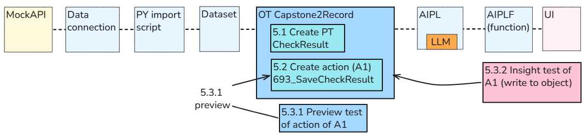

**Configuration (numbered steps in diagram above)**

- 5.1 Add the CheckResult property to the Capstone2Record object type.
- 5.2 Create the 693_SaveCheckResult Action to save a String in CheckResult.
-5.3 Test the Action using manually entered test text.

**Workflow**

- Select an object + enter test text.
- AI checks a selected **Capstone2Record object** using the supplied criteria.
- The **LLM text response** (FOUND, NOT FOUND, etc.) is saved in that object’s **CheckResult** property using **693_SaveCheckResult**.

 

### **5.1 Add OT Capstone2Record PT CheckResult (to save text)**

Add an edit-only String property named **CheckResult** to **Capstone2Record**.

 

#### **5.1.1 Create property CheckResult**

We’ll configure **CheckResult** as a single String supplied through edits—not as another column imported from MockAPI.

- Open **Ontology Manager → Capstone2Record → Properties**.

Click Create property.

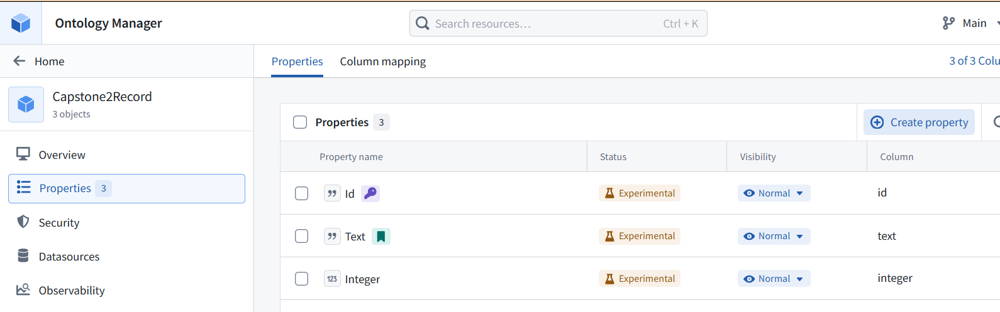

- Set:
- **Name:** CheckResult
- **Description:
- **Base type:** String
- **Allow multiple:** OFF

Values required: OFF—unchecked records can have no answer.

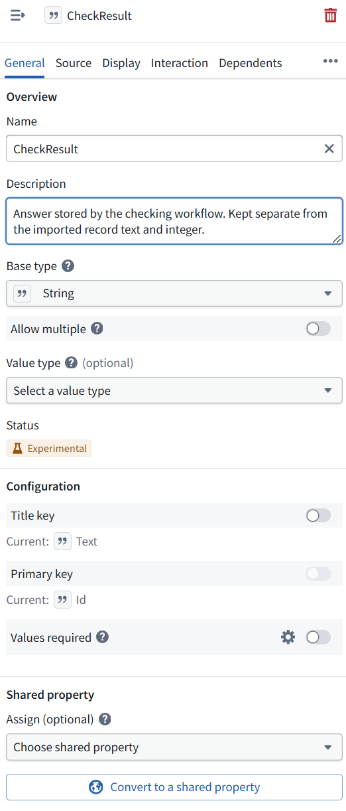

 

#### **5.1.2 Allow edits (saving values) for the ObjectType**

- Click **Datasources** in ObjectType1’s left navigation—here, the object type is **Capstone2Record**.
- Find **Edits → Allow edits**.

Turn Allow edits ON. This permits Actions to write object values. It does not change any record or enable inline editing in the UI.

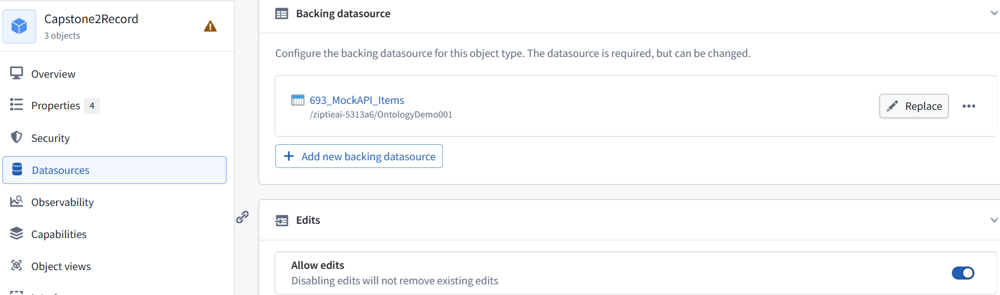

 

#### **5.1.3 Save the OT changes**

- Click **Save** in the top toolbar.

Review the changes (add CheckResult and enable edits on Capstone2Record).

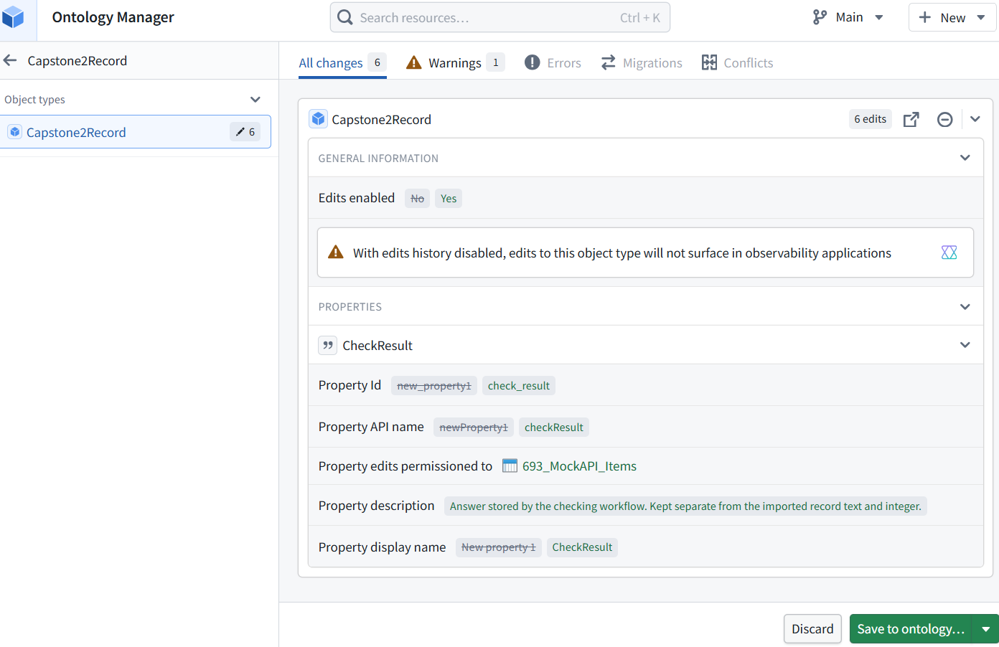

If no errors appear, click Save to ontology….

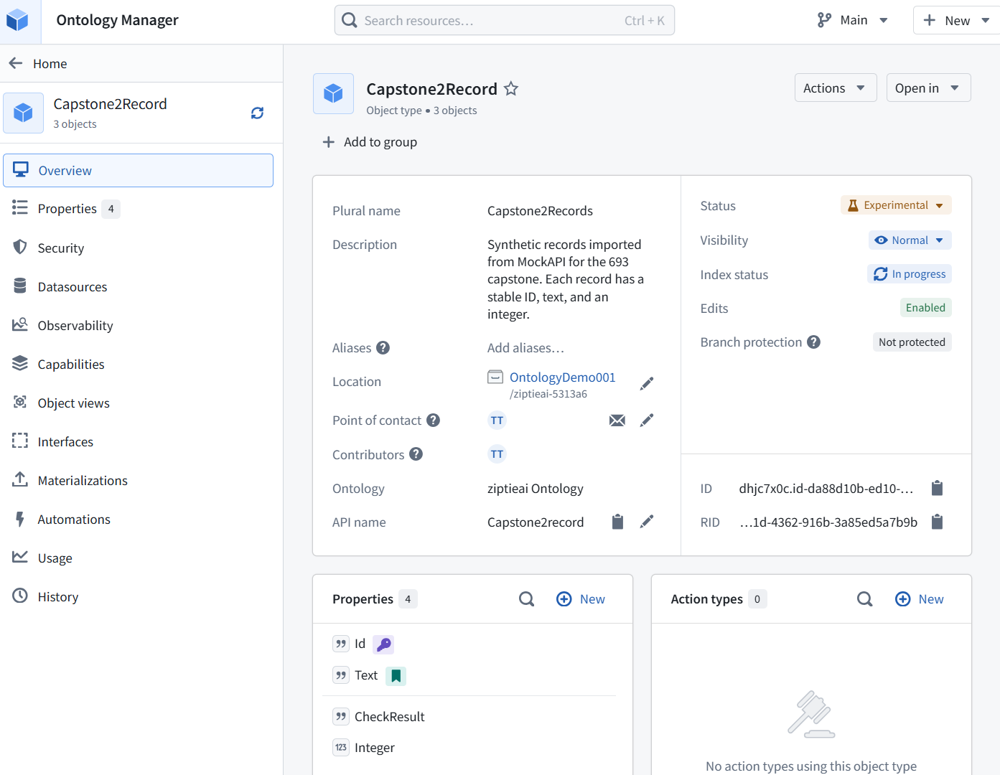

 

### **5.2 Create the 693_SaveCheckResult Action to save a String in CheckResult**

 

#### **5.2.1 Create an Action**

The action receives one record and answer text, then writes that text into **CheckResult**.

Click + New → Action type.

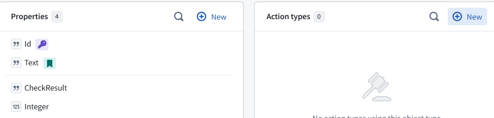

- On the **Object** tab:
  - **Object type:** Capstone2Record

Operation: Modify object(s)

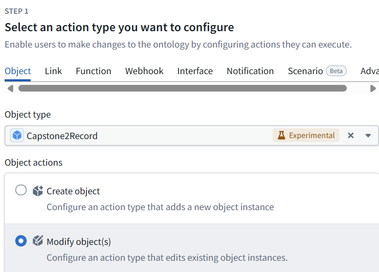

- Click **Next**.
- Under **Mapping**, click **Add property → CheckResult**.
- **Left CheckResult:** the stored property.

Right CheckResult: the input text to write into it (Left CheckResult).

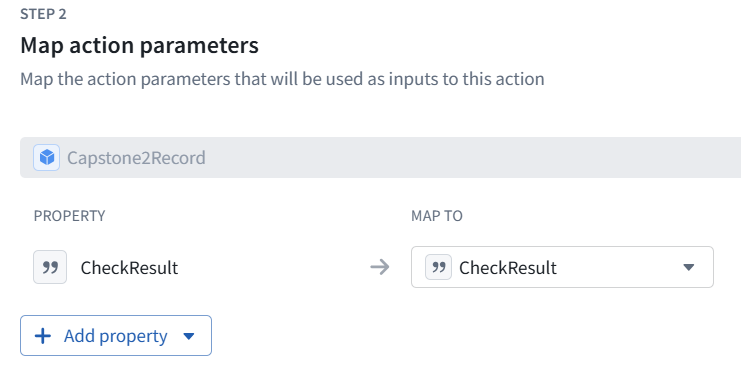

Click **Next** and enter:

- **Name:** 693_SaveCheckResult

Description: Store supplied answer text in CheckResult on the supplied Capstone2Record. Leave imported properties unchanged.

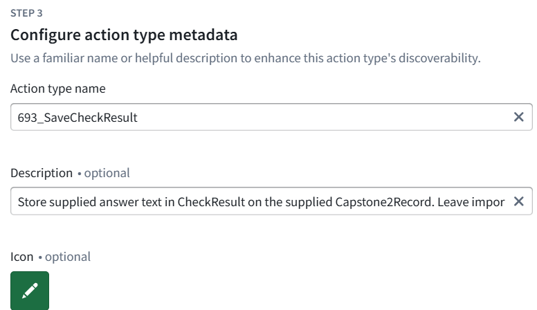

Continue with:

- **Who can submit:** Organization → ziptieai
- **Save location:** OntologyDemo001

Finish the wizard, but **do not finalize the Ontology save yet**. Open **Parameters → CheckResult** and send its settings. We’ll make the answer input required before saving.

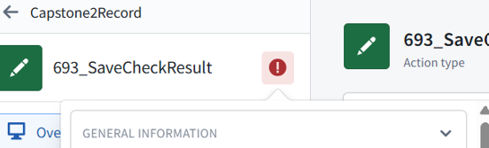

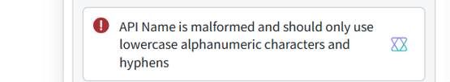

 

#### **5.2.2 Correct the API name**

**The Action’s generated API name is invalid.** Its displayed name can keep the 693_ prefix, but use a letter-first, lower-kebab-case API name.

- Dismiss the warning popup.

On Overview, find API name and click its pencil.

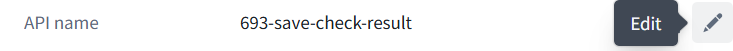

Replace 693-save-check-result with:
capstone2-save-check-result
c2-693-save-check-result

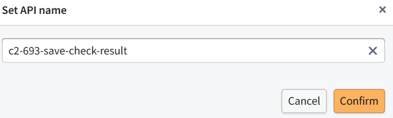

 

#### **5.2.3 Verify Required ON**

Then open **Parameters → CheckResult**:

- **Required:** ON
- **Visible:** ON

Disabled: OFF

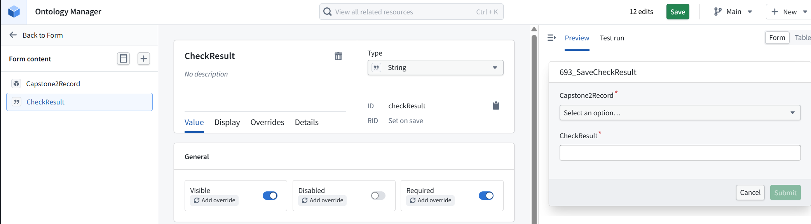

 

#### **5.2.4 Save**

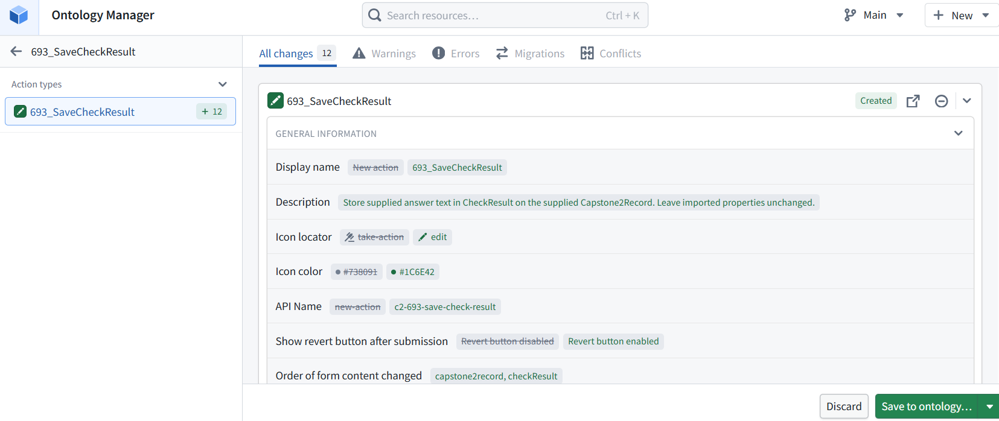

 

### **5.3 Test the Action (using action preview / insight (actual save))**

 

#### **5.3.1 Action preview (no save to object)**

Run it manually and inspect the stored value. Confirm the original record values remain unchanged. Click **User Interface** in the left sidebar. We’ll use its **Test run** tab to supply record **Id 1** and MANUAL TEST, run the Action, and then verify the stored value.

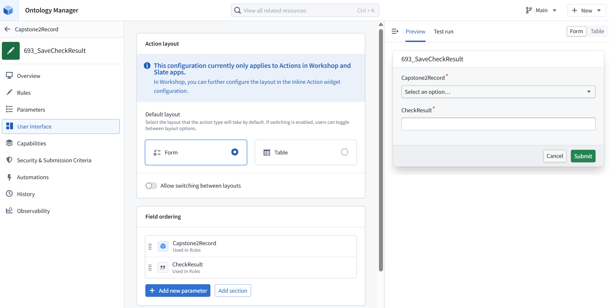

The **Test run** tab displays test results; the form is under **Preview**.

- Select the record with **Id 1**.

Enter MANUAL TEST in CheckResult.

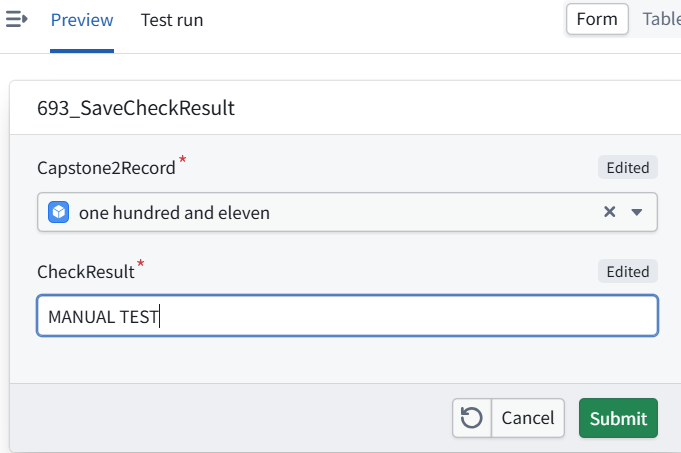

Click Submit, then inspect Test run. We’ll check the result before treating this as proof that the value was permanently stored.

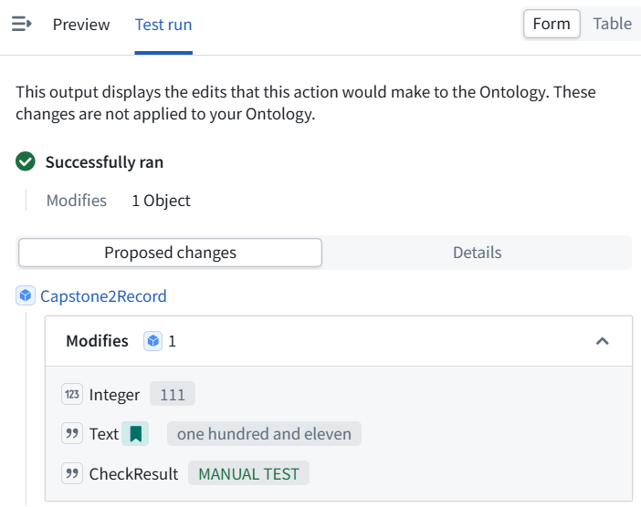

**The test passed—but nothing was saved.** The notice explicitly says these changes are **not applied** to the Ontology. The proposed result is correct:

- **CheckResult:** MANUAL TEST
- **Text:** one hundred and eleven (unchanged)
- **Integer:** 111 (unchanged)

 

#### **5.3.2 Insight test (actual save to object)**

To finish **5.3**, we still need to run the Action on the actual object and verify storage. Return to **Capstone2Record** using the upper-left back link, then open its **Open in** menu so we can access the objects.

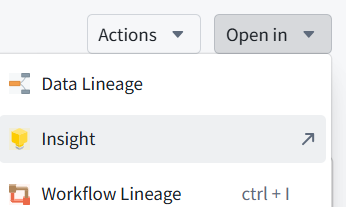

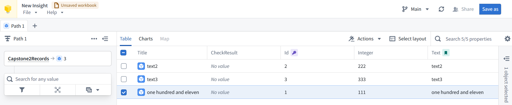

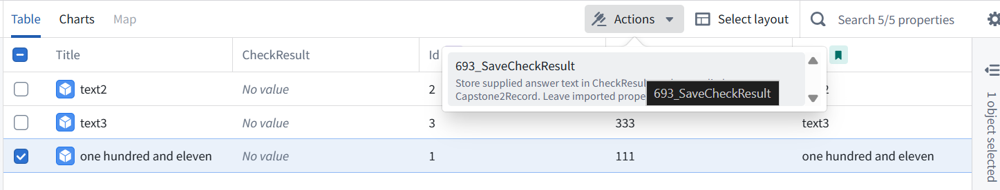

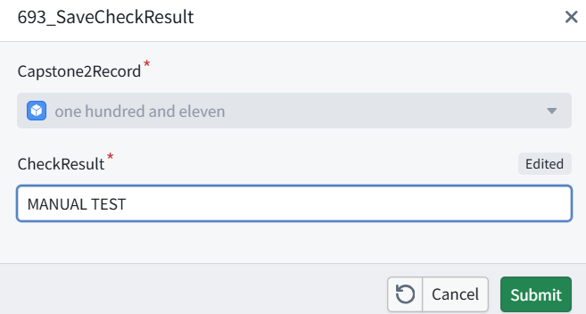

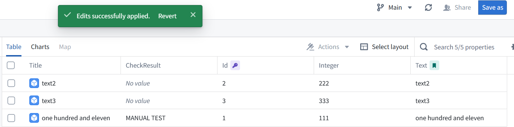
