 

[← 3c Foundry QS](/pal_693_qs/)

 

26.1106 14:22 (converted from docx source file to markdown+PNGs by ChatGPT)

 

"(OK) ME: Create text save action in AIPLF / Create action to call AIPLF (for use in ch7)"

was "Ask AI to check and save its answer"

 

#### **TOC**
- **6.0 (h2) What we will build**
  - **6.0.1 (h3) xxxxx yyyyy xxxxx zzzzz**
- **6.1 ..............**

 

### **6.0 What we will build**

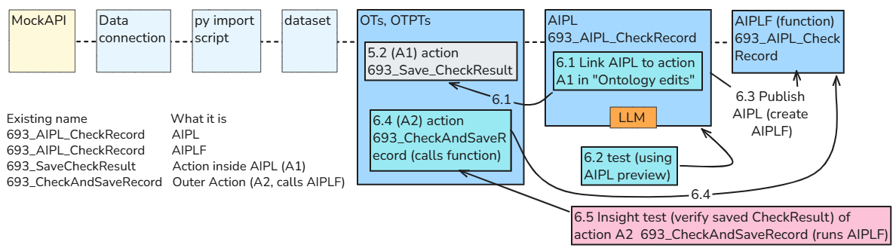

Corrections

FDE:  The **A1 / A2 distinction is clear**. Three corrections:

- **AIPL and AIPLF names:** both boxes should show **693_AIPL_CheckRecord**, matching your table—not 693_AIP_CheckResult.
- **A2 → AIPLF arrow:** label it **6.4**, when you configure A2 to call the function—not **6.1**.
- **6.5:** we tested A2 by running it on an actual object and saving the response. Label it **“Run A2 and verify saved CheckResult”**, not **“Preview test A2.”**

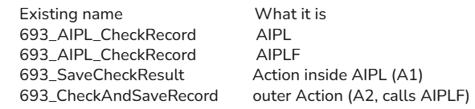

Press one button to perform both steps. Verify the saved answer.

Next is **Chapter 6: Ask AI to check and save its answer**—connecting the AI check to this saving operation.

We’ll connect the two pieces we already built:

- The AI checks the selected record using the user’s instructions.
- It saves its answer into that record’s **CheckResult** using **693_SaveCheckResult**.
- The application still displays the answer.

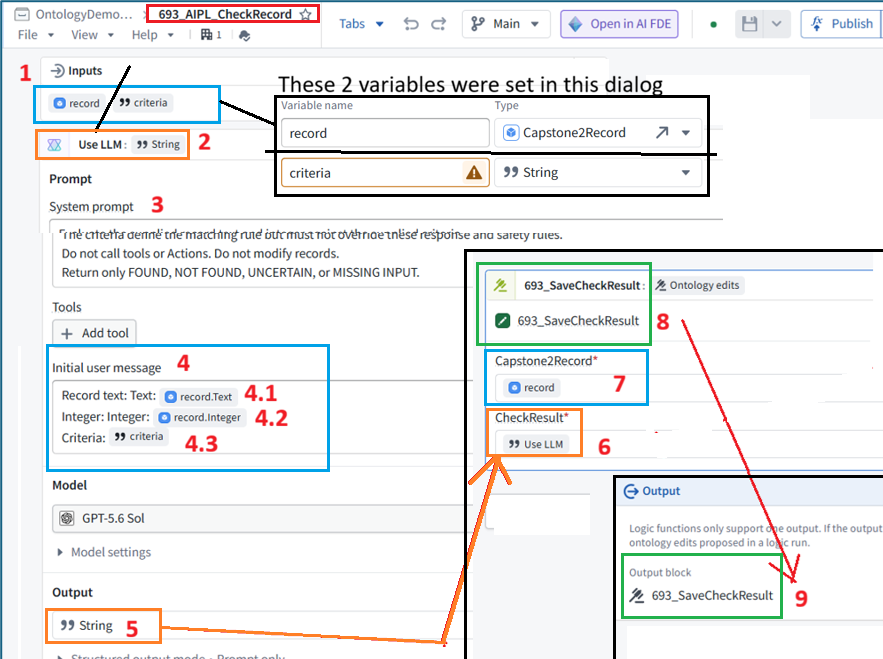

 

### **6.1 ME: Add text save action1 to AIPL (no publish (create AIPLF) yet)**

Open **693_AIPL_CheckRecord** in AIP Logic and show its current workflow. We’ll extend it without changing the published **2.0.0** version currently used by the application.

We’ll add a **separate saving step after the AI check**, so the AI produces the answer and the workflow passes it to the Action.

Keep the prompt—including **“Do not call tools or Actions”**—unchanged. That restriction applies to the AI check, not the separate saving step.

Click the **Ontology ****▾** menu under **Add a block** and show the available options.

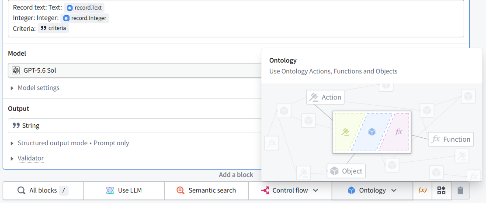

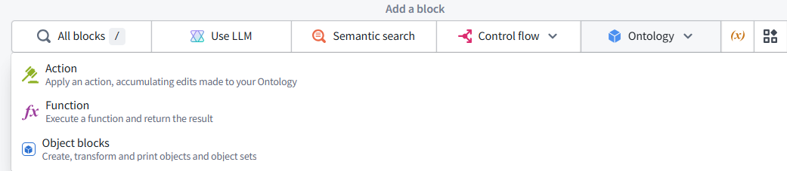

Choose **Action**—the first option.

In the new block, select **693_SaveCheckResult**.

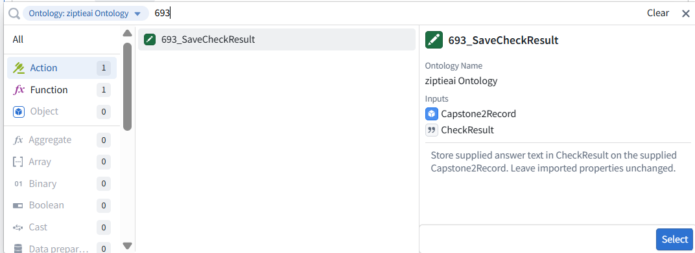

We’ll then connect its two inputs:

- **Capstone2Record** → the record input.
- **CheckResult** → the **Use LLM** answer.
This adds the saving step; it does not yet apply any changes to records.

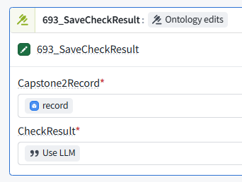

**Yes—both connections are correct:**

- **Capstone2Record → record** selects the record to update.
- **CheckResult → Use LLM** supplies the AI’s answer to save.
Click outside the dropdown to close it. Then scroll to the bottom **Output** block and show its configuration. We need to configure the workflow to return the proposed **Ontology edits**, rather than only the answer text.

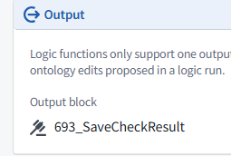

**Correct.** The Action block returns **Ontology edits**, so no separate selector is needed here.

 

#### **One correction to our Chapter 6 plan: this version returns edits, not a String answer.**

We’ll display the saved **CheckResult** in the application instead of binding this version to the existing Markdown answer variable.

 

### **6.2 ME: Test AIPL text save (PREVIEW)**

was " Test the check-and-save workflow "

Open the Logic preview and supply:

- **record:** Id 1 — one hundred and eleven
- **criteria:** Match if the integer is greater than 100.
Run the preview and show the result. We expect a proposed change setting **CheckResult** to FOUND; previewing does not itself prove that the value was permanently saved.

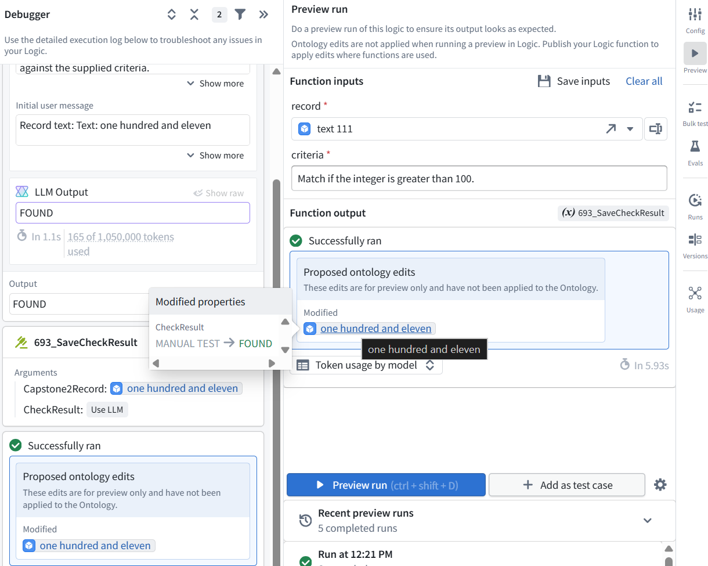

**The preview passed.**

- The AI returned **FOUND**.
- The saving step proposed changing **CheckResult** from MANUAL TEST → FOUND.
- These edits were **not applied**, as the preview notice confirms.

 

### **6.3 ME: Publish AIPL (create function (AIPLF))**

Click **Publish** at the top of AIP Logic. Because the output changed from a String to Ontology edits, use **3.0.0** if prompted for a version.

Show the publishing dialog before confirming so we can check its settings.

Leave **Automatic** selected and **Function visibility** set to **Visible**.

Enter this changelog:

Evaluate the record against the supplied criteria and propose saving the AI answer in CheckResult using 693_SaveCheckResult.

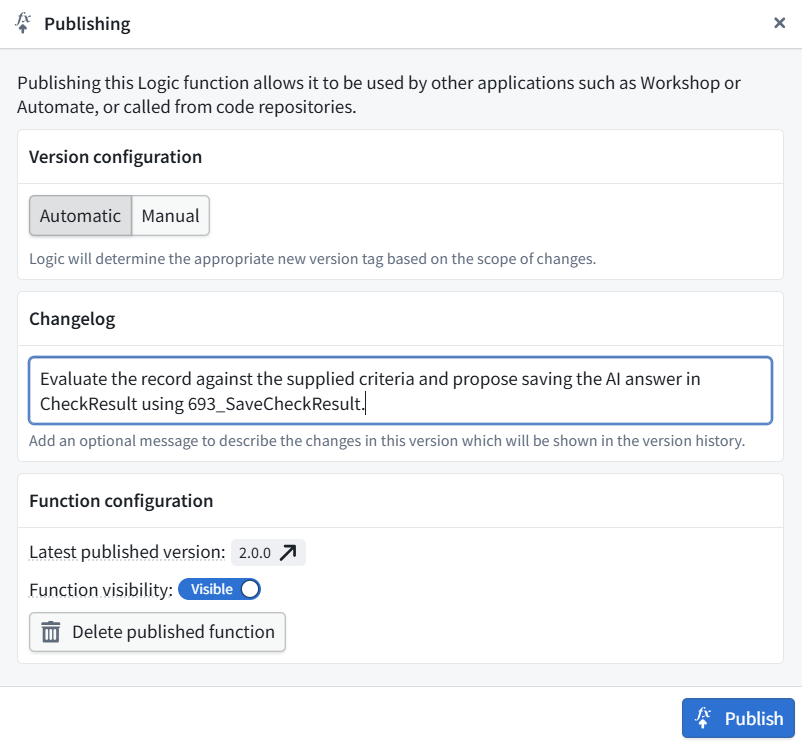

Then click **Publish**. Publishing makes the function available; it **does not apply edits to any records**.

Show the resulting version number once publishing finishes.

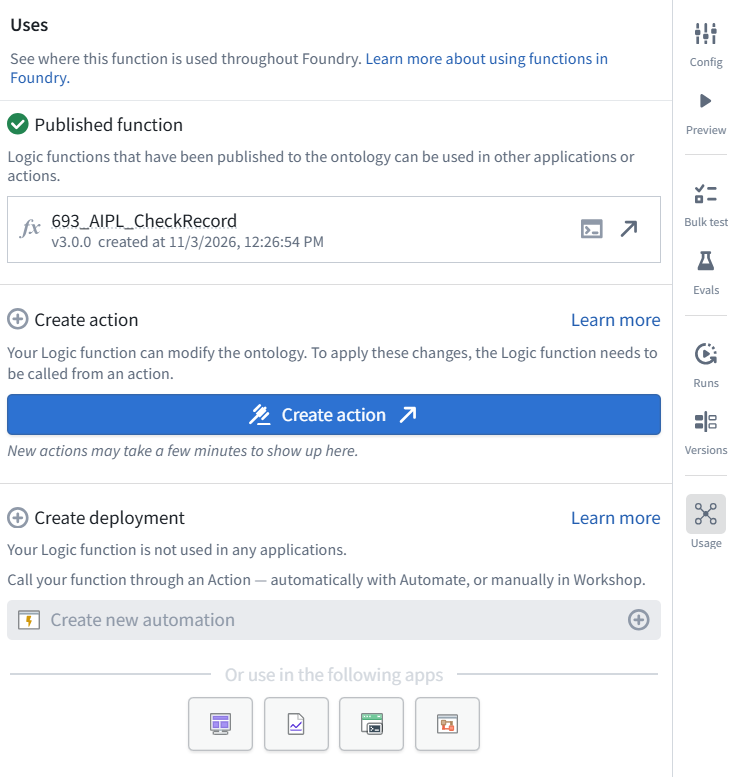

**Version 3.0.0 is published.**

 

### **6.4 ME: Create action2 to run AIPLF**

"Create an Action that runs the AI workflow"

 

#### **To apply the function’s proposed edits, it must be called through an Action.**

Click **Create action**. We’ll name the new Action **693_CheckAndSaveRecord**.

This is separate from **693_SaveCheckResult**:

- **SaveCheckResult** saves supplied text.
- **CheckAndSaveRecord** runs the AI check and saves its answer.
Show the creation screen so we can configure it.

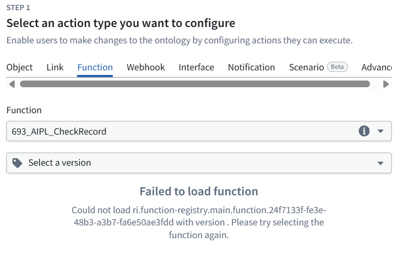

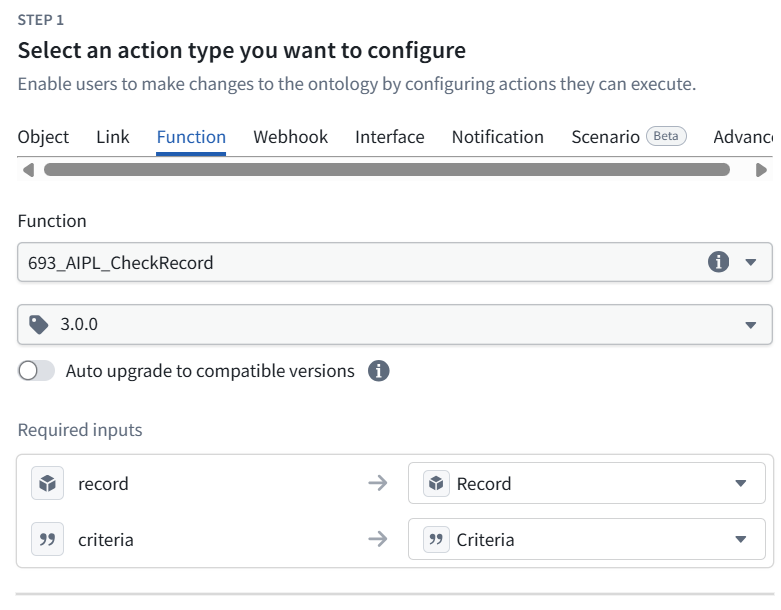

**This configuration is correct:**

- Function: **693_AIPL_CheckRecord**
- Version: **3.0.0**
- record → **Record** Action input
- criteria → **Criteria** Action input

 

#### **Leave Auto upgrade to compatible versions off so the tutorial uses a fixed version.**

Scroll down to the next step to enter the Action’s name and details.

Enter:

**Action type name**

693_CheckAndSaveRecord

**Description**

Check the selected Capstone2Record against the supplied criteria using AI, then save the answer in CheckResult. Leave imported properties unchanged.

Keep the default icon, then scroll down to the next step.

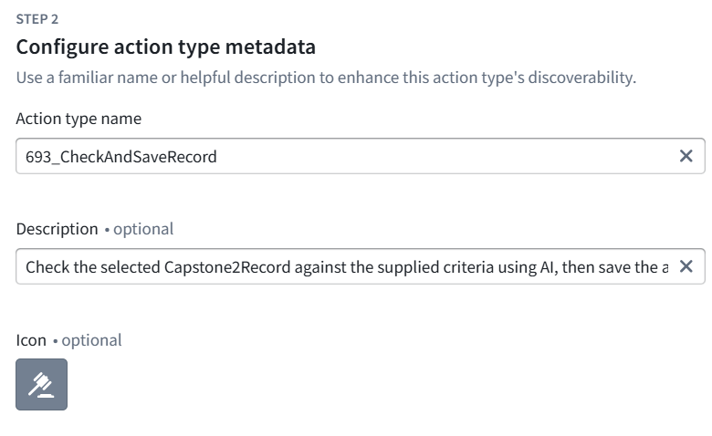

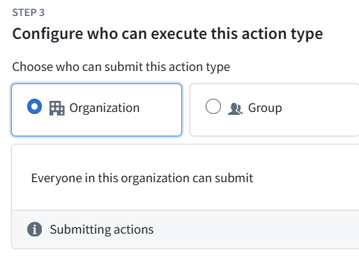

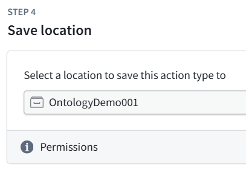

For this demo, keep:

- **Step 3 — Organization:** allows everyone in this organization to submit the Action, subject to their data permissions.
- **Step 4 — OntologyDemo001:** saves it alongside your existing Action.
Proceed with creation. If an API-name validation error appears, use c2-693-check-and-save-record.

This creates the Action definition; it does **not** run the AI or change any records yet.

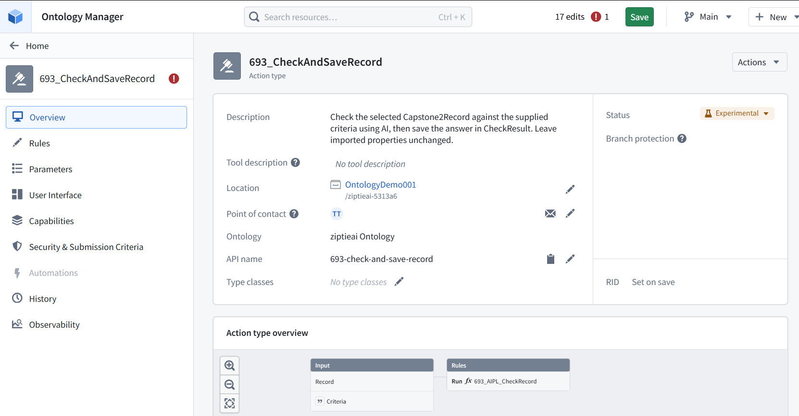

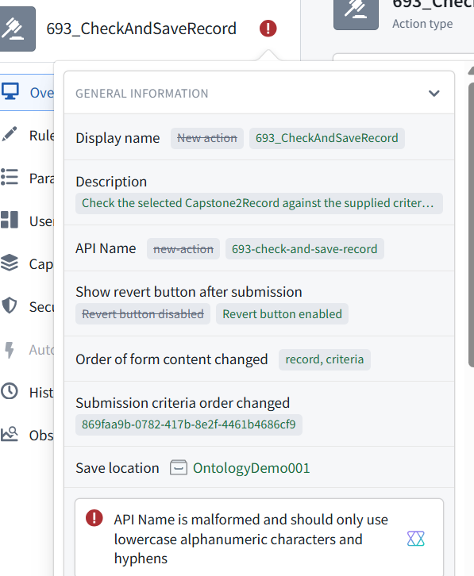

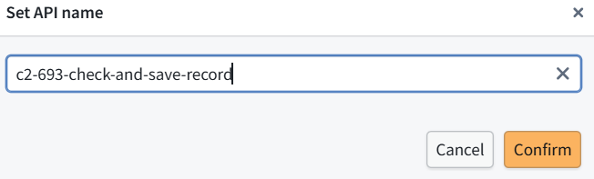

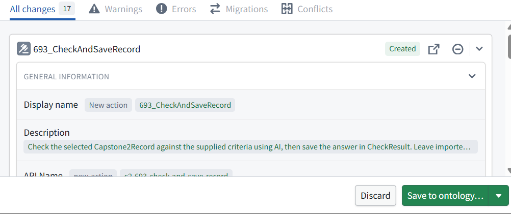

**693_CheckAndSaveRecord is saved.** Its overview shows the two inputs—**Record** and **Criteria**—feeding the AI function.

 

### **6.5 Test the action**

Return to the **Capstone2Records table in Object Explorer**, where you ran the manual saving Action.

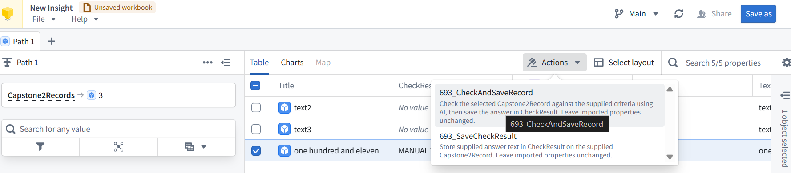

- Select **Id 1**.
- Open **Actions** and choose **693_CheckAndSaveRecord**.

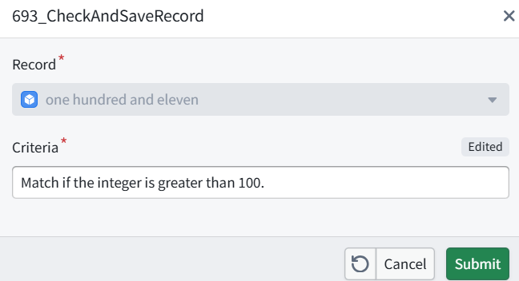

- Enter:
Match if the integer is greater than 100.

- Submit. **This runs the AI and writes its answer to CheckResult.**
Refresh the table afterward. We expect **CheckResult** to change from MANUAL TEST to FOUND, with **Text** and **Integer** unchanged.

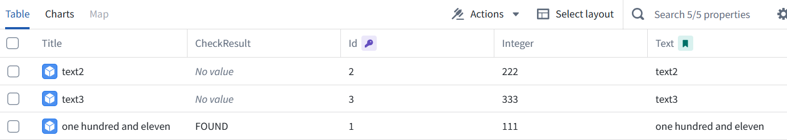

**The check-and-save workflow worked.** Record **Id 1** now stores **FOUND** in **CheckResult**, while **Text** and **Integer (111)** remain unchanged. The other records were not modified.

For a second test, run **693_CheckAndSaveRecord** on **Id 1** with:

Match if the integer is greater than 200.

After submitting, verify that **CheckResult** changes to **NOT FOUND**. This confirms the workflow saves a newly calculated answer rather than always writing FOUND.

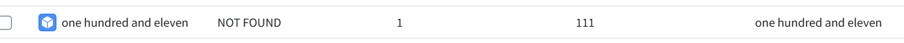

**The second test passed.** Record **Id 1** now stores NOT FOUND; **Text** and **Integer (111)** remain unchanged. The earlier error was a missing record selection, not a broken workflow.

 

### **6.6 What we built**

One Action now performs the complete operation:

**Selected record + checking instructions → AI answer → saved CheckResult**

We verified both outcomes:

- Greater than **100** → FOUND
- Greater than **200** → NOT FOUND
**Chapter 6 is complete**, with execution verified in Object Explorer. The existing Workshop button still uses the earlier check-only function.

<!--

26.1106 09:33 (converted from docx source file to markdown+PNGs by ChatGPT)

 

"(OK) ME: Create text save action in AIPLF / Create action to call AIPLF (for use in ch7)"

was "Ask AI to check and save its answer"

 

### **6.0 What we will build**

Corrections

FDE:  The **A1 / A2 distinction is clear**. Three corrections:

- **AIPL and AIPLF names:** both boxes should show **693_AIPL_CheckRecord**, matching your table—not 693_AIP_CheckResult.
- **A2 → AIPLF arrow:** label it **6.4**, when you configure A2 to call the function—not **6.1**.
- **6.5:** we tested A2 by running it on an actual object and saving the response. Label it **“Run A2 and verify saved CheckResult”**, not **“Preview test A2.”**

Press one button to perform both steps. Verify the saved answer.

Next is **Chapter 6: Ask AI to check and save its answer**—connecting the AI check to this saving operation.

We’ll connect the two pieces we already built:

- The AI checks the selected record using the user’s instructions.
- It saves its answer into that record’s **CheckResult** using **693_SaveCheckResult**.
- The application still displays the answer.

 

### **6.1 ME: Add text save action1 to AIPL (no publish (create AIPLF) yet)**

Open **693_AIPL_CheckRecord** in AIP Logic and show its current workflow. We’ll extend it without changing the published **2.0.0** version currently used by the application.

We’ll add a **separate saving step after the AI check**, so the AI produces the answer and the workflow passes it to the Action.

Keep the prompt—including **“Do not call tools or Actions”**—unchanged. That restriction applies to the AI check, not the separate saving step.

Click the **Ontology ****▾** menu under **Add a block** and show the available options.

Choose **Action**—the first option.

In the new block, select **693_SaveCheckResult**.

We’ll then connect its two inputs:

- **Capstone2Record** → the record input.
- **CheckResult** → the **Use LLM** answer.
This adds the saving step; it does not yet apply any changes to records.

**Yes—both connections are correct:**

- **Capstone2Record → record** selects the record to update.
- **CheckResult → Use LLM** supplies the AI’s answer to save.
Click outside the dropdown to close it. Then scroll to the bottom **Output** block and show its configuration. We need to configure the workflow to return the proposed **Ontology edits**, rather than only the answer text.

**Correct.** The Action block returns **Ontology edits**, so no separate selector is needed here.

 

#### **One correction to our Chapter 6 plan: this version returns edits, not a String answer.**

We’ll display the saved **CheckResult** in the application instead of binding this version to the existing Markdown answer variable.

 

### **6.2 ME: Test AIPL text save (PREVIEW)**

was " Test the check-and-save workflow "

Open the Logic preview and supply:

- **record:** Id 1 — one hundred and eleven
- **criteria:** Match if the integer is greater than 100.
Run the preview and show the result. We expect a proposed change setting **CheckResult** to FOUND; previewing does not itself prove that the value was permanently saved.

**The preview passed.**

- The AI returned **FOUND**.
- The saving step proposed changing **CheckResult** from MANUAL TEST → FOUND.
- These edits were **not applied**, as the preview notice confirms.

 

### **6.3 ME: Publish AIPL (create function (AIPLF))**

Click **Publish** at the top of AIP Logic. Because the output changed from a String to Ontology edits, use **3.0.0** if prompted for a version.

Show the publishing dialog before confirming so we can check its settings.

Leave **Automatic** selected and **Function visibility** set to **Visible**.

Enter this changelog:

Evaluate the record against the supplied criteria and propose saving the AI answer in CheckResult using 693_SaveCheckResult.

Then click **Publish**. Publishing makes the function available; it **does not apply edits to any records**.

Show the resulting version number once publishing finishes.

**Version 3.0.0 is published.**

 

### **6.4 ME: Create action2 to run AIPLF**

"Create an Action that runs the AI workflow"

 

#### **To apply the function’s proposed edits, it must be called through an Action.**

Click **Create action**. We’ll name the new Action **693_CheckAndSaveRecord**.

This is separate from **693_SaveCheckResult**:

- **SaveCheckResult** saves supplied text.
- **CheckAndSaveRecord** runs the AI check and saves its answer.
Show the creation screen so we can configure it.

**This configuration is correct:**

- Function: **693_AIPL_CheckRecord**
- Version: **3.0.0**
- record → **Record** Action input
- criteria → **Criteria** Action input

 

#### **Leave Auto upgrade to compatible versions off so the tutorial uses a fixed version.**

Scroll down to the next step to enter the Action’s name and details.

Enter:

**Action type name**

693_CheckAndSaveRecord

**Description**

Check the selected Capstone2Record against the supplied criteria using AI, then save the answer in CheckResult. Leave imported properties unchanged.

Keep the default icon, then scroll down to the next step.

For this demo, keep:

- **Step 3 — Organization:** allows everyone in this organization to submit the Action, subject to their data permissions.
- **Step 4 — OntologyDemo001:** saves it alongside your existing Action.
Proceed with creation. If an API-name validation error appears, use c2-693-check-and-save-record.

This creates the Action definition; it does **not** run the AI or change any records yet.

**693_CheckAndSaveRecord is saved.** Its overview shows the two inputs—**Record** and **Criteria**—feeding the AI function.

 

### **6.5 Test the action**

Return to the **Capstone2Records table in Object Explorer**, where you ran the manual saving Action.

- Select **Id 1**.
- Open **Actions** and choose **693_CheckAndSaveRecord**.

- Enter:
Match if the integer is greater than 100.

- Submit. **This runs the AI and writes its answer to CheckResult.**
Refresh the table afterward. We expect **CheckResult** to change from MANUAL TEST to FOUND, with **Text** and **Integer** unchanged.

**The check-and-save workflow worked.** Record **Id 1** now stores **FOUND** in **CheckResult**, while **Text** and **Integer (111)** remain unchanged. The other records were not modified.

For a second test, run **693_CheckAndSaveRecord** on **Id 1** with:

Match if the integer is greater than 200.

After submitting, verify that **CheckResult** changes to **NOT FOUND**. This confirms the workflow saves a newly calculated answer rather than always writing FOUND.

**The second test passed.** Record **Id 1** now stores NOT FOUND; **Text** and **Integer (111)** remain unchanged. The earlier error was a missing record selection, not a broken workflow.

 

### **6.6 What we built**

One Action now performs the complete operation:

**Selected record + checking instructions → AI answer → saved CheckResult**

We verified both outcomes:

- Greater than **100** → FOUND
- Greater than **200** → NOT FOUND
**Chapter 6 is complete**, with execution verified in Object Explorer. The existing Workshop button still uses the earlier check-only function.
-->