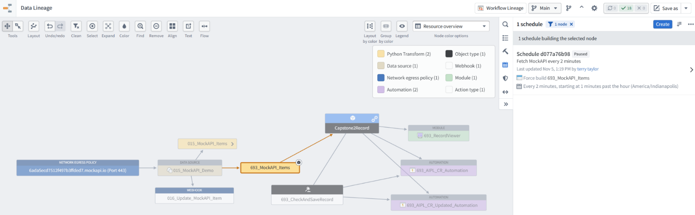

 

[← 3c Foundry QS](/pal_693_qs/)

 

_26.1110 16:41 (converted from docx source file to markdown+PNGs by ChatGPT)_

 

## **7-2 Data lineage / scheduling confusion (chat)**

730 ME: is data lineage equator or north?

731FDE: **Data Lineage is North in your configuration diagrams**—it is the user-facing app where you inspect dependencies and configure build schedules.

The datasets and build operations it manages are **Equator**.

732 ME2: so "data lineage" is basically my complete diagrams. i show the lineage of what happens to data.  
"schedule" belongs in dataset.  
for some reason it has been put in data lineage..

733 FDE2: **Yes—your diagrams show the broader workflow: how data enters Foundry, becomes objects, reaches the LLM, and produces a saved response.** Data Lineage overlaps with that, though your diagrams also explain configuration steps and user interactions.

And **placing scheduling beside the dataset is a natural expectation**. Foundry does provide a **Schedules** tab on the dataset page, but its advanced schedule editor opens in **Data Lineage**.

That placement supports schedules involving multiple datasets and upstream dependencies. **For your single-dataset demo, it adds a navigation jump without much benefit.** The tutorial should state that jump explicitly:

**Open the dataset’s Schedules tab. Advanced schedule configuration opens in Data Lineage.**

Summarize aboveRemove belowFork session

734 ME3: my point "data lineage" tool does have a graph shown the data flow (like my complete dialogs) ... but "scheduling" is specifically and only for datasets..

735 FDE3: Yes—**your point is about two distinct functions placed in one tool**:

**Data Lineage’s graph** shows data flow and dependencies, like your diagrams.

**Its scheduling controls** configure dataset builds.

In this demo, we open **Data Lineage to schedule a dataset build**, not to work on the lineage graph. I blurred that distinction in my explanation.

736 ME4: so logically "schedulling" does not belong in "data lineage". the reason i am pressing this point: i want to make sure i understand how it works. Please a very straight direct answer please.

Summarize aboveRemove belowFork session

737 FDE4: **Correct: scheduling and data lineage are separate functions.** Foundry puts dataset-build scheduling controls inside the Data Lineage app, but scheduling is not itself lineage.

**You are scheduling the dataset build—not the graph or the data flow.**

Summarize aboveRemove belowFork session

738 ME5: thanks... one major point of confusion removed.

Summarize aboveRemove belowFork session

739 FDE5: You’re welcome. I should have made that distinction directly from the start.

Summarize aboveRemove belowFork session

740 ME6: ps: scheduling is equator?

Summarize aboveRemove belowFork session

741 FDE6: **Yes—the schedule that triggers dataset builds is Equator.** The **Data Lineage screen used to configure it is North**.

743 I am totally confused by data lineage. 693_MockAPI_Items = datasource, right? but the color coding says "python transform"

744 FDE:  **693_MockAPI_Items is a dataset.** It is **not** the data connection source.

This graph colors it **“Python Transform” because a Python transform produces that dataset**. The legend describes how it is produced, rather than labeling it simply “dataset.”

**693_MockAPI_Items is also the source dataset for Capstone2Record.** “Source dataset” describes its role in that relationship; it does not make it a **Data Connection source**.

745 ME: so scheduling means when you run the pyscript?

746 FDE:  **Yes—in this demo, scheduling the dataset build determines when the Python script runs.**

Every two minutes:

**Run capstone2_items.py (Python script) → fetch MockAPI records → write them into 693_MockAPI_Items (dataset).**

747 ME: "693_AIPL_CR_Automation " is the name for the automation.  
why is "AIPL" part of that name?  
the automation puts a hook into the Object type, not AIPL?  
the hook checks for new/modified objects?

748 FDE: **Yes—the automation monitors objects, not AIPL.** “AIPL” is just part of the name we chose; it is not required.

You have **two automations** monitoring **Capstone2Record (object type)**:

Your “hook” description is a useful mental model. When the condition is met:

**Automation → 693_CheckAndSaveRecord (A2 Action) → AIPLF → LLM response committed to CheckResult**

The name includes “AIPL” because the downstream operation uses that AI workflow—not because AIPL is what the automation watches.

749 ME: AIPL is not only not required, its wrong and misleading?

750 FDE: **Yes—it is misleading ****for this demo****.** It suggests the automation monitors AIPL, when it actually monitors **Capstone2Record objects**.

Clearer names would be:

**693_NewObject_Automation**

**693_UpdatedObject_Automation**

The existing names don’t affect execution, but they obscure what triggers each automation.

751 ME: a lot of little obscurities = great frustration for a new user. my goal is not to criticize, but to get good results. and more happy new foundry users.

752 FDE: Understood. **Each unclear name adds another thing the reader must remember instead of understand.** Across a whole demo, that becomes exhausting.

Your corrections are improving the tutorial, not merely criticizing terminology. I contributed to the confusion with some naming choices and indirect explanations.

The standard should be: **name things by their role, identify what each resource is, and describe exactly what changes when the reader acts.**

