 

[← 6 Add A1/A2 Actions](/pal_693_qs_6_a1_a2/) / [↑ 3c Foundry QS](/pal_693_qs/) / [→ 8 Schedule (Data Lineage)](/pal_693_qs_8_schedule/)

26.1106 09:33 (converted from docx source file to markdown+PNGs by ChatGPT)

 

was "Check new records automatically"

Add a record in MockAPI and manually fetch the latest data. Verify that the new record is checked and its answer saved without pressing the checking button.

 

### **7.0 What we will build**

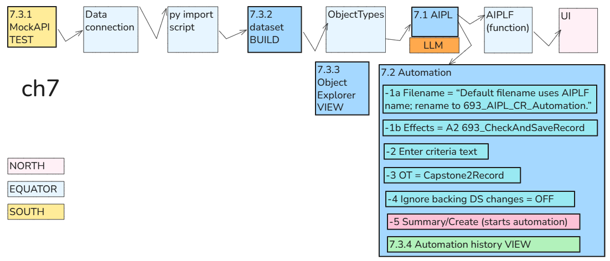

Until now, you selected a record and ran **693_CheckAndSaveRecord** manually. We’ll use **Automate** to run that Action when a **new Capstone2Record appears**.

For this chapter, use fixed checking instructions:

Match if the integer is greater than 100.

We’ll still fetch MockAPI records **manually**. Scheduling the fetch comes in Chapter 8.

**Chapter 7 is verified and complete.**

The execution history confirms:

- **Trigger reason:** Dataset changes
- **Triggered by:** automation test — the new record
- **Status:** All effects have completed
- **693_CheckAndSaveRecord:** **1 success, 0 failures**
**Manual fetch → new object → automatic AI check → saved CheckResult**

You manually fetched the records, but did **not** manually run the check. The automation detected **Id 4** and saved FOUND.

 

### **7.1 View AIPL / Usage (from this dialog create AIPLF automation)**

Return to **693_AIPL_CheckRecord** in AIP Logic and open **Usage** on the right-hand toolbar.

Show that panel so we can find the automation controls for the published function and its Action.

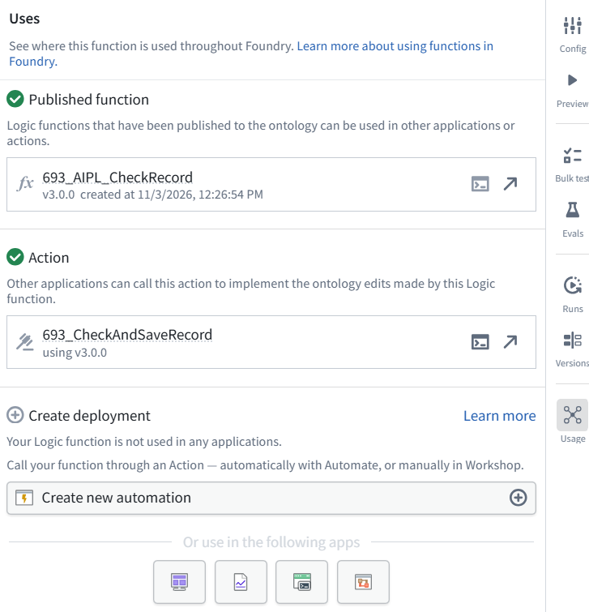

The panel confirms action **693_CheckAndSaveRecord** uses function **3.0.0**.

 

### **7.2 Create the automation 693_AIPL_CR_Automation (auto-activated)**

1 Click **Create new automation** under **Create deployment**. We’ll configure it for **new records only**, so updating **CheckResult** does not repeatedly trigger the same check.

*FDE: ****AIPLF******, version 3.0.0****.*

*Automate generated that default filename from the function’s name. The automation actually runs ****693_CheckAndSaveRecord (A2)****, which calls that AIPLF.*

***ME: ******but i opened the dialog from the AIPL?***

***FDE: ******Yes—you opened it from AIPL’s Usage panel.**** That panel lists the related resources:*

- ***Published function:**** AIPLF ****693_AIPL_CheckRecord, v3.0.0***
- ***Action:*** ***693_CheckAndSaveRecord (A2)***
***Create new automation**** uses that ****A2 Action****. The default filename borrows the AIPLF’s name, even though you started from the AIPL screen.*

 

#### **-1 Overview / Summary / AIPLF and A2**

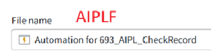

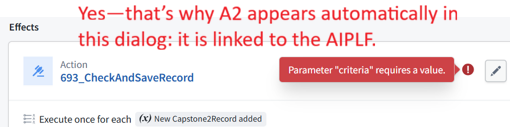

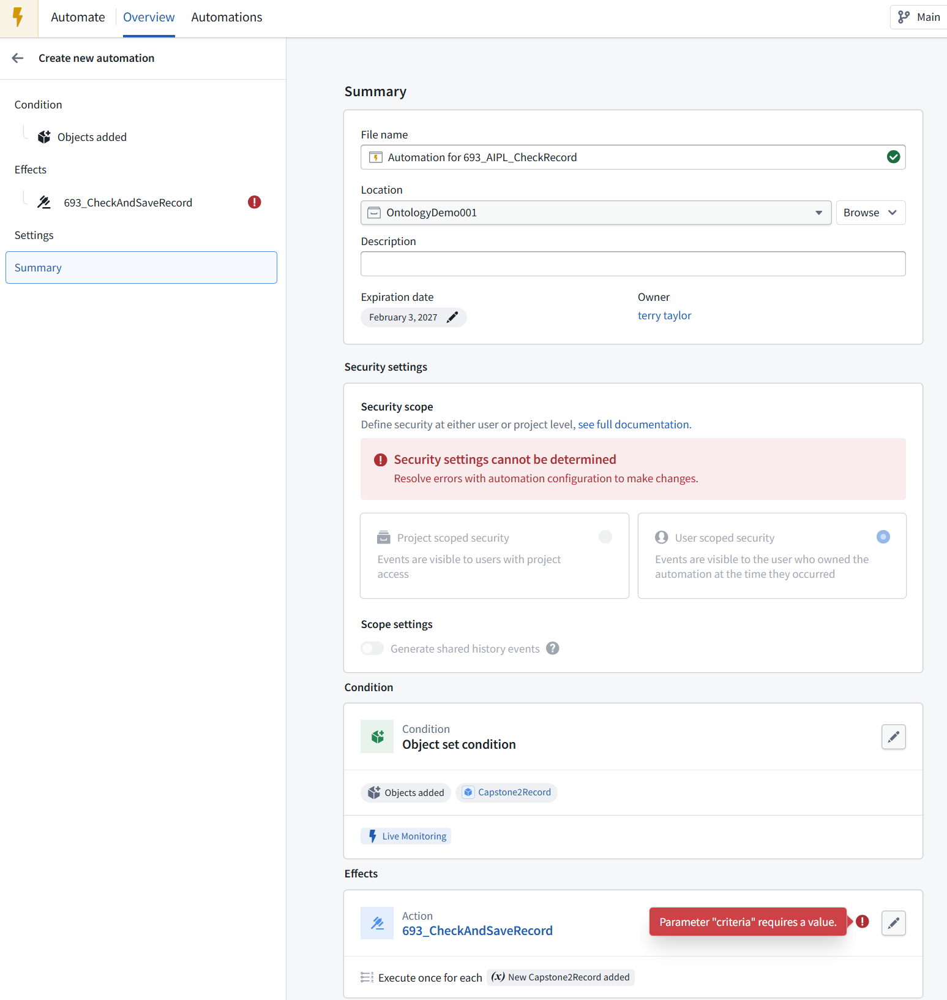

The automation already has the right structure:

- **Condition:** a Capstone2Record is added.
- **Effect:** run **A2 ****693_CheckAndSaveRecord** once for each new record.
The red error says the required **criteria** input is missing.

Click **693_CheckAndSaveRecord** under **Effects** in the left sidebar. We’ll supply:

Match if the integer is greater than 100.

Leave the security settings alone for now—the screen says configuration errors must be resolved before those settings can be determined.

 

#### **-2 Overview / Effects / A2 / Criteria static value**

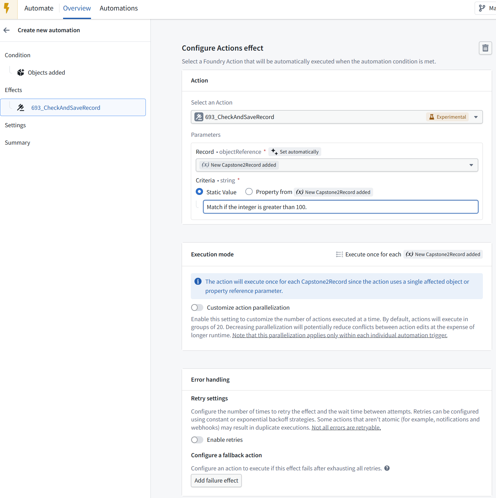

**The effect is configured correctly:**

- **Record:** the newly added Capstone2Record.
- **Criteria:** fixed text, Match if the integer is greater than 100.
- **Execution:** once for each new record.
Leave parallelization and retries unchanged for this demo.

 

#### **-3 Overview / Condition / Objects added (to set) / OT = Capstone2Record**

Next, click **Objects added** under **Condition** in the left sidebar. We’ll verify which object set is monitored before enabling the automation.

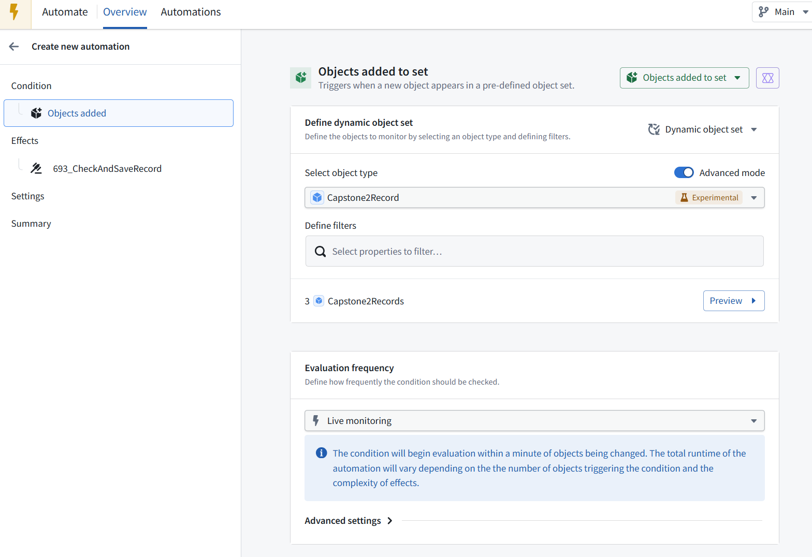

**The condition is correct:**

- **Objects added to set**
- Object type: **Capstone2Record**
- **No filters**—monitors the whole type.
- **Live monitoring**—the notice says evaluation begins within a minute of an object change, with processing time afterward.
Because **CheckResult** is not used in a filter, saving an answer won’t make the record leave and re-enter this set.

 

#### **-4 Expand Advanced settings**

so we can check whether existing objects are included when the automation starts.

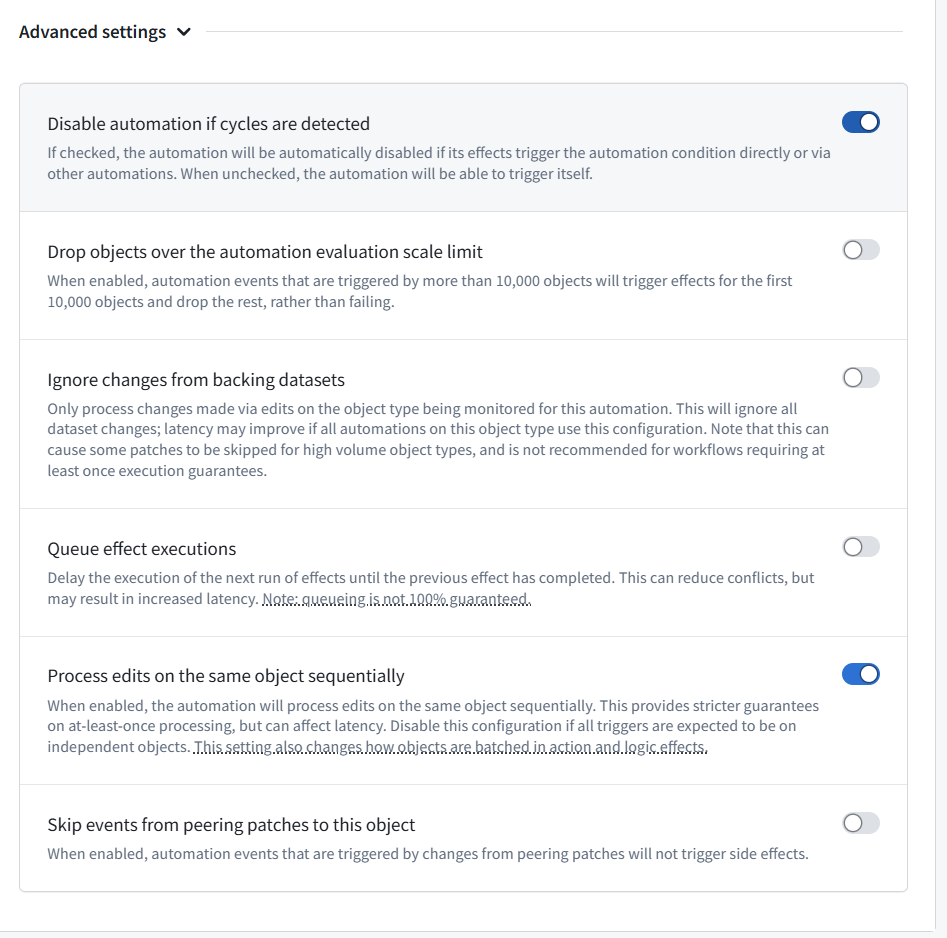

 

**Keep these defaults. Two are especially important:**

 

**Disable automation if cycles are detected — ON: keeps loop protection enabled.**

 

**Ignore changes from backing datasets — OFF: necessary so newly imported MockAPI records can trigger the automation.**

There’s no existing-object startup option shown here.

 

#### **-5 click Summary in the left sidebar.**

We’ll name the automation and review its security settings before creating it.

Yes—keep your name **693_AIPL_CR_Automation**.

Enter this **Description**:

When a new Capstone2Record appears, run 693_CheckAndSaveRecord with the criteria “Match if the integer is greater than 100.” and save the AI answer in CheckResult.

Keep **User scoped security** selected and **Generate shared history events** off for this demo. The summary shows **No action required**, and the effect has a green check.

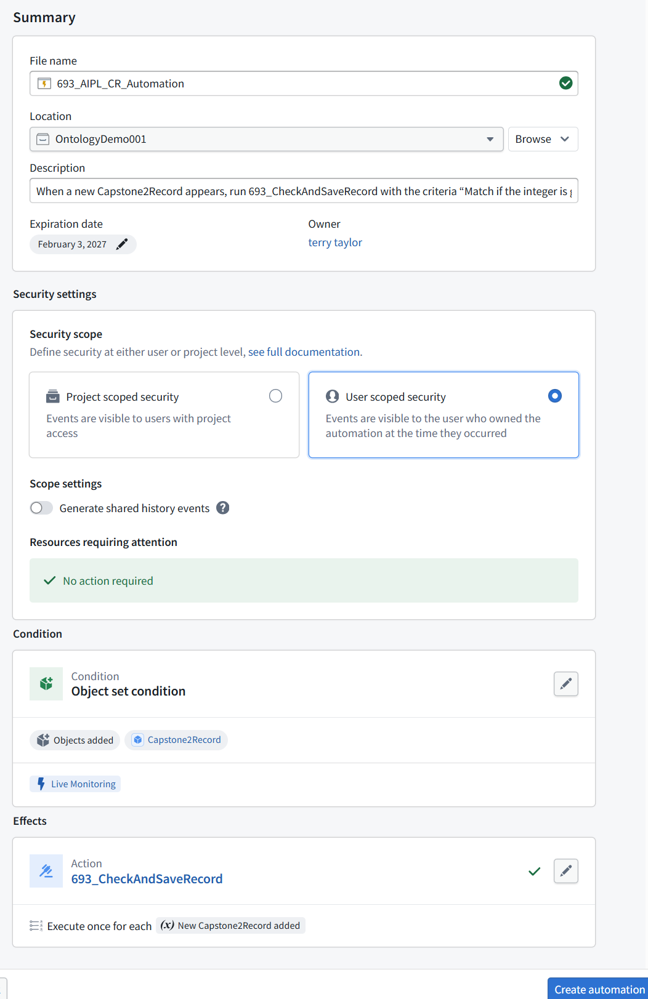

 

#### **-6 create automation**

If a confirmation or activation screen appears, show it before continuing.

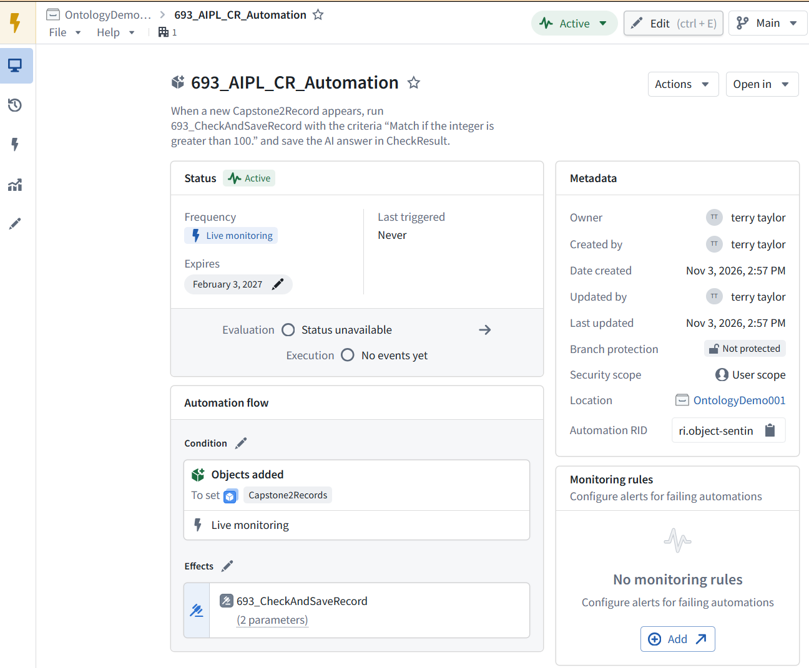

**The automation is created and Active.** It has not triggered yet (**Last triggered: Never**).

 

### **7.3 Test**

 

#### **7.3.1 Add MockAPI record**

In MockAPI, add this record **while preserving the existing three**:

{"id":"4","text":"automation test","integer":444}

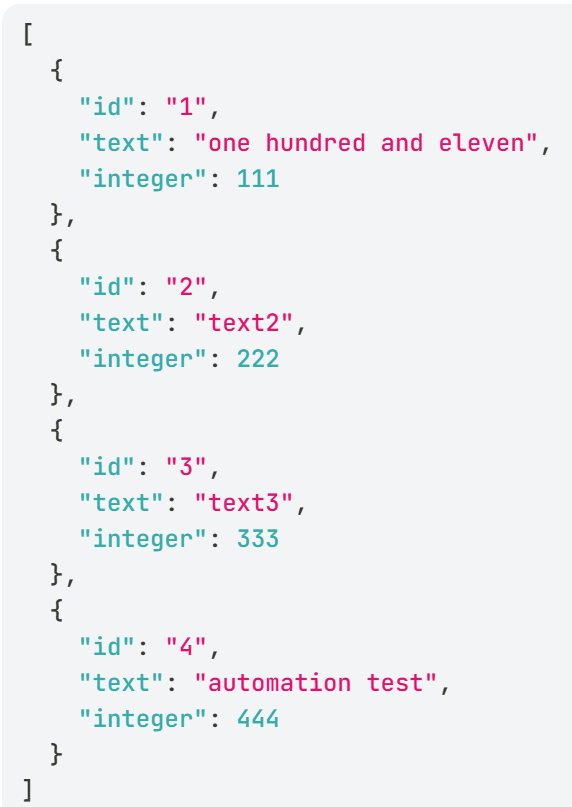

**Remember:** MockAPI’s **Data → Update** replaces the entire collection, so don’t paste only this record there.

 

#### **7.3.2 Build dataset 693_MockAPI_Items**

Then manually build the import that produces **693_MockAPI_Items**, as in Chapter 1. Once the new object is indexed, the automation should check it and save **FOUND** because 444 > 100.

We’ll verify both the automation’s execution history and record **Id 4**—do not run the check Action manually.

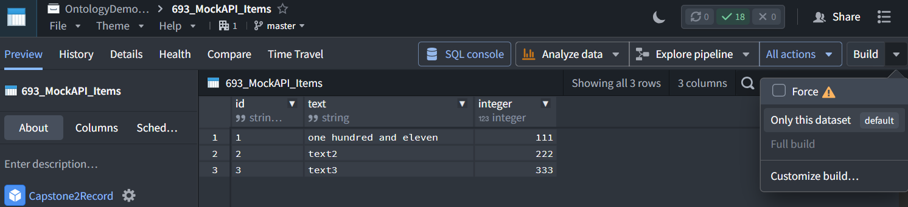

**Yes—this is where you run the import to fetch the MockAPI records into the dataset.**

After adding record **Id 4** in MockAPI:

- Keep **Only this dataset** selected.
- Enable **Force** so the import runs again even if Foundry sees no input changes—the external MockAPI change may not be detected.

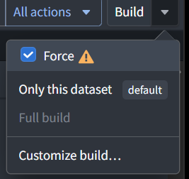

- Click **Build**.
check the dataset preview for **Id 4**.

Indexing and the automation run follow afterward.

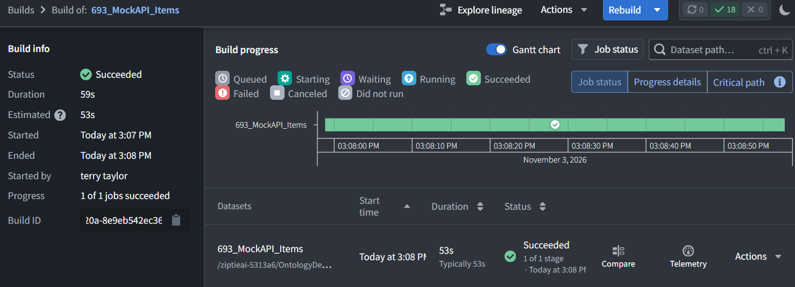

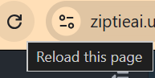

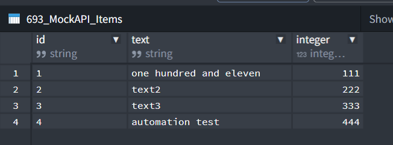

**The import succeeded:** the stored dataset now includes **Id 4**, automation test, integer **444**.

 

#### **7.3.3 Refresh the Capstone2Records table in Object Explorer**

Allow time for indexing and live monitoring, then check whether **Id 4 → CheckResult** becomes **FOUND**.

Do **not** run either Action manually—we’re testing the automation.

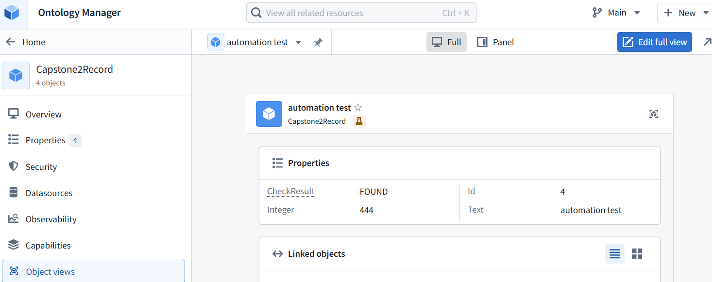

 

**The new object has the expected saved answer:**

- **Id:** 4
- **Text:** automation test
- **Integer:** 444
- **CheckResult:** FOUND
Since you did not run the Action manually, this is evidence that the automation checked the new record.

 

#### **7.3.4 Open 693_AIPL_CR_Automation / execution history.**

We’ll confirm the Action succeeded for this record before closing Chapter 7.

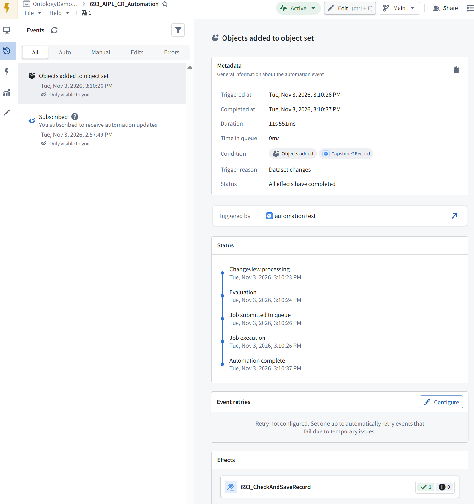

