 

[← 7 Add automation](/pal_693_qs_7_automation/) / [↑ 3c Foundry QS](/pal_693_qs/) / [→ 8a Add processing of updated objects](/pal_693_qs_8a_automate_updated/)

_26.1110 16:53 (converted from docx source file to markdown+PNGs by ChatGPT)_

 

## **8 Schedule (Data Lineage)**

**TOC**

- **[8.0 What we will build](#section-8-0)**
- **[8.0b Accessing applications](#section-8-0b)**
  - **[Build schedules / data lineage](#section-build-schedules-data-lineage)**
  - **[Dataset (not shown in list of applications)](#section-dataset-not-shown-in-list-of-applications)**
- **[8.1 Pause / Delete any existing old schedule](#section-8-1)**
  - **[8.1.1 Pause schedule (pause any schedule you are not using)](#section-8-1-1)**
  - **[8.1.2 Delete schedule](#section-8-1-2)**
- **[8.2 Create new schedule](#section-8-2)**
  - **[1 The schedule builds 693_MockAPI_Items (dataset) every two minutes.](#section-1)**
  - **[2 Each build runs capstone2_items.py (Python script) from 015_MockAPI_Import (repository).](#section-2)**
  - **[3 The script fetches records from MockAPI and writes them into the dataset.](#section-3)**
- **[8.3 Add a MockAPI item with a new (unused) ID](#section-8-3)**
- **[8.4 Trace the result (then pause the schedule)](#section-8-4)**
  - **[8.4.1a Dataset](#section-8-4-1a)**
  - **[8.4.1b Dataset Metrics / Schedule](#section-8-4-1b)**
  - **[8.4.2 Insight](#section-8-4-2)**
  - **[8.4.3 Automation](#section-8-4-3)**
  - **[8.4.4 UI](#section-8-4-4)**
- **[8.5 Test CheckRecord in UI (this is not automation)](#section-8-5)**

 

### **8.0 What we will build**

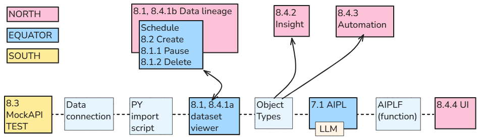

Schedule the Python import to fetch MockAPI records into **693_MockAPI_Items every two minutes**.

**The complete flow is:**

- **Scheduled Python import → **
- **dataset update → **
- **new Capstone2Record object → **
- **Chapter 7 automation → **
- **A2 → **
- **AIPLF → **
- **LLM response saved in CheckResult**

**We will:**

- Delete the old build schedule (if exists) and create a new one.
- Add a MockAPI item with a **new, unused Id**.
- Wait for the scheduled import—**without manually clicking Build or running an Action**.
- Verify the new object and its saved **CheckResult** in **Insight**, then verify the successful execution in **Automate**.
- Verify that the new object appears in **693_RecordViewer**.
- Pause the build schedule after testing.

**Note:**

- **Limitation:** the import fetches new and updated records, but the Chapter 7 automation processes **only newly added objects**. Updating an existing object does not trigger another AI operation.
- The separate **8.5 CheckRecord button test** runs the earlier response-only AIPLF from the UI. It does **not** save the response in CheckResult.

**Note: My tabs for this ch8 (all Foundry apps except for MockAPI.io)**

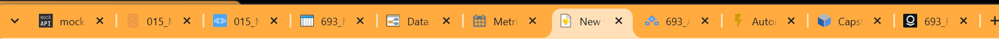

- MockAPI.io
- Data connection
- VS code
- Dataset
- Dataset metrics / schedule
- Data Lineage
- Build Schedules
- Insight
- AIP Logic (AIPL)
- Automation
- Ontology Manager
- Workshop (UI)

 

### **8.0b Accessing applications**

 

#### **Build schedules / data lineage**

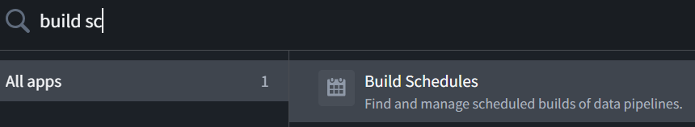

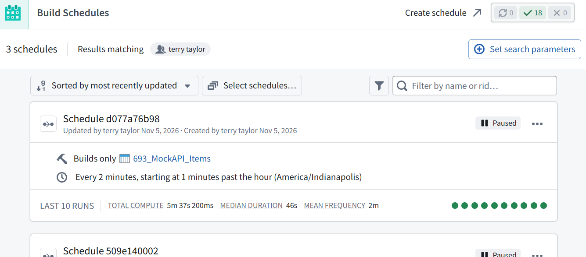

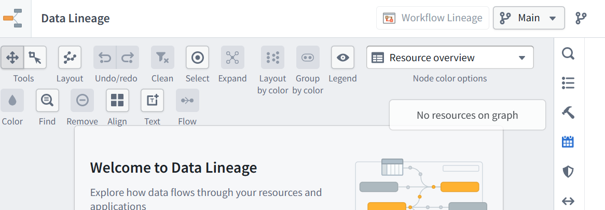

 

#### **Dataset (not shown in list of applications)**

This section addresses an important gap. 

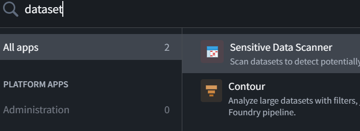

For the dataset entry, use:

**Open the existing dataset:** In the **OntologyDemo001** project, find and open **693_MockAPI_Items**. Then select **Preview → Schedules**.

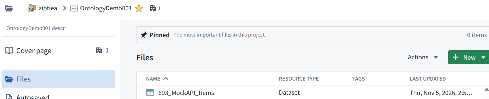

  
**Do not use New → Dataset**—that creates another dataset.

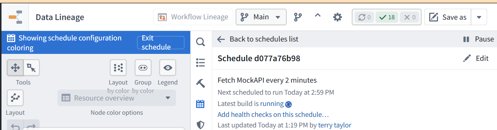

 

### **8.1 Pause / Delete any existing old schedule**

 

#### **8.1.1 Pause schedule (pause any schedule you are not using)**

- In **Data Lineage → Schedules**, open **Schedule d077a76b98**.
- Click **Pause**.
- Verify the schedule shows **Paused**.

Leave **693_AIPL_CR_Automation** active.

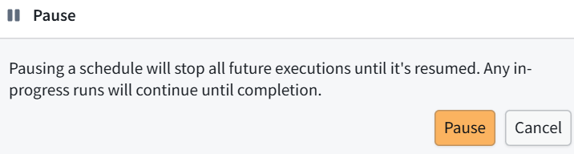

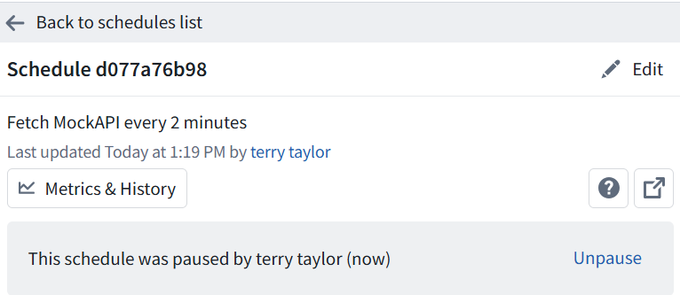

 

#### **8.1.2 Delete schedule**

In **Data Lineage**, click **Back to schedules list** at the top of the right-hand panel.

Show that list so we can locate the delete control for **Schedule afe13ab56b**. Leave it paused.

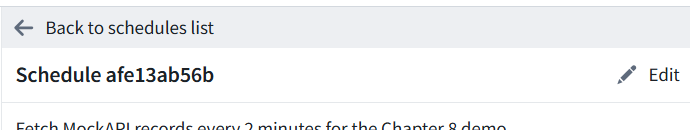

click Edit.

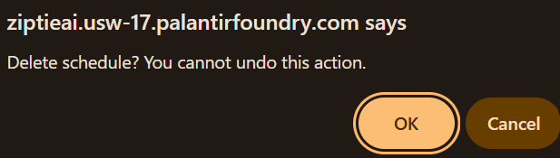

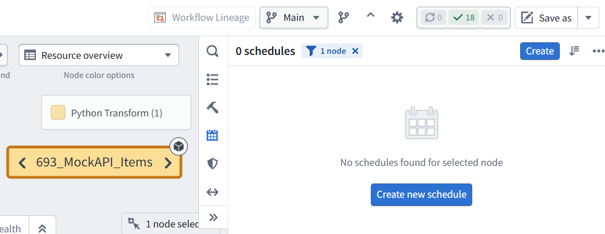

The delete control appearing only after **Edit** certainly made that harder to find.

**The old schedule is deleted:** the panel shows **0 schedules** for **693_MockAPI_Items**.

ME: no UI warning about the delete... only a browser popup.

Correct—the deletion confirmation was a **browser popup**, not a Foundry dialog.

 

### **8.2 Create new schedule**

 

#### **1 The schedule builds 693_MockAPI_Items (dataset) every two minutes.**

 

#### **2 Each build runs capstone2_items.py (Python script) from 015_MockAPI_Import (repository).**

 

#### **3 The script fetches records from MockAPI and writes them into the dataset.**

*015_MockAPI_Import (repository), showing capstone2_items.py (Python script).*

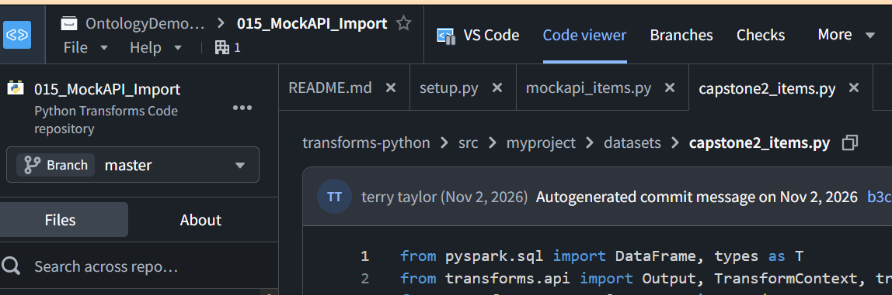

1 For this new schedule:

- **Schedule description:** Build 693_MockAPI_Items (dataset) every two minutes
- Keep **Targets-only** selected.
- Keep **693_MockAPI_Items (dataset)** as the target resource.
- Under **When to build**, select **At a specific time**.
- Set **Run every → 2 Minutes** and **Starting at → 1 minute past the hour**.

*The screenshot uses the older description “Fetch MockAPI every 2 minutes”; the description is only a label.*

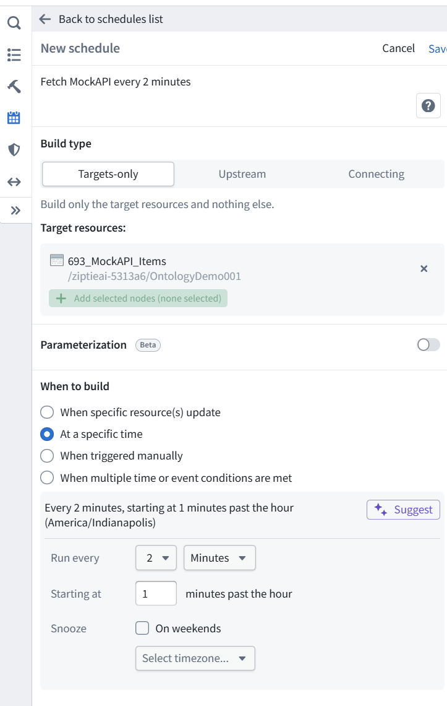

2 Expand **Advanced options** → enable **Force build** and acknowledge its warning.

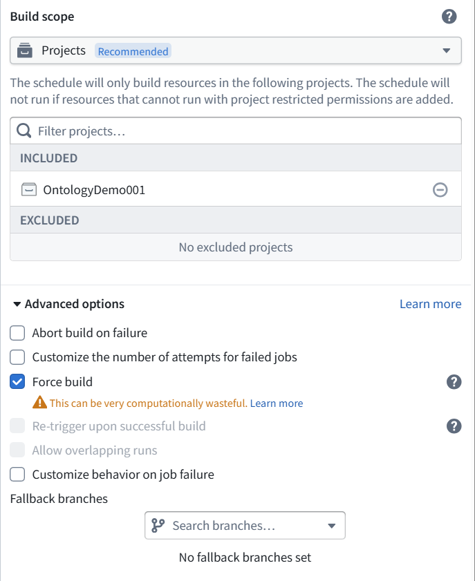

3 Click **Save** at the top of the above panel. This returns to Data Lineage dialog.

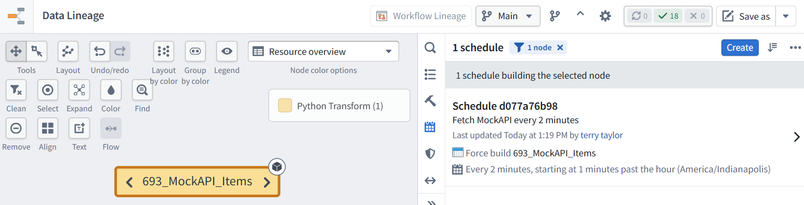

**The new schedule is saved and enabled.**

- **Schedule d077a76b98**
- Force builds **693_MockAPI_Items**
- Every **2 minutes**, at minutes **01, 03, 05, …**
- Timezone: **America/Indianapolis**

 

### **8.3 Add a MockAPI item with a new (unused) ID**

To test:

1 Add a MockAPI item with a **new, unused Id**, preserving existing items.

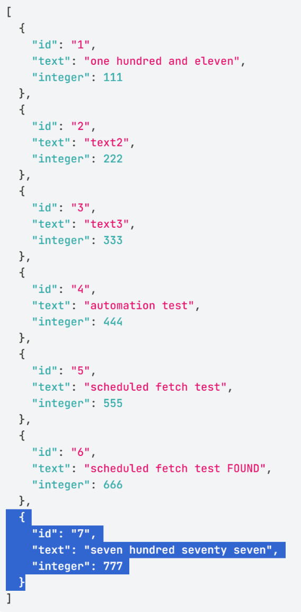

**Id 7 is new**, and the existing six items are preserved.

2 Save the MockAPI update, then wait for the scheduled import and automation. 

3 In **Ontology Manager → Capstone2Record**, look for **Id 7**. We expect **Integer = 777** and **CheckResult = FOUND**, using the automation’s criterion **“integer is greater than 100.”**

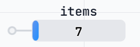

 

### **8.4 Trace the result (then pause the schedule)**

 

#### **8.4.1a Dataset**

**Correction:** I called it **Dataset Preview**, but it is **not listed as a standalone application in your app launcher**.

It is the **dataset viewer**, opened by opening **693_MockAPI_Items** from its project or folder. 

**Open 693_MockAPI_Items → Preview → Schedules.**

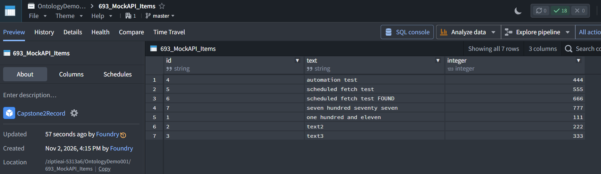

 

#### **8.4.1b Dataset Metrics / Schedule**

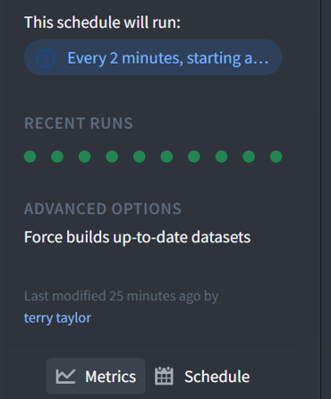

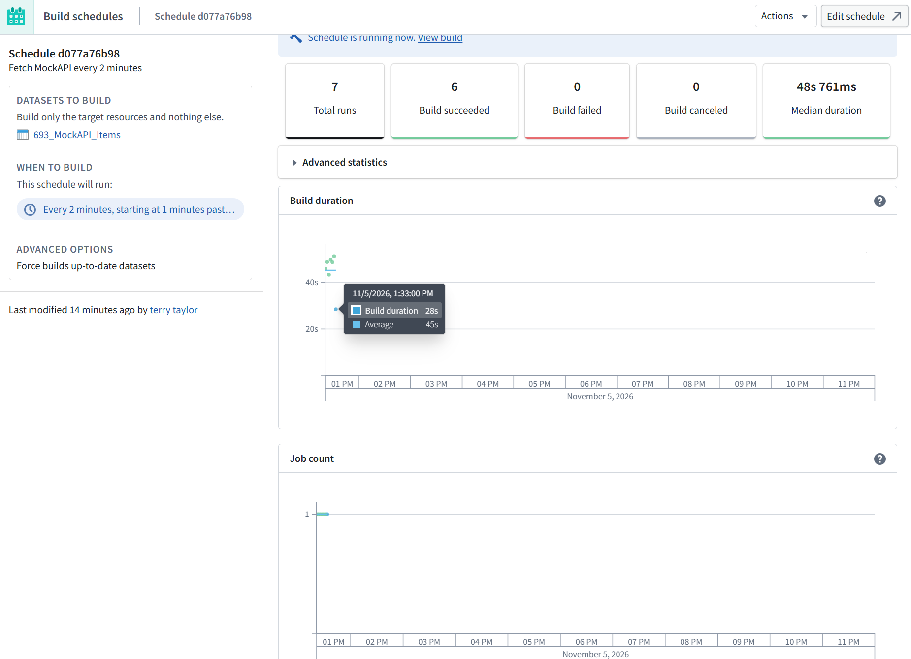

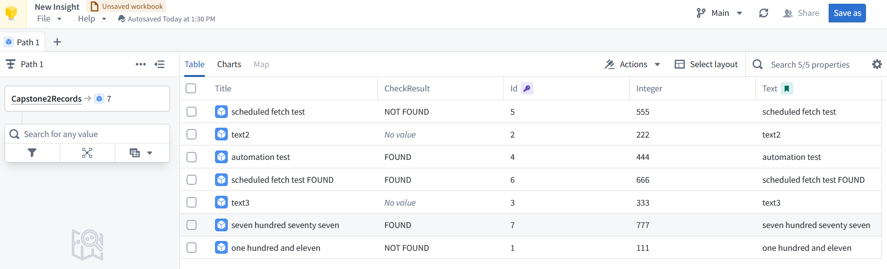

 

#### **8.4.2 Insight**

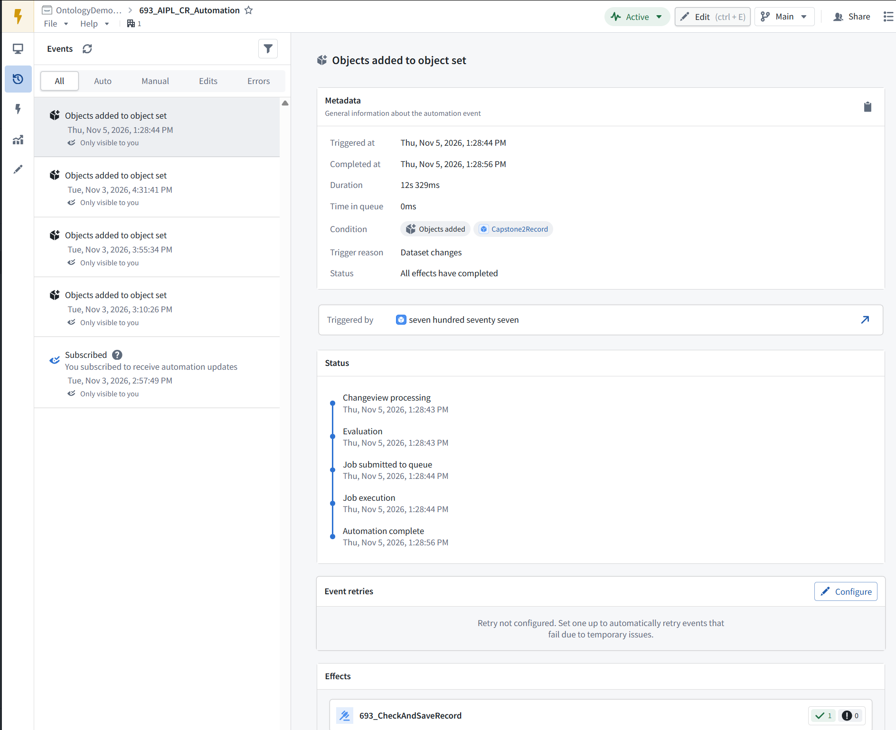

 

#### **8.4.3 Automation**

 

#### **8.4.4 UI**

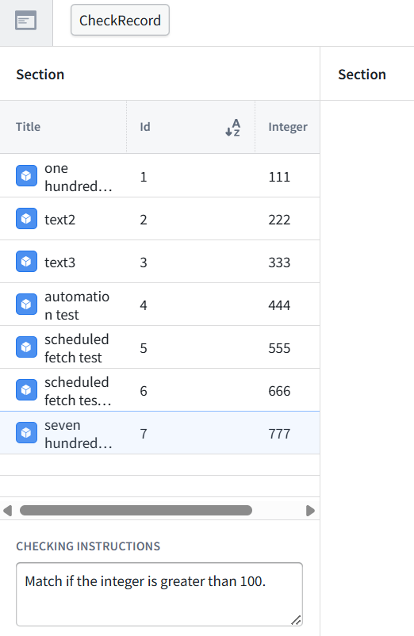

 

### **8.5 Test CheckRecord in UI (this is not automation)**

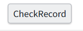

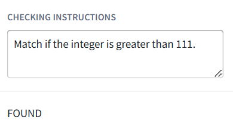

