 

[← 8 Schedule (Data Lineage)](/pal_693_qs_8_schedule/) / [↑ 3c Foundry QS](/pal_693_qs/) / [→ 8b Governance](/pal_693_qs_8b_governance/)

 

_26.1110 16:57 (converted from docx source file to markdown+PNGs by ChatGPT)_

 

This chapter should have been after ch7. But in this QS version it was done after ch8. A future QS version will fix the order.

**TOC**

- **[7b.0 What we will build](#section-7b-0)**
- **[7b.1 Inspect the automation’s trigger options](#section-7b-1)**
- **[7b.2 Create a second automation so that the Ch7 automation continues handling new objects](#section-7b-2)**
- **[7b.3 Test an update to an existing object](#section-7b-3)**
- **[7b.4 End to end (add DS build scheduling)](#section-7b-4)**
  - **[End-to-end test](#section-end-to-end-test)**
  - **[The end-to-end update test passed](#section-the-end-to-end-update-test-passed)**

 

### **7b.0 What we will build**

- **7****b is a logical extension of Chapter 7.**** ****Run the AI operation again when an object’s Text or Integer changes****. **The Chapter 7 automation processes only newly added objects. In this chapter, extend the automation setup to also process existing objects when their **Text or Integer** properties change.

- **Do not trigger on CheckResult changes**, because the AI operation writes that property and could trigger itself repeatedly.

- **Test:** change an existing object’s Integer from **55 to 555**, import the update, and verify that **CheckResult changes from NOT FOUND to FOUND** without manually running an Action.

- Once implemented, update Chapter 8’s limitation note to reflect the added behavior.

 

### **7b.1 Inspect the automation’s trigger options**

Check the available update triggers before changing the existing automation.

Open **Automate**.

Open **693_AIPL_CR_Automation (automation)**.

Click **Edit**.

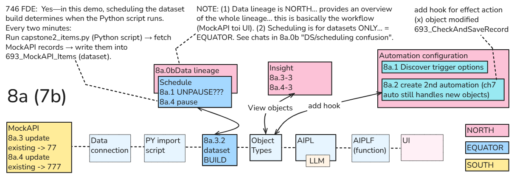

Select **Objects added** under **Condition**.

Open the **Objects added to set ****▾** dropdown at the top.  Objects modified in a set is the trigger we need.

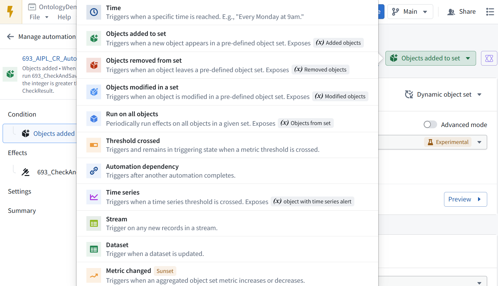

 

### **7b.2 Create a second automation so that the Ch7 automation continues handling new objects**

Close the dropdown.

Leave the editor **without saving changes**.

Return to the automation’s overview and open **Actions**. That menu shows the duplicate/copy options.

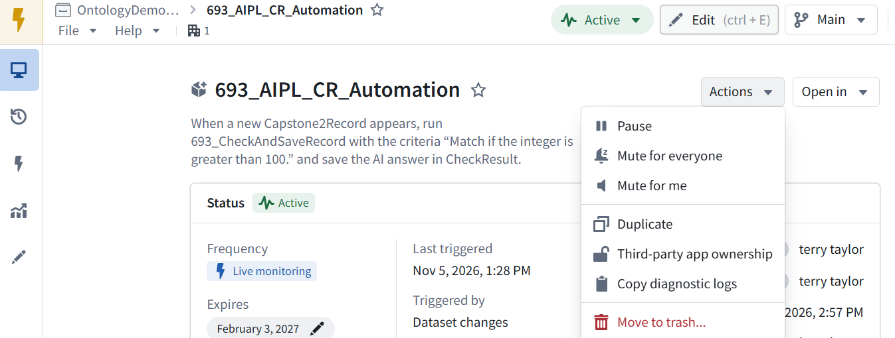

Click **Duplicate**.

Name the copy **693_AIPL_CR_Updated_Automation (automation)** if prompted. Keep **OntologyDemo001** as its location.

View the next screen **before activating the copy** so we can change its trigger and select which properties to monitor. 

Set **File name** to:693_AIPL_CR_Updated_Automation

Replace **Description** with:
When an existing Capstone2Record object's Text or Integer changes, run 693_CheckAndSaveRecord to update CheckResult.

Click the pen for  **Object**** set condition**.

In the dropdown shown, click **Objects modified in a set** at the bottom.

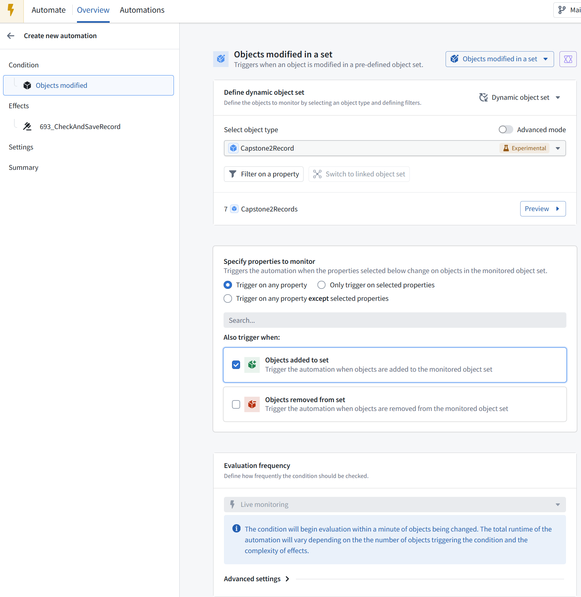

Under **Specify properties to monitor** Select **Only trigger on selected properties**.

Use **Search…** to select **Text** and **Integer** only. **Do not select CheckResult.**

Under **Also trigger when**, uncheck **Objects added to set**—the original automation already handles new objects.

Leave **Objects removed from set** unchecked. View the selected properties before continuing.

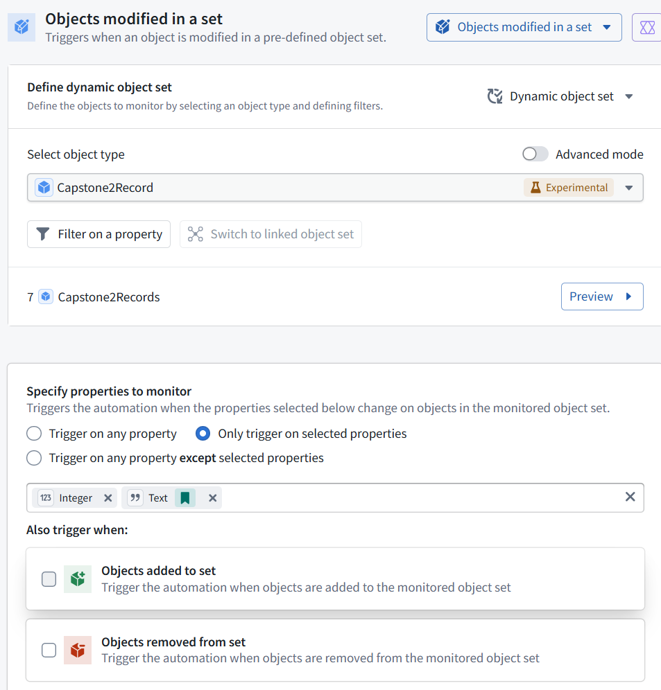

**Correct:** only changes to **Integer** or **Text** will trigger this automation. Added and removed objects are unchecked. Next, open **693_CheckAndSaveRecord (A2 Action)** under **Effects**—use its pencil if needed. Verify that **Record** refers to the **modified object**, rather than the previously configured “new object added.”

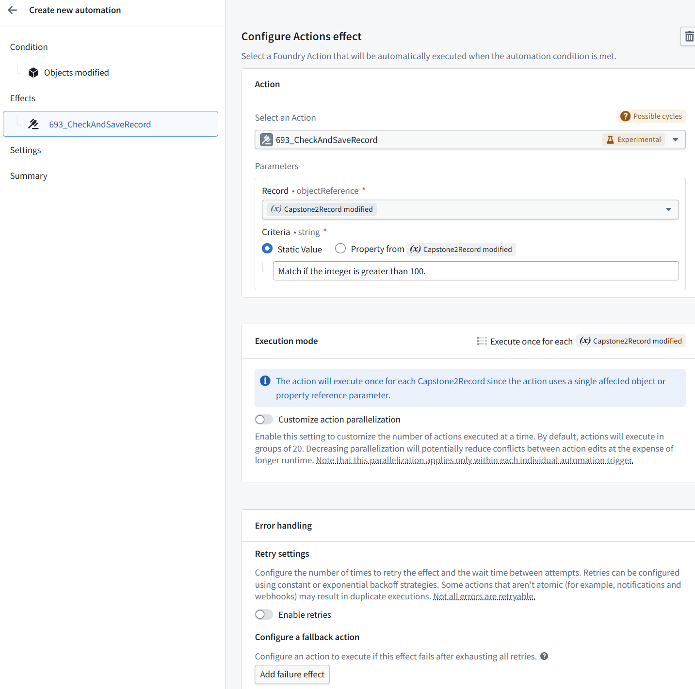

**The inputs are correct:**

**Record:** Capstone2Record modified

**Criteria:** Match if the integer is greater than 100.

There is a **Possible cycles** warning. Click or hover over that warning and show its explanation. **Do not create the automation yet**—we should inspect the warning even though we excluded CheckResult from the monitored properties.

The warning says the Action modifies objects in the monitored set. **Our configuration monitors only Text and Integer; A2 writes only CheckResult**, so that write should not retrigger this automation.

**Keep cycle detection enabled.**

Next, open **Condition → Objects modified → Advanced settings** and verify:
**- ****Disable automation if cycles are detected:** ON
**- ****Ignore changes from backing datasets:** OFF

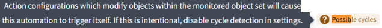

Then return to **Summary** and show it before creating the automation.

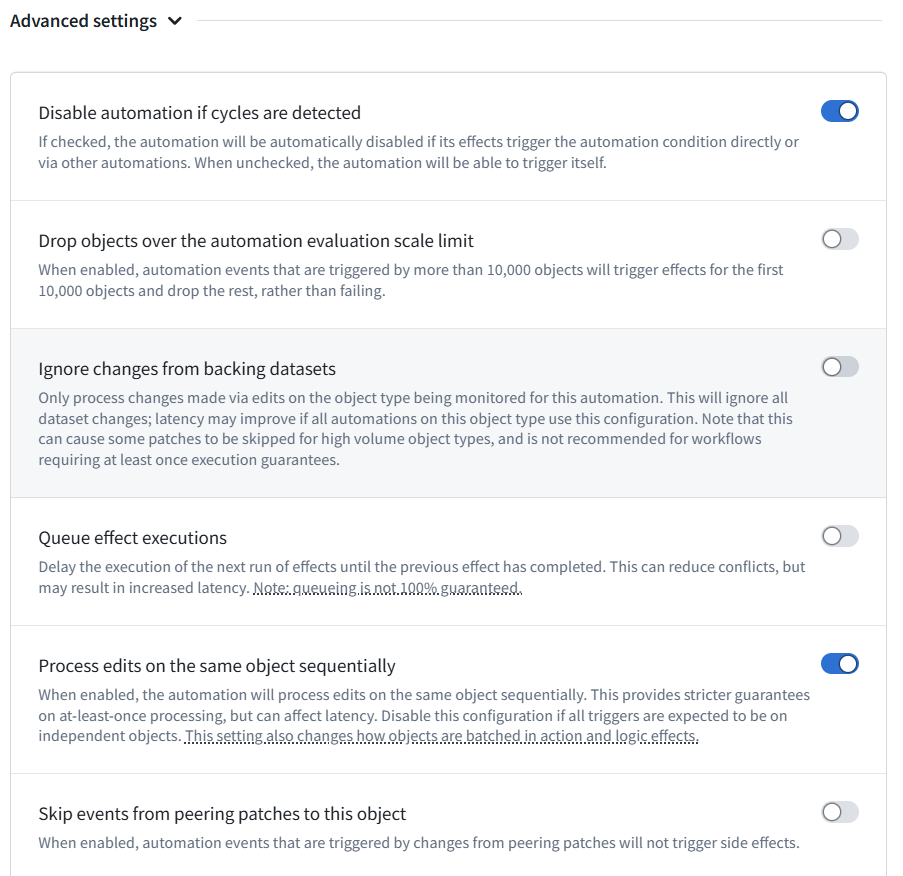

**The configuration is ready:**
- **693_AIPL_CR_Updated_Automation (automation)** monitors changes to **Text and Integer**.
- **693_CheckAndSaveRecord (A2 Action)** receives the modified object.
- Cycle detection is **ON**.
**- ****Ignore changes from backing datasets** is **OFF**.
- Summary shows **No action required**.

Click **Create automation** at the bottom right.

Then confirm its status is **Active** before we modify a test record.

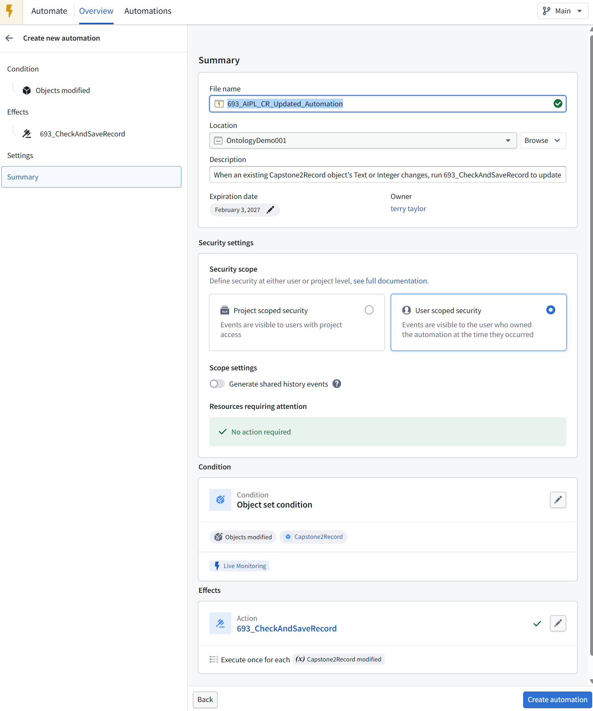

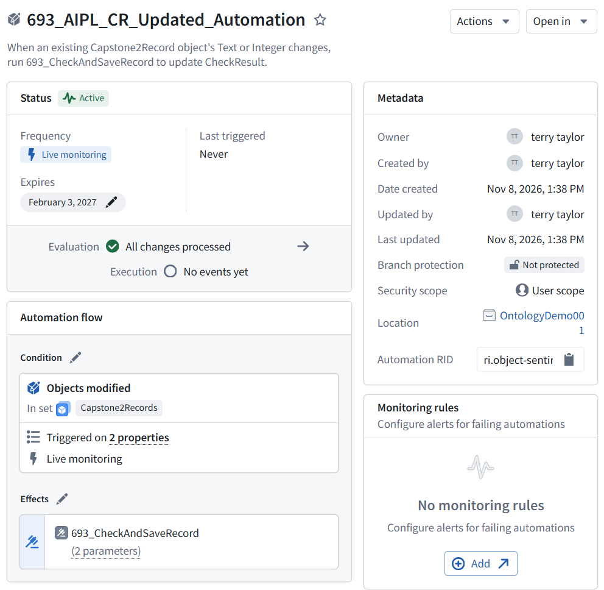

**693_AIPL_CR_Updated_Automation (automation) is Active. No events have run yet.**

 

### **7b.3 Test an update to an existing object**

In **MockAPI**, change only the integer of existing item **Id 7** from **777 to 77**. Preserve its Id, text, and all other items.

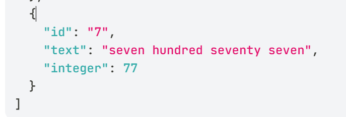

Build **693_MockAPI_Items (dataset)** once, with **Force** enabled, to import the change.

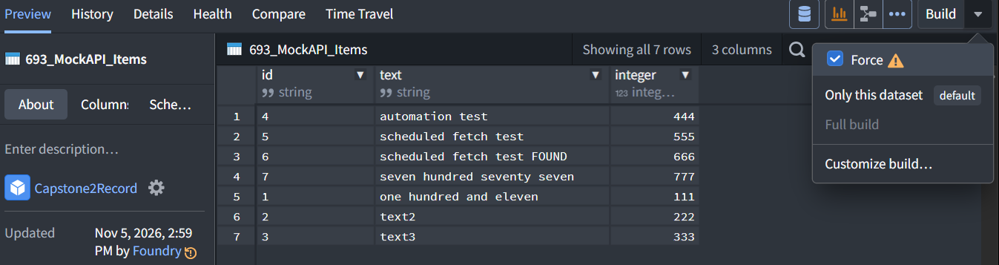

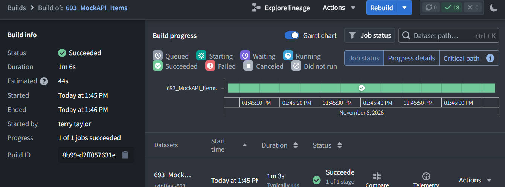

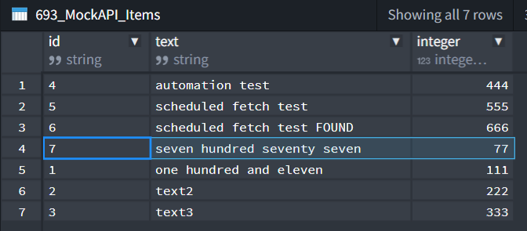

In **Insight**, refresh the **Capstone2Record objects** table.
Expected for **Id 7**:
**- ****Integer:** 77
**- ****CheckResult:** changes from FOUND to NOT FOUND

**Do not manually run A2.** We’re testing whether the updated-object automation runs it.

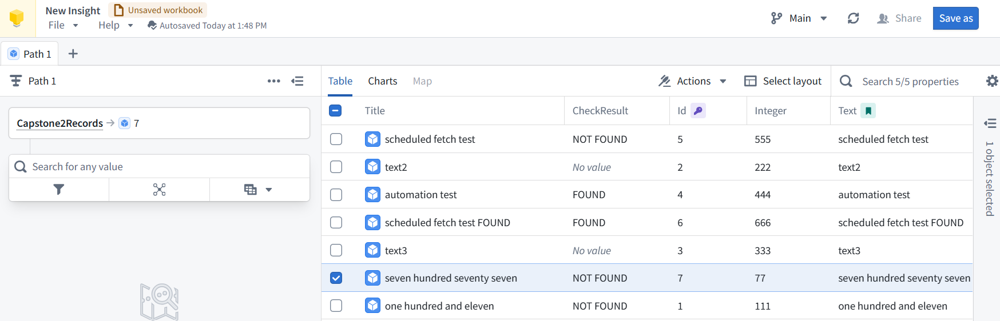

**The update test passed.** In **Insight**, existing object **Id 7** now shows:
**- ****Integer:** 77
**- ****CheckResult:** NOT FOUND—previously FOUND
**- ****Text:** unchanged

Next, open **Automate → 693_AIPL_CR_Updated_Automation (automation) → clock/history icon**.

Select the newest event and verify that **Id 7** triggered it and **693_CheckAndSaveRecord (A2 Action)** completed successfully.

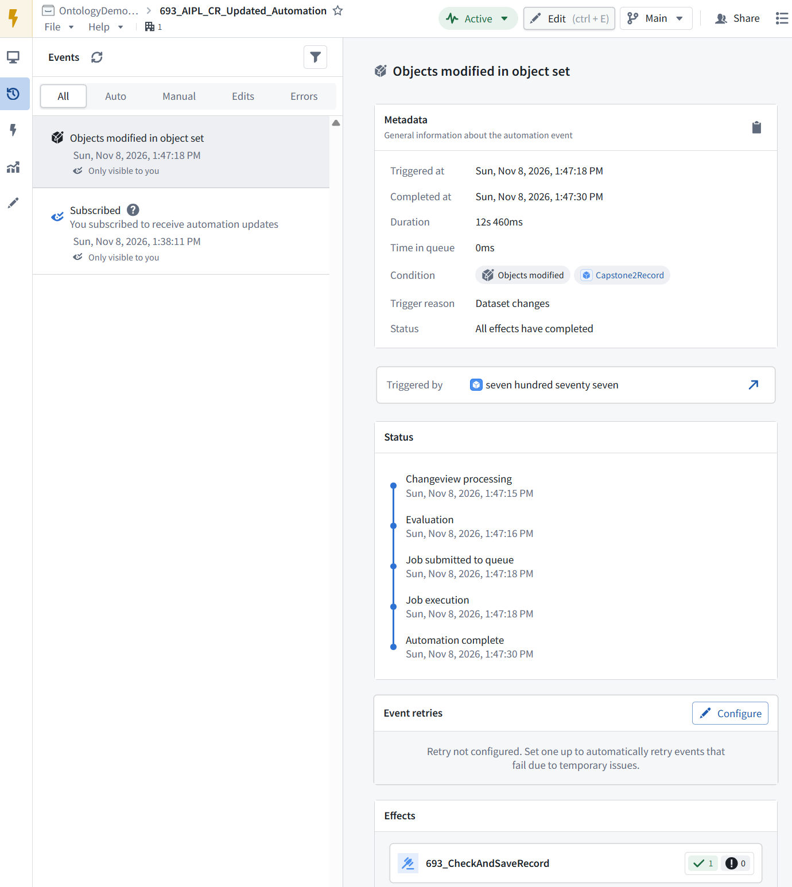

 

### **7b.4 End to end (add DS build scheduling)**

The AI operation was automatic, but fetching the changed MockAPI data was manual.  To make the whole flow automatic, resume the **Chapter 8 build schedule for 693_MockAPI_Items (dataset)**:

- **Scheduled dataset build → Python script fetches MockAPI records → object properties update → updated-object automation runs A2 → CheckResult is committed**

The schedule targets the **dataset**, not the data connection.

 

#### **End-to-end test**

In **Data Lineage**, open the build schedule for **693_MockAPI_Items (dataset)** and click **Unpause** if paused.

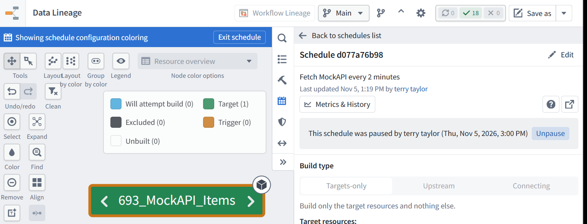

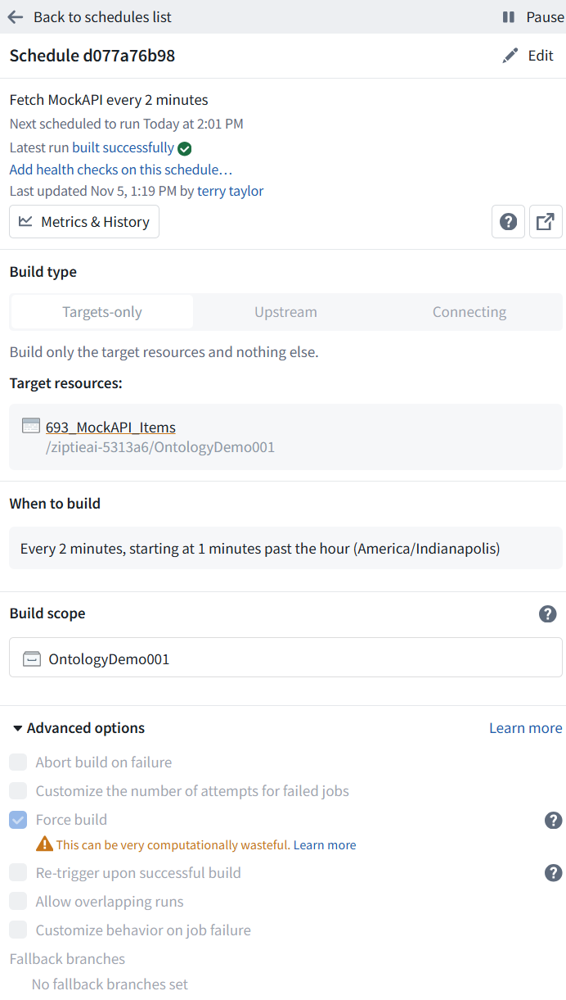

In **MockAPI**, change existing **Id 7** from integer **77 back to 777**.

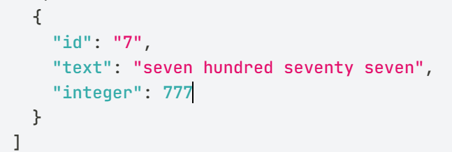

Wait—**do not manually build or run an Action**.

Verify in **Insight** that Id 7 shows **Integer = 777** and **CheckResult = FOUND**.

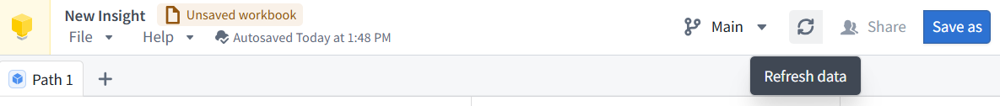

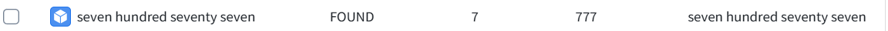

Pause the build schedule afterward.

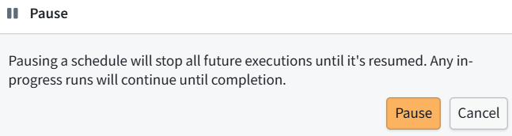

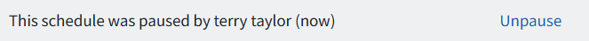

 

#### **The end-to-end update test passed**

Existing object **Id 7** now has **Integer = 777**.

**CheckResult** changed back to **FOUND**.

The build schedule is now **paused**, as confirmed by the banner.

**Chapter 7b is complete:** new objects are handled by the original automation; changes to existing objects’ **Text or Integer** are handled by the updated-object automation.

