 

[← 8a Add processing of updated objects](/pal_693_qs_8a_automate_updated/) / [↑ 3c Foundry QS](/pal_693_qs/) / [→ 9 Continuing your Foundry education](/pal_693_qs_9_where_next/)

 

_26.1110 17:04 (converted from docx source file to markdown+PNGs by ChatGPT)_

 

**TOC**

- **[8a.0 What we will build (ADD WHAT WOULD DO IF HAD ACCESS)](#section-8a-0)**
- **[8a.1 Who can read the objects](#section-8a-1)**
  - **[8a.1.1 Create disposable object type with security policy (no source dataset)](#section-8a-1-1)**
  - **[8a.1.4 Test in Insight](#section-8a-1-4)**
  - **[xxx8a.1.5 Open Granular policy (FDE went down a rabbit hole here)](#section-xxx8a-1-5-open-granular-policy-fde-went-down-a-rabbit-hole-here)**
  - **[8a.1.6 Add granular policy ID = GOV-VISIBLE  (FDE's previous instructions were wrong) Start over](#section-8a-1-6)**
  - **[8a.1.8 Restore access](#section-8a-1-8)**
- **[8a.2 Who can run 693_CheckAndSaveRecord (A2 Action)](#section-8a-2)**
  - **[8a.2.1 Ontology Manager /action / security & submission criteria](#section-8a-2-1)**
  - **[8a.2.2 Click Manage groups and show the page that opens.](#section-8a-2-2)**
  - **[8a.2.4 (2) Restrict 693_CheckAndSaveRecord (A2 Action) to that group](#section-8a-2-4)**
  - **[8a.2.6 (4) Add yourself to the group](#section-8a-2-6)**
  - **[8a.2.8 (6) Restore A2’s original organization-based condition](#section-8a-2-8)**
- **[8a.3 Inspect Action configuration history and execution history](#section-8a-3)**
  - **[8a.3.1 Find the manual submission](#section-8a-3-1)**
  - **[8a.3.2 (675) Can this data can be used programmatically (for example, to generate warnings)](#section-8a-3-2)**
  - **[8a.3.3 For custom code](#section-8a-3-3)**
  - **[8a.3.4 Can end here as an execution-history inspection](#section-8a-3-4)**
- **[8a.4a Inspect LLM data-access controls (restriction not tested)](#section-8a-4a)**
  - **[8a.4.1 First, inspect the model controls](#section-8a-4-1)**
  - **[8a.4.2 (693 FDE) This is the relevant governance screen: Control Panel → AIP settings](#section-8a-4-2)**
  - **[8a.4.3 For 8a.4’s data restriction, return to](#section-8a-4-3)**
  - **[8a.4.4 This section demonstrates where the controls are—not a verified allow/block test](#section-8a-4-4)**
- **[8a.4b Hypothetical " Control which data may be sent to LLMs" config/workflow](#section-8a-4b)**

26.1109 This chapter is complete, but it still needs to be modfied more so that it no longer resembles the original GPT chat procedure.

 

### **8a.0 What we will build (ADD WHAT WOULD DO IF HAD ACCESS)**

A trial user can not create a **second test user**. So this demo may be limited in some areas.

- **Apply and test reversible changes** where your account retains the ability to undo them.
- **Stop before changes that could remove your ability to restore access.**
- Record the original settings before changing anything.

Having only one user limits **testing another user’s access**, but does not automatically prevent a demo of governance settings.

 

### **8a.1 Who can read the objects**

A separate, disposable object type is safer than experimenting on Capstone2Record.

But we should **not deliberately remove your ability to manage or delete it**. Instead, we can test blocking your access to its **objects** while retaining permission to edit the security settings and restore access.

We’ll leave **Capstone2Record (object type)** and its workflows unchanged.

For the test object type, would you prefer to:

- Supply a small dataset, or
- Create it **without a source dataset**, with test objects added through an Action?

This is just a demo.... so do whatever shows governance. the simplest demo.

 

#### **8a.1.1 Create disposable object type with security policy (no source dataset)**

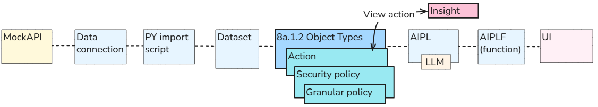

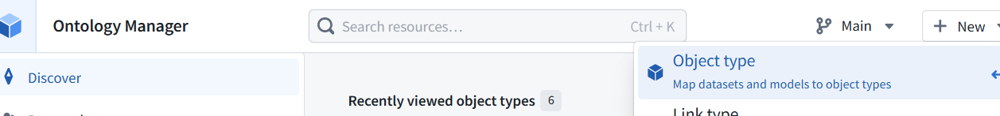

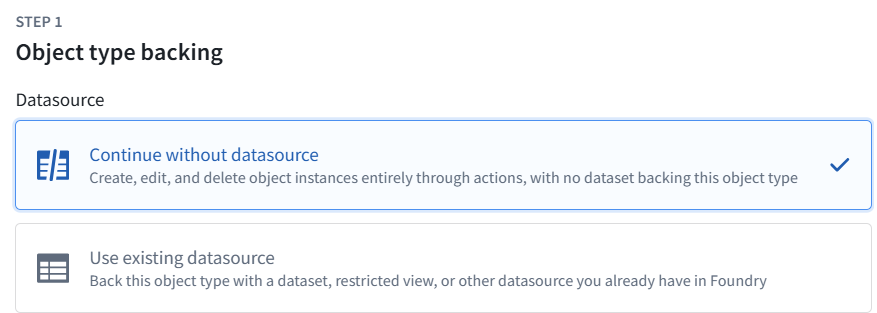

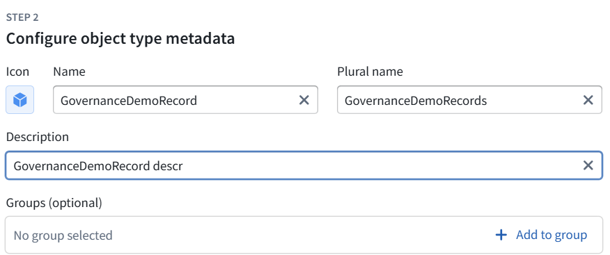

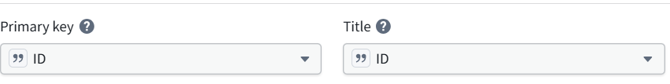

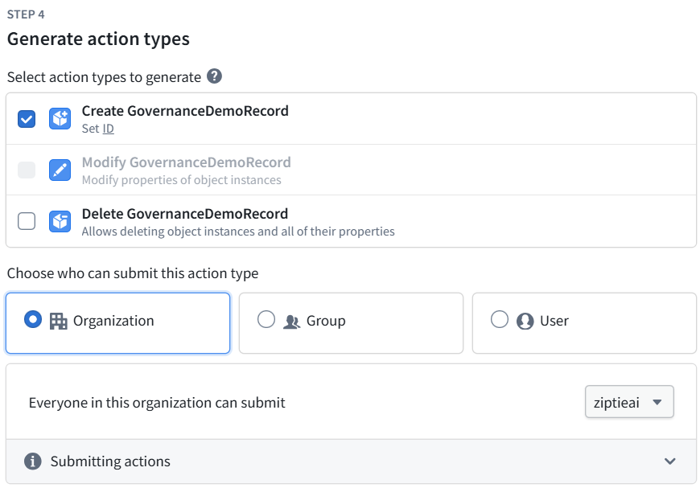

 

**Security policy**

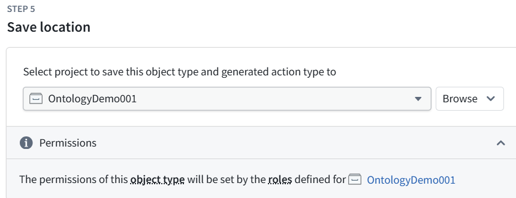

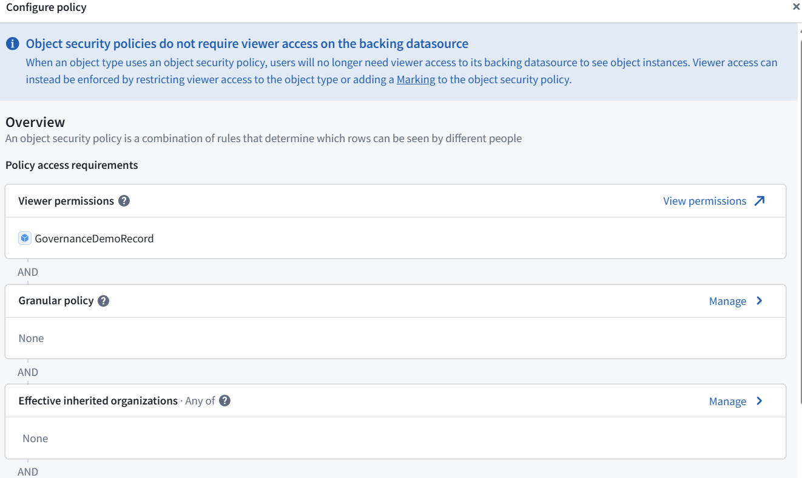

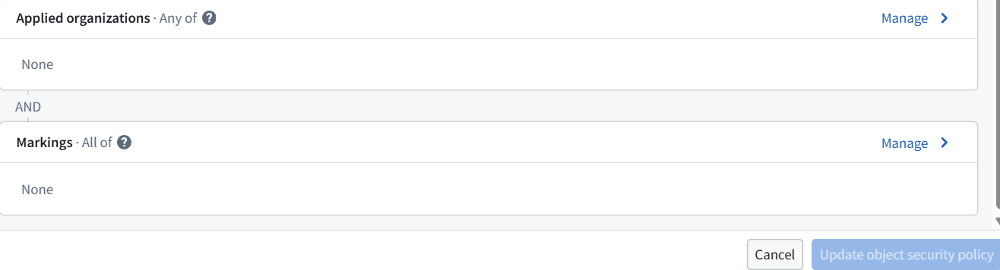

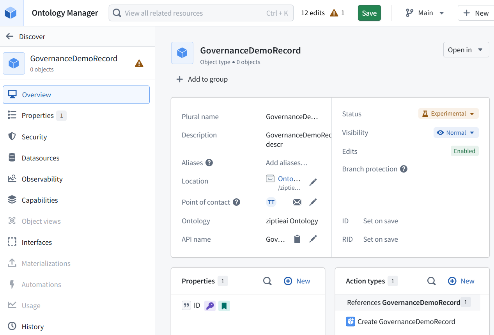

Yes—this setup is suitable for the governance demo. No need to start over:

- **GovernanceDemoRecord (object type)** has no source dataset.
- **ID** is its String primary key and title.
- **Create GovernanceDemoRecord (Action)** will create the test object.
- The default object security policy is still unchanged.

 

**Save**

The screen shows **12 edits** and **“Set on save.”**

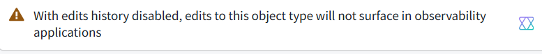

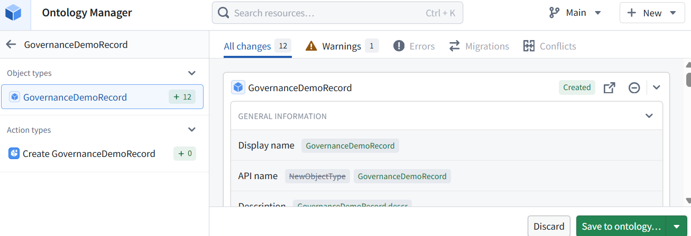

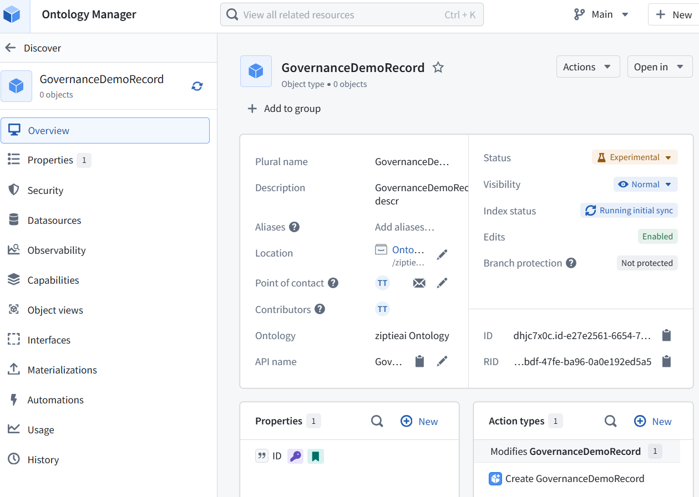

 

#### **8a.1.4 Test in Insight**

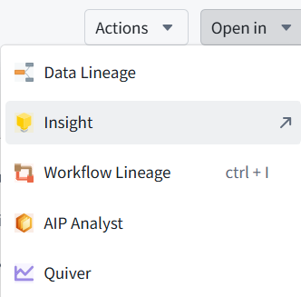

In **Insight**, open **Actions → Create GovernanceDemoRecord (Action)**. Enter **GOV-TEST-1** for **ID** and submit.

This creates one disposable test object. We’ll verify it is visible before changing its access policy.

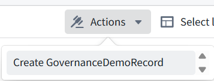

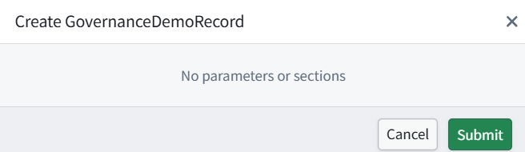

That is fine—the generated Create Action assigned a UUID automatically. My instruction to enter GOV-TEST-1 was incorrect. **ID is the primary key and cannot be changed after creation.** No change is needed: Insight shows **one visible test object**, which is all we need.

 

#### **xxx8a.1.5 Open Granular policy (FDE went down a rabbit hole here)**

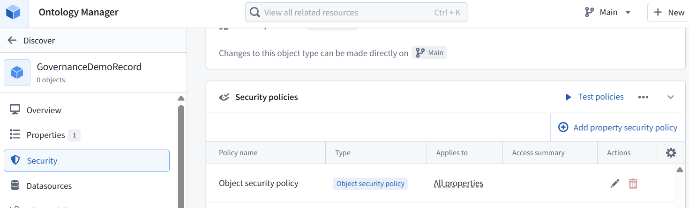

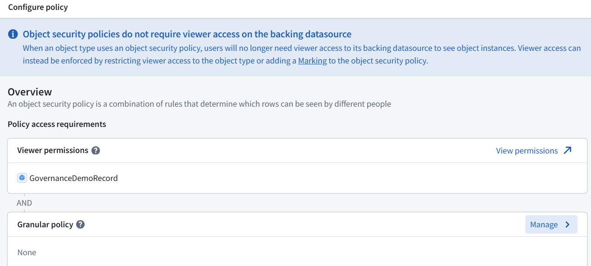

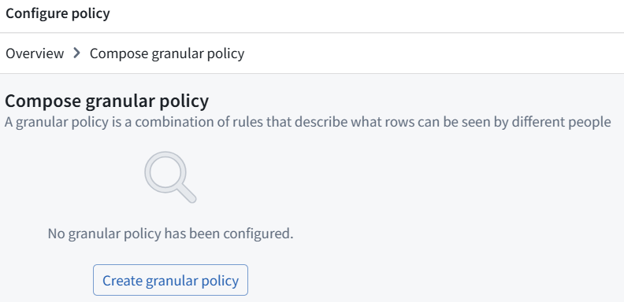

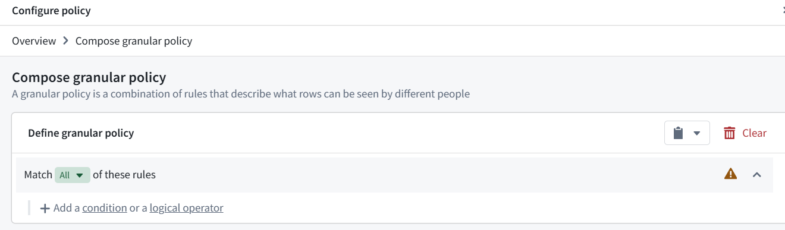

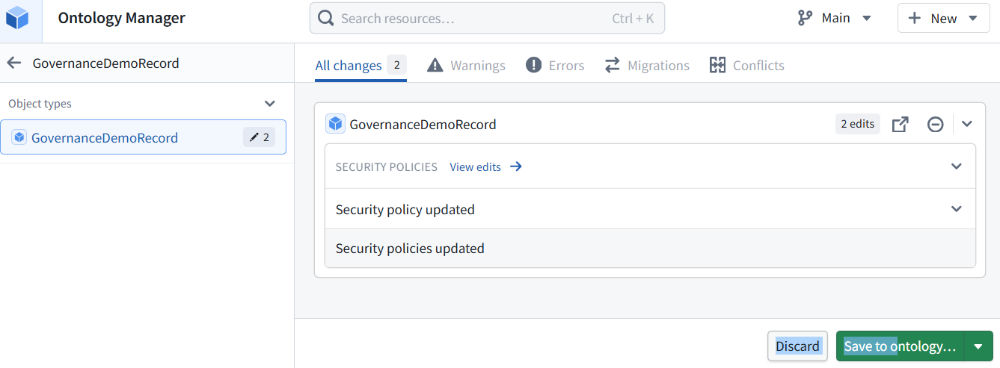

- Click **Property** in the right-hand **Define condition** panel. We’ll inspect whether we can allow viewing only when **ID** equals a test value that does not match the existing object.

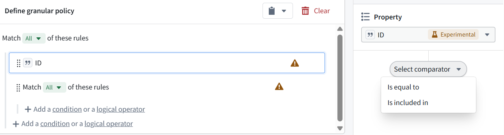

- Select **Is equal to**.

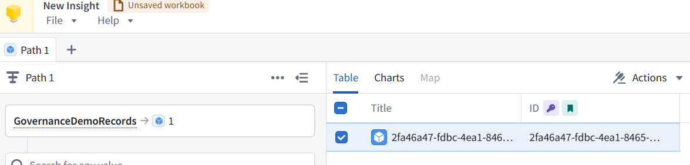

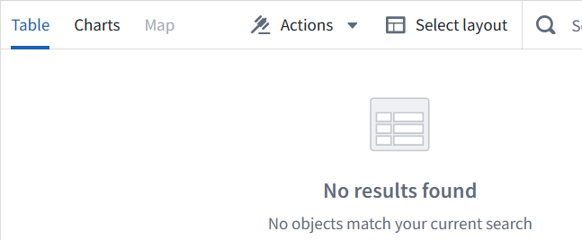

- That opened the **All / Any / Not** dropdown.vClose it, then click the words **“of these rules”** on the lower empty group—not its **All** **▾** button. We need to select the group itself to see whether a delete control appears.

 

#### **8a.1.6 Add granular policy ID = GOV-VISIBLE  (FDE's previous instructions were wrong) Start over**

The simplest fix is to rebuild this **unsaved granular policy**:

- Click **Clear** at the top of **Define granular policy**.
- Add **one condition**, not a logical operator.
- Set **Property → ID → Is equal to → Constant value → GOV-VISIBLE**.

The result should contain only **ID is equal to GOV-VISIBLE**, with no extra empty group. **Do not apply it yet.**

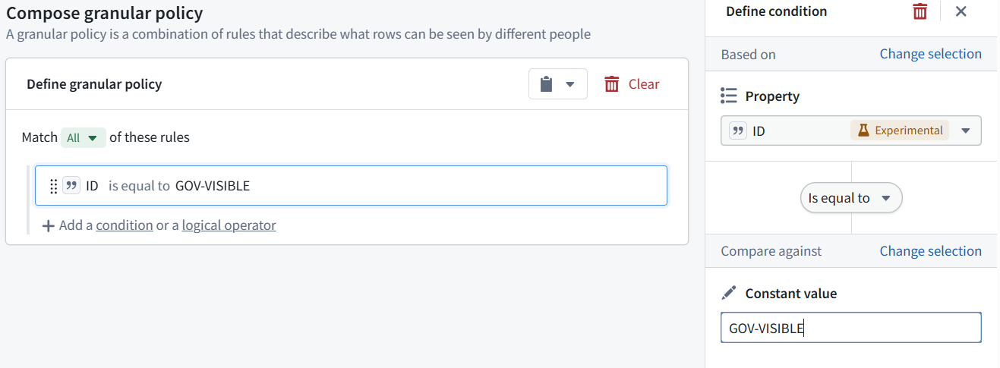

Correct—there is now just one condition, with no warning.

This policy allows viewing only objects whose **ID equals GOV-VISIBLE**. Your test object’s UUID does not match,

The policy is a **condition for permission to see an object**:

Show an object only if its **ID = GOV-VISIBLE**.

Your test object’s ID is something like **2fa46a47-…**, not GOV-VISIBLE. Therefore, **you will not be allowed to see that object after applying the policy**.

The object is **not deleted**. Removing the condition restores visibility.

We chose GOV-VISIBLE simply as a value that does **not** match your test object’s ID.

**Yes—if the review shows only the granular policy change for GovernanceDemoRecord (test object type), click Confirm changes.**

This applies the visibility restriction to the disposable test objects, not **Capstone2Record**.

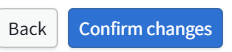

so it should become hidden.

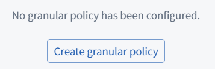

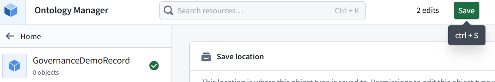

- Click **Save** in **Ontology Manager**.

 

**In insight no visible objects**

- Then refresh **Insight → GovernanceDemoRecord objects**. We expect **zero visible objects**.

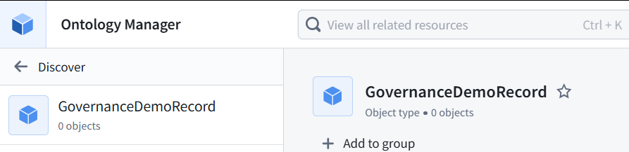

 

**The policy is saved, and Ontology Manager now shows 0 objects visible to you**

You can still access **GovernanceDemoRecord (object type)** and its settings.

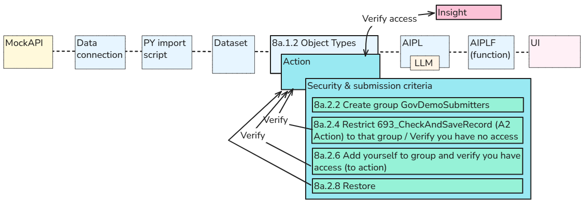

Next, refresh **Insight → GovernanceDemoRecord objects** to verify that the test object no longer appears there. Then we’ll remove the condition and restore visibility.

**The restriction worked:** Insight no longer displays the test object.

 

#### **8a.1.8 Restore access**

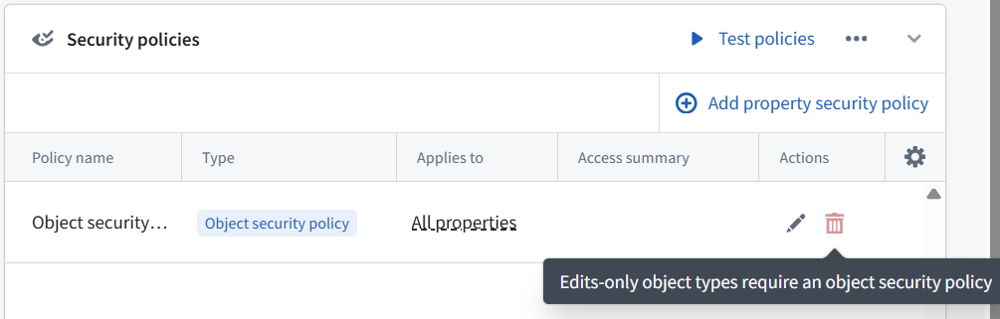

- Edit **Object security policy** using its pencil.

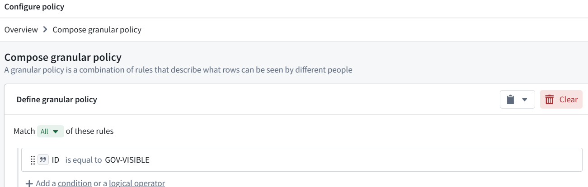

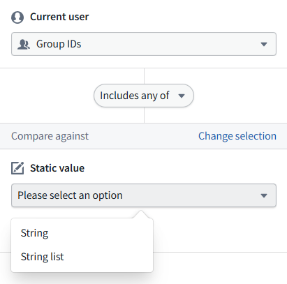

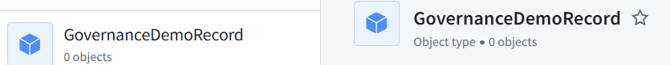

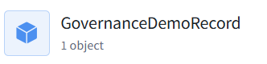

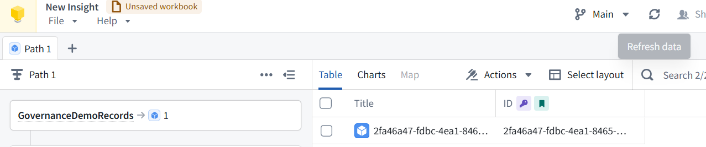

We expect the **same test object to reappear**. Do not delete the object security policy itself—remove only its granular condition.

**Access is restored:** the same test object is visible again in **Ontology Manager** and **Insight**.

This demo is complete:

**1 visible object → apply policy → 0 visible objects → remove condition → 1 visible object**

The object was never deleted. Its **visibility changed**, while your ability to manage **GovernanceDemoRecord (object type)** remained intact.

 

### **8a.2 Who can run 693_CheckAndSaveRecord (A2 Action)**

 

#### **8a.2.1 Ontology Manager /action / security & submission criteria**

- Open **Ontology Manager**.
- Open **693_CheckAndSaveRecord (A2 Action)**.

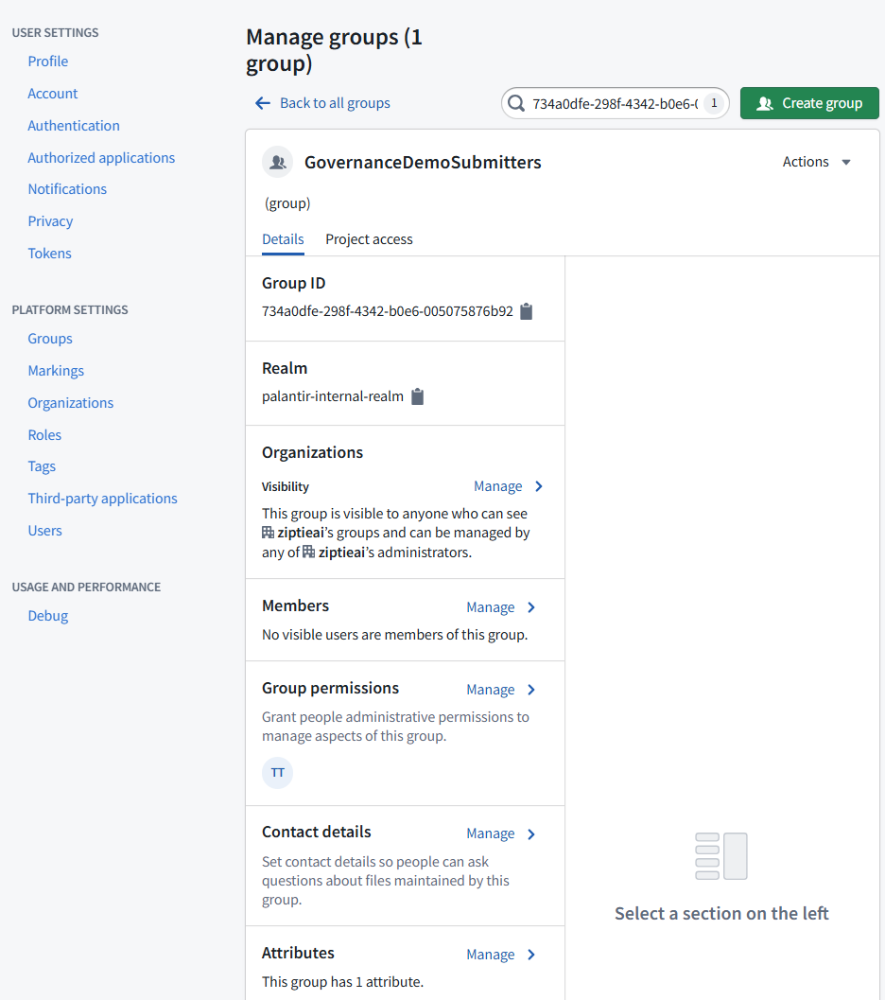

- The current submission condition allows members of **ziptieai (organization)** to run **693_CheckAndSaveRecord (A2 Action)**.
- Under **Submission criteria**, click **Current User Organizations Includes any of ziptieai**.

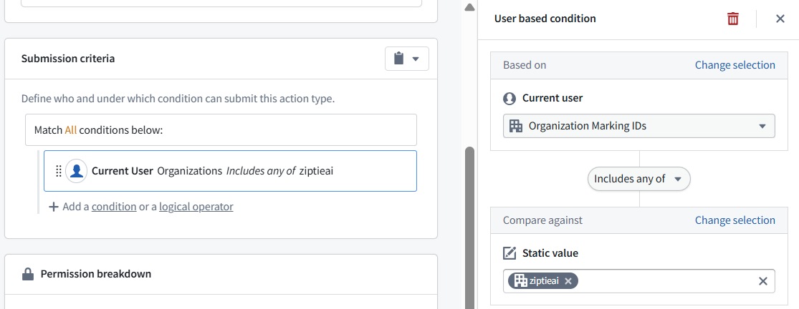

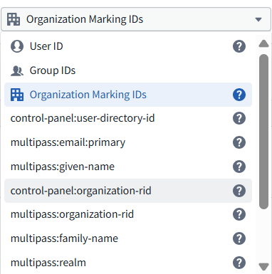

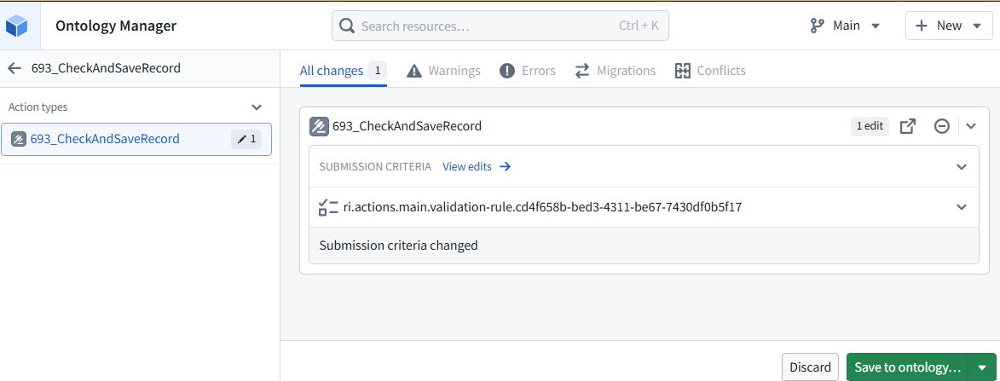

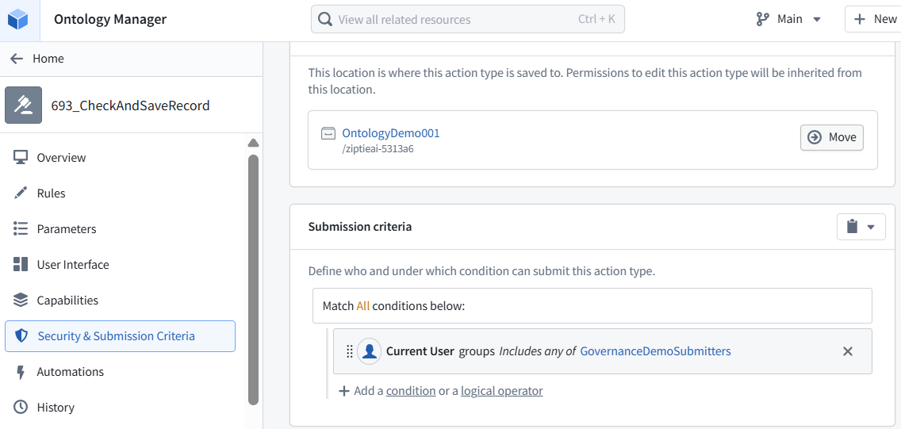

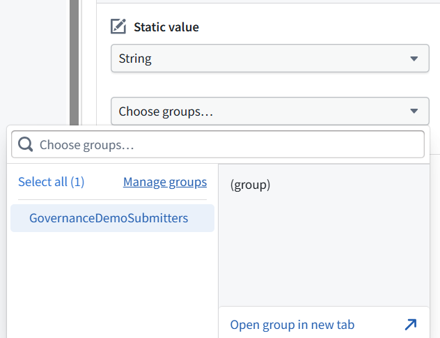

 

#### **8a.2.2 Click Manage groups and show the page that opens.**

**Do not save the Action changes** while the group selection is empty.

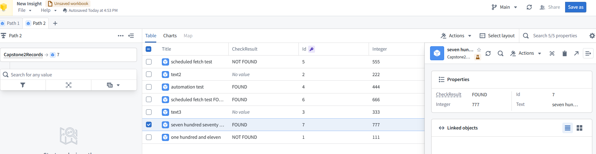

You’re in **Settings → Groups → Manage groups**. No groups are listed, and **Create group** is available.

Click **Create group**. We’ll create **GovernanceDemoSubmitters (group)** for this demo, then add your account as a member.

Show the creation dialog before confirming. Leave the unsaved **A2 Action** settings open in the other tab.

**(****650****)** **FDE** **Yes—you’re right.** To demonstrate blocking (the rest of 8a.2):

 

**(1) Create GovernanceDemoSubmitters (group) with no members**

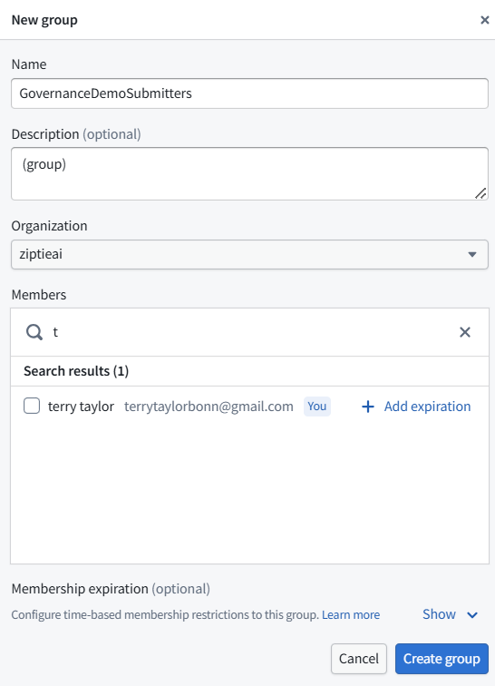

 

#### **8a.2.4 (2) Restrict 693_CheckAndSaveRecord (A2 Action) to that group**

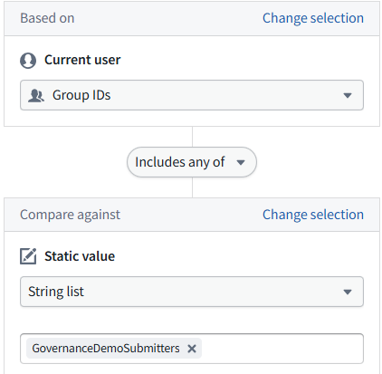

 

**(3) Verify that your submission is blocked**

- In **Ontology Manager**, **Save** the group restriction on **693_CheckAndSaveRecord (A2 Action)** if you haven’t already.

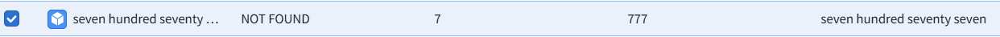

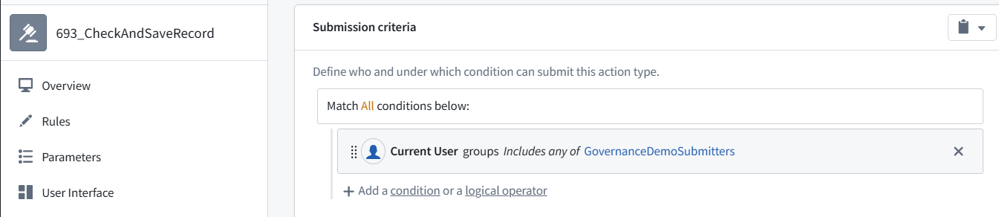

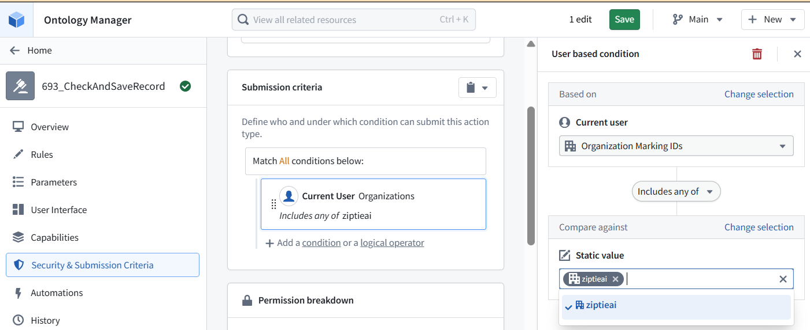

- Enter **Criteria**:  
Match if the integer is greater than 100.
- Attempt to **Submit**. Expected: submission is disabled or rejected because you are not a member of **GovernanceDemoSubmitters (group)**. **CheckResult should remain unchanged.**
- Show the restriction message. If the Action is absent from the menu, show that instead.
- A2 is absent from the menu.  Only **693_SaveCheckResult (A1 Action)** is shown. That is the observed blocked-access result—there is no A2 form to submit. Replace steps 5–6 for this test with: **Verify that 693_CheckAndSaveRecord (A2 Action) is absent from the Actions menu. Do not run 693_SaveCheckResult (A1 Action).**

 

#### **8a.2.6 (4) Add yourself to the group**

- Return to **Settings → Groups → GovernanceDemoSubmitters (group)**.

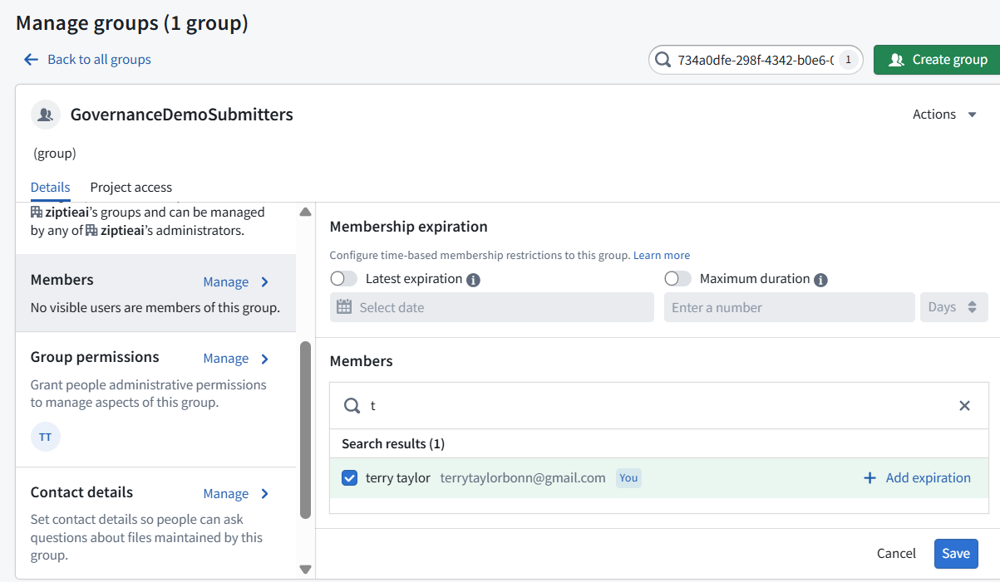

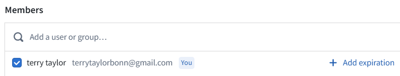

 

**2.7 (5) Verify that submission succeeds**

**A2 has reappeared. Now test that it runs:**

- Click **693_CheckAndSaveRecord (A2 Action)**.
- Confirm **Record** is **Id 7**.

Since Id 7’s Integer is **777**, **CheckResult should change from FOUND to NOT FOUND**. This visible change verifies that submission succeeded.

 

#### **8a.2.8 (6) Restore A2’s original organization-based condition**

**While the restriction is applied, the automations may also be blocked.** Keep the dataset build schedule paused during this test. Your permission to edit A2’s configuration is separate from permission to submit it.

In the screen shown:

- Click **Current User groups Includes any of GovernanceDemoSubmitters**.
- In the right-hand editor, change **Group IDs** to **Organization Marking IDs**.
- Keep **Includes any of**.

**Both settings match the original configuration:**

- Submission requires membership in **ziptieai (organization)**.
- **Allow Foundry Automate to submit this action** is **ON**.

If changes are still pending, click **Save** and confirm. **8a.2 is then complete:** group restriction → blocked access → add membership → successful submission → restore original restriction.

 

### **8a.3 Inspect Action configuration history and execution history**

**This** **is inspection, not an allow/block test.** Its demonstration is simply to trace a saved response back to the Action or automation execution.

We’ll inspect the **manual A2 submission** first, then an **automatic A2 execution**.

 

#### **8a.3.1 Find the manual submission**

- Open **Ontology Manager → 693_CheckAndSaveRecord (A2 Action)**.
- Click **History** in the left sidebar.

This is the execution **Trace**. It shows the sequence **Action → Logic function → LLM call**, with timings.

Click **Details** beside **Trace** at the top. Show that panel so we can look for the submitting user and execution information.

Leave **Edit permissions** unchanged.

 

#### **8a.3.2 (675) Can this data can be used programmatically (for example, to generate warnings)**

Yes—execution information can support automated warnings, such as:

- An Action fails.
- Execution takes too long.
- An automation repeatedly fails.

The visible **“Monitor this action”** button is the built-in starting point for configuring alerts.

 

#### **8a.3.3 For custom code**

Foundry provides observability and monitoring APIs, but we would need to verify which execution fields and APIs are available in your environment. We should not assume that every detail visible in this trace is programmatically accessible.

Also, **execution monitoring is not necessarily a property-change audit**: detecting “A2 failed” is different from identifying “who changed CheckResult from FOUND to NOT FOUND.”

 

#### **8a.3.4 Can end here as an execution-history inspection**

We verified:

- **History:** who changed A2’s configuration.
- **Observability → Run history:** successful executions and their callers.
- **Trace:** Action → Logic function → LLM call, with timings.
- **Chapter 7b automation history:** which object triggered an automatic execution.

**Limitation:** we did not verify a property-level audit showing who changed **CheckResult**, with its old and new values.

So a more accurate section title is:

**8a.3 Inspect Action configuration history and execution history**

 

### **8a.4a Inspect LLM data-access controls (restriction not tested)**

For the LLM example, distinguish who can call the function from whether particular data may be processed by a model. They are different controls. We should verify which mechanisms your enrollment supports before writing those instructions.

A useful chapter pattern:

Run successfully → apply restriction → repeat and observe the block → restore access

Two or three examples are enough. A second test user is important for access demonstrations; testing only as the owner can hide the effect.

 

#### **8a.4.1 First, inspect the model controls**

 

**AIP logic**

- Open **693_AIPL_CheckRecord (AIPL)** in **AIP Logic**.
- Open **Config**.
- In **Use LLM → Model**, open the dropdown currently showing **GPT-5.6 Sol**.
- Show that menu, including any policy or model-information controls.

**Do not change the model or publish anything.** We need to identify the available governance controls—choosing a model alone is not a data-use restriction.

This menu shows **model selection and technical details**, not data-use restrictions.

Click the **↗ arrow beside GPT-5.6 Sol** at the top-right of its information card, and show the page it opens.

Leave the model selection and **User-scoped execution** unchanged—the latter controls execution-log visibility, not whether data may be sent to the LLM.

 

**You’re now in Model Catalog → GPT-5.6 Sol (model).**

This page shows the provider, terms, and a playground—not data-access restrictions.

The documented controls are in **Control Panel → AIP settings**. Administrators can manage model availability there and configure which marked data LLMs may process.

Enable AIP features / Enable LLMs

 

**Next: open Control Panel → AIP settings**

and show that screen. **Do not disable any models or change policies yet.** If that section is unavailable to your account, we’ll mark this part as inspection-only.

 

**AIP settings**

In **Control Panel**:

- Click **What setting are you looking for?**
- Search for **AIP**.
- Open **AIP settings** if listed.

Show that screen. **Do not change any settings yet.**

 

#### **8a.4.2 (693 FDE) This is the relevant governance screen: Control Panel → AIP settings**

Three different controls are visible:

- **Palantir model access for custom workflows:** who may use the models.
- **Data access:** which **marked data** may be passed to LLMs. Currently **Allow any data** is selected.
- **Palantir models** tab: controls for individual model families.

**Important:** the Data access description says **unmarked data is always allowed when AIP is enabled**. Simply enabling a marking restriction would therefore not block our unmarked demo data.

Leave this page unchanged.

 

**Click Palantir models (tab) at the top**

and show that tab so we can inspect whether a model-specific, reversible test is available.

This tab controls **model-family availability**.

- In **Search models or model families…**, enter **GPT-5.6**.
- Show the matching entries. If there are no results, search **OpenAI** instead.

**Do not disable anything yet.** Disabling the family used by **693_AIPL_CheckRecord (AIPLF)** could also affect other workflows using that family.

**GPT-5.6 Sol appears under two providers:** **Direct OpenAI** and **Microsoft Azure**.

Click **Manage** beside **OpenAI → Direct OpenAI**, then show the dialog. **Do not change or save anything yet.** We’ll inspect the scope of the controls before choosing a test.

This page controls **the whole Direct OpenAI model family**, not access to particular data.

- **Enable this model family:** allows or blocks that family.
- **Restrict access to select organizations:** limits which organizations can use it.

Leave both unchanged.

 

#### **8a.4.3 For 8a.4’s data restriction, return to**

 

**Control Panel → AIP settings → AIP settings tab → Data access**

Select **Allow only the following markings** to reveal its controls, then show that area. **Do not click Save**—this is an enrollment-wide setting, and we’re inspecting it first.

The warning means **the marking allowlist is empty**.

Click **Edit** beside **Markings** and show the picker. **Do not save the enrollment settings yet.**

This control restricts **marked data** sent to LLMs; the text above explicitly says **unmarked data remains allowed**.

 

**No selectable markings are visible to your account**

even with the filter off. We cannot complete a marking-based test with this picker as it stands.

Restore the unchanged configuration:

- Click **Cancel** in **Manage markings**.
- Select **Allow any data**, the original setting.
- **Do not save any other changes.**

 

#### **8a.4.4 This section demonstrates where the controls are—not a verified allow/block test**

We inspected model-family enablement and the marking-based LLM data-access control. No selectable markings were available, so we did not apply or test a data restriction. Unmarked data remains allowed when AIP is enabled.

Yes—we’re finished with 8a.4 as an inspection-only section.

But we **cannot conclude that your account doesn’t support the functionality**. The controls are present; the marking picker simply showed no choices. We haven’t established why—there may be no applicable markings configured, or your account may lack visibility to them.

The accurate conclusion is:

**The LLM data-access controls are available, but we could not test a marking-based restriction because no selectable markings appeared. No restrictions were applied.**

 

### **8a.4b Hypothetical " Control which data may be sent to LLMs" config/workflow**

**Better title**

**8a.4 Control which data may be sent to LLMs**

**The demo we would perform**

Use **disposable test data**, not the existing Capstone2Record workflow.

- **Prepare two mandatory markings:** DemoAllowed and DemoRestricted.
- Protect the disposable test data with **DemoRestricted**, and give the test user access to that marking.
- **Baseline test:** run a small AIPL that sends the test text to an LLM. Verify it succeeds.
- In **Control Panel → AIP settings → Data access**, select **Allow only the following markings**.
- Include **DemoAllowed**, but exclude **DemoRestricted**, then save.
- Repeat the LLM call from a session with access to **DemoRestricted**. Verify the request is **blocked**.
- Add **DemoRestricted** to the allowlist and repeat. Verify the request **succeeds**.
- Restore the original **Allow any data** setting and remove the disposable test setup.

**Important mechanism:** this control checks the mandatory markings available to the **request’s session/token**, not merely the markings on the text actually sent. An excluded marking on the token can block the request even if that particular prompt contains unmarked text.

Control LLM data access with Markings

Because this setting affects the enrollment, we would record its original state and coordinate the test before applying it.

**About your second account**

That is useful. Once the invitation is accepted, a **second user in a separate browser profile** lets us test restrictions while your original account retains administrative access.

However, **a second user does not by itself solve the empty marking picker**. We still need to establish whether you can create and manage mandatory markings. Our earlier conclusion was only that **no selectable markings appeared**, not that your account lacks the functionality.

can you give me that list again, but this time with clearly stated what apps / tools are used?  
i want to make a diagram like my typical workflow diagrams (see attached)

762 For **8a.4**, these are the apps/tools for each step. **This is a planned demo—not yet verified in your environment.**

**Suggested diagram boxes**

**Markings management**  
Create test markings  
↓  
**Projects & files**  
Create marked test project  
↓  
**AIP Logic**  
Baseline: allowed  
↓  
**Control Panel**  
Exclude test marking  
↓  
**AIP Logic**  
Verify blocked  
↓  
**Control Panel**  
Allow test marking  
↓  
**AIP Logic**  
Verify allowed  
↓  
**Control Panel**  
Restore original setting

**Important diagram note:** the restriction checks the markings available to the **request’s session/token**, not just the prompt’s contents. We must verify the test session has **DemoRestricted** available.

Control LLM data access with Markings

763 so the only workflow testing (the diagram i attached) is in AIPL do a preview? (if so thats fine.... just want to verify)

764 **Yes—the only execution test is AIPL Preview in AIP Logic:** verify the LLM call succeeds, is blocked, then succeeds again.

**No MockAPI import, dataset build, AIPLF, Action, automation, or Workshop UI is needed for this test.**

Summarize aboveRemove belowFork session

765 everything else is configuration

Summarize aboveRemove belowFork session

766 **Yes. Everything else is configuration; AIPL Preview is where we test the result.**
