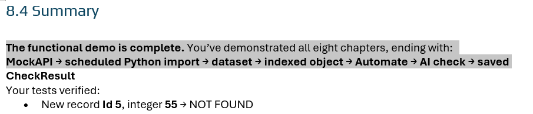

 

[← 3c Foundry QS](/pal_693_qs/)

 

26.1106 09:33 (converted from docx source file to markdown+PNGs by ChatGPT)

 

**ME: ****The functional demo is ALMOST complete.**

Our 8 chapters ended with:

**MockAPI → scheduled Python import → dataset → indexed object → Automate → AI check → saved** **CheckResult**

ME: There is just one thing yet to do.

The scheduled import fetches new and updated records, but the AI automation checks only newly added objects. Changes to existing objects’ Text or Integer properties do not trigger a recheck, so CheckResult may become stale.

FDE: To complete the behavior, rerun the AI check when an existing object’s Text or Integer changes—but not when CheckResult changes, to avoid a loop.

 

**FDE: Yes—this accurately states the limitation and makes the unfinished work explicit.**

Only one small correction: end the flow with **“saved CheckResult”**, rather than just **“saved.”**

You could also finish with the concrete remaining task:

To complete the behavior, rerun the AI check when an existing object’s Text or Integer changes—but not when CheckResult changes, to avoid a loop.

My error: I copied some text to this chapter 9, and I mistakenly did not select "CheckResult" on a new line.

ME: thanks.... when i copied the text "CheckResult" was on a new line and i missed it. Your abilities to notice such errors is impressive... and my ability to write so that a human reader can actaully understand what we are doing is equally impressive. together we make a great team..

FDE: We do make a good team. You keep the explanation grounded in **what a reader needs to understand and do**; I help check the mechanics and consistency.

And in this case, your original already included **CheckResult**—the line break fooled us. No correction was needed there.
