 

[← 3c Enterprise](/pal/)

_This is the original ZiptieAI take on the core Foundry concepts (worked out in tandem with FDE). I only figured this out 26.1117, so there are several TODO's and WIP's below._

 

**These concepts describe what you do during the quick starts and deep dives** (hands-on, to the point, learning quickly, minimal text/diagrams, with FDE assistance). **"2.1", "2.2", "2.2a" are sections in the [3c Enterprise page](/pal/)**.

- **1 (2.1 QS0-1 TODO) Detect/analyze haystack needles: Install/test/modify the real-world Foundry example GAIA**
- **2 (2.1 QS0-2 TODO) Detect/analyze haystack needles: Create (with FDE) your own haystack needle app**
- **4 (2.2 QS1) Create "full" Ontology “backend” (Ontology OTs/PTs, actions, links) for analysis of Dataset with Workshop**. Ontology helps organize and control access to an enterprise’s valuable operational knowledge (“alpha”).
- **5 (2.2a DD WIP) Add AI**
- **6 (2.2a DD WIP) Add governance**

 

See also 
- **[GPT chats (26.1117)](/pal_onto_rest_analogies/)**.
- Why Foundry represents **[the future of AI programming](/future_foundry_and_docs/)**.
- But there are challenges to learning Foundry: **[Why the ZAI approach to learning Foundry is the most effective](/pal_zai_learning_method/)**.

 

--------------------

 

### **1 (2.1 QS0-1 TODO) Detect/analyze haystack needles: Install/test/modify the real-world Foundry example GAIA**

In 1/2 you created everything for a real-world app like in this example. 
See **docx [692](https://drive.google.com/drive/folders/1-Adawag9uA8_bq-hDF-nOuPYaRLz1eEO)** for details on how to install and modify the example.

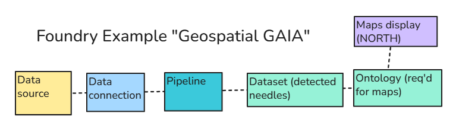

_Geospatial example: Input 2 sets of intelligence data (ELINT and ATR GEOINT, the **"haystack"**), find ~3 million matching entries, sift through the 3 million to find 4 entries of interest (**4 "needles"**), display the 4 entries on a map._ 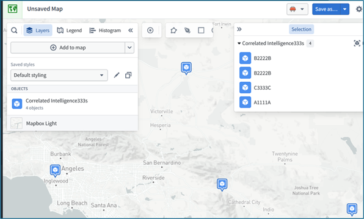 

 

--------------------

 

### **(2.1 QS0-2 TODO) Detect/analyze haystack needles: Create (with FDE) your own haystack needle app**

use PY/Pipeline to detect (filter out).

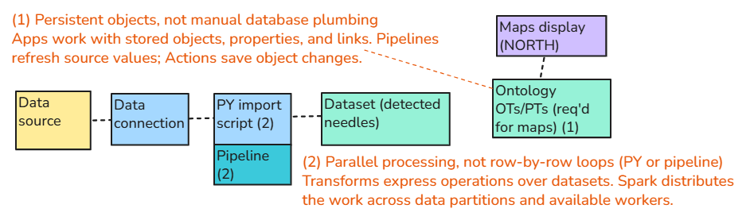

<!-- 
### **3 (TODO) Display / analyze with Maps (create Ontology OTs/PTs)**

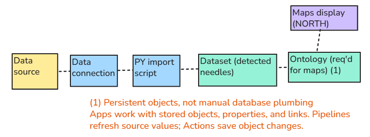
-->

 

--------------------

 

### **4 (2.2 QS1) Create "full" Ontology "backend" (Ontology OTs/PTs, actions, links) for analysis of Dataset with Workshop**

Ontology helps organize and control access to an enterprise's valuable operational knowledge ("alpha"). 

_Main Foundry diagram (ZAI original diagram verified by FDE)_ 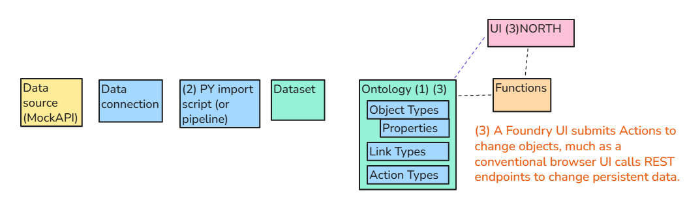

 

#### **Ontology/REST analogies**

| Operation | Foundry Ontology | REST analogy | Important differences |
|---|---|---|---|
| **1. Read an object** | Workshop Object Table reads a `693_Record` object from the Ontology. | `GET /records/123` returns the record's properties. | Foundry exposes objects through its Ontology query mechanisms, not necessarily a conventional REST GET endpoint. Objects may be backed by datasets or other data sources. |
| **2. Modify an object** | Workshop submits the `693_SaveCheckResult` Action to update an object's `CheckResult` property. | `PATCH /records/123` with `{"CheckResult":"FOUND"}` updates the record. | Foundry Actions are governed operations with permissions and validation. Changes may be stored as Ontology edits rather than directly modifying the underlying dataset. |
| **3. Execute AI and save the result** (see next section) | Workshop submits `693_CheckAndSaveRecord`, which runs the AI check through AIPLF and saves its answer using an Action. | `POST /records/123/check` invokes server-side logic that calls an LLM and updates the record. | The Foundry workflow combines Action logic, AIPLF, AI processing, and object edits. A conventional REST application would require developers to implement and connect these components themselves. |

 

--------------------

 

### **5 (2.2a DD WIP) Add AI**

Adding AI introduces new data flows that must be governed, particularly when proprietary information is sent to external models. AIPL, Actions, authorization policies, and UI controls each play a role in controlling those flows.

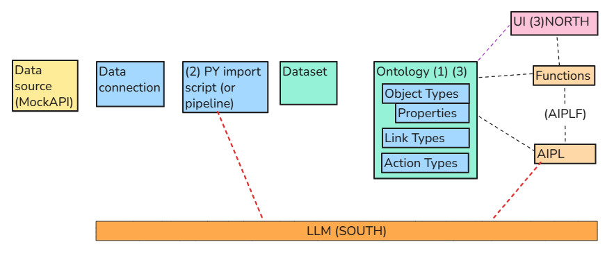

_OLD_ 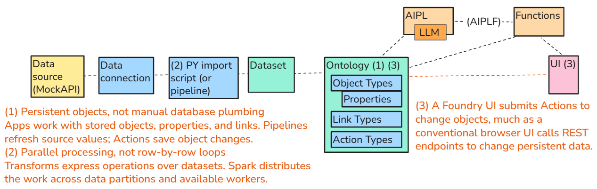

 

--------------------

 

### **6 (2.2a DD WIP) Add governance**

One especially important distinction: monitoring is not the same as preventing leakage. If sensitive data has already been transmitted to an external model, detecting it afterward may be too late. Preventive controls must operate before transmission.

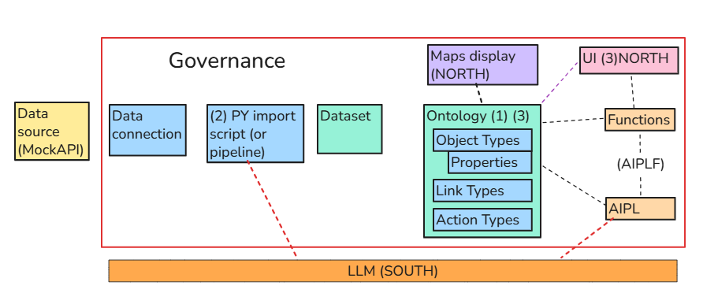

 

--------------------

                          

--------------------
--------------------
--------------------
--------------------
--------------------
--------------------
--------------------
--------------------
--------------------
--------------------
--------------------

 

# OLD CONCEPTS 

**TOC**
  - **C1 Why Foundry?** (00, v1 26.1016)
  - **C2 The future of programming Foundry (and writing documentation) is here today (WIP)** (00b, v1 26.1020)
  - **C3 Core Foundry Enterprise Concepts** (0, #697; v1 26.1011)
  - **C4 Core Foundry Enterprise AI Concepts** (1)

 

### **[C1 Why Foundry?](/pal_concepts_why_foundry/)** (v1 26.1016)

(WIP... below is just some initial thoughts)

- People are discovering that **no matter how great the model is, it will never have real intelligence** (that's something I have been writing for a year; its obvious to anyone with basic tech insight and basic familiarity with the core of what makes AI tick (and AI does tick, because its simply binary computation on clocked circuits)).
- So **the future focus on LLMs will be more on price and power usage** (for the majority of apps). LLMs will be commodities in the (very near) future. The big LLM providers are in trouble (this is why Anthropic has come up wiht its latest gimmicks: protecting an LLM's "feelings" and demanding gov control of LLMs (because they are just too dangerous); all scams to get gov funding and suppress the competition).   
- Since the model will never have real intelligence, the focus will be on **creating agents (enterprise SW) that bridge the gap between the human world and the LLM world**. 
- **Foundry is designed just for such a reality**.  
- Boring Warren Buffett. He let the AI boom pass him by. Looks like he might have been right (yet again).
- (Eisman interview)

_(left) Non-AI App, (center) AI app ("agent") + local LLM, (right) remote LLM_ 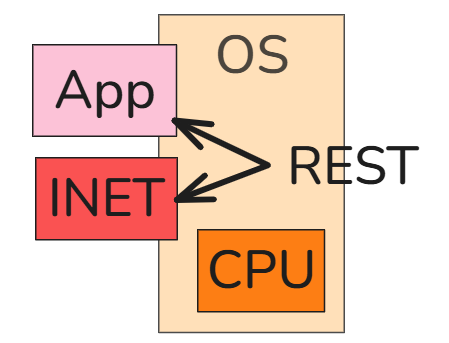    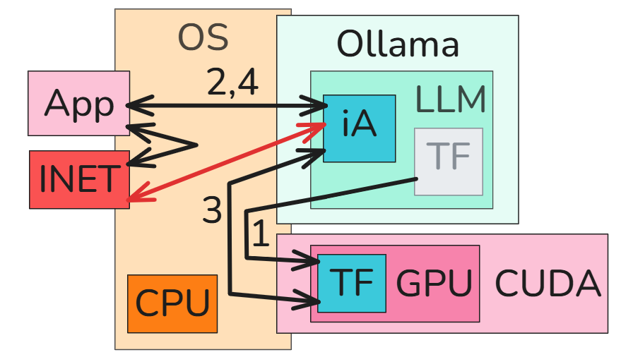    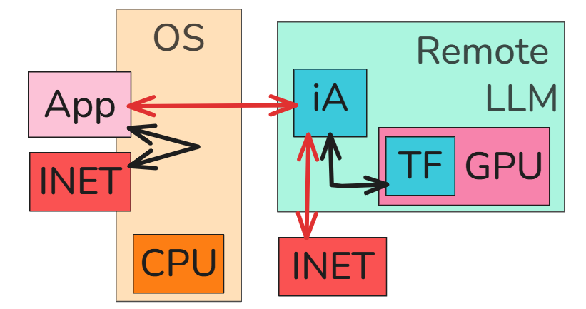 

 

--------------------

 

### **[C2 The future of programming Foundry (and documentation) is here today (WIP)](/future_foundry_and_docs/)** (v1 26.1020)

I am programming and writing a Foundry QS (quick start) by simply chatting with FDE/GPT. 
- Most of the text is FDE chat responses and the screenshots submitted to FDE (FDE can "see" screenshots and diagrams). 
- In the future, you will simply talk with FDE and FDE can see your screen. 
- Programming speeds will be vastly faster, and the bar for programming productivity will be raised once again.

_The new programming/documentation paradigm with FDE/GPT._ 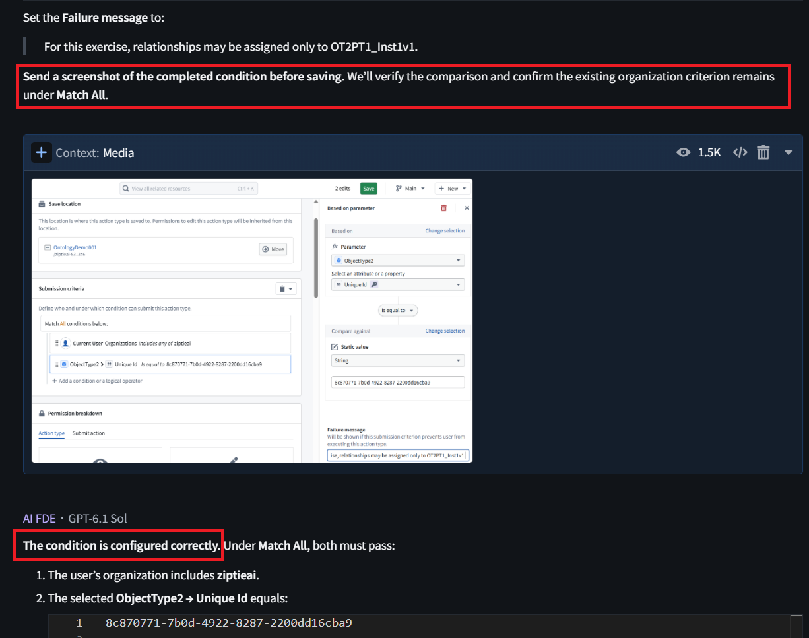 

 

--------------------

 

### **[C3 Core Foundry Enterprise Concepts](/pal_concepts_ep/)** (v1 26.1011)

<!-- **TOC**
- 0.1 ZAI focuses on hands-on demos (and useful docs) to learn Foundry
- 0.2 ZAI original Foundry concepts diagram (needs an update)
- 0.3 New ZAI Foundry south/equator/north concepts diagram/docx (WIP / v1 26.1012)
- 0.4    The original (official) Foundry south/ontology/north intro webpage 
 
-->

#### **New ZAI version of Foundry core concepts**

I needed a few months of hands-on experience before I was able to create a ZAI version of the Foundry intro (core concepts) (see **[docx #697ex](https://drive.google.com/drive/folders/1-Adawag9uA8_bq-hDF-nOuPYaRLz1eEO)** (WIP)). The ZAI version (WIP) replaces the original "ontology" section with the "equator" section.  

_Note: The new ZAI Foundry intro will also cross reference all demos with Foundry apps (for details see **[docx #697ex](https://drive.google.com/drive/folders/1-Adawag9uA8_bq-hDF-nOuPYaRLz1eEO)** and section **"2 Foundry demos" / "2.0 Master demo list"** below on this webpage)._

_New ZAI south/equator/north diagram (only new ZAI stuff shown)_ 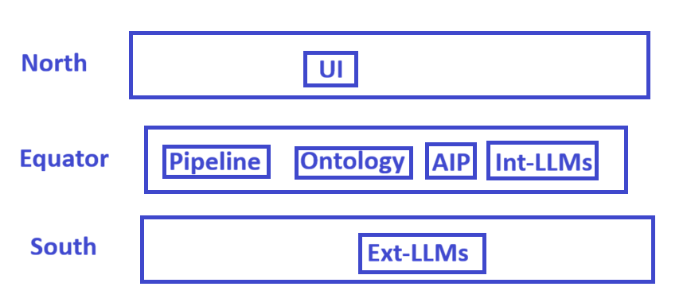 

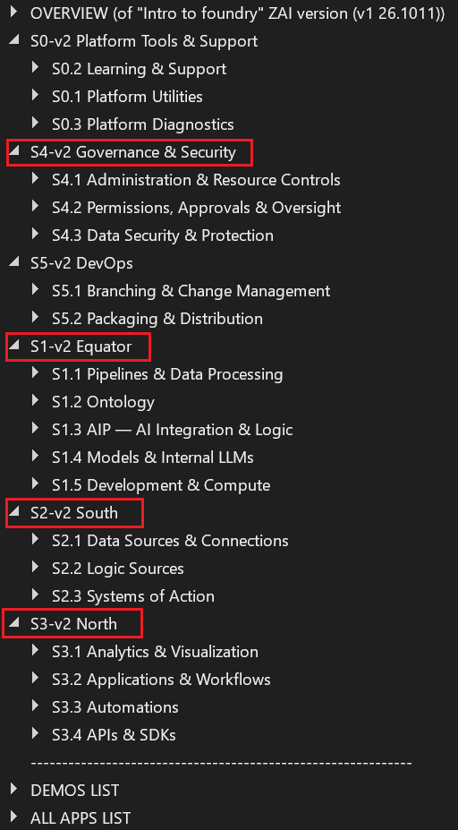

<!--  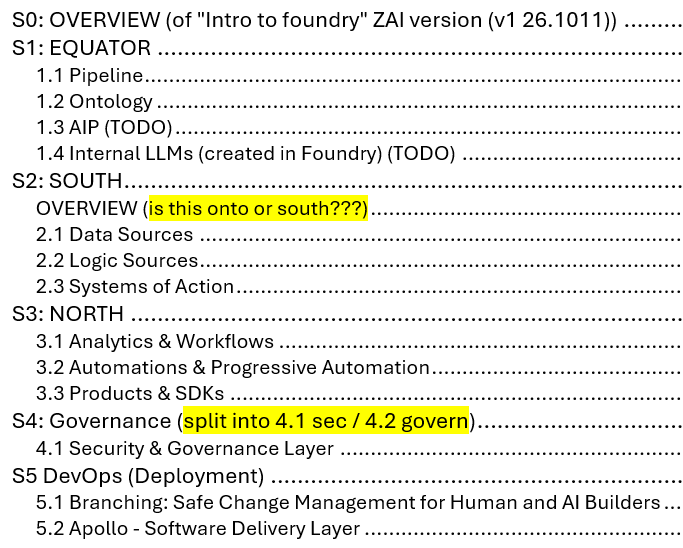    -->

#### **Original official version of Foundry core concepts**

A quote from the webpage itself: "**If you remember one thing from this course**, let it be this: the Ontology is the centerpiece of the entire platform." The course is quite interesting perhaps for a management reader, but too complicated and abstract for a reader wanting to learn Foundry hands-on ASAP. **But such a doc (reorganized) could serve as the main guide for what demos to do.**

_**[Webpage](https://learn.palantir.com/introduction-to-foundry-aip-for-enterprise-organizations)** on learn.palantir.com_ 
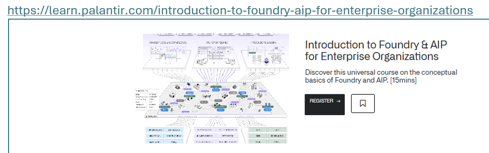 

 

<!-- ### 0.4 PAL south/ontology/north diagram (no equator)

This diagram is missing the "equator" (of which ontology is only a component (granted, the most important component)). 

_PAL south/ontology/north diagram_ 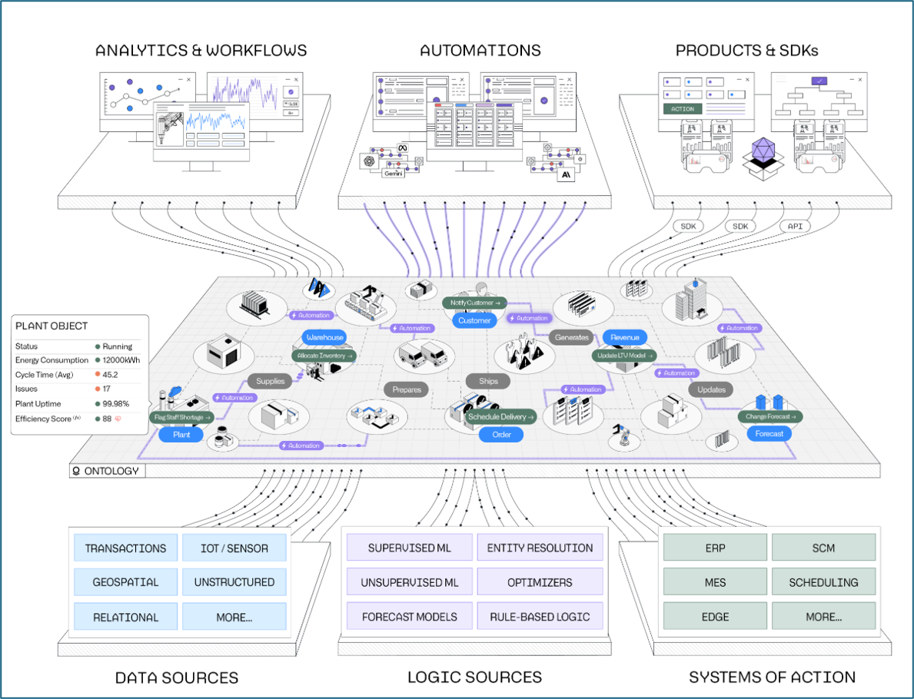 

  -->

--------------------

 

### **[C4 Core Foundry Enterprise AI Concepts](/pal_concepts/)**

**The AI concepts webpage was inspired by Alex Karp's talks about sovereignty and ALPHA in the enterprise.** These issues are due to the nature of AI (unpredictable matrix math computations that recognize patterns / perform classification). 

<!-- A historical review of ALPHA/sovereignty
- 1 Mainframes and PCs
- 2 REST APIs
- 3 AI APIs for AI search engines
- 4 AI APIs LLMs and Foundry -->

<!-- 
- **SUMMARY (TL;DR): Why has Palantir been so successful recently?**
- **C-1 (1-2) AI can be a blessing or a curse for your enterprise. Foundry makes it much more of a blessing.**
- **C-2 (3-5) What exactly are AI, SOVereignty, and ALPHA?**
- **C-3 (7-8) Know the difference between AI scammers and your AI allies (a Frontier AI LLM provider can be both).**
- **C-4 (9) Historical overview of SOV/ALPHA. Before LLMs and (now) with LLMs for the enterprise and (future?) the PC.**

_NOTE: See (below) section "2 Tutorial projects" subsection "2.2x CONCEPTS (DEEP DIVE): ZAI demos" for lower level concepts (workflows, data protection, AIP, and automation)._ -->

_Alex Karp sounding the alarm about sovereignty and ALPHA in the enterprise._ 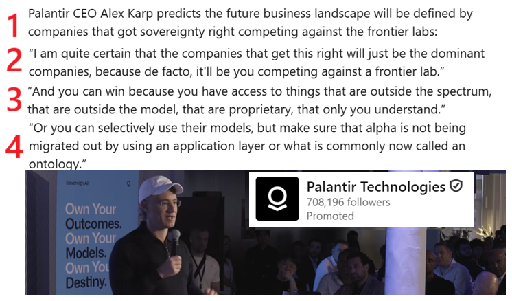

_Palantir provides proven engineering (the crystal ball is just a metaphor, marketing genius); those selling AGI are selling a fantasy that can cause big problems in an enterprise._   

<!--
- **AI can be a blessing or a curse for your enterprise**. FOundry makes it much more of a blessing.
- **What exactly are AI, SOV, ALPHA?**
- **Understanding the goals of the AI titans and how you can protect yourself.**
- **A historical perspective on SOV/ALPHA**. Past, present, and future. -->
<!--
  - **1 What AI can do _FOR_ your enterprise**.
  - **2 What AI can do _TO_ your enterprise**. Much of how AI can help you win can also be used against you.
  - **3 AI (LLMs) is pattern recognition** (not intelligence)
  - **4 What are SOV, ALPHA**. Alpha = your company’s business model, workflows, secrets. SOV = your independence from a specific AI LLM provider.
  - **5 How AI steals SOV/ALPHA**
  - **7 Know your enemy**. The AI LLM shops have their own goals, that don't always aline with those of your enterprise.
  - **8 Know your defense options**. If you understand how PAL Foundry works, then you understand the core problems and solutions. ZAI provides unique and insightful intro into the core concepts.
- **Finally, a historical perspective on SOV/ALPHA**. These concepts are nothing new.
  - **9 SOV/ALPHA past/present/future**
    - **9.1 (PAST) ALPHA/SOV Before LLMs**. Microsoft used Windows to extract ALPHA (40 years ago). The goal was a monopoly (the same for AI shops now).
    - **9.2 (PRESENT) ALPHA/SOV with LLMs for Enterprise**. If you use AI for business processes and intel, you need to appreciate what the token sellers are doing with your submitted prompts.
    - **9.3 (FUTURE) ALPHA/SOV with LLMs for the PC?**. A new open HW PC standard with built in Foundry type system to protect SOV/ALPHA.
- **What is ALPHA/SOV**
- **Why LLMs want your ALPHA/SOVereignty**
- PAST, PRESENT, FUTURE of ALPHA/SOV
  - **(PAST) ALPHA/SOV Before LLMs**
  - **(PRESENT) ALPHA/SOV after LLMs**. How Palantir alerted to the ALPHA/SOV problems and substantially mitigates the risks (for the enterprise).
  - **(FUTURE) ALPHA/SOV for the PC?**
-------------------
- **1 The problems with AI (LLMs) in the Enterprise**.
- **2 How Foundry solves these problems (Alex Karp's "Alpha" concept)** .
- **3 Basic Foundry workflows**. -->
<!-- - BELOW: Alex Karp sounding the alarm about sovereignty in the enterprise (it took me a while to understand that I think he meant... I am still not 100% sure what he meant, but I am pretty sure about my take on "alpha".
- NOTE the sign behind Alex: Own your own outcomes, Own your models, Own your destiny. ?? -->
<!-- >
 _Foundry enterprise platform functionality_ 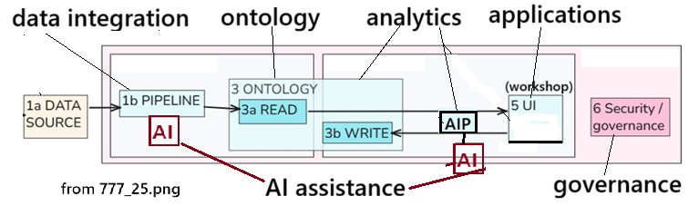  -->

 

---

 

26.1117 (0930, v1 26.0804)
