 

_Converted 2026-11-21 11:35 AM EST_

**TOC**
- [2 learn.palantir.com/page/course-catalog](#2-learn-palantir-com-page-course-catalog)
  - [MAIN_all_21.png](#main-all-21-png)
  - [xx2.1 Getting Started with Palantir Learn (OLD PDF w/ links) (ORANGE)](#xx2-1-getting-started-with-palantir-learn-old-pdf-w-links-orange)
  - [2.2 (#610 D1) Speedrun: Your First End-to-End Workflow (registered????) (bureau, office goods)](#2-2-610-d1-speedrun-your-first-end-to-end-workflow-registered-bureau-office-goods)
  - [2.3 Foundry & AIP Aware (8 HOURS!!!!) (ORANGE) (NEW)](#2-3-foundry-aip-aware-8-hours-orange-new)
  - [xx2.4 Introduction to Foundry & AIP for Enterprise Organizations (VERBIAGE?) (ORANGE)](#xx2-4-introduction-to-foundry-aip-for-enterprise-organizations-verbiage-orange)
  - [xx2.5 Scoping Use Cases for Foundry & AIP (VERBIAGE?) (ORANGE)](#xx2-5-scoping-use-cases-for-foundry-aip-verbiage-orange)
  - [2.6 (#611 D2) Speedrun: Your First AIP Workflow (48 of 49 lessons completed (97%))](#2-6-611-d2-speedrun-your-first-aip-workflow-48-of-49-lessons-completed-97)
  - [2.7 Speedrun: Data Science Fundamentals (NEW) (ORANGE)](#2-7-speedrun-data-science-fundamentals-new-orange)
  - [2.8 (#614 D3) Speedrun: Your First Agentic AIP Workflow (Priya Nair) (COMPLETED)](#2-8-614-d3-speedrun-your-first-agentic-aip-workflow-priya-nair-completed)
  - [2.9 Deep Dive: Creating Your First Ontology (NEW)](#2-9-deep-dive-creating-your-first-ontology-new)
  - [2.10 (#618 D7) Deep Dive: Building Your First Pipeline (COMPLETED) (products, customers, transactions)](#2-10-618-d7-deep-dive-building-your-first-pipeline-completed-products-customers-transactions)
  - [2.11 (#627 DD19) Deep Dive: Transforming your data with Code Repositories (transform_df) (x19 of 20 lessons completed (95%))](#2-11-627-dd19-deep-dive-transforming-your-data-with-code-repositories-transform-df-x19-of-20-lessons-completed-95)
  - [2.12 (#617 D6) Deep Dive: Building Your First Application (20 of 20 lessons completed (100%))](#2-12-617-d6-deep-dive-building-your-first-application-20-of-20-lessons-completed-100)
  - [2.13 (#615 D4) Speedrun: Your First Ontology Function (COMPLETED) (40.51 days)](#2-13-615-d4-speedrun-your-first-ontology-function-completed-40-51-days)
  - [2.14 Deep Dive: Creating Your First Data Connection (NEW)](#2-14-deep-dive-creating-your-first-data-connection-new)
  - [2.15 Deep Dive: Data Governance Best Practices - Security Primitives (NEW)](#2-15-deep-dive-data-governance-best-practices-security-primitives-new)
  - [2.16 Deep Dive: Data Analysis in Contour (NEW)](#2-16-deep-dive-data-analysis-in-contour-new)
  - [2.17 Deep Dive: Data Analysis in Quiver (NEW) (1 of 26 lessons completed (3%))](#2-17-deep-dive-data-analysis-in-quiver-new-1-of-26-lessons-completed-3)
  - [2.18 (#616_pal_D5) Speedrun: Mining Your First Business Process (20 of 20 lessons completed (100%))](#2-18-616-pal-d5-speedrun-mining-your-first-business-process-20-of-20-lessons-completed-100)
  - [2.19 Deep Dive: Data Protection Tools in Foundry (NEW)](#2-19-deep-dive-data-protection-tools-in-foundry-new)
  - [xx2.20 quiz (ORANGE)](#xx2-20-quiz-orange)
  - [2.21 Applied Notional Project (NEW)](#2-21-applied-notional-project-new)
- [T1 learn.palantir.com/page/training-track-data-engineer (5 TODO)](#t1-learn-palantir-com-page-training-track-data-engineer-5-todo)
  - [SCRATCH =================================](#scratch)
  - [T1.1 (#610 D1) (COURSE) Speedrun: Your first End-to-End Workflow](#t1-1-610-d1-course-speedrun-your-first-end-to-end-workflow)
  - [T1.2 (#618 D7) (COURSE) Deep Dive: Building your first Pipeline](#t1-2-618-d7-course-deep-dive-building-your-first-pipeline)
  - [T1.3 (NEW?) (COURSE) Speedrun: Creating Your First Data Connection](#t1-3-new-course-speedrun-creating-your-first-data-connection)
  - [>T1.4 (EXAMPLE) No-code approach to data cleaning with Pipeline Builder](#t1-4-example-no-code-approach-to-data-cleaning-with-pipeline-builder)
  - [>T1.4 (EXAMPLE) Parse different data formats in Pipeline Builder](#t1-4-example-parse-different-data-formats-in-pipeline-builder)
  - [INTERMEDIATE ==========================================](#intermediate)
  - [>T1.5 (EXAMPLE) Reuse functions and parameters in Pipeline Builder](#t1-5-example-reuse-functions-and-parameters-in-pipeline-builder)
  - [>T1.6 (EXAMPLE) (INSTALLED??) Transform geospatial data in Pipeline Builder](#t1-6-example-installed-transform-geospatial-data-in-pipeline-builder)
  - [xT1.7 (EXAMPLE) (EGRESS?) Connecting to AWS S3](#xt1-7-example-egress-connecting-to-aws-s3)
  - [>T1.8 (EXAMPLE) (EGRESS?) Connecting to Postgres](#t1-8-example-egress-connecting-to-postgres)
  - [ADVANCED ==========================================](#advanced)
  - [T1.9 (EXAMPLE) (NOT AVAIL) Use LLMs for translation in Pipeline Builder](#t1-9-example-not-avail-use-llms-for-translation-in-pipeline-builder)
  - [>T1.10 (EXAMPLE) Advanced incremental data processing with PySpark in Code Repositories](#t1-10-example-advanced-incremental-data-processing-with-pyspark-in-code-repositories)
  - [T1.11 (#626 E17) (EXAMPLE) Detect anomalies in time series data with Code Workspaces](#t1-11-626-e17-example-detect-anomalies-in-time-series-data-with-code-workspaces)
  - [ADDITIONAL ==========================================](#additional)

 

## **2 learn.palantir.com/page/course-catalog**

 

### **MAIN_all_21.png**

 

### **xx2.1 Getting Started with Palantir Learn (OLD PDF w/ links) (ORANGE)**

https://learn.palantir.com/getting-started-with-palantir-learn/2132079

 

### **2.2 (#610 D1) Speedrun: Your First End-to-End Workflow (registered????) (bureau, office goods)**

 

#### **https://learn.palantir.com/speedrun-your-first-e2e-workflow/1790882**

 

#### **#610_pal_D1_foundry_v02_26.0704_SS**

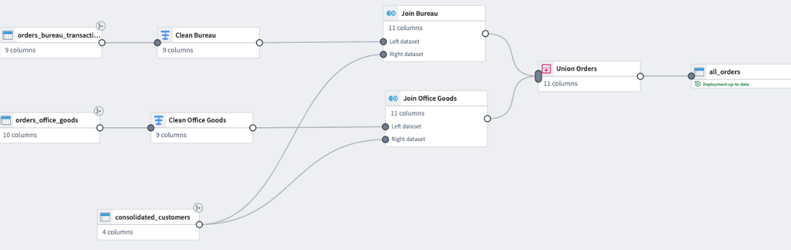

 

### **2.3 Foundry & AIP Aware (8 HOURS!!!!) (ORANGE) (NEW)**

https://learn.palantir.com/foundry-aip-aware

This course ties together various courses on Learn.Palantir to create an immersive and hands-on experience for people looking to build in Foundry & AIP, scope use cases, position Foundry & AIP within an Enterprise IT Landscape. [8 hrs]

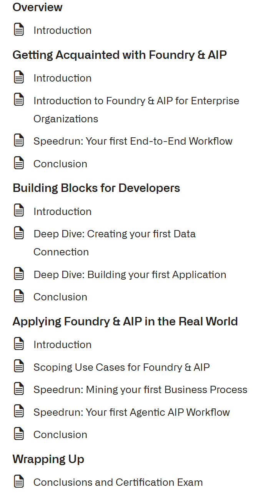

 

### **xx2.4 Introduction to Foundry & AIP for Enterprise Organizations (VERBIAGE?) (ORANGE)**

Discover this universal course on the conceptual basics of Foundry and AIP. [15mins]

https://learn.palantir.com/introduction-to-foundry-aip-for-enterprise-organizations

 

### **xx2.5 Scoping Use Cases for Foundry & AIP (VERBIAGE?) (ORANGE)**

Understand questions to ask and key concepts to consider when scoping use cases to be built in Foundry. [15mins]

https://learn.palantir.com/scoping-use-cases-for-foundry-aip

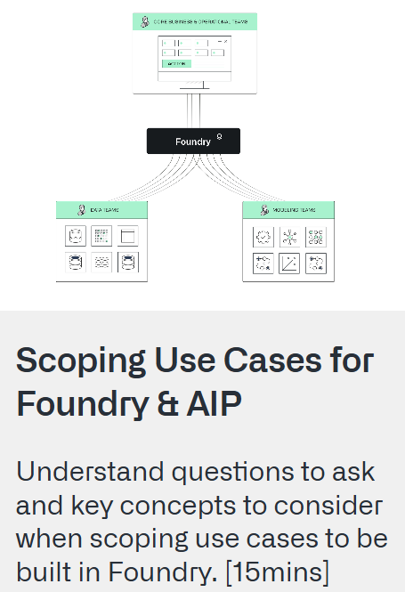

 

### **2.6 (#611 D2) Speedrun: Your First AIP Workflow (48 of 49 lessons completed (97%))**

 

#### **https://learn.palantir.com/speedrun-your-e2e-aip-workflow**

 

#### **#612_pal_D2_aip_v08_26.0710_SS**

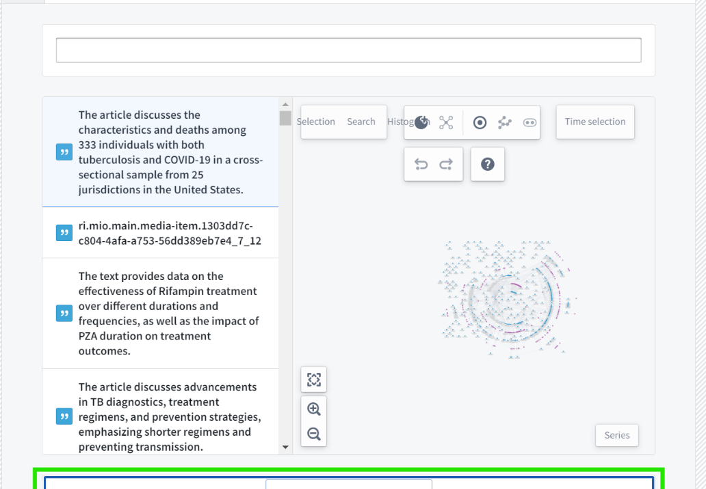

 

### **2.7 Speedrun: Data Science Fundamentals (NEW) (ORANGE)**

Learn how to use Foundry and AIP for Data Science.

https://learn.palantir.com/speedrun-data-science-fundamentals

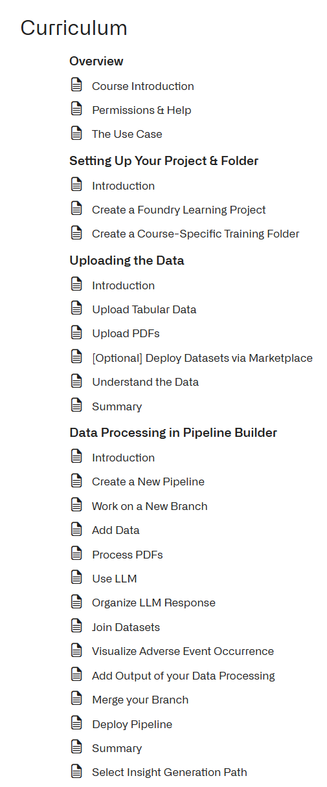

 

### **2.8 (#614 D3) Speedrun: Your First Agentic AIP Workflow (Priya Nair) (COMPLETED)**

 

#### **https://learn.palantir.com/speedrun-your-first-agentic-aip-workflow**

 

#### **#614_pal_D3_agentic_ai_qs_v03_26.0715_ss**

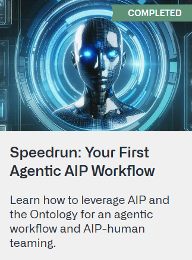

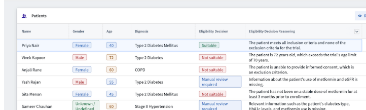

 

### **2.9 Deep Dive: Creating Your First Ontology (NEW)**

Learn what the Foundry Ontology is, why it is valuable, and how to build your own. [60 to 90 minutes]

https://learn.palantir.com/deep-dive-creating-your-first-ontology

 

### **2.10 (#618 D7) Deep Dive: Building Your First Pipeline (COMPLETED) (products, customers, transactions)**

 

#### **https://learn.palantir.com/deep-dive-building-your-first-pipeline**

 

#### **#618_pal_D7_first_pipeline_v02_26.0720_ss (2)**

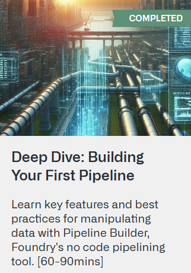

 

### **2.11 (#627 DD19) Deep Dive: Transforming your data with Code Repositories (transform_df) (x19 of 20 lessons completed (95%))**

 

#### **https://learn.palantir.com/deep-dive-transforming-your-data-with-code-repositories**

 

#### **#627_pal_DD19_transform_data_w_code_repos_v02_26.0805_ss.docx**

 

### **2.12 (#617 D6) Deep Dive: Building Your First Application (20 of 20 lessons completed (100%))**

 

#### **https://learn.palantir.com/deep-dive-building-your-first-application**

 

#### **#617_pal_D6_first_app_v01_26.0719_ss**

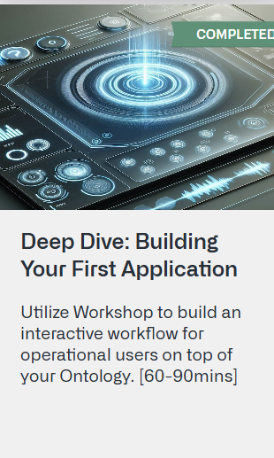

 

### **2.13 (#615 D4) Speedrun: Your First Ontology Function (COMPLETED) (40.51 days)**

26 of 26 lessons completed (100%)

 

#### **https://learn.palantir.com/speedrun-your-first-ontology-function**

 

#### **#615_pal_D4_onto_function_qs_v02_26.0717_ss (2)**

 

### **2.14 Deep Dive: Creating Your First Data Connection (NEW)**

Learn how to use Foundry's Data Connection application to securely and quickly retrieve data from various types of sources. [45-60mins]

https://learn.palantir.com/deep-dive-data-connection

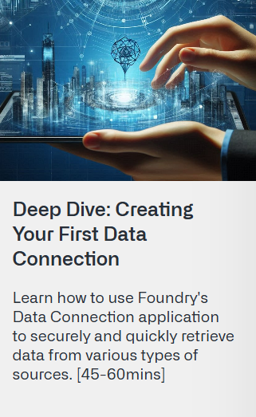

 

### **2.15 Deep Dive: Data Governance Best Practices - Security Primitives (NEW)**

Learn how to leverage Foundry tools to configure projects, apply markings to sensitive data, and implement restricted views, enhancing your organization's data protection framework. [45-60mins]

https://learn.palantir.com/deep-dive-data-governance-best-practices-security-primitives

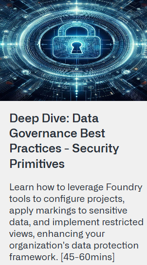

 

### **2.16 Deep Dive: Data Analysis in Contour (NEW)**

Learn how to transform, join, and visualize tabular data using Foundry's Contour application. [60-90mins]

https://learn.palantir.com/deep-dive-data-analysis-in-contour

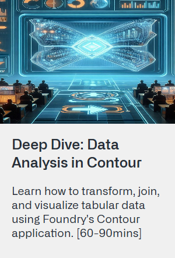

 

### **2.17 Deep Dive: Data Analysis in Quiver (NEW) (1 of 26 lessons completed (3%))**

https://learn.palantir.com/deep-dive-data-analysis-in-quiver

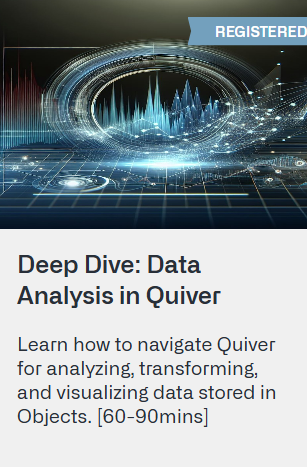

 

### **2.18 (#616_pal_D5) Speedrun: Mining Your First Business Process (20 of 20 lessons completed (100%))**

 

#### **https://learn.palantir.com/speedrun-mining-your-first-business-process/2103028**

 

#### **#616_pal_D5_biz_process_mining_qs_v02_26.0718_ss (1)**

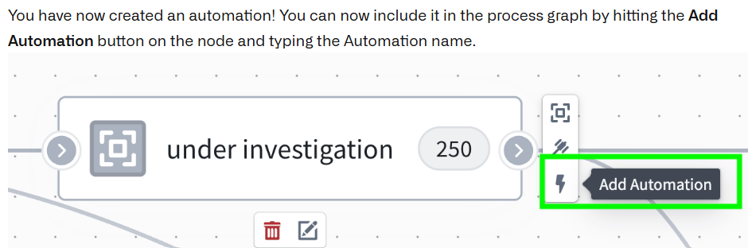

 

### **2.19 Deep Dive: Data Protection Tools in Foundry (NEW)**

Learn how to utilize Foundry tools to implement download controls, automate data scans, and obfuscate data. [45-60mins]

https://learn.palantir.com/deep-dive-data-protection-tools-in-foundry

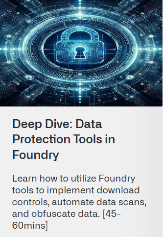

 

### **xx2.20 quiz (ORANGE)**

https://learn.palantir.com/foundry-aip-builder-foundations-quiz

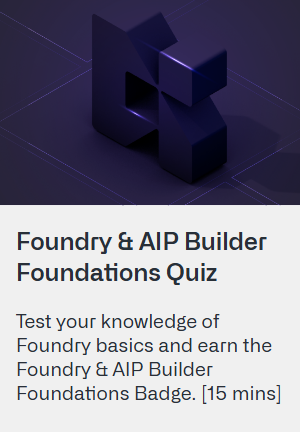

 

### **2.21 Applied Notional Project (NEW)**

Build an operational workflow with minimal instructions based on requirements taken from a notional statement of work. [1-2 days]

https://learn.palantir.com/applied-notional-project-automobile-inbox

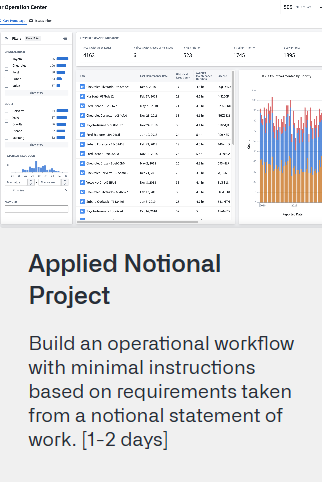

 

## **T1 learn.palantir.com/page/training-track-data-engineer (5 TODO)**

 

### **SCRATCH =================================**

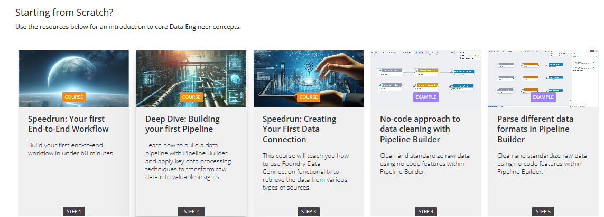

 

### **T1.1 (#610 D1) (COURSE) Speedrun: Your first End-to-End Workflow**

Build your first end-to-end workflow in under 60 minutes

 

#### **https://learn.palantir.com/speedrun-your-first-e2e-workflow/1944887**

 

### **T1.2 (#618 D7) (COURSE) Deep Dive: Building your first Pipeline**

Learn how to build a data pipeline with Pipeline Builder and apply key data processing techniques to transform

 

#### **https://learn.palantir.com/deep-dive-building-your-first-pipeline**

 

### **T1.3 (NEW?) (COURSE) Speedrun: Creating Your First Data Connection**

This course will teach you how to use Foundry Data

 

#### **https://learn.palantir.com/deep-dive-data-connection**

 

### **>T1.4 (EXAMPLE) No-code approach to data cleaning with Pipeline Builder**

Clean and standardize raw data using no-code features within Pipeline Builder.

 

#### **https://ziptieai.usw-17.palantirfoundry.com/workspace/now/platform/de7f0bc4-e673-425c-a992-95a40e0c4ea8**

 

### **>T1.4 (EXAMPLE) Parse different data formats in Pipeline Builder**

Harmonize different data assets (JSON, XML, and XLSX) using Pipeline Builder.

 

#### **https://ziptieai.usw-17.palantirfoundry.com/workspace/now/platform/33b92ac7-9e59-46cc-abd1-7ad1905f1f12**

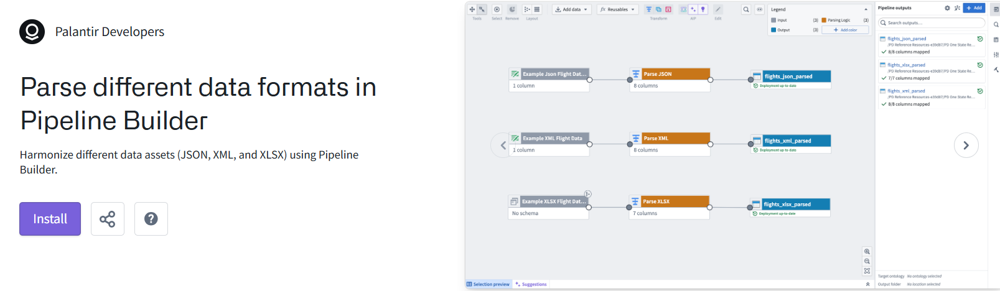

 

### **INTERMEDIATE ==========================================**

 

### **>T1.5 (EXAMPLE) Reuse functions and parameters in Pipeline Builder**

Reuse logic across a data pipeline via parameters and custom functions in Pipeline Builder.

 

#### **https://ziptieai.usw-17.palantirfoundry.com/workspace/now/platform/bddb1d26-46b0-40f3-9276-fb94605600aa**

 

### **>T1.6 (EXAMPLE) (INSTALLED??) Transform geospatial data in Pipeline Builder**

Integrate, transform and visualize geospatial data using Pipeline Builder.

 

#### **https://ziptieai.usw-17.palantirfoundry.com/workspace/now/platform/0bf8ef1f-ca56-44c2-bbde-93478c0238d6**

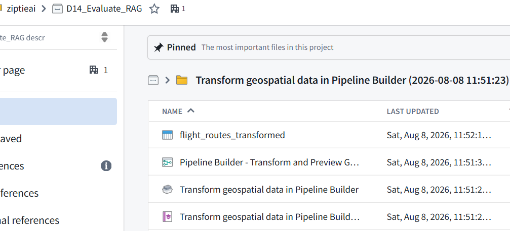

 

### **xT1.7 (EXAMPLE) (EGRESS?) Connecting to AWS S3**

Ingest data from AWS S3 into Palantir Foundry.

 

#### **https://build.palantir.com/platform/3b679834-f847-4ff2-82ad-6cf7018f1224**

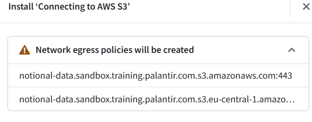

 

### **>T1.8 (EXAMPLE) (EGRESS?) Connecting to Postgres**

Ingest data from Postgres into Palantir Foundry.

 

#### **https://ziptieai.usw-17.palantirfoundry.com/workspace/now/platform/04af99f4-9b04-4187-8ab5-ce2f2452bfae**

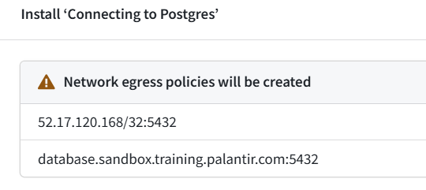

 

### **ADVANCED ==========================================**

 

### **T1.9 (EXAMPLE) (NOT AVAIL) Use LLMs for translation in Pipeline Builder**

Translate your data by using the built-in functionality of large language models available within Pipeline Builder.

 

#### **https://ziptieai.usw-17.palantirfoundry.com/workspace/now/platform/4380bc2d-6ddf-4135-90c0-67bf7527ddd3**

 

### **>T1.10 (EXAMPLE) Advanced incremental data processing with PySpark in Code Repositories**

Make data pipelines more efficient by processing data incrementally on only the latest additions.

 

#### **https://ziptieai.usw-17.palantirfoundry.com/workspace/now/platform/b5ec7380-9a17-46e1-b965-d25923411e78**

 

### **T1.11 (#626 E17) (EXAMPLE) Detect anomalies in time series data with Code Workspaces**

Analyze and visualize cyclic time series data for anomalies using a third party model in Code Workspaces and Quiver.

 

#### **https://ziptieai.usw-17.palantirfoundry.com/workspace/now/platform/dbfa6631-8ae1-42d8-bfe2-b24bbac5c107**

 

### **ADDITIONAL ==========================================**

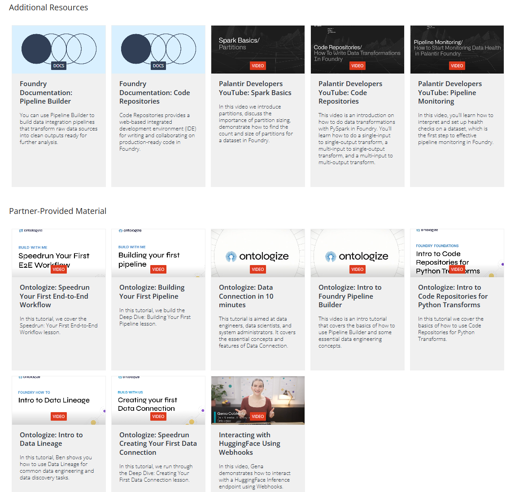
