 

_Converted 2026-11-21 11:35 AM EST_

**TOC**
- [2 learn.palantir.com/page/course-catalog](#2-learn-palantir-com-page-course-catalog)
  - [MAIN_all_21.png](#main-all-21-png)
  - [xx2.1 Getting Started with Palantir Learn (OLD PDF w/ links) (ORANGE)](#xx2-1-getting-started-with-palantir-learn-old-pdf-w-links-orange)
  - [2.2 (#610 D1) Speedrun: Your First End-to-End Workflow (registered????) (bureau, office goods)](#2-2-610-d1-speedrun-your-first-end-to-end-workflow-registered-bureau-office-goods)
  - [2.3 Foundry & AIP Aware (8 HOURS!!!!) (ORANGE) (NEW)](#2-3-foundry-aip-aware-8-hours-orange-new)
  - [xx2.4 Introduction to Foundry & AIP for Enterprise Organizations (VERBIAGE?) (ORANGE)](#xx2-4-introduction-to-foundry-aip-for-enterprise-organizations-verbiage-orange)
  - [xx2.5 Scoping Use Cases for Foundry & AIP (VERBIAGE?) (ORANGE)](#xx2-5-scoping-use-cases-for-foundry-aip-verbiage-orange)
  - [2.6 (#611 D2) Speedrun: Your First AIP Workflow (48 of 49 lessons completed (97%))](#2-6-611-d2-speedrun-your-first-aip-workflow-48-of-49-lessons-completed-97)
  - [2.7 Speedrun: Data Science Fundamentals (NEW) (ORANGE)](#2-7-speedrun-data-science-fundamentals-new-orange)
  - [2.8 (#614 D3) Speedrun: Your First Agentic AIP Workflow (Priya Nair) (COMPLETED)](#2-8-614-d3-speedrun-your-first-agentic-aip-workflow-priya-nair-completed)
  - [2.9 Deep Dive: Creating Your First Ontology (NEW)](#2-9-deep-dive-creating-your-first-ontology-new)
  - [2.10 (#618 D7) Deep Dive: Building Your First Pipeline (COMPLETED) (products, customers, transactions)](#2-10-618-d7-deep-dive-building-your-first-pipeline-completed-products-customers-transactions)
  - [2.11 (#627 DD19) Deep Dive: Transforming your data with Code Repositories (transform_df) (x19 of 20 lessons completed (95%))](#2-11-627-dd19-deep-dive-transforming-your-data-with-code-repositories-transform-df-x19-of-20-lessons-completed-95)
  - [2.12 (#617 D6) Deep Dive: Building Your First Application (20 of 20 lessons completed (100%))](#2-12-617-d6-deep-dive-building-your-first-application-20-of-20-lessons-completed-100)
  - [2.13 (#615 D4) Speedrun: Your First Ontology Function (COMPLETED) (40.51 days)](#2-13-615-d4-speedrun-your-first-ontology-function-completed-40-51-days)
  - [2.14 Deep Dive: Creating Your First Data Connection (NEW)](#2-14-deep-dive-creating-your-first-data-connection-new)
  - [2.15 Deep Dive: Data Governance Best Practices - Security Primitives (NEW)](#2-15-deep-dive-data-governance-best-practices-security-primitives-new)
  - [2.16 Deep Dive: Data Analysis in Contour (NEW)](#2-16-deep-dive-data-analysis-in-contour-new)
  - [2.17 Deep Dive: Data Analysis in Quiver (NEW) (1 of 26 lessons completed (3%))](#2-17-deep-dive-data-analysis-in-quiver-new-1-of-26-lessons-completed-3)
  - [2.18 (#616_pal_D5) Speedrun: Mining Your First Business Process (20 of 20 lessons completed (100%))](#2-18-616-pal-d5-speedrun-mining-your-first-business-process-20-of-20-lessons-completed-100)
  - [2.19 Deep Dive: Data Protection Tools in Foundry (NEW)](#2-19-deep-dive-data-protection-tools-in-foundry-new)
  - [xx2.20 quiz (ORANGE)](#xx2-20-quiz-orange)
  - [2.21 Applied Notional Project (NEW)](#2-21-applied-notional-project-new)
- [T1 learn.palantir.com/page/training-track-data-engineer (5 TODO)](#t1-learn-palantir-com-page-training-track-data-engineer-5-todo)
  - [SCRATCH =================================](#scratch)
  - [T1.1 (#610 D1) (COURSE) Speedrun: Your first End-to-End Workflow](#t1-1-610-d1-course-speedrun-your-first-end-to-end-workflow)
  - [T1.2 (#618 D7) (COURSE) Deep Dive: Building your first Pipeline](#t1-2-618-d7-course-deep-dive-building-your-first-pipeline)
  - [T1.3 (NEW?) (COURSE) Speedrun: Creating Your First Data Connection](#t1-3-new-course-speedrun-creating-your-first-data-connection)
  - [>T1.4 (EXAMPLE) No-code approach to data cleaning with Pipeline Builder](#t1-4-example-no-code-approach-to-data-cleaning-with-pipeline-builder)
  - [>T1.4 (EXAMPLE) Parse different data formats in Pipeline Builder](#t1-4-example-parse-different-data-formats-in-pipeline-builder)
  - [INTERMEDIATE ==========================================](#intermediate)
  - [>T1.5 (EXAMPLE) Reuse functions and parameters in Pipeline Builder](#t1-5-example-reuse-functions-and-parameters-in-pipeline-builder)
  - [>T1.6 (EXAMPLE) (INSTALLED??) Transform geospatial data in Pipeline Builder](#t1-6-example-installed-transform-geospatial-data-in-pipeline-builder)
  - [xT1.7 (EXAMPLE) (EGRESS?) Connecting to AWS S3](#xt1-7-example-egress-connecting-to-aws-s3)
  - [>T1.8 (EXAMPLE) (EGRESS?) Connecting to Postgres](#t1-8-example-egress-connecting-to-postgres)
  - [ADVANCED ==========================================](#advanced)
  - [T1.9 (EXAMPLE) (NOT AVAIL) Use LLMs for translation in Pipeline Builder](#t1-9-example-not-avail-use-llms-for-translation-in-pipeline-builder)
  - [>T1.10 (EXAMPLE) Advanced incremental data processing with PySpark in Code Repositories](#t1-10-example-advanced-incremental-data-processing-with-pyspark-in-code-repositories)
  - [T1.11 (#626 E17) (EXAMPLE) Detect anomalies in time series data with Code Workspaces](#t1-11-626-e17-example-detect-anomalies-in-time-series-data-with-code-workspaces)
  - [ADDITIONAL ==========================================](#additional)

<!-- Converted 2026-11-21 11:51 AM EST -->

**TOC**
- [T2 learn.palantir.com/page/training-track-application-developer (13 TODO)](#t2-learn-palantir-com-page-training-track-application-developer-13-todo)
  - [BASIC ====================================================](#basic)
  - [T2.1 (#610 D1) (COURSE) (speedrun: your first end-to-end workflow)](#t2-1-610-d1-course-speedrun-your-first-end-to-end-workflow)
  - [T2.2 (DONE?) (COURSE) (deep dive: creating your first ontology)](#t2-2-done-course-deep-dive-creating-your-first-ontology)
  - [T2.3 ((#617 D6) (COURSE) (deep dive: building your first application)](#t2-3-617-d6-course-deep-dive-building-your-first-application)
  - [T2.4 ((#615 D4) (COURSE) (deep dive: your first ontology function)](#t2-4-615-d4-course-deep-dive-your-first-ontology-function)
  - [>T2.5 (EXAMPLE) Configure layouts for optimal visual impact in Workshop](#t2-5-example-configure-layouts-for-optimal-visual-impact-in-workshop)
  - [>T2.6 (EXAMPLE) Navigation Bar with URL Routing in Workshop](#t2-6-example-navigation-bar-with-url-routing-in-workshop)
  - [>T2.7 (EXAMPLE) Conditional Displays in Workshop](#t2-7-example-conditional-displays-in-workshop)
  - [>T2.8 (EXAMPLE) Create a guided data entry form in Workshop](#t2-8-example-create-a-guided-data-entry-form-in-workshop)
  - [>T2.9 (EXAMPLE) Customizable Questionnaire in Workshop (AKA: Create bespoke forms and attach media in Workshop)](#t2-9-example-customizable-questionnaire-in-workshop-aka-create-bespoke-forms-and-attach-media-in-workshop)
  - [INTERMEDIATE ====================================================](#intermediate)
  - [T2.10 (DONE??) (COURSE) speedrun: mining your first business process](#t2-10-done-course-speedrun-mining-your-first-business-process)
  - [>T2.11 (EXAMPLE) Display and configure geo-markers in Maps](#t2-11-example-display-and-configure-geo-markers-in-maps)
  - [T2.12 (#623 E12) (EXAMPLE) Build a common operating picture with geospatial data](#t2-12-623-e12-example-build-a-common-operating-picture-with-geospatial-data)
  - [>T2.13 (EXAMPLE) Notify Alert Assignees Using Action Notifications](#t2-13-example-notify-alert-assignees-using-action-notifications)
  - [>T2.14 (EXAMPLE) Create a dynamic inbox application for task triaging in Workshop](#t2-14-example-create-a-dynamic-inbox-application-for-task-triaging-in-workshop)
  - [>T2.15 (EXAMPLE) Visualize time series in Workshop](#t2-15-example-visualize-time-series-in-workshop)
  - [ADVANCED ====================================================](#advanced)
  - [>T2.16 (EXAMPLE) Write-back enabled Decision Support](#t2-16-example-write-back-enabled-decision-support)
  - [>T2.17 (EXAMPLE) Embedding "what-if" scenarios in operations](#t2-17-example-embedding-what-if-scenarios-in-operations)
  - [>T2.18 (EXAMPLE) Enhancing applications with 3D models](#t2-18-example-enhancing-applications-with-3d-models)
  - [ADDITIONAL ==========================================](#additional)
  - [>T2.19 (COURSE 2days) Applied Notional Project (auto inbox)](#t2-19-course-2days-applied-notional-project-auto-inbox)
- [T3 learn.palantir.com/page/training-track-ai-engineer (6 TODO)](#t3-learn-palantir-com-page-training-track-ai-engineer-6-todo)
  - [BASIC ====================================================](#basic)
  - [T3.1 (#611 D2) (COURSE) (speedrun: your first aip workflow)](#t3-1-611-d2-course-speedrun-your-first-aip-workflow)
  - [T3.2 (#618 D7) (COURSE) (deep dive: building your first pipeline)](#t3-2-618-d7-course-deep-dive-building-your-first-pipeline)
  - [T3.3 (EXAMPLE) (REPEAT) Build with AIP Agent Studio (same as chatbot studio)](#t3-3-example-repeat-build-with-aip-agent-studio-same-as-chatbot-studio)
  - [T3.4 (NOT AVAIL) (EXAMPLE) Use LLMs to classify data in Pipeline Builder](#t3-4-not-avail-example-use-llms-to-classify-data-in-pipeline-builder)
  - [T3.5 (#621 E10) Parse PDFs with LLMs in Pipeline Builder](#t3-5-621-e10-parse-pdfs-with-llms-in-pipeline-builder)
  - [INTERMEDIATE =====================================](#intermediate)
  - [T3.6 (NOT AVAIL) Use LLMs for translation in Pipeline Builder](#t3-6-not-avail-use-llms-for-translation-in-pipeline-builder)
  - [T3.7 (NOT AVAIL) Use LLMs for sentiment analysis in Pipeline Builder](#t3-7-not-avail-use-llms-for-sentiment-analysis-in-pipeline-builder)
  - [>T3.8 (EXAMPLE) Semantic Search with Palantir-Provided Models](#t3-8-example-semantic-search-with-palantir-provided-models)
  - [>T3.9 (EXAMPLE) Schema matching and data validation using LLMs](#t3-9-example-schema-matching-and-data-validation-using-llms)
  - [>T3.10 (EXAMPLE) Cluster images for comprehensive feature analysis](#t3-10-example-cluster-images-for-comprehensive-feature-analysis)
  - [ADVANCED =============================================](#advanced)
  - [T3.11 (#614_pal_D3) (COURSE) Speedrun: Your First Agentic AIP Workflow](#t3-11-614-pal-d3-course-speedrun-your-first-agentic-aip-workflow)
  - [>T3.12 (EXAMPLE) Leverage feedback loops in AIP Logic](#t3-12-example-leverage-feedback-loops-in-aip-logic)
  - [>T3.13 (EXAMPLE) Deploy GPT-4o against media and images (AKA: "deploy large multimodal models (LLM) against media and images")](#t3-13-example-deploy-gpt-4o-against-media-and-images-aka-deploy-large-multimodal-models-llm-against-media-and-images)
  - [T3.14 (#619 D8??) (EXAMPLE) Use AIP Logic to classify and edit objects](#t3-14-619-d8-example-use-aip-logic-to-classify-and-edit-objects)
  - [T3.15 (#624 E15 FAILED) (EXAMPLE) Cross-validate Images and Documents using AIP](#t3-15-624-e15-failed-example-cross-validate-images-and-documents-using-aip)
  - [>T3.16 (EXAMPLE) Train a computer vision model to detect objects in images](#t3-16-example-train-a-computer-vision-model-to-detect-objects-in-images)
  - [ADDITIONAL =============================================](#additional)
  - [(WEBPAGE) AI Platform (AIP)AIP LogicOverview](#webpage-ai-platform-aip-aip-logicoverview)
- [T4 learn.palantir.com/page/training-track-data-scientist (2 TODO)](#t4-learn-palantir-com-page-training-track-data-scientist-2-todo)
  - [BASIC ====================================================](#basic)
  - [>T4.1 (COURSE) Speedrun: Data Science Fundamentals](#t4-1-course-speedrun-data-science-fundamentals)
  - [T4.2 (#610 D1) (COURSE) Speedrun: Your first End-to-End Workflow](#t4-2-610-d1-course-speedrun-your-first-end-to-end-workflow)
  - [T4.3 (#619 D8 70%) (DOCS) Tutorial: Supervised Machine Learning](#t4-3-619-d8-70-docs-tutorial-supervised-machine-learning)
  - [>T4.4 (EXAMPLE) Model training in Jupyter Code Workspaces](#t4-4-example-model-training-in-jupyter-code-workspaces)
  - [ADDITIONAL =============================================](#additional)
- [T5 learn.palantir.com/page/training-track-frontend-osdk-developer (1 TODO)](#t5-learn-palantir-com-page-training-track-frontend-osdk-developer-1-todo)
  - [BASIC ====================================================](#basic)
  - [T5.1 (#610 D1) (COURSE) Speedrun: Your first End-to-End Workflow](#t5-1-610-d1-course-speedrun-your-first-end-to-end-workflow)
  - [T5.2 (COURSE) Deep Dive: Creating Your First Ontology (NEW)](#t5-2-course-deep-dive-creating-your-first-ontology-new)
  - [>T5.3 (EXAMPLE) Getting Started with Ontology SDK (OSDK) - Build a To Do application (NEW)](#t5-3-example-getting-started-with-ontology-sdk-osdk-build-a-to-do-application-new)
  - [ADDITIONAL =============================================](#additional)
- [T6 learn.palantir.com/page/training-track-data-analyst (9 TODO)](#t6-learn-palantir-com-page-training-track-data-analyst-9-todo)
  - [BASIC ====================================================](#basic)
  - [T6.1 (#610 D1) Speedrun: Your first End-to-End Workflow](#t6-1-610-d1-speedrun-your-first-end-to-end-workflow)
  - [>T6.2 (COURSE) Deep Dive: Data Analysis in Contour (NEW)](#t6-2-course-deep-dive-data-analysis-in-contour-new)
  - [>T6.3 (COURSE) Deep Dive: Data Analysis in Quiver (1 of 26 lessons completed (3%)) (NEW)](#t6-3-course-deep-dive-data-analysis-in-quiver-1-of-26-lessons-completed-3-new)
  - [>T6.4 (EXAMPLE) Ontology Aggregations In Quiver (NEW)](#t6-4-example-ontology-aggregations-in-quiver-new)
  - [>T6.5 (EXAMPLE) Format and design documents in Notepad (NEW)](#t6-5-example-format-and-design-documents-in-notepad-new)
  - [INTERMEDIATE ====================================================](#intermediate)
  - [>T6.6 (EXAMPLE) Exploratory Data Analysis in Jupyter Code Workspaces (NEW)](#t6-6-example-exploratory-data-analysis-in-jupyter-code-workspaces-new)
  - [>T6.7 (EXAMPLE) Graphically explore relationships in your Ontology with a Vertex Graph (NEW)](#t6-7-example-graphically-explore-relationships-in-your-ontology-with-a-vertex-graph-new)
  - [>T6.8 (EXAMPLE) Dynamically generate sections with Notepad Templates (NEW)](#t6-8-example-dynamically-generate-sections-with-notepad-templates-new)
  - [ADVANCED ====================================================](#advanced)
  - [>T6.9 (EXAMPLE) Vega Plots for Advanced Charting in Quiver (NEW)](#t6-9-example-vega-plots-for-advanced-charting-in-quiver-new)
  - [>T6.10 (EXAMPLE) Visualize time series data within a geospatial map (NEW)](#t6-10-example-visualize-time-series-data-within-a-geospatial-map-new)
  - [ADDITIONAL ====================================================](#additional)

 

## **2 learn.palantir.com/page/course-catalog**

 

### **MAIN_all_21.png**

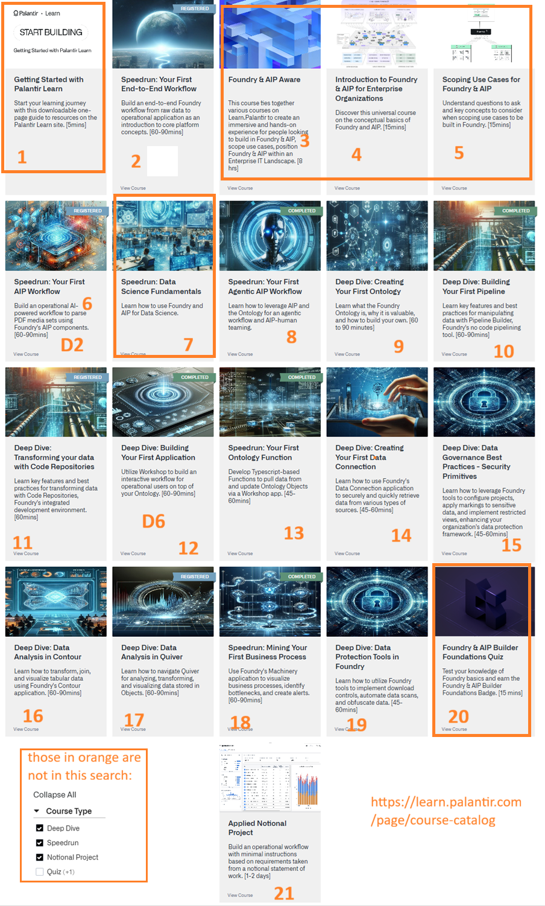

 

### **xx2.1 Getting Started with Palantir Learn (OLD PDF w/ links) (ORANGE)**

https://learn.palantir.com/getting-started-with-palantir-learn/2132079

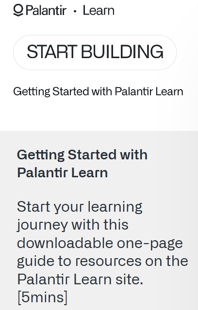

 

### **2.2 (#610 D1) Speedrun: Your First End-to-End Workflow (registered????) (bureau, office goods)**

 

#### **https://learn.palantir.com/speedrun-your-first-e2e-workflow/1790882**

 

#### **#610_pal_D1_foundry_v02_26.0704_SS**

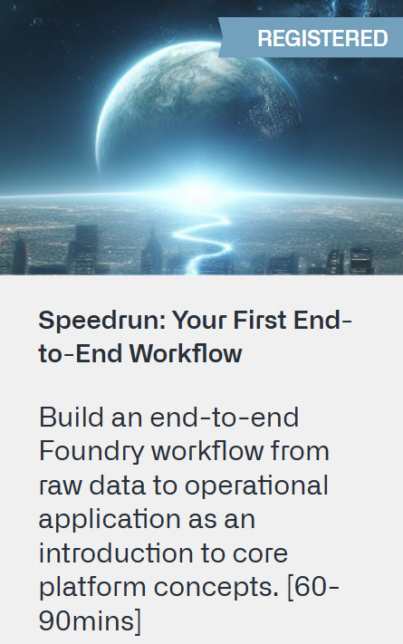

 

### **2.3 Foundry & AIP Aware (8 HOURS!!!!) (ORANGE) (NEW)**

https://learn.palantir.com/foundry-aip-aware

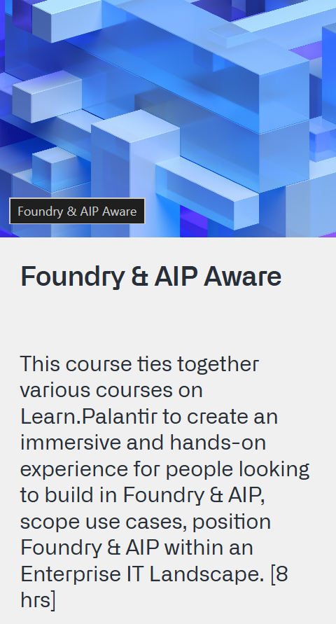

This course ties together various courses on Learn.Palantir to create an immersive and hands-on experience for people looking to build in Foundry & AIP, scope use cases, position Foundry & AIP within an Enterprise IT Landscape. [8 hrs]

 

### **xx2.4 Introduction to Foundry & AIP for Enterprise Organizations (VERBIAGE?) (ORANGE)**

Discover this universal course on the conceptual basics of Foundry and AIP. [15mins]

https://learn.palantir.com/introduction-to-foundry-aip-for-enterprise-organizations

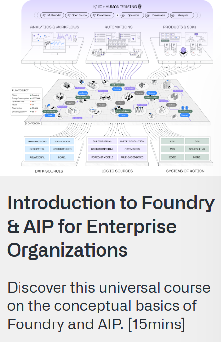

 

### **xx2.5 Scoping Use Cases for Foundry & AIP (VERBIAGE?) (ORANGE)**

Understand questions to ask and key concepts to consider when scoping use cases to be built in Foundry. [15mins]

https://learn.palantir.com/scoping-use-cases-for-foundry-aip

 

### **2.6 (#611 D2) Speedrun: Your First AIP Workflow (48 of 49 lessons completed (97%))**

 

#### **https://learn.palantir.com/speedrun-your-e2e-aip-workflow**

 

#### **#612_pal_D2_aip_v08_26.0710_SS**

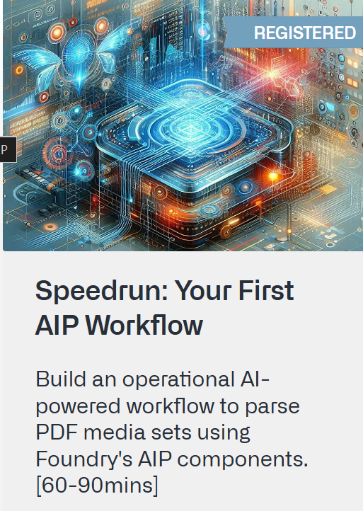

 

### **2.7 Speedrun: Data Science Fundamentals (NEW) (ORANGE)**

Learn how to use Foundry and AIP for Data Science.

https://learn.palantir.com/speedrun-data-science-fundamentals

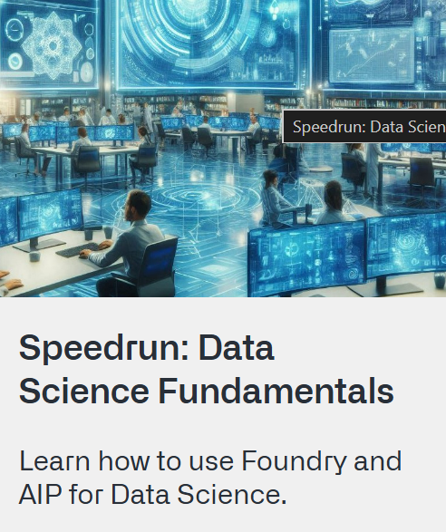

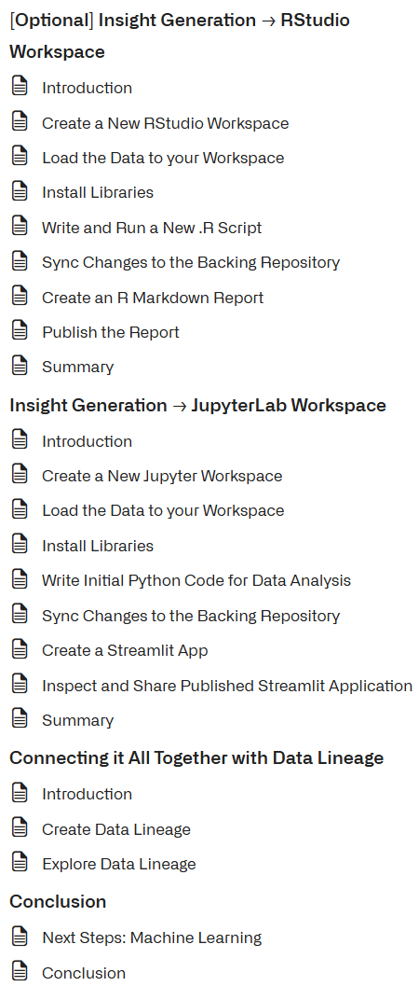

 

### **2.8 (#614 D3) Speedrun: Your First Agentic AIP Workflow (Priya Nair) (COMPLETED)**

 

#### **https://learn.palantir.com/speedrun-your-first-agentic-aip-workflow**

 

#### **#614_pal_D3_agentic_ai_qs_v03_26.0715_ss**

 

### **2.9 Deep Dive: Creating Your First Ontology (NEW)**

Learn what the Foundry Ontology is, why it is valuable, and how to build your own. [60 to 90 minutes]

https://learn.palantir.com/deep-dive-creating-your-first-ontology

 

### **2.10 (#618 D7) Deep Dive: Building Your First Pipeline (COMPLETED) (products, customers, transactions)**

 

#### **https://learn.palantir.com/deep-dive-building-your-first-pipeline**

 

#### **#618_pal_D7_first_pipeline_v02_26.0720_ss (2)**

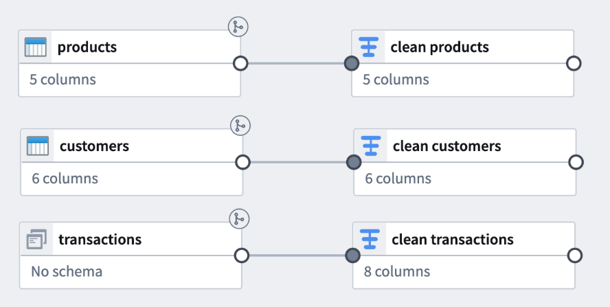

 

### **2.11 (#627 DD19) Deep Dive: Transforming your data with Code Repositories (transform_df) (x19 of 20 lessons completed (95%))**

 

#### **https://learn.palantir.com/deep-dive-transforming-your-data-with-code-repositories**

 

#### **#627_pal_DD19_transform_data_w_code_repos_v02_26.0805_ss.docx**

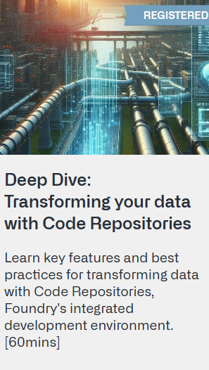

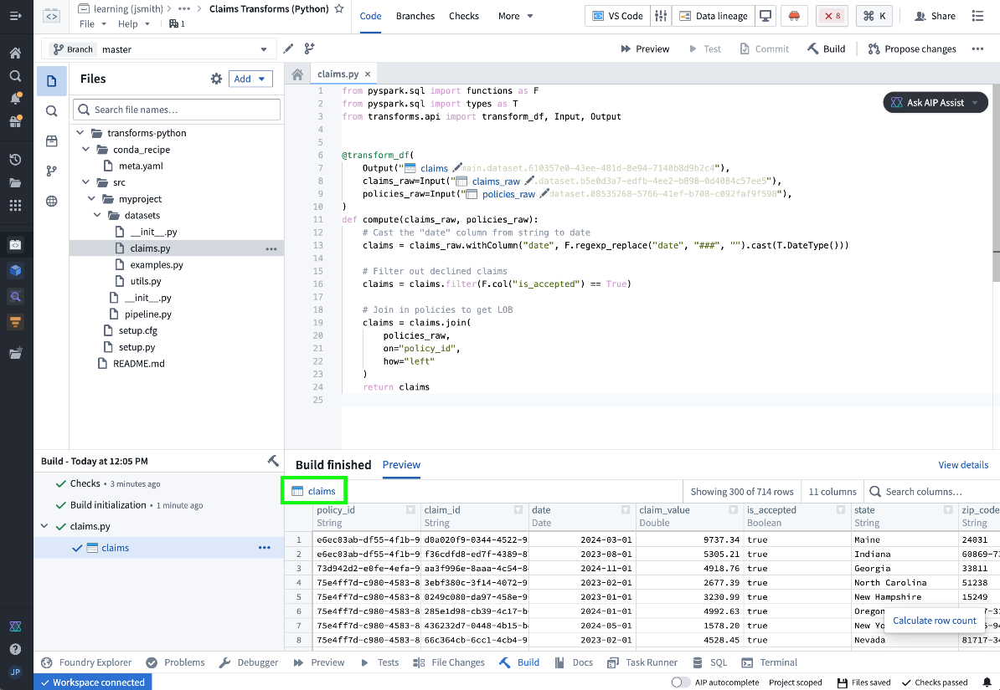

 

### **2.12 (#617 D6) Deep Dive: Building Your First Application (20 of 20 lessons completed (100%))**

 

#### **https://learn.palantir.com/deep-dive-building-your-first-application**

 

#### **#617_pal_D6_first_app_v01_26.0719_ss**

 

### **2.13 (#615 D4) Speedrun: Your First Ontology Function (COMPLETED) (40.51 days)**

26 of 26 lessons completed (100%)

 

#### **https://learn.palantir.com/speedrun-your-first-ontology-function**

 

#### **#615_pal_D4_onto_function_qs_v02_26.0717_ss (2)**

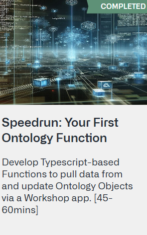

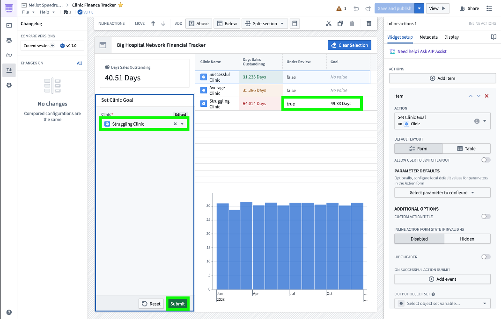

 

### **2.14 Deep Dive: Creating Your First Data Connection (NEW)**

Learn how to use Foundry's Data Connection application to securely and quickly retrieve data from various types of sources. [45-60mins]

https://learn.palantir.com/deep-dive-data-connection

 

### **2.15 Deep Dive: Data Governance Best Practices - Security Primitives (NEW)**

Learn how to leverage Foundry tools to configure projects, apply markings to sensitive data, and implement restricted views, enhancing your organization's data protection framework. [45-60mins]

https://learn.palantir.com/deep-dive-data-governance-best-practices-security-primitives

 

### **2.16 Deep Dive: Data Analysis in Contour (NEW)**

Learn how to transform, join, and visualize tabular data using Foundry's Contour application. [60-90mins]

https://learn.palantir.com/deep-dive-data-analysis-in-contour

 

### **2.17 Deep Dive: Data Analysis in Quiver (NEW) (1 of 26 lessons completed (3%))**

https://learn.palantir.com/deep-dive-data-analysis-in-quiver

 

### **2.18 (#616_pal_D5) Speedrun: Mining Your First Business Process (20 of 20 lessons completed (100%))**

 

#### **https://learn.palantir.com/speedrun-mining-your-first-business-process/2103028**

 

#### **#616_pal_D5_biz_process_mining_qs_v02_26.0718_ss (1)**

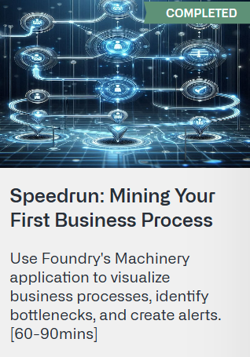

 

### **2.19 Deep Dive: Data Protection Tools in Foundry (NEW)**

Learn how to utilize Foundry tools to implement download controls, automate data scans, and obfuscate data. [45-60mins]

https://learn.palantir.com/deep-dive-data-protection-tools-in-foundry

 

### **xx2.20 quiz (ORANGE)**

https://learn.palantir.com/foundry-aip-builder-foundations-quiz

 

### **2.21 Applied Notional Project (NEW)**

Build an operational workflow with minimal instructions based on requirements taken from a notional statement of work. [1-2 days]

https://learn.palantir.com/applied-notional-project-automobile-inbox

 

## **T1 learn.palantir.com/page/training-track-data-engineer (5 TODO)**

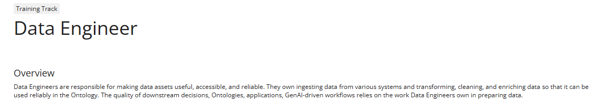

 

### **SCRATCH =================================**

 

### **T1.1 (#610 D1) (COURSE) Speedrun: Your first End-to-End Workflow**

Build your first end-to-end workflow in under 60 minutes

 

#### **https://learn.palantir.com/speedrun-your-first-e2e-workflow/1944887**

 

### **T1.2 (#618 D7) (COURSE) Deep Dive: Building your first Pipeline**

Learn how to build a data pipeline with Pipeline Builder and apply key data processing techniques to transform

 

#### **https://learn.palantir.com/deep-dive-building-your-first-pipeline**

 

### **T1.3 (NEW?) (COURSE) Speedrun: Creating Your First Data Connection**

This course will teach you how to use Foundry Data

 

#### **https://learn.palantir.com/deep-dive-data-connection**

 

### **>T1.4 (EXAMPLE) No-code approach to data cleaning with Pipeline Builder**

Clean and standardize raw data using no-code features within Pipeline Builder.

 

#### **https://ziptieai.usw-17.palantirfoundry.com/workspace/now/platform/de7f0bc4-e673-425c-a992-95a40e0c4ea8**

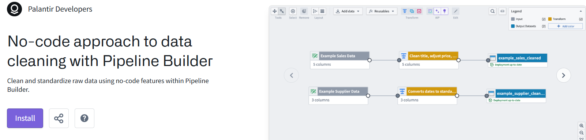

 

### **>T1.4 (EXAMPLE) Parse different data formats in Pipeline Builder**

Harmonize different data assets (JSON, XML, and XLSX) using Pipeline Builder.

 

#### **https://ziptieai.usw-17.palantirfoundry.com/workspace/now/platform/33b92ac7-9e59-46cc-abd1-7ad1905f1f12**

 

### **INTERMEDIATE ==========================================**

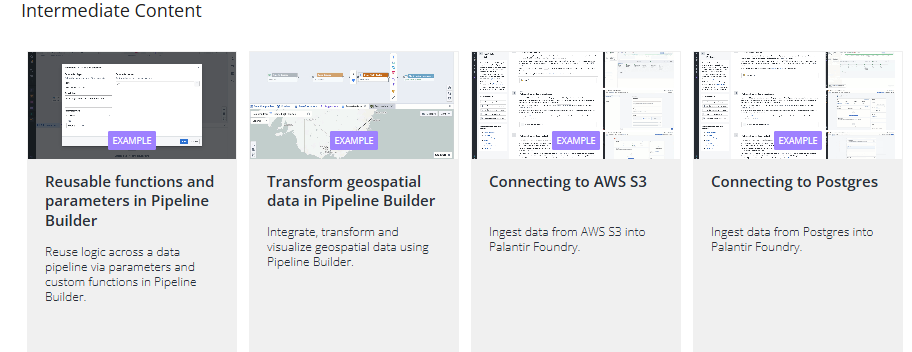

 

### **>T1.5 (EXAMPLE) Reuse functions and parameters in Pipeline Builder**

Reuse logic across a data pipeline via parameters and custom functions in Pipeline Builder.

 

#### **https://ziptieai.usw-17.palantirfoundry.com/workspace/now/platform/bddb1d26-46b0-40f3-9276-fb94605600aa**

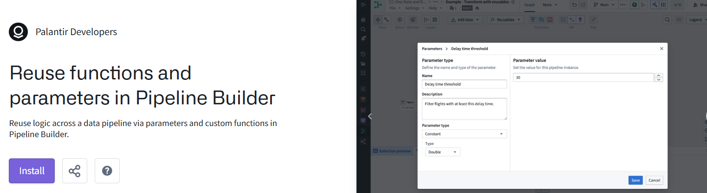

 

### **>T1.6 (EXAMPLE) (INSTALLED??) Transform geospatial data in Pipeline Builder**

Integrate, transform and visualize geospatial data using Pipeline Builder.

 

#### **https://ziptieai.usw-17.palantirfoundry.com/workspace/now/platform/0bf8ef1f-ca56-44c2-bbde-93478c0238d6**

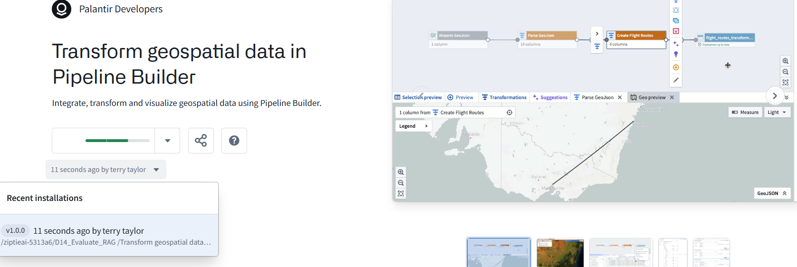

 

### **xT1.7 (EXAMPLE) (EGRESS?) Connecting to AWS S3**

Ingest data from AWS S3 into Palantir Foundry.

 

#### **https://build.palantir.com/platform/3b679834-f847-4ff2-82ad-6cf7018f1224**

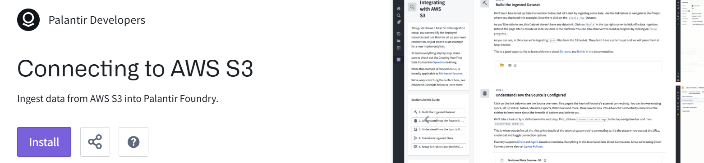

 

### **>T1.8 (EXAMPLE) (EGRESS?) Connecting to Postgres**

Ingest data from Postgres into Palantir Foundry.

 

#### **https://ziptieai.usw-17.palantirfoundry.com/workspace/now/platform/04af99f4-9b04-4187-8ab5-ce2f2452bfae**

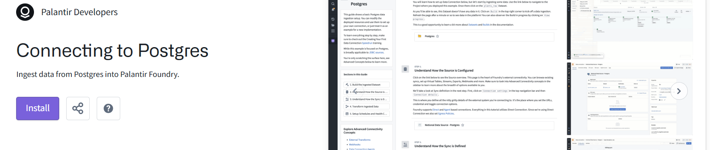

 

### **ADVANCED ==========================================**

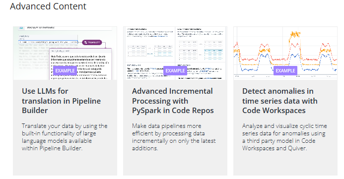

 

### **T1.9 (EXAMPLE) (NOT AVAIL) Use LLMs for translation in Pipeline Builder**

Translate your data by using the built-in functionality of large language models available within Pipeline Builder.

 

#### **https://ziptieai.usw-17.palantirfoundry.com/workspace/now/platform/4380bc2d-6ddf-4135-90c0-67bf7527ddd3**

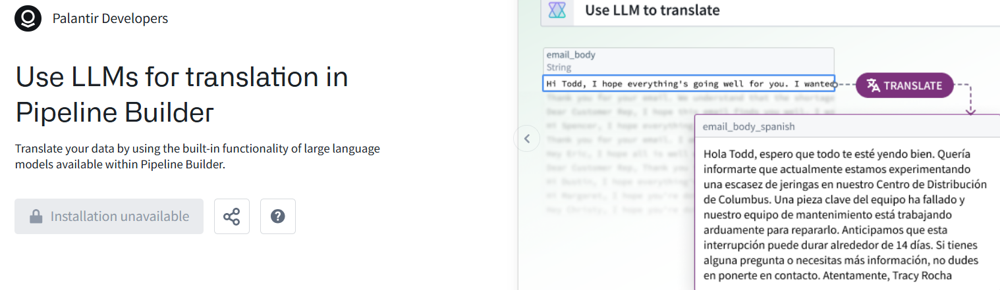

 

### **>T1.10 (EXAMPLE) Advanced incremental data processing with PySpark in Code Repositories**

Make data pipelines more efficient by processing data incrementally on only the latest additions.

 

#### **https://ziptieai.usw-17.palantirfoundry.com/workspace/now/platform/b5ec7380-9a17-46e1-b965-d25923411e78**

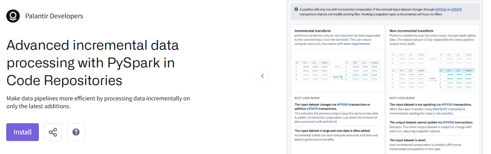

 

### **T1.11 (#626 E17) (EXAMPLE) Detect anomalies in time series data with Code Workspaces**

Analyze and visualize cyclic time series data for anomalies using a third party model in Code Workspaces and Quiver.

 

#### **https://ziptieai.usw-17.palantirfoundry.com/workspace/now/platform/dbfa6631-8ae1-42d8-bfe2-b24bbac5c107**

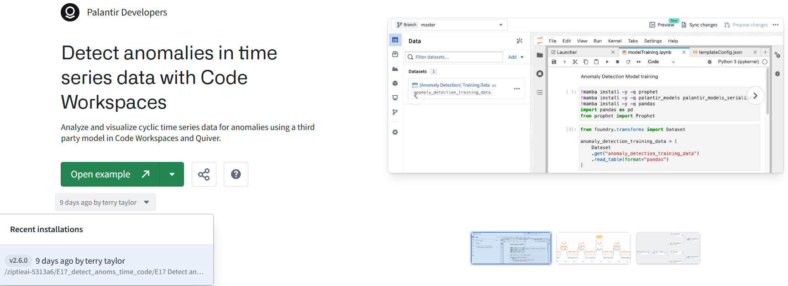

 

### **ADDITIONAL ==========================================**

              

--------
-----------
-------------
--------------
-------------
------------

              

 

## **T2 learn.palantir.com/page/training-track-application-developer (13 TODO)**

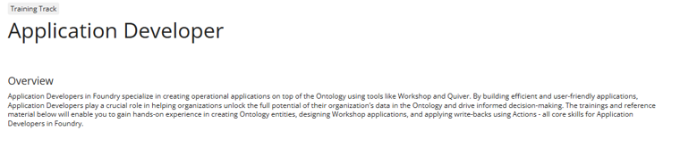

 

### **BASIC ====================================================**

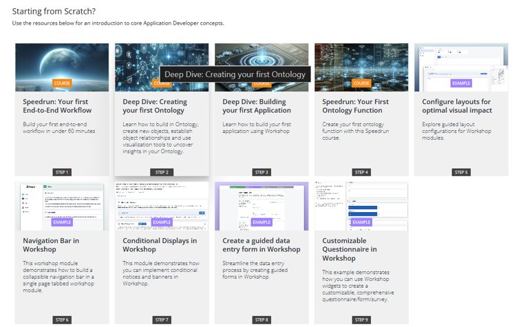

 

### **T2.1 (#610 D1) (COURSE) (speedrun: your first end-to-end workflow)**

 

#### **https://learn.palantir.com/speedrun-your-first-e2e-workflow/1944887**

 

### **T2.2 (DONE?) (COURSE) (deep dive: creating your first ontology)**

 

### **T2.3 ((#617 D6) (COURSE) (deep dive: building your first application)**

 

#### **https://learn.palantir.com/deep-dive-building-your-first-application**

 

### **T2.4 ((#615 D4) (COURSE) (deep dive: your first ontology function)**

 

#### **https://learn.palantir.com/speedrun-your-first-ontology-function**

 

### **>T2.5 (EXAMPLE) Configure layouts for optimal visual impact in Workshop**

Explore guided layout configurations for Workshop modules.

 

#### **https://ziptieai.usw-17.palantirfoundry.com/workspace/now/platform/8ae16eb2-5311-4364-ab3f-6df312f93d29**

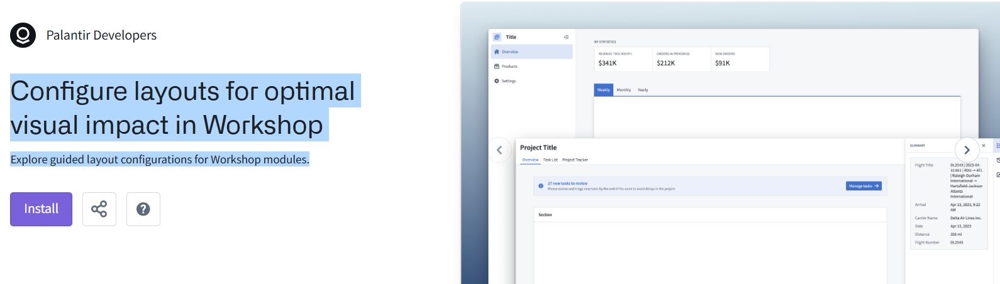

 

### **>T2.6 (EXAMPLE) Navigation Bar with URL Routing in Workshop**

This Workshop module demonstrates how to use the module header to build a collapsible vertical navigation bar within a single-page, tabbed interface, while also serving as reference for page, tab & variable URL routing.

 

#### **https://ziptieai.usw-17.palantirfoundry.com/workspace/now/platform/b7bf6948-9a87-443e-8404-ed34cb79c20e**

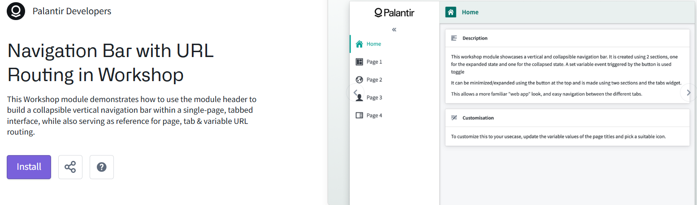

 

### **>T2.7 (EXAMPLE) Conditional Displays in Workshop**

This Example demonstrates how you can implement conditional notices and banners in Workshop

 

#### **https://ziptieai.usw-17.palantirfoundry.com/workspace/now/platform/58413ed4-9fd4-43ed-89cc-a413a4c57e15**

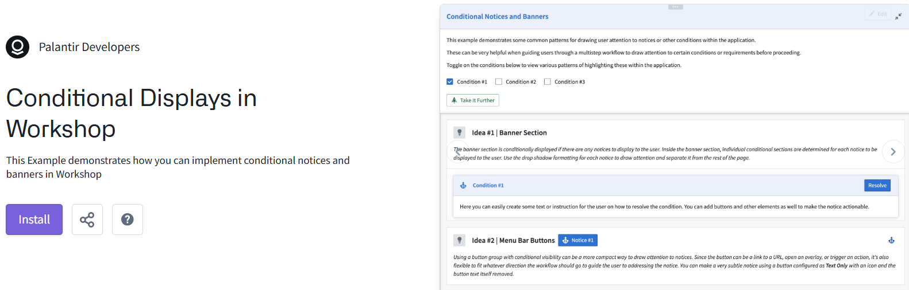

 

### **>T2.8 (EXAMPLE) Create a guided data entry form in Workshop**

Streamline the data entry process by creating guided forms in Workshop.

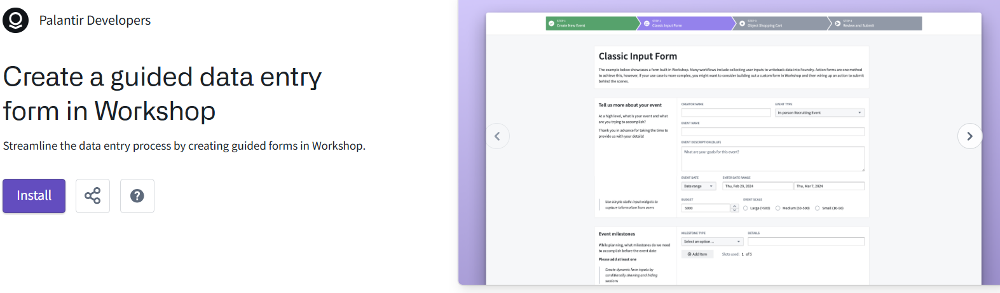

 

### **>T2.9 (EXAMPLE) Customizable Questionnaire in Workshop (AKA: Create bespoke forms and attach media in Workshop)**

This Example demonstrates how Workshop widgets can be used to create custom forms, as well as the method for attaching media to Objects using Actions.

 

#### **https://ziptieai.usw-17.palantirfoundry.com/workspace/now/platform/23a87022-70eb-4e8a-b32f-f30e1173de50**

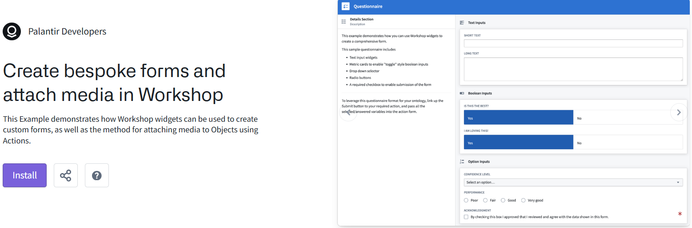

 

### **INTERMEDIATE ====================================================**

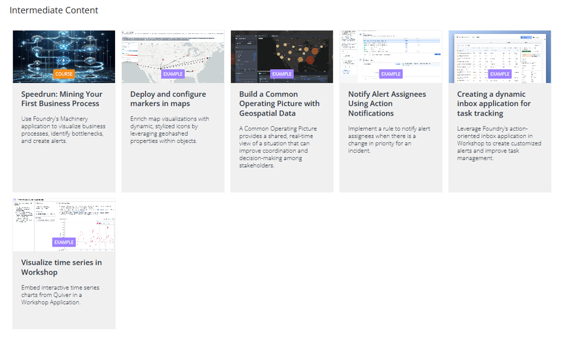

 

### **T2.10 (DONE??) (COURSE) speedrun: mining your first business process**

 

### **>T2.11 (EXAMPLE) Display and configure geo-markers in Maps**

Enrich map visualizations with dynamic, stylized icons by leveraging geohashed properties within objects.

 

#### **https://ziptieai.usw-17.palantirfoundry.com/workspace/now/platform/11700725-7f6a-40f5-8de0-45a242ccbff2**

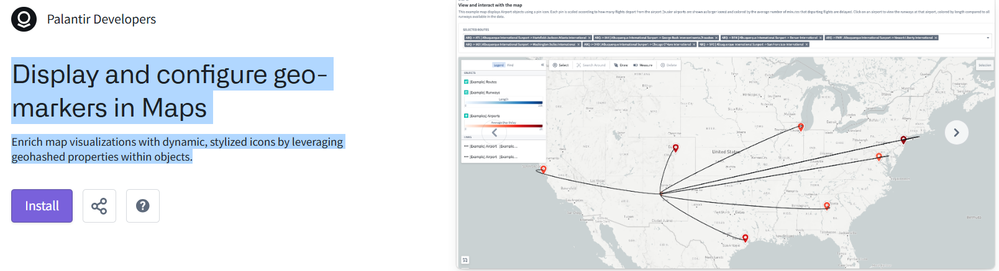

 

### **T2.12 (#623 E12) (EXAMPLE) Build a common operating picture with geospatial data**

A Common Operating Picture provides a shared, real-time view of a situation that can improve coordination and decision-making among stakeholders.

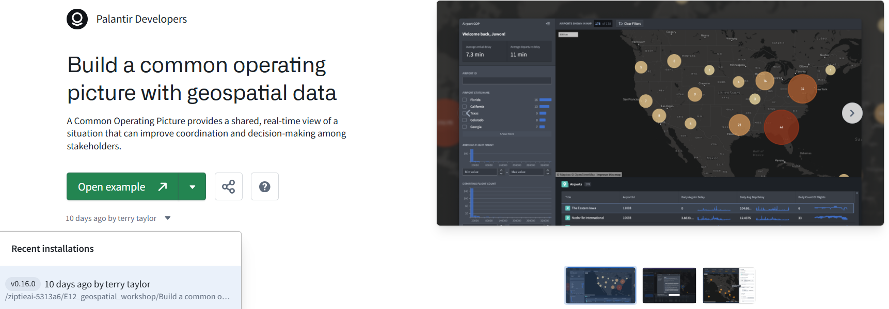

 

### **>T2.13 (EXAMPLE) Notify Alert Assignees Using Action Notifications**

Implement a rule to notify alert assignees when there is a change in priority for an incident.

 

#### **https://ziptieai.usw-17.palantirfoundry.com/workspace/now/platform/a43ae784-6884-4b07-94b2-3a795b9f4646**

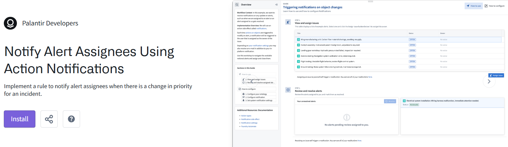

 

### **>T2.14 (EXAMPLE) Create a dynamic inbox application for task triaging in Workshop**

Leverage Foundry’s action-oriented inbox application in Workshop to create customized alerts and improve task management.

 

#### **https://ziptieai.usw-17.palantirfoundry.com/workspace/now/platform/6d60ad76-44cf-47c7-9042-1dac05a0515d**

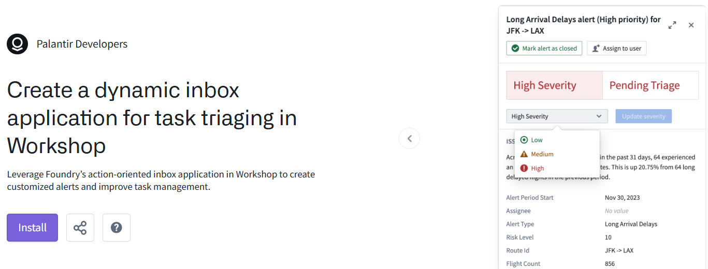

 

### **>T2.15 (EXAMPLE) Visualize time series in Workshop**

Embed interactive time series charts from Quiver in a Workshop Application.

 

#### **https://ziptieai.usw-17.palantirfoundry.com/workspace/now/platform/592a7933-68c0-4b1c-a6f8-0062c4631046**

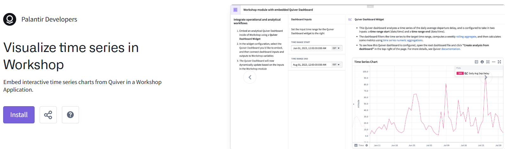

 

### **ADVANCED ====================================================**

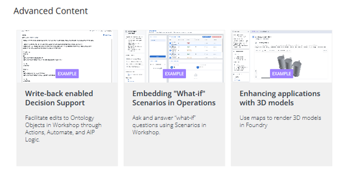

 

### **>T2.16 (EXAMPLE) Write-back enabled Decision Support**

Facilitate edits to Ontology Objects in Workshop through Actions, Automate, and AIP Logic.

 

#### **https://ziptieai.usw-17.palantirfoundry.com/workspace/now/platform/e28c95c8-24d7-4b39-afd3-a9ad25449894**

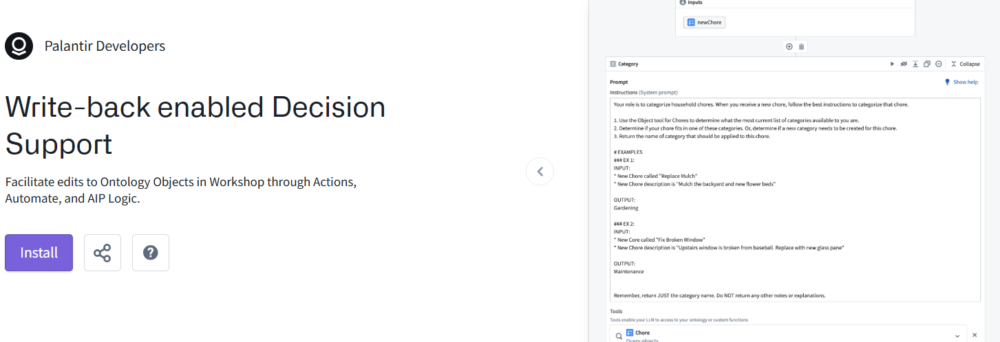

 

### **>T2.17 (EXAMPLE) Embedding "what-if" scenarios in operations**

Ask and answer “what-if” questions using Scenarios in Workshop.

 

#### **https://ziptieai.usw-17.palantirfoundry.com/workspace/now/platform/596fb429-6d17-48de-b70c-6a520fb4eab2**

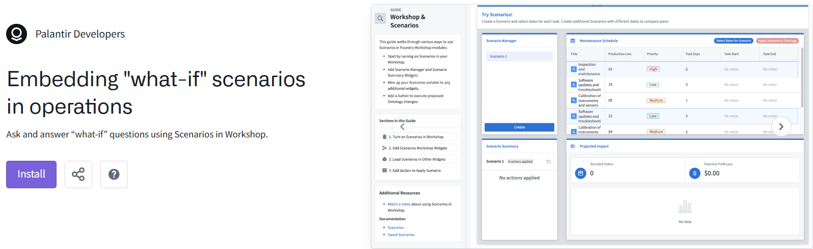

 

### **>T2.18 (EXAMPLE) Enhancing applications with 3D models**

Use maps to render 3D models in Foundry.

 

#### **https://ziptieai.usw-17.palantirfoundry.com/workspace/now/platform/52ee4774-eeab-457e-9b84-0ba9e6d64514**

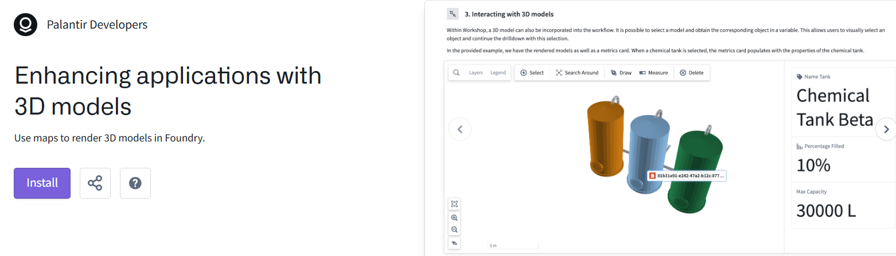

 

### **ADDITIONAL ==========================================**

The youtube video is just talk.

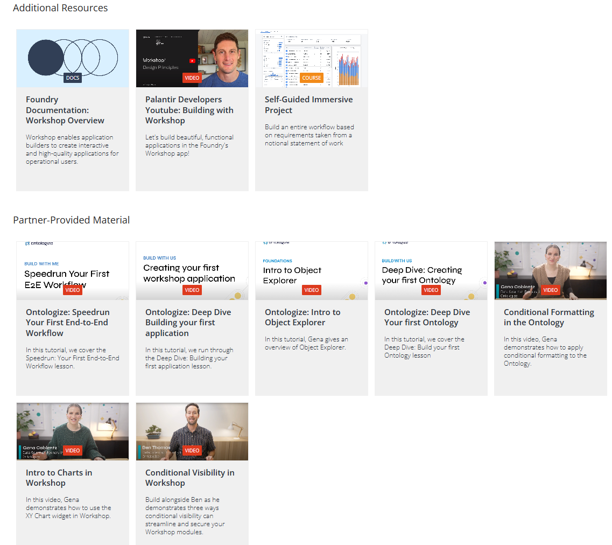

 

### **>T2.19 (COURSE 2days) Applied Notional Project (auto inbox)**

Build an operational workflow with minimal instructions based on requirements taken from a notional statement of work. [1-2 days]

 

#### **https://learn.palantir.com/applied-notional-project-automobile-inbox**

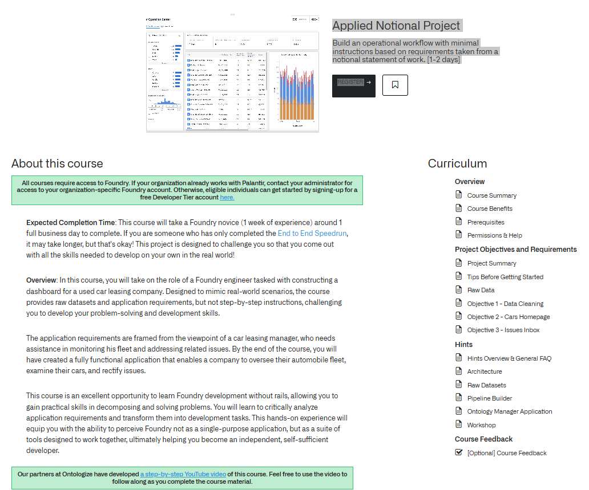

 

## **T3 learn.palantir.com/page/training-track-ai-engineer (6 TODO)**

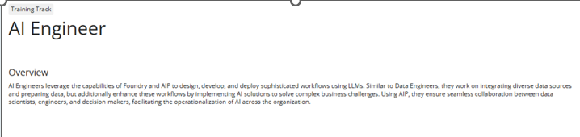

 

### **BASIC ====================================================**

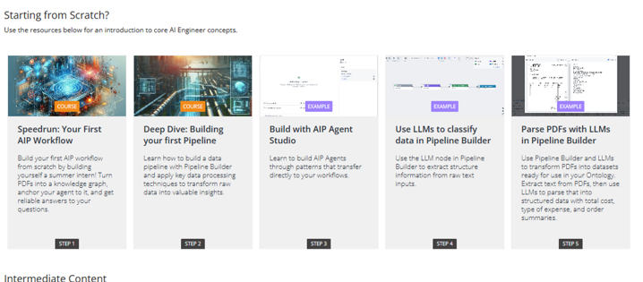

 

### **T3.1 (#611 D2) (COURSE) (speedrun: your first aip workflow)**

 

### **T3.2 (#618 D7) (COURSE) (deep dive: building your first pipeline)**

 

### **T3.3 (EXAMPLE) (REPEAT) Build with AIP Agent Studio (same as chatbot studio)**

Build AIP Agents step-by-step from basic Q&A to advanced Workshop-integrated systems. This progressive walkthrough covers three agent configurations that demonstrate real-world patterns you can adapt to your use cases.

 

#### **https://build.palantir.com/platform/19a1024e-fccf-45a8-ab18-f7f9c7d9ee5b**

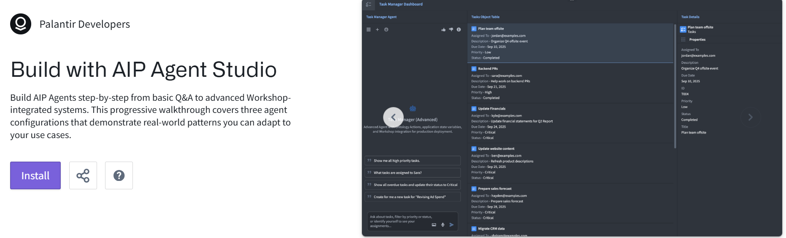

 

### **T3.4 (NOT AVAIL) (EXAMPLE) Use LLMs to classify data in Pipeline Builder**

Use the LLM node in Pipeline Builder to extract structure information from raw text inputs.

 

#### **https://ziptieai.usw-17.palantirfoundry.com/workspace/now/platform/f4ea83c3-f047-46d6-9a7f-5254dd334dff**

 

### **T3.5 (#621 E10) Parse PDFs with LLMs in Pipeline Builder**

 

#### **https://build.palantir.com/platform/9146fa33-e423-4f17-bc30-62cf6001fbb8**

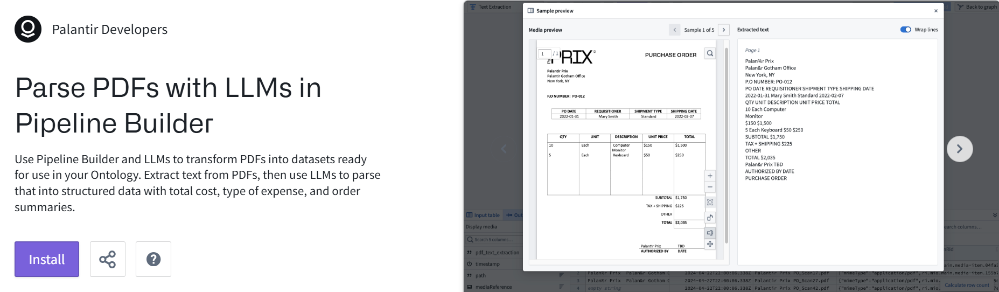

 

### **INTERMEDIATE =====================================**

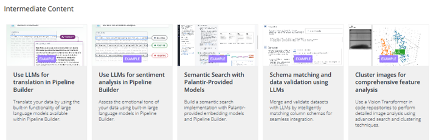

 

### **T3.6 (NOT AVAIL) Use LLMs for translation in Pipeline Builder**

Translate your data by using the built-in functionality of large language models available within Pipeline Builder.

 

#### **https://ziptieai.usw-17.palantirfoundry.com/workspace/now/platform/4380bc2d-6ddf-4135-90c0-67bf7527ddd3**

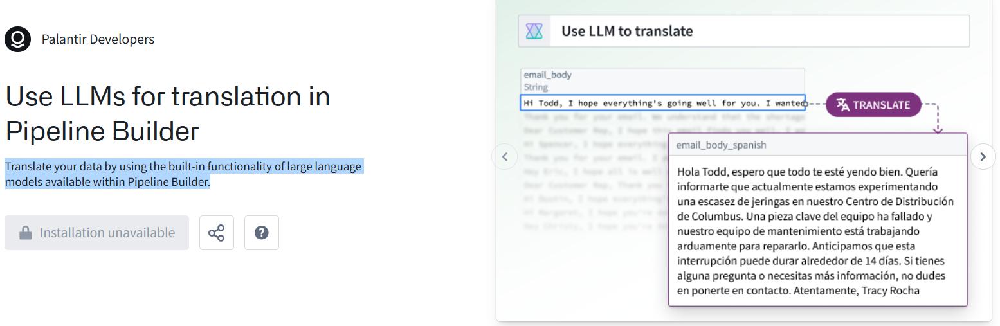

 

### **T3.7 (NOT AVAIL) Use LLMs for sentiment analysis in Pipeline Builder**

Assess the emotional tone of your data using built-in large language models in Pipeline Builder.

 

#### **https://ziptieai.usw-17.palantirfoundry.com/workspace/now/platform/af374d7f-a396-4f5d-8730-d82dd0d81519**

 

### **>T3.8 (EXAMPLE) Semantic Search with Palantir-Provided Models**

Build a semantic search implementation with Palantir-provided embedding models and Pipeline Builder.

 

#### **https://ziptieai.usw-17.palantirfoundry.com/workspace/now/platform/4be57ec0-83a3-4c3b-a066-62cbfd9d1fb6**

 

### **>T3.9 (EXAMPLE) Schema matching and data validation using LLMs**

Merge and validate datasets with LLMs by intelligently matching column schemas for seamless integration.

 

#### **https://ziptieai.usw-17.palantirfoundry.com/workspace/now/platform/ee5c0f4d-8c21-4987-be51-612973a03c99**

 

### **>T3.10 (EXAMPLE) Cluster images for comprehensive feature analysis**

 

#### **https://ziptieai.usw-17.palantirfoundry.com/workspace/now/platform/964018c9-cfd9-452d-bc4f-ac576995c7c7**

 

### **ADVANCED =============================================**

 

### **T3.11 (#614_pal_D3) (COURSE) Speedrun: Your First Agentic AIP Workflow**

38 of 38 lessons completed (100%)

 

#### **https://learn.palantir.com/speedrun-your-first-agentic-aip-workflow**

 

### **>T3.12 (EXAMPLE) Leverage feedback loops in AIP Logic**

Enhance your AIP Logic functions by implementing feedback loops to capture user preferences and tribal knowledge.

 

### **>T3.13 (EXAMPLE) Deploy GPT-4o against media and images (AKA: "deploy large multimodal models (LLM) against media and images")**

Apply Vision models on media data with Code Repositories using GPT-4o.

 

#### **https://ziptieai.usw-17.palantirfoundry.com/workspace/now/platform/56ca9571-24ea-4035-b156-15cb55bffe4b**

 

### **T3.14 (#619 D8??) (EXAMPLE) Use AIP Logic to classify and edit objects**

Build Logic functions and deploy them with Automate to classify and edit objects in the Ontology.

 

#### **18 days ago by terry taylor**

 

#### **https://ziptieai.usw-17.palantirfoundry.com/workspace/now/platform/212abb10-c561-48c2-81ff-8803b0299798**

 

### **T3.15 (#624 E15 FAILED) (EXAMPLE) Cross-validate Images and Documents using AIP**

Leverage AIP on media data to cross-validate and find similarities and differences.

 

#### **https://ziptieai.usw-17.palantirfoundry.com/workspace/now/platform/e99a7898-6dc2-4394-a5ec-a583a2d87568**

 

### **>T3.16 (EXAMPLE) Train a computer vision model to detect objects in images**

Train an object detection model on images with a prebuilt image annotation workflow using code repositories, workshop, and third party media detection models.

 

#### **https://ziptieai.usw-17.palantirfoundry.com/workspace/now/platform/8e8d9f84-e386-40b0-8643-20f35d089f6a**

 

### **ADDITIONAL =============================================**

 

### **(WEBPAGE) AI Platform (AIP)AIP LogicOverview**

 

#### **https://www.palantir.com/docs/foundry/logic/overview**

AIP Logic

AIP Logic is a no-code development environment for building, testing, and releasing functions powered by LLMs. AIP Logic enables you to build feature-rich AI-powered functions that leverage the Ontology without the complexity typically introduced by development environments and API calls. Using Logic’s intuitive interface, application builders can engineer prompts, test, evaluate and monitor, set up automation, and more.

You can use AIP Logic to automate and support your critical tasks, whether connecting key information from unstructured inputs to your Ontology, resolving scheduling conflicts, optimizing asset performance by finding the best allocation, reacting to disruptions in your supply chain, or more.

Logic functions can also be  so that .

AIP Logic provides an intuitive interface to leverage the Ontology and LLMs via a Logic function that takes inputs (like Ontology objects or text strings) and can return an output (objects and/or strings) or make edits to the Ontology. For example, the LLM-powered function below takes input data from an Ontology object and cross-references that data with a customer email to recommend a solution for a given issue based on previous resolutions.

AIP Logic is built on the same rigorous  model that governs the rest of the Palantir platform, including user and . These platform security controls grant an LLM access only to what is necessary to complete a task.

Learn more about the  of AIP Logic or  with building a Logic function.

 

## **T4 learn.palantir.com/page/training-track-data-scientist (2 TODO)**

 

### **BASIC ====================================================**

 

### **>T4.1 (COURSE) Speedrun: Data Science Fundamentals**

Learn how to use Foundry and AIP for Data Science.

 

#### **https://learn.palantir.com/speedrun-data-science-fundamentals**

 

### **T4.2 (#610 D1) (COURSE) Speedrun: Your first End-to-End Workflow**

Build your first end-to-end workflow in under 60 minutes

 

#### **https://learn.palantir.com/speedrun-your-first-e2e-workflow**

 

### **T4.3 (#619 D8 70%) (DOCS) Tutorial: Supervised Machine Learning**

This tutorial will walk you through a simplified supervised machine learning project in Foundry.

 

#### **https://www.palantir.com/docs/foundry/model-integration/tutorial-intro**

 

### **>T4.4 (EXAMPLE) Model training in Jupyter Code Workspaces**

Train, evaluate, and publish models in Jupyter Code Workspaces.

 

#### **https://ziptieai.usw-17.palantirfoundry.com/workspace/now/platform/4c112433-28d0-47f3-9600-531d84ff2a33**

 

#### **See also https://www.palantir.com/docs/foundry/model-integration/tutorial-train-jupyter-notebook**

 

### **ADDITIONAL =============================================**

 

## **T5 learn.palantir.com/page/training-track-frontend-osdk-developer (1 TODO)**

 

### **BASIC ====================================================**

 

### **T5.1 (#610 D1) (COURSE) Speedrun: Your first End-to-End Workflow**

Build your first end-to-end workflow in under 60 minutes

 

#### **https://learn.palantir.com/speedrun-your-first-e2e-workflow**

 

### **T5.2 (COURSE) Deep Dive: Creating Your First Ontology (NEW)**

Learn what the Foundry Ontology is, why it is valuable, and how to build your own. [60 to 90 minutes]

 

**https://learn.palantir.com/deep-dive-creating-your-first-ontology**

 

### **>T5.3 (EXAMPLE) Getting Started with Ontology SDK (OSDK) - Build a To Do application (NEW)**

 

#### **https://ziptieai.usw-17.palantirfoundry.com/workspace/now/platform/24af346e-637c-472f-b1de-9168dff0e74d**

 

### **ADDITIONAL =============================================**

 

## **T6 learn.palantir.com/page/training-track-data-analyst (9 TODO)**

 

### **BASIC ====================================================**

 

### **T6.1 (#610 D1) Speedrun: Your first End-to-End Workflow**

Build your first end-to-end workflow in under 60 minutes

 

#### **https://learn.palantir.com/speedrun-your-first-e2e-workflow**

 

### **>T6.2 (COURSE) Deep Dive: Data Analysis in Contour (NEW)**

In this course, you will be exposed to various methods to clean, transform, and visualize data in Contour.

 

#### **https://learn.palantir.com/deep-dive-data-analysis-in-contour**

 

### **>T6.3 (COURSE) Deep Dive: Data Analysis in Quiver (1 of 26 lessons completed (3%)) (NEW)**

Learn how to navigate Quiver for analyzing, transforming, and visualizing data stored in Objects.

 

#### **https://learn.palantir.com/deep-dive-data-analysis-in-quiver**

 

### **>T6.4 (EXAMPLE) Ontology Aggregations In Quiver (NEW)**

Aggregate and transform Ontology data using Quiver.

 

#### **https://ziptieai.usw-17.palantirfoundry.com/workspace/now/platform/aca96854-0154-4b86-a636-93da4d684658**

 

### **>T6.5 (EXAMPLE) Format and design documents in Notepad (NEW)**

Learn basic formatting and layout options for collaborative rich-text editing in Notepad.

 

#### **https://ziptieai.usw-17.palantirfoundry.com/workspace/now/platform/1ad2bfe8-abc7-4ba8-8263-d83b4a1e7724**

 

### **INTERMEDIATE ====================================================**

 

### **>T6.6 (EXAMPLE) Exploratory Data Analysis in Jupyter Code Workspaces (NEW)**

Analyze, visualize, and interact with aggregated data in Jupyter Code Workspaces.

 

#### **https://ziptieai.usw-17.palantirfoundry.com/workspace/now/platform/90017216-b432-4271-a959-4c81b264c9d2**

 

### **>T6.7 (EXAMPLE) Graphically explore relationships in your Ontology with a Vertex Graph (NEW)**

Leverage Vertex to visualize operational relationships of an Ontology object. Interact with graph nodes and traverse links to evaluate cause and effect relationships.

 

#### **https://ziptieai.usw-17.palantirfoundry.com/workspace/now/platform/74deb43d-2497-4ec3-b3c5-a3c035f32400**

 

### **>T6.8 (EXAMPLE) Dynamically generate sections with Notepad Templates (NEW)**

Dynamically create content for each object in a set using section generators in a Notepad Template.

 

#### **https://ziptieai.usw-17.palantirfoundry.com/workspace/now/platform/77b31962-199d-455f-b630-82ae3a18f0d5**

 

### **ADVANCED ====================================================**

 

### **>T6.9 (EXAMPLE) Vega Plots for Advanced Charting in Quiver (NEW)**

Create detailed interactive charts and other customizable visualizations with the Vega Plot card in Quiver.

 

#### **https://ziptieai.usw-17.palantirfoundry.com/workspace/now/platform/1c24cf8c-912d-4b6f-a2e3-2fdc1cdb4d89**

 

### **>T6.10 (EXAMPLE) Visualize time series data within a geospatial map (NEW)**

Enrich geospatial analysis by integrating time series data, offering a dynamic view of spatial and temporal trends.

 

#### **https://ziptieai.usw-17.palantirfoundry.com/workspace/now/platform/bd38ca10-f29a-4887-9c91-b8ddde41120e**

 

### **ADDITIONAL ====================================================**

