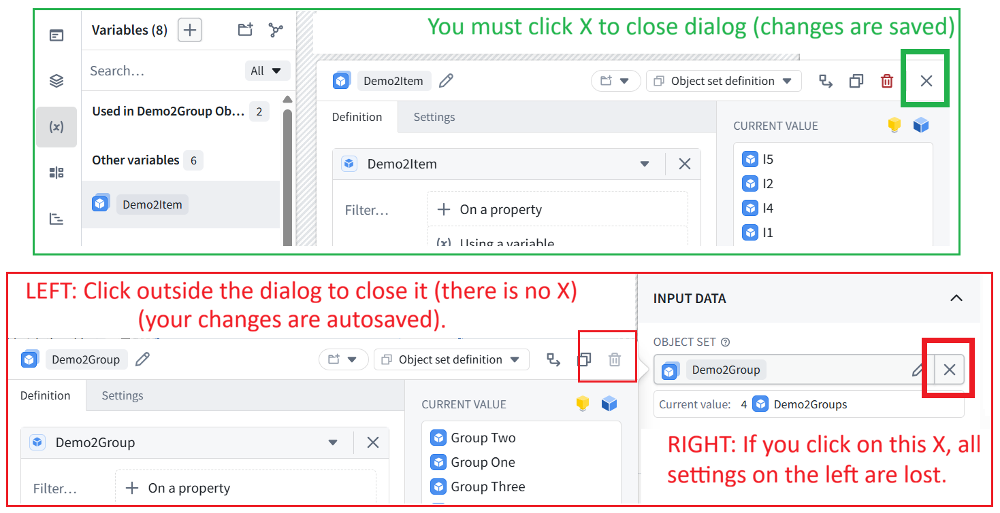
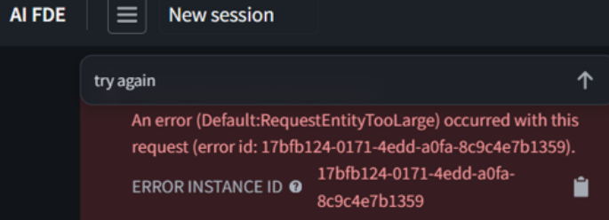
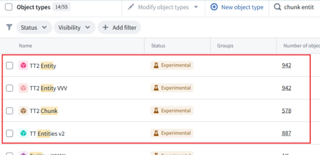

 

[← 3c Enterprise](/pal/)

26.1120 (v1 26.1120)

_Its important to master the UI_ 

 

Chapters (extracted from docx)
- **FDE**
- **Other important topics** (TODO: combine these into a single page)
  - **2.3 Foundry ontology (object type) management**. You are limited to 60 object types (OT's) in the ontology. Deleting existing OT's requires deleting other dependencies first (you cant just delete OT's).

_**[Single source docx #685](https://drive.google.com/drive/folders/1-Adawag9uA8_bq-hDF-nOuPYaRLz1eEO)** (WIP) for FDE webpages (markdown and PNG's are extracted by ChatGPT)._

 

-------------------------
-------------------------
-------------------------
-------------------------
-------------------------
-------------------------

 

### **FDE**

- **2.3a FDE ERROR: Foundry RequestEntityTooLarge (prompt window oversize) error**. If your chat window with FDE gets large enough, you will get this error. The fix is simple, but not obvious (and you cant ask FDE to help you fix it).

 

#### **[2.3a FDE ERROR: Foundry RequestEntityTooLarge (prompt window oversize) error](/pal_RequestEntityTooLarge/)**

_A show stopper (FDE error) -- If this happens, you need to summarize part of your chat window_  

 

-------------------------
-------------------------
-------------------------
-------------------------
-------------------------
-------------------------

 

### **Other important topics**

 

-------------------------

 

#### **[2.3 Foundry ontology (object type) management](/pal_ontology_management/)** (v1 26.1018) (was 2.0b)

The trial version of Foundry is very generous, but limits the total numbers of Object Types to 60. You probably won't hit that limit in 2.1 or 2.2, but to avoid running into problems in future demos, you might want to learn how to delete previous Object Types (then ask you create future demos you will appreciate the importance of tracking which demos are lowest priority).

_Deleting objects_  

 

--------------------

 

26.1120 (v1 26.1120)

