 

[← 3c Enterprise](/pal/)

_Converted from DOCX by GPT on 2026-11-24 17:29:53 EST_

This file describes "correquisites", things to keep in mind while doing the Foundry QS's.  The first 3 correq's are show-stoppers.

**Note**: This file was created 26.1124. There are lot of small issues that I have run into before and undoubtedly will again, but for the moment I can't recall them all. This page will grow as I run into them again.

 

## **1 FDE "RequestEntityTooLarge" error**

 

### **Cause**

Knowing how to use FDE (Forward Deployed Engineer, Foundry’s excellent AI assistant) is the most important skill you will learn. But if your chat history gets too long, FDE may stop working. This section explains the cause and the easy fix.

This is the chat history.

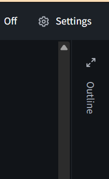

You have 1.1 milion tokens max. The following shows 588K tokens.

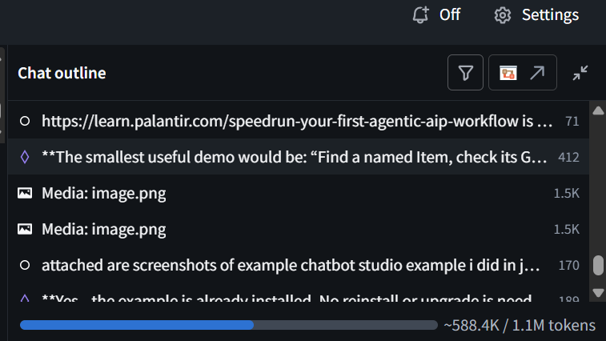

Although it says that you still have 500K tokens, you can actually run out of space much earlier. When that happens you get the following error (*no working FDE is a real show stopper).*

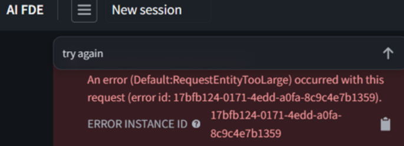

 

### **Solution**

The solution is to reduce the chat window size. To do this

1\. Click at the end of the chat window text that you no longer need.

2\. Move the cursor over the chat until you see the button **Summarize above**. Note that the text above will be removed from the prompt context window. FDE will basically lose its working memory of the details of those summarized chats.

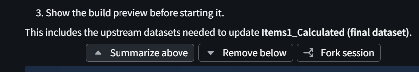

Apparently FDE maintains a massive context window, which is bascially it remembers all the details. If you summarize something important, those details are gone.

 

### **A few words of caution**

- Its easy to click on the buttons in red below if you are taking screenshots of FDE. "Summarize above" will nuke your chat history. That may cause FDE to lose a good deal of its memory about what your were doing.

- Do not using FDE for anything but using Foundry. You can use FDE for months and worth with a very large context. But it is for free, so its probably best to keep your usage to a minimum.

The blue square is for text and screenshot entry. The ability of FDE to "see" screenshots is a game changer.

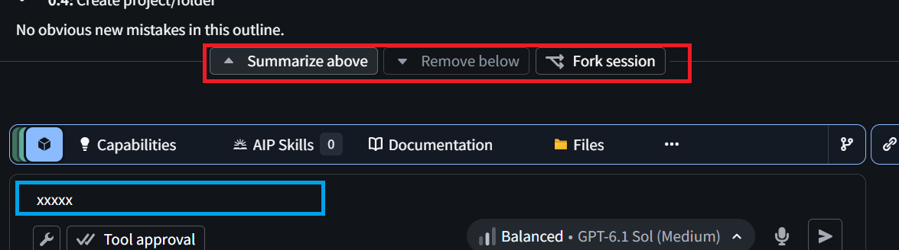

 

## **2 Foundry location requirements**

- **You must be in a country that PAL supports** (thats only a few countries). **Check access eligibility before investing time in this tutorial.** Palantir’s developer offering restricts access by country and requires identity verification. You may find it difficult to locate a definitive, current country list. Confirm eligibility through the current sign-up process or Palantir support.

- **You can NOT use a VPN**.

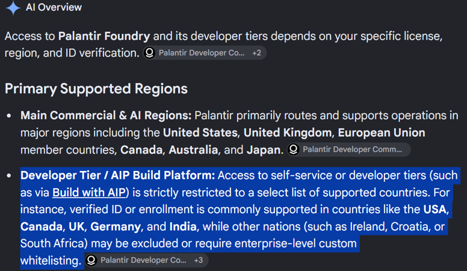

 

## **3 Foundry ontology (object type) management**

The trial version of Foundry is very generous, but limits the total numbers of Object Types to 60. You probably wont hit that limit while doing the quick starts.  The page ziptieai.com/pal_fde/ explains (WIP) how to delete object types (I have done this a few times already).

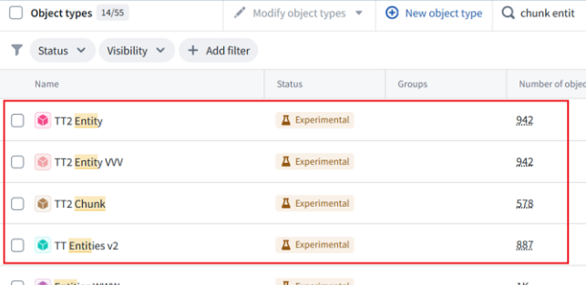

 

## **4 Focus on the details of the UI**

Foundry has a lot of capability and a lot of diagrams. Its a good idea to be familiar with the details of these dialogs.

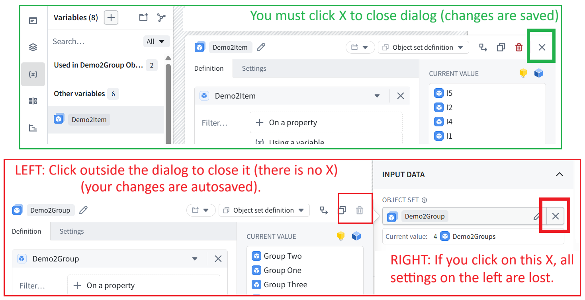

 

## **5 Reloading pages**

If you make modifications in one dialog, you might need to reload other dialogs. Refreshing does not cause any data loss.

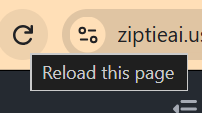

 

## **6 Project / folder, stars**

The following apps you will use quite often in this demo (with the exception of Pipeline Builder and Contour).

https://[namespace/server].palantirfoundry.com/workspace/narrative/

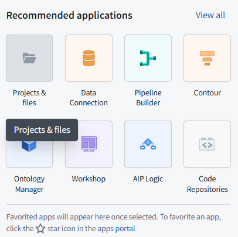

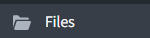

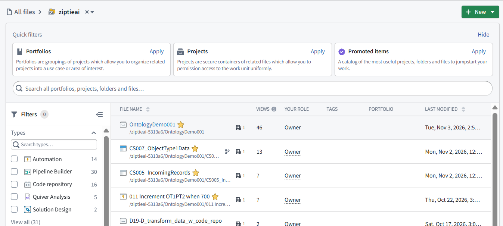

Note the gold stars. And item marked with a gold start will appear in the left panel of favorites.

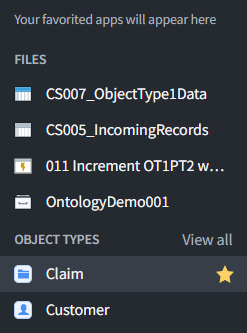

 

## **7 Opening new tabs (CTRL-click)**

Use CTRL + left click to open a Foundry tool or URL in a new tab.
