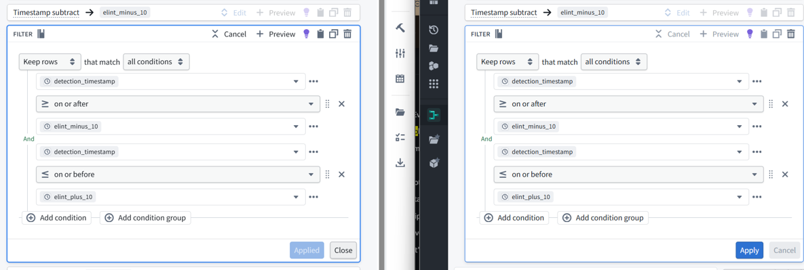
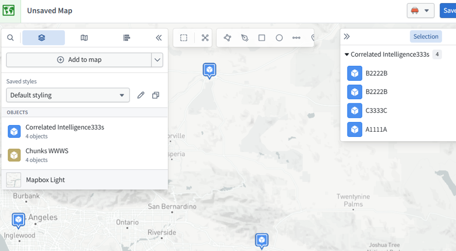
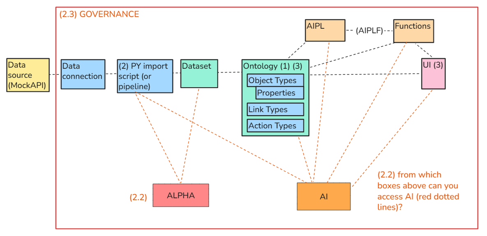
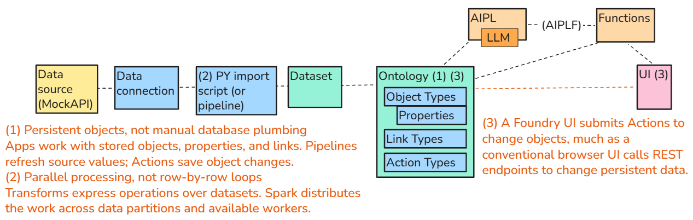

<br>

26.1117

<br>

<br>

-----------------
-----------------
-----------------
-----------------

<br>


# **ME1: on webpage https://ziptieai.com/pal/ title "3c Enterprise" under heading "1 Concepts" there are 2 subheadings**

1 Ontology/REST analogies
2 Protecting Enterprise Alpha: Ontology, AI, and Governance

i want to chat with you about these 2 subheadings

<br>

## 1 Ontology/REST analogies

i suggest to rename to "1 Ontology <> REST-backend anologies"

ontology is like a REST-backend with built in DB
WORKSHOP accesses in REST style
allows workshop to analyze
in our QS, we search for needle using AI in AIPLF.
but on the main "3c Enterprise" ziptieai webpage, i compare our demo to the Palantir EXAMPLE geospatial GAIA.
BUT for GAIA demo the search is using filter in the pipeline (see attached pic1) .




maps are used to display resulting data. (see attached pic2)



<br>

## it seems to me that there needs to be a new "1 Concepts" subsection

### 1b "haystack needed search"
and we describe where the spark based searches occur
2 Protecting Enterprise Alpha: Ontology, AI, and Governance
where is alpha, AI and governance?

<br>

## i want to create a diagram.
and specific exactly where these are (see attached pic 3)




<br>

-----------------

<br>

FDE: 

**Yes—these should be three distinct concepts.** Based on your text and diagrams, I would organize them as follows.

## 1a Ontology ↔ REST-backend analogies

Your proposed title works; I would spell it:

> **1a Ontology ↔ REST backend: a useful analogy**

The central explanation:

> **The Ontology provides persistent objects, relationships, permissions, and controlled operations. Workshop uses these capabilities much as a conventional browser UI uses a backend API to read and change stored data.**

Your three points, slightly refined:

- **Ontology:** comparable to an application backend backed by persistent storage—not merely an in-memory object model.
- **Workshop:** reads objects, follows links, and submits Actions. This resembles REST-backed application behavior; we need not claim Workshop literally uses REST for every operation.
- **Analysis:** Workshop and other North tools can display, filter, summarize, and interact with the objects.

**Workshop is one consumer of the Ontology, not its sole purpose.**

## 1b Finding the needle: where searching happens

**Yes—this deserves its own subsection.** Suggested title:

> **1b Finding the needle: pipeline filters, object queries, and AI**

The important distinction is **not all searching is AI, and not all searching uses Spark**.

| Where | How matching happens | Your example |
|---|---|---|
| **Data pipeline** | Filters, joins, calculations, and correlations select matching rows. Spark can distribute these operations when it is the execution engine. | The geospatial demo’s timestamp-range filter |
| **Ontology queries** | Indexed property filters and link traversal select objects. Do not describe these as Spark jobs. | Find Items belonging to a selected Group |
| **AI workflow** | An LLM interprets criteria or content and evaluates the records supplied to it. | The QS’s AIPL/AIPLF matching workflow |
| **North application** | Users explore, filter, and visualize results; the app may delegate queries to the underlying services. | The map displaying the geospatial results |

For the geospatial example, describe the pictured filter specifically:

> **This pipeline step keeps detections within the configured time window. The resulting objects are then available for display on the map.**

That screenshot alone does not establish every matching operation in the larger demo.

**The map displays the needles; it is not necessarily where they were found.**

## 2 Protecting Enterprise Alpha: Ontology, AI, and Governance

For this section, distinguish **valuable content**, **processing capability**, and **controls**.

### Where is Alpha?

If by **enterprise alpha** you mean the organization’s proprietary knowledge and advantage, it has **no single location**.

It can reside in:

- **Source data and datasets:** observations, records, documents.
- **Pipeline logic:** proprietary calculations, correlations, and selection rules.
- **Ontology:** meaningful properties and relationships that make data operational.
- **AIPL and Functions:** prompts, decision rules, and specialized logic.
- **Saved decisions and feedback:** knowledge captured through operational use.

**AI does not automatically create alpha; it can help extract, apply, or augment it.**

For your diagram, label the red box:

> **Enterprise Alpha: valuable data, relationships, logic, and decisions**

Use callouts to the relevant boxes rather than limiting it to Python and datasets.

### Where is AI?

Your dotted lines should distinguish two meanings:

1. **AI assistance while building:** AI FDE helps configure apps or write code.
2. **AI executing in the workflow:** a pipeline, AIPL, Function, or AI-enabled UI component invokes a model.

**The Ontology supplies governed context and receives authorized changes; it is not itself an LLM.** A line from Ontology to AI should therefore mean **“governed object data/context,”** not “the Ontology automatically runs AI.”

### Where is governance?

**Across the Foundry boundary**, as your outer rectangle suggests—but enforced at different points:

- Source access and network egress.
- Dataset permissions and markings.
- Object/property visibility.
- Action submission criteria.
- Model availability and LLM data-access policies.
- Execution records and audit capabilities.

A compact diagram caption could be:

> **Alpha is the valuable data and logic. AI is a capability applied to it. Governance controls who or what may access, process, change, and send it outside the platform.**


<br>

-----------------
-----------------
-----------------
-----------------

<br>


# **ME2: so it would have better if the original QS1 was just a simplified version of the GAIA demo?**

- 1 we create set of haystack data (simplified version)
- 2 use pipeline (or PY scripts) to detect needles
- 3 save needles to dataset
- 4 display dataset in foundry-app "maps".

The examples are the last section.
But QS1 could have shown at the end how to install the GAIA exmaple,
and explained how it matched QS1.
This would give a potential student a lot of motivation,
because realize the power of the simple demo they just created.

then create QS2 (similar to our current QS) which provides 
- 5 REST-analogous accesss to backend objects backed by the dataset
- 6 UI that can display the needles
- 7 AI that can perform various analyses on needles

then the "deep dive" that we are doing now.


<br>

-----------------


<br>


FDE: Yes—for your intended audience, that would likely be a stronger learning sequence. It separates three ideas that our original QS introduced together:

1. Find matching data.
1. Make it available as operational objects.
1. Use applications and AI to interact with it.

### QS1: Find and map the needles
Goal: detect a few meaningful matches in a larger, understandable collection.

1. Create a small, generic haystack with deliberately planted matches.
1. Use pipeline filters or Python transforms to detect them.
1. Save the matching rows to an output dataset.
1. Display the results on a map.
1. Introduce the GAIA example and explain how its more sophisticated workflow uses the same basic mechanisms.

One necessary adjustment: the Maps screenshot shows objects, not direct dataset rows. To reproduce that approach, QS1 needs a small intervening step:

1. Source → transforms → matching dataset → map-ready object type → Map

We could keep object-type creation minimal and defer the deeper Ontology explanation to QS2.

**Your proposed ending is particularly valuable:**

> “You have just built a small version of this mechanism. Now see what it enables in a richer example.”

We would need to verify GAIA’s current availability, installation requirements, and prerequisites before promising an install exercise.

### QS2: Inspect, analyze, and act on the needles
Goal: turn the results into an interactive application.

1. Explain the persistent objects and their backend/API analogy.
1. Build a Workshop UI to inspect the needles and follow relationships.
1. Use AI to interpret or summarize selected needles.
1. Optionally save an analysis or human decision through an Action.

This also makes the role of AI clearer: QS1 finds needles using explicit rules; QS2 adds interpretation of those results. AI need not scan the entire haystack.

### Deep Dive: Broader Foundry coverage
Then D1–D6 introduce the apps and techniques more systematically, with the South and North extensions we discussed.

The educational progression becomes:

> QS1: discover the value → QS2: make it interactive and intelligent → Deep Dive: learn the wider toolset.

I would treat this as a redesign for the next edition—not a reason to discard the current QS. Much of its material can become QS2, while D1 supplies much of the foundation for QS1.

<br>

-----------------
-----------------
-----------------
-----------------

<br>


ME: I dont want to discard the current. This is what I would like to do:
-1 add this plan to the main "3c Enterprise" page... a very short version.
-2 finish basic DD (deep dive)
-3 create QS1 (the current QS becomes QS2)
-4 continue on DD (try to "plug in" all the missing pieces... tools that need to describe, etc)

<br>

-----------------

<br>

**Yes—that preserves the current work and gives the series a clear development order.**

Suggested short text for **3c Enterprise**:

### Foundry tutorial roadmap

1. **Finish the basic Deep Dive (D1–D6):** introduce the core Foundry mechanisms through small, connected exercises.
2. **Add QS1—Find and map the needles:** detect matches in sample data, display them on a map, and connect the exercise to the richer GAIA example. **The existing Quick Start becomes QS2**, extending the workflow with an interactive UI, AI, Actions, and automation.
3. **Expand the Deep Dive:** plug in additional data sources, analysis tools, and techniques, showing where each fits in the overall architecture.

**The existing Quick Start remains available throughout.**


<br>

-----------------
-----------------
-----------------
-----------------

<br>

ME: by "plan" i mean not what i am going to do...
But rather what the end goal is.

I want to reorg the concepts to reflect what we discussed....
and update diagrams.
in the attached diagrams "QS-1, QS-2a, ...." does not mean any particular QS right now,
but the eventual desired general QS progression.
i want to diagrams something like these to the main "3c Enterprise" section "1 Concepts"
to show TODAY (even if not yet implemented) what hte goal is.

pic1: 3 diagrams, basic "haystack needles" demo.
the needles are in the dataset, and use north tools (maps, UI, etc) to find specific needles.

pic2,3,4: ontology, AI, governance.

<br>

-----------------

<br>


**Understood—this is the intended learning progression, not a development schedule or a list of tutorials already available.** You can present it today under **1 Concepts**, with that distinction stated once.

Suggested introduction:

> **The diagrams below show the intended Quick Start learning progression: detect relevant records, explore the results, build an operational application, add AI, and apply governance. They describe the overall learning goal; not every stage is currently implemented as a separate tutorial.**

## Suggested concept headings

| Heading | Main message |
|---|---|
| **1.1 Detect needles in the haystack** | Pipeline transforms identify matching records and store them in a dataset. |
| **1.2 Explore the detected needles** | North tools—such as Maps—display the results and help users investigate particular matches. |
| **1.3 Work with persistent objects and Actions** | The Ontology provides objects, properties, links, and controlled changes for applications to use. |
| **1.4 Apply AI where it adds value** | AI can participate in pipeline processing or analyze objects through AIPL, Functions, and applications. |
| **1.5 Govern the complete workflow** | Controls determine who and what may access, process, change, and transmit data. |

The **GAIA comparison fits at the end of 1.2**: show how the small exercise illustrates mechanisms used in a richer example, without implying that it reproduces the entire example.

## Diagram adjustments

### Picture 1: detection versus exploration

**Your separation is useful:**

- **Pipeline:** detects candidate needles according to configured rules.
- **Output dataset:** stores those detected candidates.
- **North tools:** display, filter, and investigate them further.

Keep the distinction explicit: **the map does not have to repeat the original detection process.**

For the Maps path shown, retain:

**Detected dataset → Ontology objects → Maps**

For other North tools, Ontology is not universally required—some can analyze datasets directly.

### Picture 2: Ontology-backed applications

This diagram works for **objects, links, Actions, Functions, and Workshop**. Since it represents the eventual conceptual progression, remove **“current QS”** from its title.

Suggested title:

> **QS-3: Build an application over persistent objects**

### Picture 3: where AI can participate

Replace **“Where can AI be injected??????”** with:

> **AI can be invoked during data processing or during application use.**

Show model-call connections from:
- **Python transforms / Pipeline Builder**
- **AIPL**
- **Functions**

A UI may also expose native AI features or call those workflows. **A dataset or object type does not invoke an LLM merely by existing.**

For **“LLM (SOUTH)”**, add a qualification:

> **Model service—external or Foundry-hosted**

An LLM is not necessarily outside Foundry; its placement depends on how it is hosted.

### Picture 4: governance

**The outer governance boundary works.** Include a short caption:

> **Governance spans source access, datasets, objects, Actions, model use, and data egress—not just the UI.**

**The overall story is now: detect → explore → operationalize → augment with AI → govern throughout.** Governance appears last in the explanation, but applies across every stage.

<br>

-----------------
-----------------
-----------------
-----------------

<br>


ME: thanks... you apparently agree with the gist of what i am proposing.

if i had had such diagrams and explanation froom the beginning, learning this would have been so much easier.
i think the ZiptieAi concepts will make it vastly easeier to understand foundry.

<br>

-----------------

<br>


**Yes—I agree with the gist.** Your diagrams give readers a map **before** asking them to navigate individual Foundry screens.

They separate questions that otherwise get tangled together:

- **Where is the data?**
- **Where does processing happen?**
- **What does the Ontology provide?**
- **Which app configures or uses each capability?**
- **Where can AI participate, and what governs it?**

That is the contribution of the ZiptieAI concepts: **connect the tools to a coherent mental model**, then use small, verified exercises to make that model concrete.

We’ve repeatedly seen how those distinctions resolve confusion in your own learning. Putting them at the beginning should help other beginners avoid the same detours.


<br><br><br><br><br><br><br><br><br><br><br><br><br><br><br><br><br><br>
<br>

-----------------
-----------------
-----------------
-----------------

<br>

# **26.1116**

_Main Foundry diagram (ZAI original diagram verified by FDE)_<br>

# **ME: attached is my diagram for Foundry ... the core of what it is.** 

I am trying to compare ontology operations with REST operations.

could you give me examples of ontology/REST pairs.

<br>

## GPT: Your diagram makes the comparison quite natural. Foundry Ontology operations are conceptually similar to REST API operations on business objects.

The main distinction is that Foundry provides a managed object model and controlled Actions, rather than requiring you to build all the REST endpoints yourself.

<br>

-----------------

<br>

## Ontology ↔ REST equivalents

Using your `693_Record` objects as an example:

| Operation          | Foundry Ontology                        | Conventional REST               |
| ------------------ | --------------------------------------- | ------------------------------- |
| Create object      | Create an object through an Action      | `POST /records`                 |
| Read object        | Query an Object Type                    | `GET /records/123`              |
| Read many objects  | Query an Object Set                     | `GET /records`                  |
| Filter objects     | Apply an Object Set filter              | `GET /records?status=FOUND`     |
| Update property    | Modify object through an Action         | `PATCH /records/123`            |
| Replace object     | Action that sets multiple properties    | `PUT /records/123`              |
| Delete object      | Delete object through an Action         | `DELETE /records/123`           |
| Link two objects   | Create or modify an object relationship | `POST /records/123/links`       |
| Run business logic | Execute a Foundry Action                | `POST /records/123/check`       |
| Trigger automation | Ontology event / automation trigger     | Webhook or event-driven handler |

These are conceptual equivalents, not necessarily the exact HTTP endpoints Foundry exposes.

<br>

-----------------

<br>

## Three concrete examples

### 1. Read an object

#### Foundry

Workshop Object Table reads a `693_Record` object.

Ontology → Object

#### REST

```
GET /records/123
```

Returns the record's properties.

### 2. Modify an object

#### Foundry

Workshop button submits `693_SaveCheckResult`, updating the object's `CheckResult` property.

#### REST

```
PATCH /records/123
```

```
{"CheckResult":"FOUND"}
```

### 3. Execute AI and save its result

#### Foundry

693_CheckAndSaveRecord` runs the AI check through AIPLF and saves the answer through an Action.

#### REST

```
POST /records/123/check
```

Server-side logic calls the LLM and updates the record.

<br>

-----------------

<br>

## One important architectural distinction

In conventional REST applications, the API usually handles both reads and writes.

In Foundry:

- Object Types / Object Sets provide the structured data and query model.
- Action Types provide controlled write operations and business logic.
- Workshop UI reads objects and submits Actions.
- AIP Logic / Functions can supply AI processing used by those workflows.

So the closest mapping for your diagram is:

#### Foundry

- Object Types + Object Sets + Actions

#### REST application

- Resources + GET/POST/PATCH/DELETE endpoints

#### Both expose controlled operations on persistent business data.

**One qualification for your diagram:** Foundry Actions are not simply REST endpoints. They are governed business operations with permissions, validation, and potentially more complex logic. But the REST analogy is very useful for explaining their practical role.


<br>

-----------------
-----------------
-----------------
-----------------

<br>


# **ME2: i am not trying to make them the same... i am just to explain**

the understood ontology with "analoguies" to REST endpoints (assume reader understands those). There is so much chatter about the "mystical" ontology... i am just trying to de-mystify it. the details are great to mention in anycase.

_(ME: question above is kind of sloppy on my part)_

<br>

## Exactly. Your objective is not to equate Ontology with REST, but to use familiar REST concepts to explain what Ontology actually does.

I think that's an effective teaching approach, especially for developers who already understand APIs.

For example:

| Foundry concept    | Familiar REST analogy                              |
| ------------------ | -------------------------------------------------- |
| Object Type        | Resource type, such as `/customers`                |
| Object instance    | Individual resource, such as `/customers/123`      |
| Property           | Resource field, such as `customer.name`            |
| Link Type          | Relationship between resources                     |
| Object Set         | Collection returned by a query                     |
| Action Type        | Controlled operation, analogous to an API endpoint |
| Action submission  | Calling an endpoint to perform an operation        |
| Action permissions | API authorization rules                            |

The central insight is that Ontology isn't some mysterious AI mechanism. It's a structured representation of business objects, their relationships, and the operations permitted on them.

The additional Foundry capabilities—governance, security, integration with datasets, AI, automation, and UI—are important, but they don't invalidate the analogy.

Your diagram also makes an important point: Ontology is only one part of Foundry's overall data-processing and application architecture. The data pipeline, AIP Logic, Functions, and UI have their own roles.

I'd use a sentence like this in your tutorial:

> If you're familiar with REST APIs, you already understand much of the basic idea behind Foundry Ontology: objects resemble API resources, properties resemble resource fields, links resemble relationships, and Actions resemble controlled API operations. The implementation and capabilities differ, but the analogy helps remove the mystery.

That gets your point across without suggesting the two technologies are identical.

<br>

-----------------
-----------------
-----------------
-----------------

<br>

ME: the 3 foundry/rest examples above... can you give them to me as a markdown table... include also any disclaimers (about how they in reality are different)

FDE: Here is the Markdown table, using the three examples from above. The REST endpoints are illustrative analogies, not actual Foundry API endpoints.

```

| Operation | Foundry Ontology | REST analogy | Important differences |
|---|---|---|---|
| **1. Read an object** | Workshop Object Table reads a `693_Record` object from the Ontology. | `GET /records/123` returns the record's properties. | Foundry exposes objects through its Ontology query mechanisms, not necessarily a conventional REST GET endpoint. Objects may be backed by datasets or other data sources. |
| **2. Modify an object** | Workshop submits the `693_SaveCheckResult` Action to update an object's `CheckResult` property. | `PATCH /records/123` with `{"CheckResult":"FOUND"}` updates the record. | Foundry Actions are governed operations with permissions and validation. Changes may be stored as Ontology edits rather than directly modifying the underlying dataset. |
| **3. Execute AI and save the result** | Workshop submits `693_CheckAndSaveRecord`, which runs the AI check through AIPLF and saves its answer using an Action. | `POST /records/123/check` invokes server-side logic that calls an LLM and updates the record. | The Foundry workflow combines Action logic, AIPLF, AI processing, and object edits. A conventional REST application would require developers to implement and connect these components themselves. |

```

### Suggested disclaimer for your webpage

```

**REST analogy disclaimer:** These examples are intended to
demystify Foundry Ontology for readers familiar with REST APIs.
They illustrate similar operations, not identical implementations.

Foundry Ontology provides a managed model of business objects,
properties, relationships, and Actions. Foundry also provides
built-in mechanisms for authorization, governance, data integration,
and application workflows.

The REST endpoints shown are hypothetical examples, not actual
Foundry API URLs. Foundry does expose APIs, but its Ontology
operations do not necessarily map one-to-one to conventional
REST endpoints.

```

The main conceptual takeaway: Ontology provides a structured way to read and operate on business objects. REST APIs provide another familiar way to expose operations on resources. The analogy explains the basic mechanics without claiming that their architectures are identical.


<br>

-----------------
-----------------
-----------------
-----------------

<br>

ME: good disclaimer.... give me a 1-2 sentence version

GPT: REST analogy disclaimer: These examples illustrate conceptual similarities between Foundry Ontology operations and familiar REST endpoints, not identical implementations. The REST endpoints are hypothetical; Foundry uses its own mechanisms for managing objects, relationships, Actions, permissions, and data integration.

<br>

-----------------
-----------------
-----------------
-----------------

<br>

**ME:** Alex Karp talked about "alpha" in an enterprise and how ontology protects that from being leaked. But I would say that how actually works:

- (1) ontology is basically the "backend" of the enterprise ... this is what "alpha" means. its like the REST API backend is the core product of a company.&#x20;
- (2) a backend does not leak secrets.&#x20;
- (3) but when you add AI in a backend, then things get tricky. you have to be able to monitor whatever is sent to an external model. (thus the important of AIPL)
- (4)  you also need to limit what an end user can enter in a UI that goes to an external AI. you need monitoring (governance) on the UI.


**FDE:** I think your four points capture the central issue very well: the enterprise's valuable business logic and data must remain protected, even when AI is allowed to interact with them.

I'd make a few technical distinctions.

### 1. Ontology as the enterprise backend — largely agree

Your REST analogy works here.

The Ontology represents business objects, relationships, and permitted operations. It can expose much of the enterprise's operational knowledge.

But alpha is broader than the backend itself. In Karp's terminology, it generally refers to the enterprise's distinctive competitive advantage: its proprietary data, operational knowledge, processes, and decision-making capabilities.

The Ontology can encode and operationalize that alpha, but it isn't necessarily the entirety of it.

### 2. A backend doesn't leak secrets — with one qualification

A backend can leak information through insecure endpoints, excessive permissions, logging, compromised credentials, or application bugs.

Your underlying point is valid: a well-controlled backend can keep sensitive information within defined security boundaries.

The important issue is which operations and data flows are permitted.

### 3. Adding AI creates another potential leakage path — strongly agree

This is particularly important when using external LLMs.

Consider:

Enterprise objects and proprietary data

AIP Logic / Function

Selects and constructs the model request

Governance and model-access controls

Enforce permitted data flows

External LLM

AIPL is important because it helps define what information is assembled and submitted to the model. But AIPL alone isn't a complete security boundary. You also need model-access policies, authorization, auditability, and appropriate data-handling controls.

### 4. UI governance — agree, but enforce it beyond the UI

A user might enter confidential data, malicious instructions, or other information that shouldn't reach an external model.

UI validation and restrictions are useful, but the backend must independently enforce those restrictions. Otherwise, someone could bypass the UI and invoke the underlying operation directly.

In practice, governance should cover both the user inputs and the complete request sent to the LLM, including retrieved object properties, system prompts, and tool results.

### The bigger conceptual point

I'd summarize your thesis this way:

Ontology helps organize and control access to an enterprise's valuable operational knowledge ("alpha"). Adding AI introduces new data flows that must be governed, particularly when proprietary information is sent to external models. AIPL, Actions, authorization policies, and UI controls each play a role in controlling those flows.

One especially important distinction: monitoring is not the same as preventing leakage. If sensitive data has already been transmitted to an external model, detecting it afterward may be too late. Preventive controls must operate before transmission.

That distinction would fit particularly well into your Chapter 8b Governance discussion.

<br>

-----------------
-----------------
-----------------
-----------------

<br>

ME: give me a title for the 2 paragraphs above about my thesis

GPT: Protecting Enterprise Alpha: Ontology, AI, and Governance

<br>

-----------------
-----------------
-----------------
-----------------

<br>

ME: We normally think of in-memory objects and a DB that stores them... but Foundry has blurred these distinctions. 
And its using spark (isnt this kind of like CUDA, but for DB, allowing to put them on a GPU and run massively parallet operations on the DB?). So I am not trying to make analogies.... its more I am trying to explain the paradigm shift.

**Yes—you’re identifying a shift in what the application developer has to manage.** Foundry lets you work with persistent objects, links, and Actions without manually implementing the usual loading, mapping, and saving between application objects and database records.

**But Spark is a separate part of the picture, and it is not like CUDA:**

| Technology | What it does |
|---|---|
| **Spark** | Runs data-processing operations in parallel, usually across **CPUs** on one or more machines |
| **CUDA** | Enables computation on NVIDIA **GPUs** |
| **Foundry Object Storage V2** | Stores and serves Ontology object data and edits |

Spark can use GPU acceleration with additional technology, but **our transforms did not configure that**. Spark also does not mean the Ontology database itself is running on a GPU.

### The paradigm shift in our demo

**Dataset pipeline:** Python/Spark prepares data → Foundry indexes it into objects.

**Operational application:** UI reads those objects → an Action saves an object edit.

Submitting **Set Status** does **not** run Spark. Rebuilding the source dataset does.

For your explanation, I’d write:

> **Foundry presents data to applications as persistent, linked objects with defined operations. Developers work with those objects rather than manually building the mapping and synchronization between database records and application objects. Data pipelines prepare and refresh the source values; Actions save operational changes to the objects.**

The distinction between memory and persistent storage still exists internally. **Foundry abstracts much of that distinction from the application-building experience.**


<br>

-----------------
-----------------
-----------------
-----------------

<br>

ME: OK OK.... so what, you can run a model on a CPU. My point is, Spark is like CUDA because you are moving from procedural to parallel processing for massive repetitive tasks.


Yes—at that level, your comparison is valid. Both let you express work that can execute in parallel across many processing units, rather than manually process each item sequentially.

Spark: distributes data-processing tasks across partitions and workers.
CUDA: distributes computation across GPU threads.
Your point is the shift from explicitly sequential processing to expressing operations over large collections that the execution system parallelizes. My earlier answer focused too narrowly on the hardware distinction.

<br>

-----------------
-----------------
-----------------
-----------------

<br>

ME: so this diagram... on the lower left i have space for what we just talk about.... (1) the new paradigm and (2) parallelization. can you come up with a good summary i can add to diagram?

_Main Foundry diagram (ZAI original diagram verified by FDE)_<br>

FDE: 
Persistent objects, not manual database plumbing
Apps work with stored objects, properties, and links. Pipelines refresh source values; Actions save object changes.

Parallel processing, not row-by-row loops
Transforms express operations over datasets. Spark distributes the work across data partitions and available workers.

<br>

-----------------
-----------------
-----------------
-----------------

<br>
