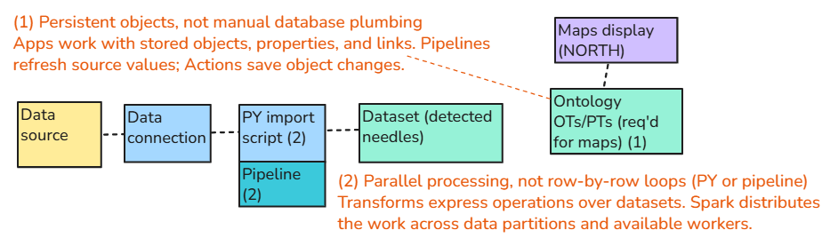
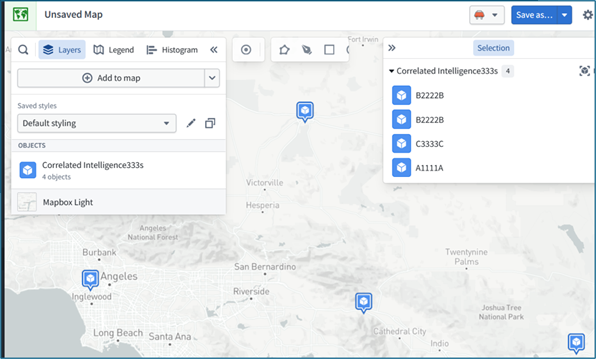

 

[← 3c Enterprise](/pal/)

26.1119 (v1 26.1118)

**Original [docx #686](https://drive.google.com/drive/folders/1-Adawag9uA8_bq-hDF-nOuPYaRLz1eEO) source file** (with notes).

BASED ON PAL example #11.  
- #622_pal_E11_geospatial_gaia_v03_26.0806_ss (v02_26.0729)

(4.0.3d) The algorithm is:
1.	4.6 (spatial) Join: create pairs where
ELINT.h3_index_2 = GEOINT.h3_index_2.
2.	4.7 Time filter: keep pairs where the GEOINT detection occurred between 10 minutes before and 1 day after the ELINT timestamp.
3.	4.8 Deduplicate: keep one arbitrary surviving pair per distinct combination of
(ELINT.track_id, ELINT.elint_geometry).
Step 3 does not keep just one combination overall—it keeps one row for each combination, yielding four rows in this example.

