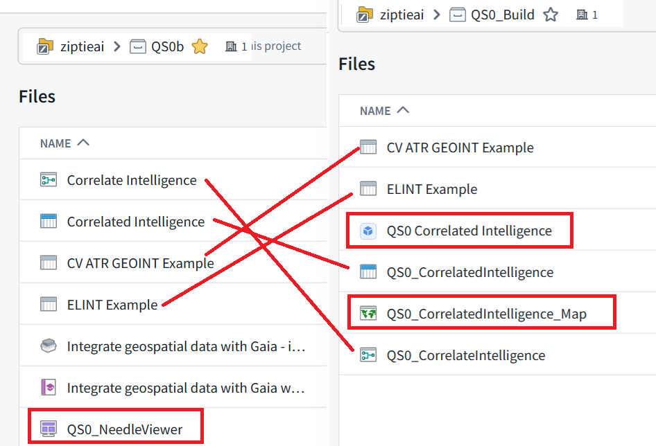

<!-- 0a Take notes while doing this QS0 -->
[↑ 3.2 Foundry QS0](/pal_qs0/) / [→ Overview](/pal_qs0_0b_config_dias/)

_Converted from DOCX by GPT on 2026-11-26 05:36:46 EST_

 

Below is a description of a mixup while I was putting together this QS0. But I was able to figure out the problem (and chat about it with FDE) thanks to my own notes. You run into problems, and screenshots can really help  you and FDE figure out what happened (that why the screenshots are often so big in these QS docs; some information in the corner of a screenshot comes in handy sometimes). Your configured demo will probably differ somewhat from what is written here, because you will be using FDE as a guide.

"Project mixup:

The installed example was in project QS0b.

The build-from-scratch version was project QS0_Build.

But the UI (QS0_NeedleViewer) was mistakenly created in the wrong project.

The UI still worked fine."

