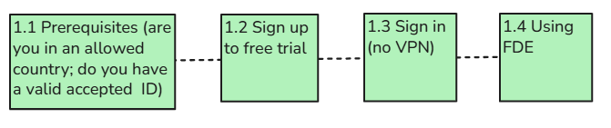
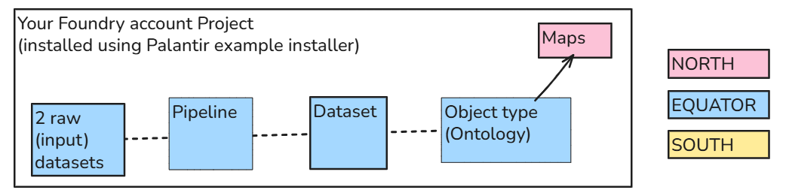
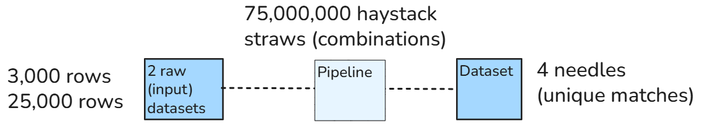
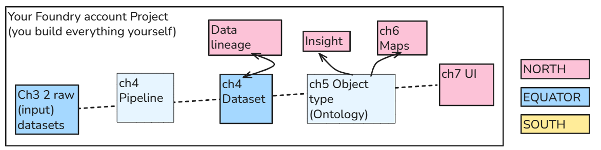
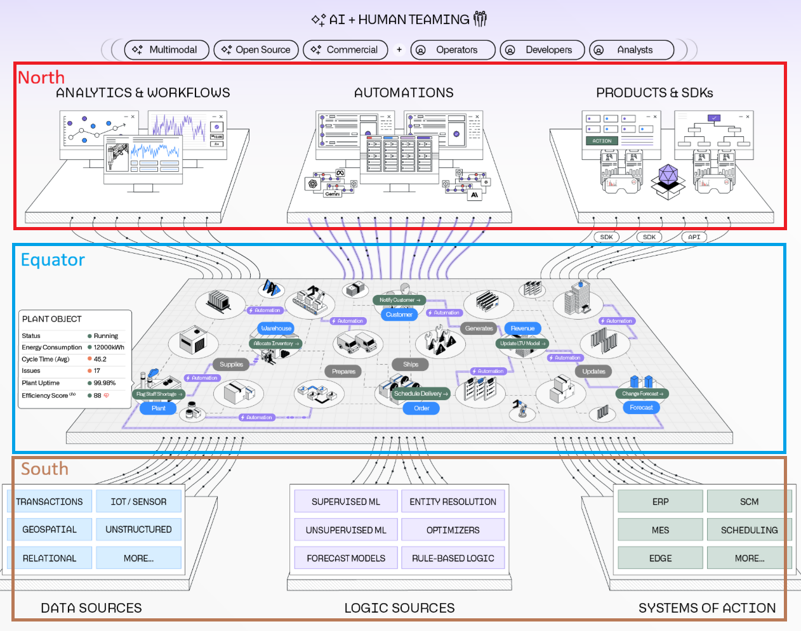

<!-- 0b Overview -->
[← Take notes while doing this QS0](/pal_qs0_0a_best_demo/) / [↑ 3.2 Foundry QS0](/pal_qs0/) / [→ 1 First steps (Foundry sign up, FDE, project/folder, applications)](/pal_qs0_1_introl/)

_Converted from DOCX by GPT on 2026-11-26 05:36:46 EST_

 

In this quick start you build a Foundry app from scratch that covers the core basics.  All the screenshots in this demo are from the author's PC.  The author worked alone with FDE (Foundry's built-in AI) to build this QS. Without human assistance. The author had just a few months experience with Foundry.

**TOC**
- [1 Ch1 First steps (Foundry sign up, FDE, project/folder, applications)](#section-1)
- [2 Ch2 Install marketplace and test](#section-2)
- [3 Ch8 Haystack needles algorithm](#section-3)
- [4 Ch3-7 Build your own version of the examples](#section-4)

 

### **1 Ch1 First steps (Foundry sign up, FDE, project/folder, applications)**

The diagram below shows the first steps.

 

### **2 Ch2 Install marketplace and test**

The following shows what you do in ch2. the example running in your account after installation.

 

### **3 Ch8 Haystack needles algorithm**

**Before starting, you might want to understand what the resulting demo does.**

Basically you input

- 2 datasets with 28000 totall rows..

- You build a pipeline that finds 4 needles out of 75,000,000 straws.

The amazing thing is, you can do this even if you have no prior experience with data science.

The key is FDE (the AI assistant) can guide you all the way.

**(4.0.3d) The algorithm is:**

1\. **4.6 (spatial) Join:** create pairs where  
ELINT.h3_index_2 = GEOINT.h3_index_2.

2\. **4.7 Time filter:** keep pairs where the GEOINT detection occurred between **10 minutes before and 1 day after** the ELINT timestamp.

3\. **4.8 Deduplicate:** keep **one arbitrary surviving pair per distinct combination** of  
(ELINT.track_id, ELINT.elint_geometry).

Step 3 does not keep just one combination overall—it keeps one row **for each combination**, yielding four rows in this example.

 

### **4 Ch3-7 Build your own version of the examples**

- Ch3 raw input

- Ch4 Pipeline

- Ch5 Object type (ontology)

- Ch6 Display with maps

- Ch7 Display with custom built UI

The box background colors classify Foundry apps into 3 groups.

- **North.** User-facing applications and interactions  (Maps, Workshop UI, etc)

- **Equator**. Foundry’s integration, data, Ontology, and logic layer.

- **South**. External systems outside Foundry (such as an external data source).

Note that this ZAI grouping of Foundry tools is a version of Palantir's own grouping. The difference, however, is a very important one. The original Foundry diagram (https://www.palantir.com/docs/foundry/architecture-center/ontology-system ) had the following classifications:

- **North.** User-facing applications and interactions.

- **Ontology** (only Ontology). ZAI considers that ontology is just portion of the the middle layer (and quite logically chose the name EQUATOR).

- **South**. External systems.

