 

[← 3c Enterprise](/pal/)

Converted: 2026-11-19 08:53:39 EST

 

## **2 Install marketplace app and test**

**TOC**

- [2.0 Find the installation](#section-2-0-find-the-installation)

  - [Click on Home](#section-click-on-home)

  - [Click on install examples](#section-click-on-install-examples)

  - [Search for "gaia". not found](#section-search-for-gaia-not-found)

  - [Click on "applications" "View all"](#section-click-on-applications-view-all)

  - [Search for "marketplace"](#section-search-for-marketplace)

  - [Search for "gaia" (1 search result found)](#section-search-for-gaia-1-search-result-found)

- [2.1 Chat](#section-2-1-chat)

- [2.2a Install](#section-2-2a-install)

  - [Click on the example picture](#section-click-on-the-example-picture)

  - [Validation error](#section-validation-error)

  - [FDE: This is a non-blocking naming warning—not the previous dependency error. The green Install button is enabled.](#section-fde-this-is-a-non-blocking-naming-warning-not-the-previous-dependency-error-the-green-install-button-is-enabled)

  - [Click Install. After it finishes, show the installed project’s file list.](#section-click-install-after-it-finishes-show-the-installed-project-s-file-list)

  - [FDE: Installation completed successfully.](#section-fde-installation-completed-successfully)

- [2.3 Next: verify the input data](#section-2-3-next-verify-the-input-data)

  - [Click "view installation"](#section-click-view-installation)

  - [Click dataset "ELINT Example"](#section-click-dataset-elint-example)

  - [CV ATR GEOINT Example (dataset)](#section-cv-atr-geoint-example-dataset)

- [2.4 First how how to run the example](#section-2-4-first-how-how-to-run-the-example)

  - [2.4.1 Explore ontology / insight](#section-2-4-1-explore-ontology-insight)

  - [2.4.2 Show in maps](#section-2-4-2-show-in-maps)

  - [2.4.3 Add to maps](#section-2-4-3-add-to-maps)

 

### **2.0 Find the installation**

 

#### **Click on Home**

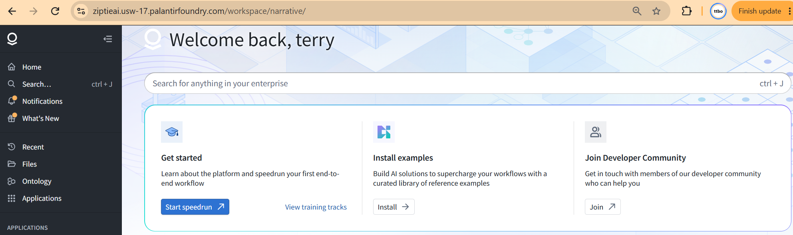

 

#### **Click on install examples**

 

#### **Search for "gaia". not found**

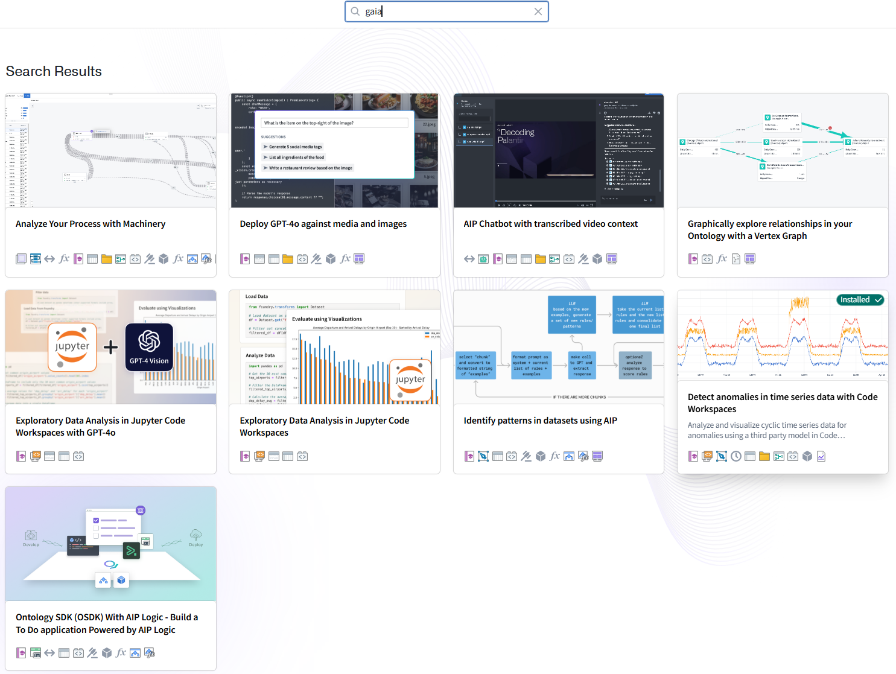

 

#### **Click on "applications" "View all"**

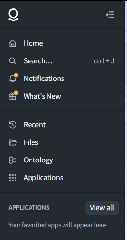

 

#### **Search for "marketplace"**

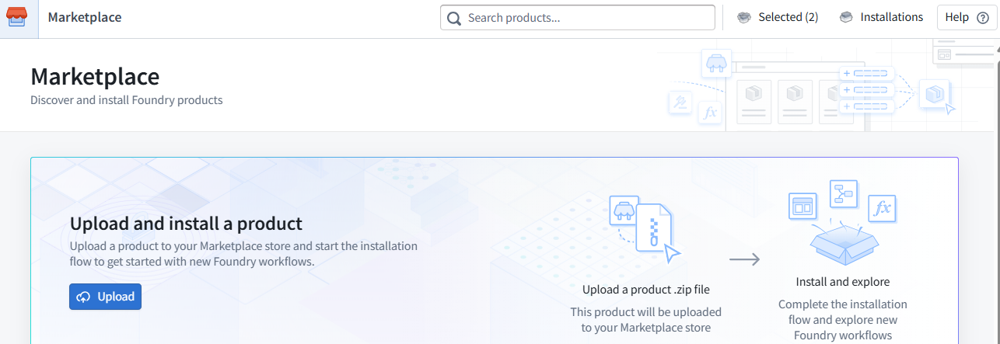

 

#### **Search for "gaia" (1 search result found)**

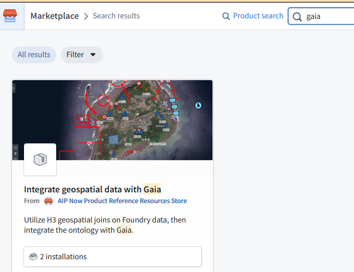

 

### **2.1 Chat**

ME: the objective of the installation part is to show the "chaos" (sorry, but its best word) when searching for something.

foundry is great, many great demos, but trying to find demos is utterly confusing.

i wont write in the QS0, but this is what I would write as the first steps...

i only pasted the last screenshot.

this is one of teh reasons i decided to write the qs's.

in the deeep dive, we can reference various demos, speedruns, examples, .. whatever theyre called.

and give simple direction on how to find them and what to do.

its something that needs to be done.

1 Install

1.1 Find the installation

click on Home

Click on install examples

search for "gaia". not found.

Click on "applications" "View all"

search for "marketplace"

search for "gaia" (1 search result found)

**Yes—finding the example is part of the task, not a prerequisite we should leave unexplained.** Your tutorials can bridge the gap between “this example exists” and “here is exactly how to locate and use it.”

For QS0, I would document the **successful route** and put the failed search in a short note.

**1 Install the example to obtain its input data**

**1.1 Find the example in Marketplace**

Open Foundry’s **Applications** menu.

Click **View all**.

Search for marketplace and open **Marketplace**.

In **Product search**, enter gaia.

Open **Integrate geospatial data with Gaia**, from **AIP Now Product Reference Resources Store**.

**Navigation note:** In this environment, searching for gaia under **Home → Install examples** did not find it. The **Marketplace** search did.

The exact title, store name, and screenshot give the reader a way to confirm **“I found the right thing.”**

For Deep Dive references, use the same pattern each time:

**Exact example title → where to find it → prerequisites → what to do → expected result.**

That is useful documentation in its own right—not merely an introduction to the technical exercise.

 

### **2.2a Install**

 

#### **Click on the example picture**

https://ziptieai.usw-17.palantirfoundry.com/workspace/marketplace/store/ri.marketplace.main.remote-store.0a4deab8-0190-4b5e-adf4-8c0ce325abde/product/82078e2a-9655-4ba1-bea2-020b1ea8a167/latest

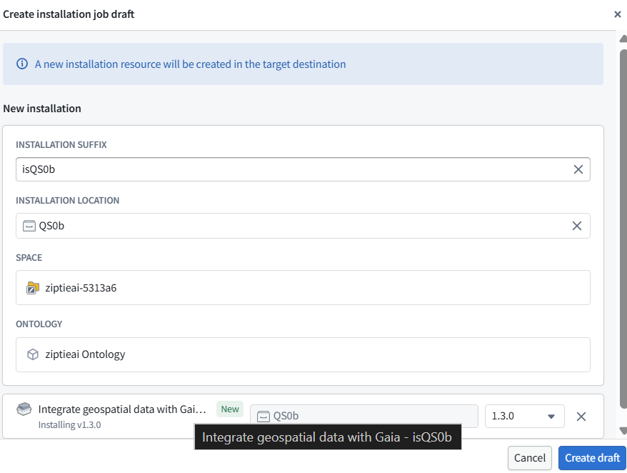

 

#### **Validation error**

SourceOntology

The packaged API name differs from the API name that will be used on this environment. On new installs, this means a naming conflict was detected and a different API name will be generated. On upgrades where this entity already exists, the existing API name will be preserved and no change is expected. In Singleton mode or with "Always install source Ontology entity API names" enabled, the conflict must be resolved to proceed with installation.

This error was generated by **Ontology**

{

"blockSetReference": {

"type": "existingBlockSet",

"existingBlockSet": "ri.marketplace.main.block-set-installation.da4a6805-ab22-47f0-b7fd-1f3ea5d8e77e"

},

"blockSetShapeId": "c7cc8719-7c0e-4211-ba78-ee4d880c7c04",

"error": {

"type": "typedBlockInstallServiceValidationError",

"typedBlockInstallServiceValidationError": {

"blockType": "ONTOLOGY",

"error": {

"severity": "NON_BLOCKING",

"error": {

"errorCode": "INVALID_ARGUMENT",

"errorName": "OntologyMetadata:ObjectTypeFromMarketplaceApiNameConflict",

"errorInstanceId": "fbf69760-a74a-4256-9098-c06a7a2231c6",

"parameters": {

"preallocatedObjectTypeApiName": "CorrelatedIntelligence_2",

"conflictingExistingInterfaceType": "[]",

"conflictingExistingObjectType": "[ri.ontology.main.object-type.e909cba5-86d6-45cd-9320-cfe0dab2778f]",

"packagedObjectTypeApiName": "CorrelatedIntelligence"

},

"parametersV2": {

"preallocatedObjectTypeApiName": "CorrelatedIntelligence_2",

"conflictingExistingInterfaceType": [],

"conflictingExistingObjectType": [

"ri.ontology.main.object-type.e909cba5-86d6-45cd-9320-cfe0dab2778f"

],

"packagedObjectTypeApiName": "CorrelatedIntelligence"

},

"areParametersV2JsonSerialized": true

},

"fallbackMessage": "The packaged API name differs from the API name that will be used on this environment. On new installs, this means a naming conflict was detected and a different API name will be generated. On upgrades where this entity already exists, the existing API name will be preserved and no change is expected. In Singleton mode or with \"Always install source Ontology entity API names\" enabled, the conflict must be resolved to proceed with installation."

},

"traceId": "27d199ef68ab10be"

}

},

"severity": "NON_BLOCKING"

}

 

#### **FDE: This is a non-blocking naming warning—not the previous dependency error. The green Install button is enabled.**

An existing object type already uses the API name CorrelatedIntelligence, so Foundry has allocated:

CorrelatedIntelligence_2

for this new installation. **No change to the existing object type is required.**

The draft now contains the expected Gaia resources: **three datasets, one pipeline, one object type, and one walkthrough**.

 

#### **Click Install. After it finishes, show the installed project’s file list.**

**Do not delete anything yet.** We’ll first verify the two input datasets and check how to remove the other resources without losing those inputs or affecting earlier installations.

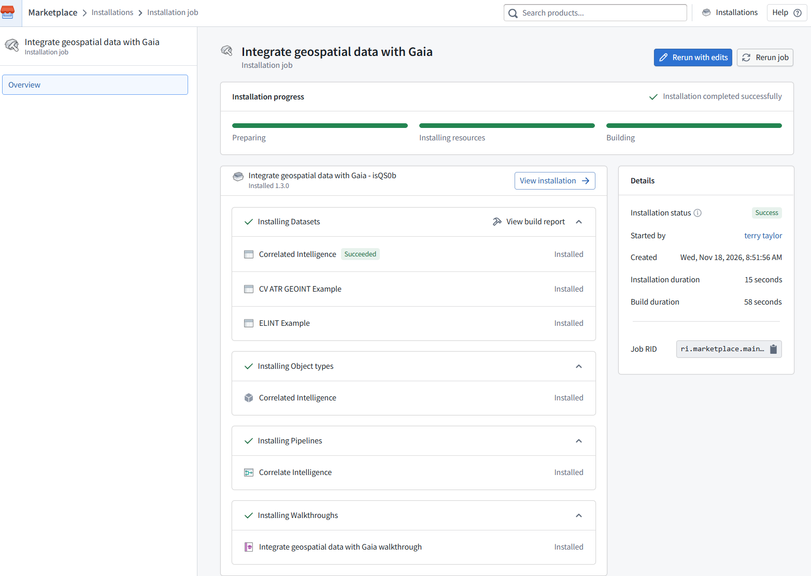

 

#### **FDE: Installation completed successfully.**

The new **Gaia – iQS0b installation**, version **1.3.0**, includes both input datasets.

 

### **2.3 Next: verify the input data**

<ol>

Click **ELINT Example (dataset)** in the installation results.

Show its **Preview**, including its project location and columns.

Then do the same for **CV ATR GEOINT Example (dataset)**.

</ol>

**Keep everything installed for now.** Once we verify those two inputs, we’ll plan the cleanup so QS0 starts with only the supplied data, without affecting your earlier installations.

 

#### **Click "view installation"**

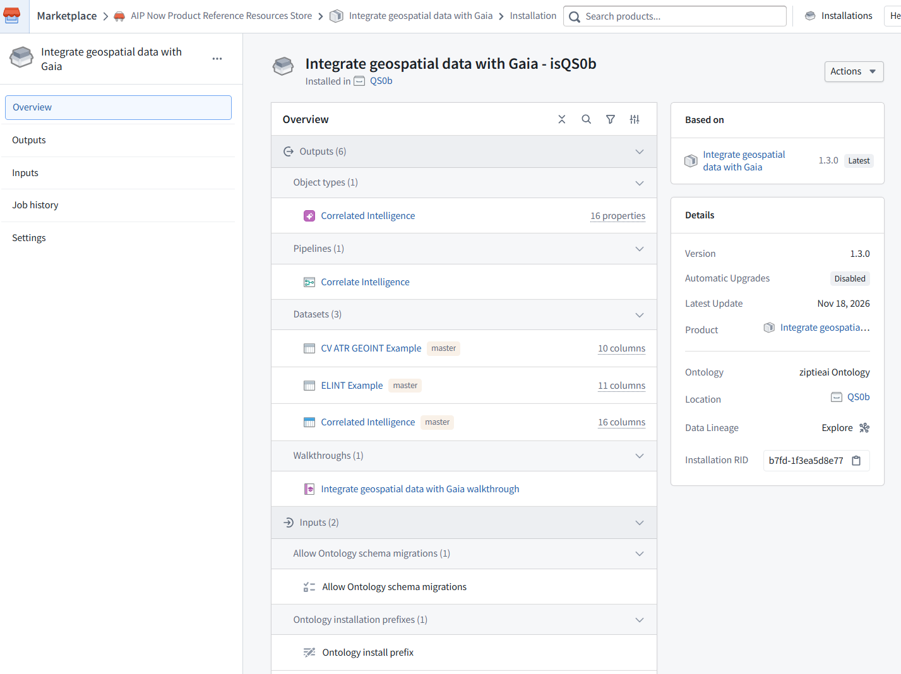

 

#### **Click dataset "ELINT Example"**

 

#### **CV ATR GEOINT Example (dataset)**

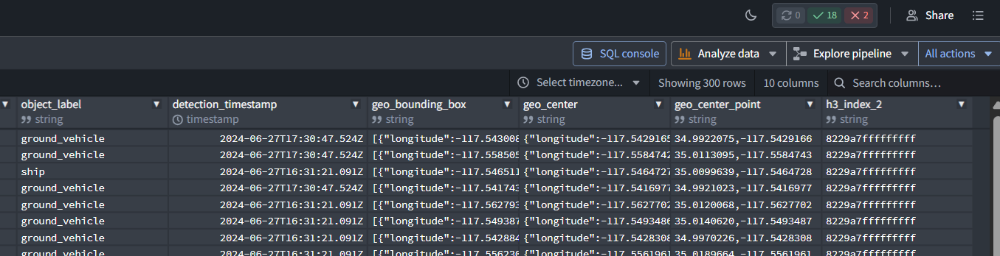

 

### **2.4 First how how to run the example**

 

#### **2.4.1 Explore ontology / insight**

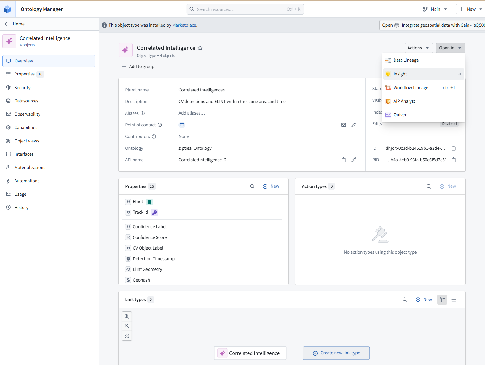

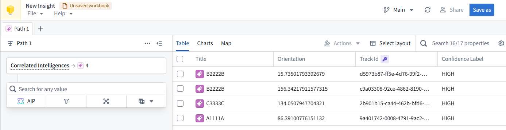

 

#### **2.4.2 Show in maps**

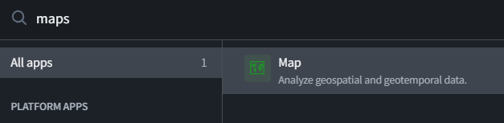

 

#### **2.4.3 Add to maps**

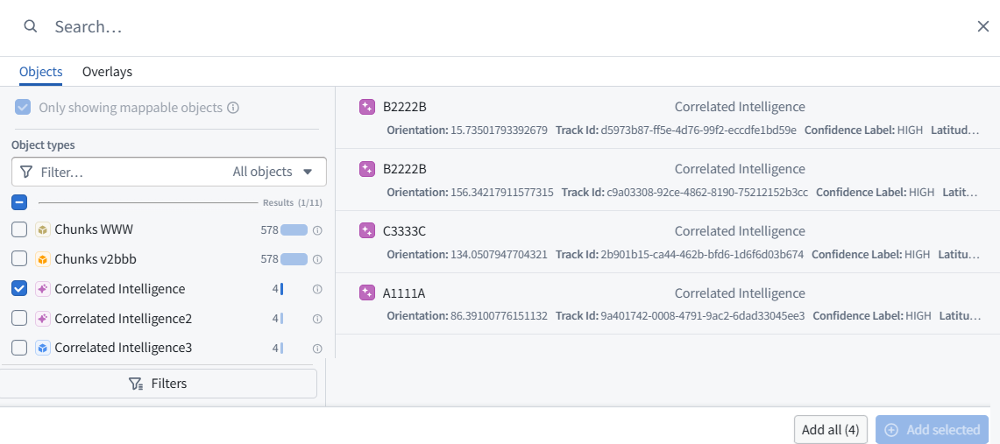

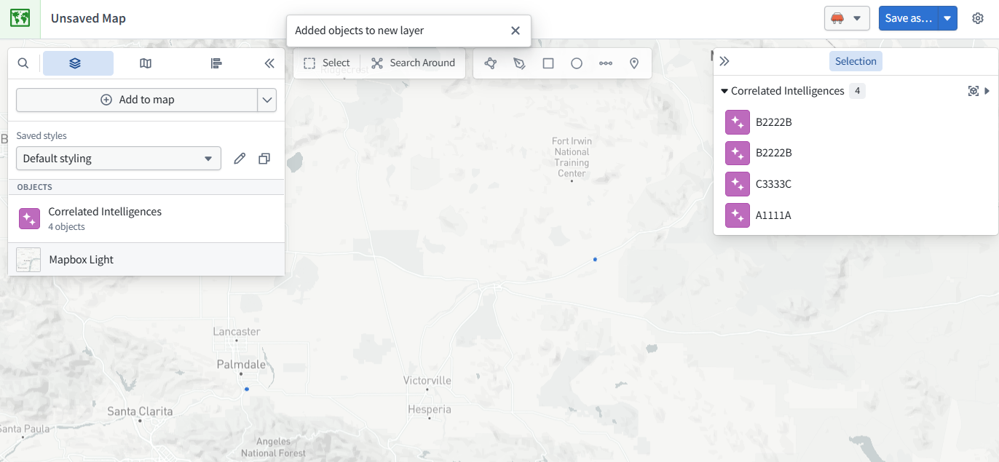

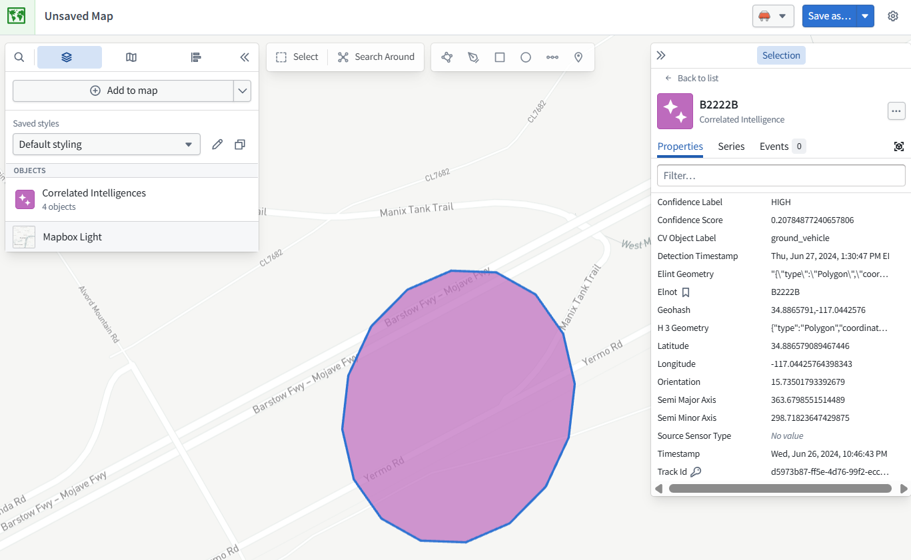
