 

<!-- 2 Install marketplace app and test -->
[← 1 First steps](/pal_qs0_1_introl/) / [↑ 3.2 Foundry QS0](/pal_qs0/) / [→ 3 Create own project with datasets](/pal_qs0_3_download_ds/)

_Converted 2026-11-19 01:03 PM EST_

 

**TOC**
- [2.1 Find the installation](#section-2-1-find-the-installation)
- [2.2 Install](#section-2-2-install)
- [2.3 Verify the input data](#section-2-3-verify-the-input-data)
- [2.4 Run the example](#section-2-4-run-the-example)
  - [2.4.1 Explore ontology / insight](#section-2-4-1-explore-ontology-insight)
  - [2.4.2 Show in maps](#section-2-4-2-show-in-maps)

<!--   - [2.4.3 Add to maps](#section-2-4-3-add-to-maps)-->

 

### **2.1 Find the installation**

Click on Home

Click on install examples

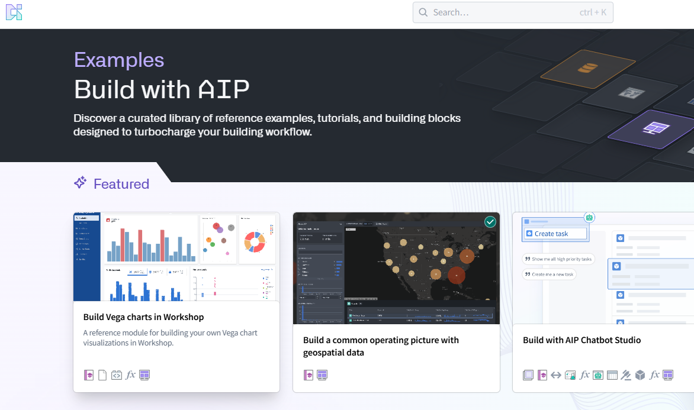

Search for "gaia". not found

Click on "applications" "View all"

Search for "marketplace"

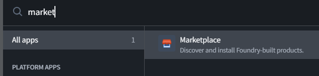

Search for "gaia" (1 search result found)

**Summary: F****inding the example is part of the task, not a prerequisite we should leave unexplained.** Your tutorials can bridge the gap between “this example exists” and “here is exactly how to locate and use it.”

For QS0, I would document the **successful route** and put the failed search in a short note.

**1 Install the example to obtain its input data**

**1.1 Find the example in Marketplace**

1\. Open Foundry’s **Applications** menu.

2\. Click **View all**.

3\. Search for marketplace and open **Marketplace**.

4\. In **Product search**, enter gaia.

5\. Open **Integrate geospatial data with Gaia**, from **AIP Now Product Reference Resources Store**.

**Navigation note:** In this environment, searching for gaia under **Home → Install examples** did not find it. The **Marketplace** search did.

The exact title, store name, and screenshot give the reader a way to confirm **“I found the right thing.”**

For Deep Dive references, use the same pattern each time:

**Exact example title → where to find it → prerequisites → what to do → expected result.**

That is useful documentation in its own right—not merely an introduction to the technical exercise.

 

### **2.2 Install**

Click on the example picture.

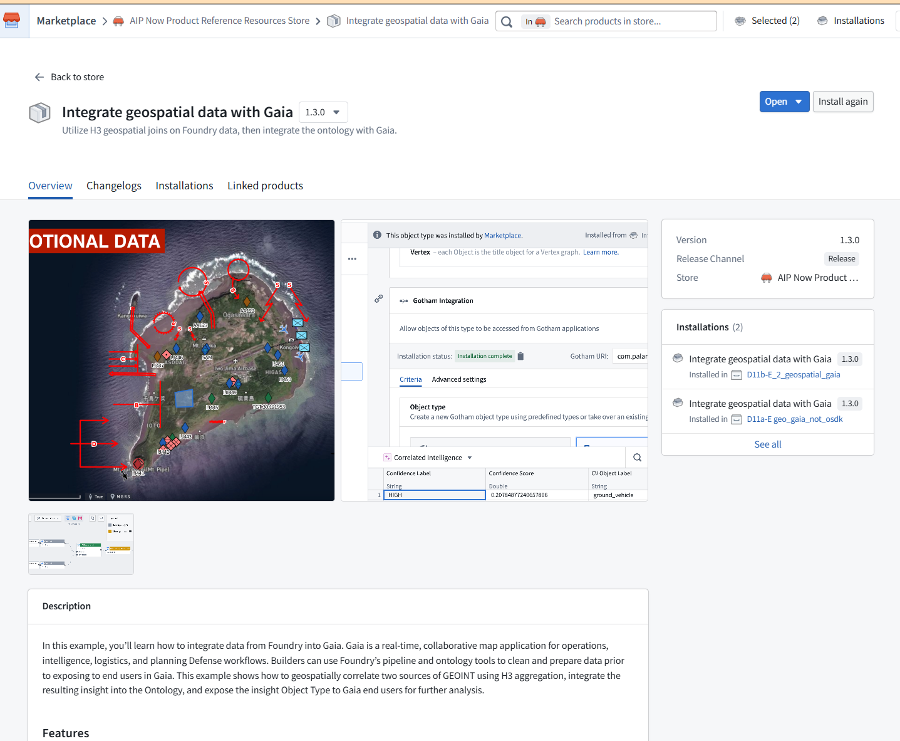

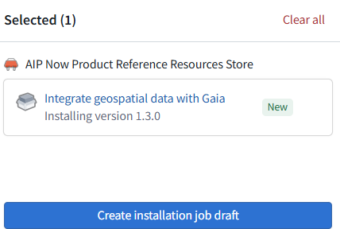

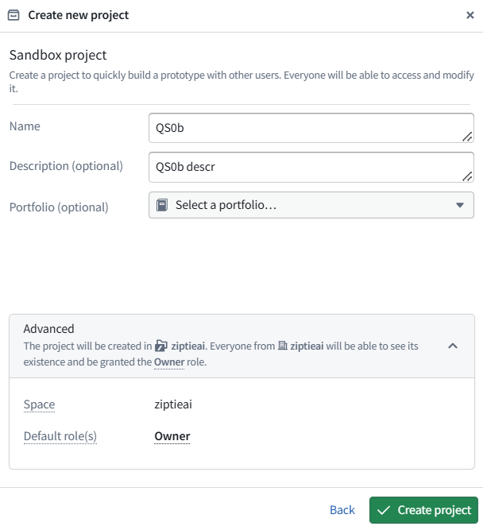

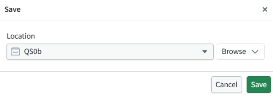

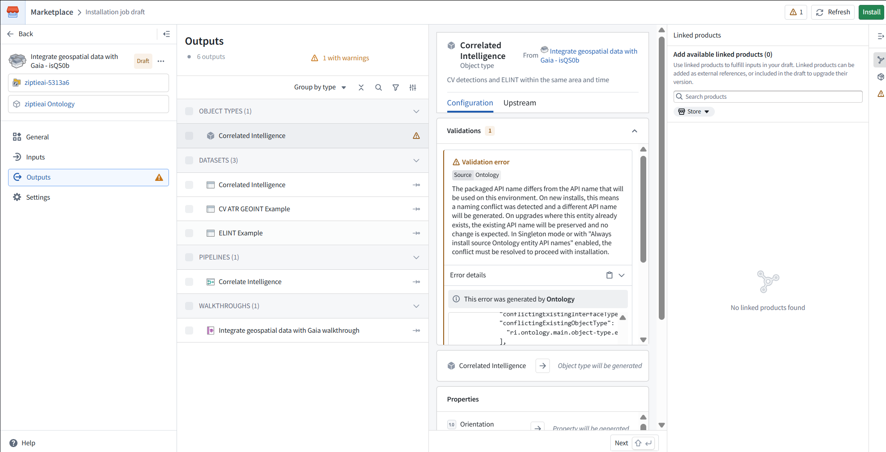

Click **Install**. After it finishes, show the installed project’s file list.

**Do not delete anything yet.** We’ll first verify the two input datasets and check how to remove the other resources without losing those inputs or affecting earlier installations.

FDE: Installation completed successfully.

The new **Gaia – iQS0b installation**, version **1.3.0**, includes both input datasets.

 

### **2.3 Verify the input data**

1\. Click **ELINT Example (dataset)** in the installation results.

2\. Show its **Preview**, including its project location and columns.

3\. Then do the same for **CV ATR GEOINT Example (dataset)**.

**Keep everything installed for now.** Once we verify those two inputs, we’ll plan the cleanup so QS0 starts with only the supplied data, without affecting your earlier installations.

Click "view installation"

Click dataset "ELINT Example"

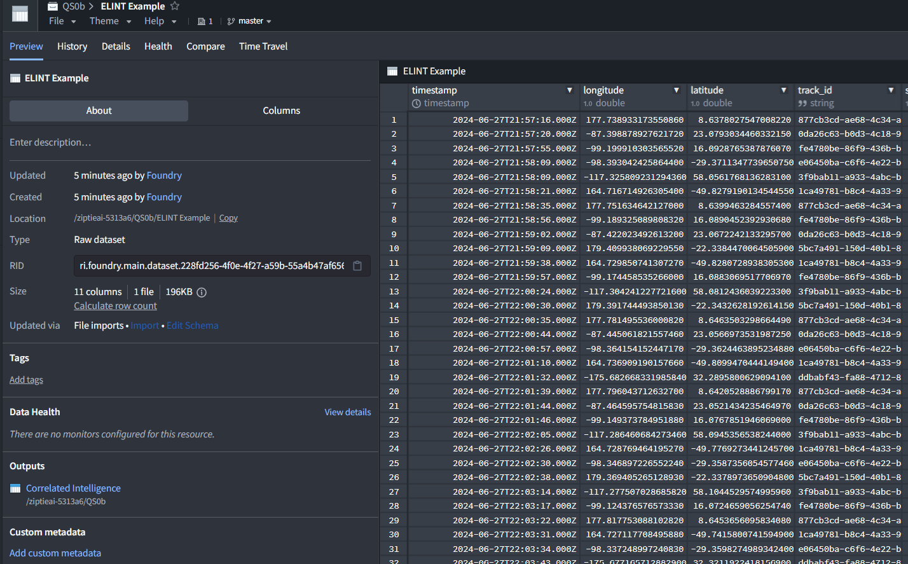

Click dataset "ELINT Example"

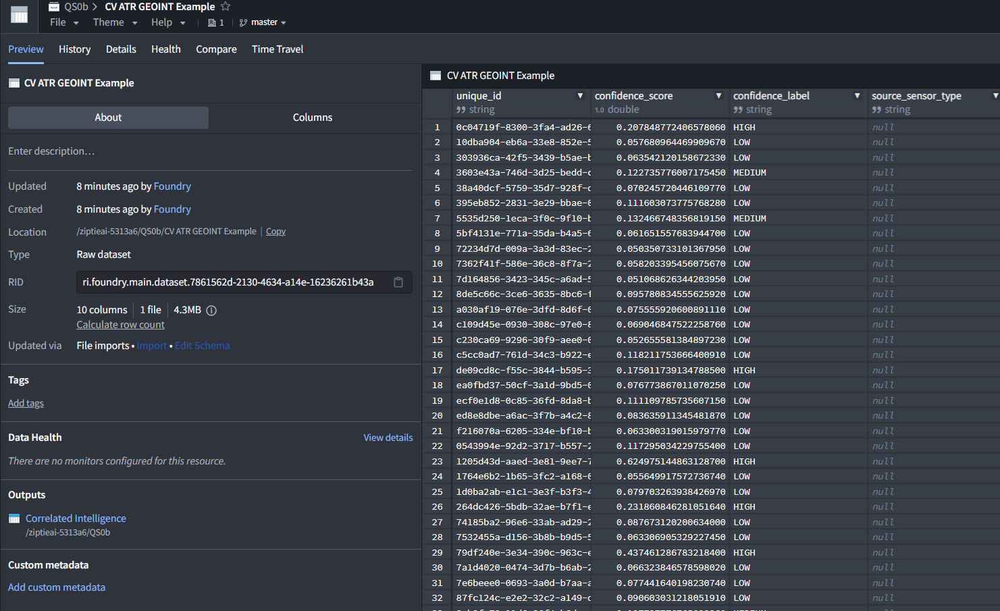

 

### **2.4 Run the example**

 

#### **2.4.1 Explore ontology / insight**

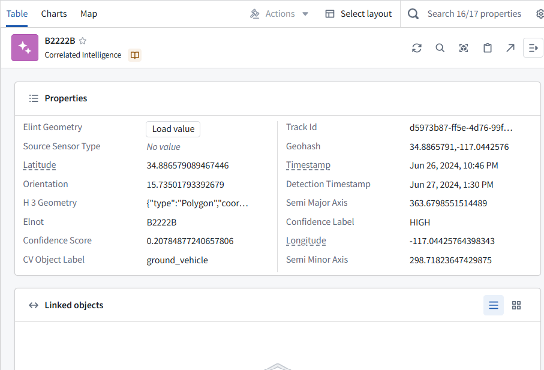

 

#### **2.4.2 Show in maps**

 

<!-- 
#### **2.4.3 Add to maps** -->

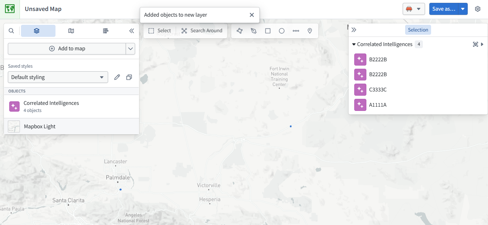

