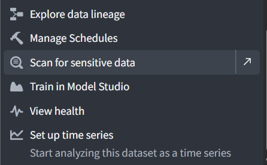
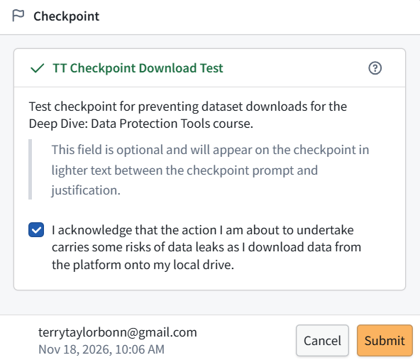
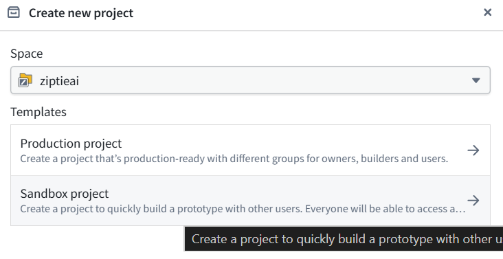
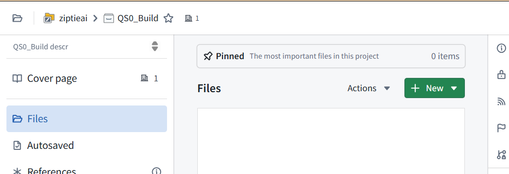
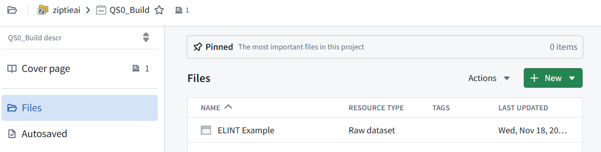
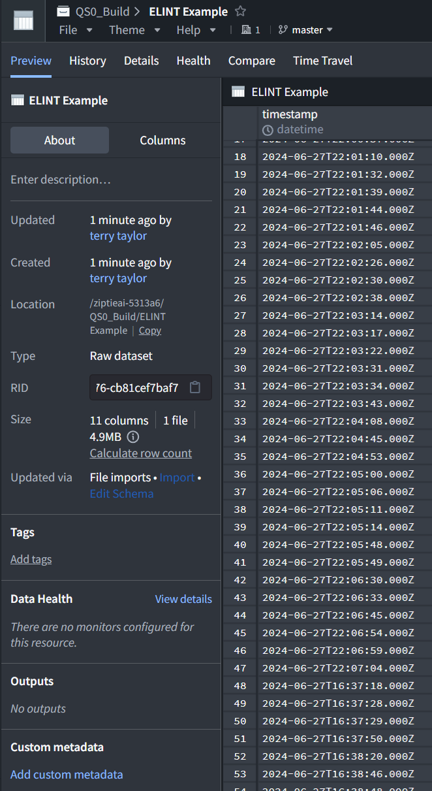
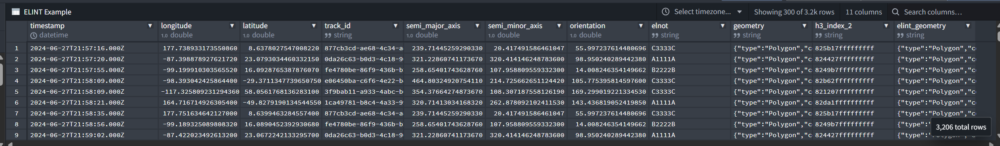
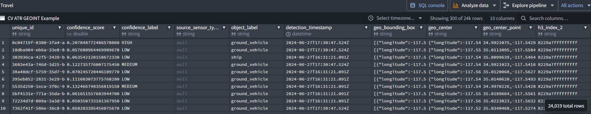

<!-- 3 Create own project with datasets -->
[← 2 Install marketplace app and test (QS0b)](/pal_qs0_2_install_mplace/) / [↑ 3.2 Foundry QS0](/pal_qs0/) / [→ 4 Build pipeline](/pal_qs0_4_pipeline/)


_Converted from DOCX by GPT on 2026-11-26 07:53:49 EST_

<br>

The next step is now to create everythings ourselves except the datasources.

Create new project, import the data sources , hten build the rest?

**That is a cleaner approach than deleting the installed example.** 

Keep **QS0b** as the reference installation and build your version in a new project.

**The transfer sequence is correct:**

**Installed dataset → download file to PC → upload file → new dataset in the new project.**

Three clarifications would make the diagram stronger:

1\. Label the outgoing lines **Download** and the incoming lines **Upload**.

2\. Rename **PC** to **Browser / local files**. It is the transfer mechanism, not a Foundry North app.

3\. Add this note:

**The uploaded datasets are independent copies. Later changes to the installed example do not automatically update them.**

Both projects are in the **same namespace**. You could place them inside one shared namespace boundary, or explicitly label your two boundaries as **two views of the same namespace**.

Also, **matching names do not make them the same datasets**—each uploaded copy has its own resource identifier.


**TOC**
- [3.1 Datasets (1) save locally then (2) import](#section-1)
  - [Proposed sequence](#section-2)
  - [Download as CSV is visible in your first screenshot.](#section-3)
- [3.2 Next: create the independent build project](#section-4)
- [3.3 Import ELINT Example.csv](#section-5)
- [3.4 Import the second dataset](#section-6)

<br>

<a id="section-1"></a>
### **3.1 Datasets (1) save locally then (2) import**

Downloading and reimporting gives the new project independent input datasets.

Your screenshots show approximately:

| **Dataset** | **Displayed size** | **Columns** |
| --- | --- | --- |
| **ELINT Example** | **196 KB** | 11 |
| **CV ATR GEOINT Example** | **4.3 MB** | 10 |

Those are Foundry’s displayed storage sizes; the downloaded files may differ. Both are small enough for a local download/upload exercise.

<br>

<a id="section-2"></a>
#### **Proposed sequence**

1\. **Download** each original input dataset.

2\. Create **QS0_Build (project)**.

3\. **Upload/import** both files as new datasets.

4\. Verify column types, timestamps, geometry strings, and row counts.

5\. Build the new pipeline from those imported datasets.

**CSV is beginner-friendly**, but we must verify the schema after importing: timestamps and geometry values may otherwise be interpreted as plain text or parsed incorrectly.

Start with **ELINT Example (dataset) → All actions** and show the menu. We’ll find the available download option and choose the format before proceeding.




<br>

<a id="section-3"></a>
#### **Download as CSV is visible in your first screenshot.**

1\. Click **Download as CSV** for **ELINT Example (dataset)**.

2\. Keep the downloaded file as:

ELINT Example.csv


3\. Repeat for **CV ATR GEOINT Example (dataset)**:

```
CV ATR GEOINT Example.csv
```




**Don’t open and resave them in Excel**—it can alter timestamps or other values. We’ll import the downloaded CSVs directly into Foundry.

If a download dialog offers a choice, select **all rows**, not just the preview sample.

Once both files are downloaded, we’ll create **QS0_Build (project)** and upload them.

Both CSVs downloaded successfully:

- **ELINT Example.csv:** 4.93 MB

- **CV ATR GEOINT Example.csv:** 15.1 MB

The CSV exports are larger than Foundry’s displayed storage sizes. That is normal; the formats and compression differ.

The first screenshot is a **download-governance checkpoint**, not a download error.

<br>

<a id="section-4"></a>
### **3.2 Next: create the independent build project**

1\. Open **Projects & files**.


2\. At the namespace level, select **New → New project**.



3\. Name it:

```
QS0_Build
```

Use the same project/security setup as **QS0b**.

4\. Show the new project’s file page. We’ll upload the CSVs one at a time and verify their schemas.




QS0_Build (project) is created and empty.

<br>

<a id="section-5"></a>
### **3.3 Import ELINT Example.csv**

Drag **ELINT Example.csv** from your Downloads folder into the project’s empty **Files** area.

Show the upload/import dialog that opens. We’ll check the dataset name, CSV parsing, and column types before completing the import.


Keep **Upload as a structured dataset** selected, then click **Next…**.

This makes the CSV available as rows and columns for Pipeline Builder. Show the next screen so we can check its parsing and schema.


This is the **access-requirements screen**, before parsing.

It shows:

- **Organization:** ziptieai

- **Other markings:** none

If these match the original dataset’s access requirements, leave them unchanged and click **Keep changes**.

Show the next screen. We should preserve any source markings rather than remove them during reimport.


You’re back at **Configure upload**. The upload has **one organization marking**, and the other-markings editor showed none selected.

Click **Upload** at the bottom right. After it completes, open the new **ELINT Example (dataset)** in **QS0_Build (project)** and show its Preview/schema screen. We still need to verify CSV parsing and column types.








ELINT Example imported successfully. The preview shows:

- **3,206 total rows**—only 300 are displayed in the preview.

- **11 columns**.

- **timestamp:** recognized as datetime.

- **longitude, latitude, semi_major_axis, semi_minor_axis, orientation:** Double.

- **track_id, elnot, geometry, h3_index_2, elint_geometry:** String.

The geometry JSON remains inside its String columns; it has not split into extra CSV columns. **No schema changes are needed here.**

<br>

<a id="section-6"></a>
### **3.4 Import the second dataset**

Return to **QS0_Build (project)** and drag in:

```
CV ATR GEOINT Example.csv
```

Choose **Upload as a structured dataset** and follow the same upload process. Keep the required access markings.

Then open its Preview and show the column headers and total row count. We’ll verify its **10 columns**, particularly **detection_timestamp**, **confidence_score**, and the geometry fields.




CV ATR GEOINT Example imported successfully:

- **24,019 total rows**, with 300 displayed in the preview.

- **10 columns**.

- **confidence_score:** Double.

- **detection_timestamp:** datetime.

- Geometry and H3 fields remain Strings.

- **source_sensor_type:** null in the displayed rows, as in the supplied data.

Data preparation is complete**. QS0_Build (project)** now has two independent inputs:

| **Dataset** | **Rows** | **Columns** |
| --- | --- | --- |
| **ELINT Example** | 3,206 | 11 |
| **CV ATR GEOINT Example** | 24,019 | 10 |

