<br>

<!-- 4 Build pipeline -->
[← 3 Create own project with datasets](/pal_qs0_3_download_ds/) / [↑ 3.2 Foundry QS0](/pal_qs0/) / [→ 5 Create Object type](/pal_qs0_5_objectype/)


_Converted 2026-11-19 02:59 PM EST_


<br>

**FDE:** **Yes—now we build our own pipeline.** Your older diagram shows the right idea: reproduce the processing alongside the reference. This time, we’ll keep our work separate in **QS0_Build (project)**.

We’ll build only one clear path:

**Two imported datasets → prepare geometry/H3 → spatial join → time filter → result dataset**

**TOC**
- [4.1 Create the pipeline](#section-4-1-create-the-pipeline)
- [4.2 Add the two input datasets](#section-4-2-add-the-two-input-datasets)
  - [Both inputs are on the canvas: ELINT has 11 columns and GEOINT has 10.](#section-both-inputs-are-on-the-canvas-elint-has-11-columns-and-geoint-has-10)
- [4.3 This node (Cast to H3) contains two necessary type conversions](#section-4-3-this-node-cast-to-h3-contains-two-necessary-type-conversions)
  - [Prepare ELINT in our new pipeline](#section-prepare-elint-in-our-new-pipeline)
  - [Add the geometry conversion](#section-add-the-geometry-conversion)
  - [Prepare ELINT is configured correctly: both conversions are applied.](#section-prepare-elint-is-configured-correctly-both-conversions-are-applied)
- [4.4 Convert the timestamp (3,206 total rows)](#section-4-4-convert-the-timestamp-3-206-total-rows)
- [4.5 Inspect GEOINT preparation (24,019 rows)](#section-4-5-inspect-geoint-preparation-24-019-rows)
- [4.6 Inspect the spatial join (3,266,584 rows)](#section-4-6-inspect-the-spatial-join-3-266-584-rows)
  - [4.6.1 Create the join in our pipeline](#section-4-6-1-create-the-join-in-our-pipeline)
  - [4.6.3 Now match the reference’s column selection:](#section-4-6-3-now-match-the-reference-s-column-selection)
- [4.7 Next: inspect the final filtering steps (2,419,560 rows)](#section-4-7-next-inspect-the-final-filtering-steps-2-419-560-rows)
  - [4.7.1 Add the time-window calculations](#section-4-7-1-add-the-time-window-calculations)
  - [4.7.2 Add the time filter](#section-4-7-2-add-the-time-filter)
- [4.8 Remove repeated matches (4 rows)](#section-4-8-remove-repeated-matches-4-rows)
  - [4.8.1 Remove repeated matches](#section-4-8-1-remove-repeated-matches)
- [4.9 Next: prepare the map-display fields](#section-4-9-next-prepare-the-map-display-fields)
  - [4.9.1 Add the point location](#section-4-9-1-add-the-point-location)
  - [4.9.2 Select the final output columns](#section-4-9-2-select-the-final-output-columns)
- [4.10 Create the output dataset](#section-4-10-create-the-output-dataset)
  - [4.10.1 Deployment and build succeeded: 1 of 1 outputs built. No redeployment is needed.](#section-4-10-1-deployment-and-build-succeeded-1-of-1-outputs-built-no-redeployment-is-needed)
  - [Verify the saved dataset](#section-verify-the-saved-dataset)

<br>

<a id="section-4-1-create-the-pipeline"></a>
### **4.1 Create the pipeline**

1\. Open **QS0_Build (project) → Files**.

2\. Click **New** and select **Pipeline Builder**.


3\. Name the pipeline: QS0_CorrelateIntelligence

4\. Show the creation dialog or editor that opens. We’ll add the two imported datasets next. We’ll use the original pipeline to check the exact settings, but **won’t copy the extra experimental branches from your older diagram**.

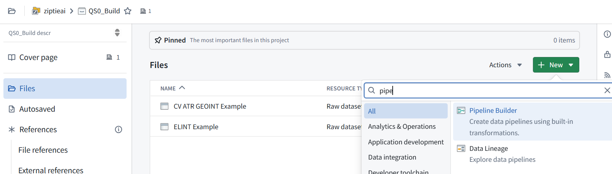

**The name and location are correct.**

Keep **Batch pipeline**, but change the batch compute from **Faster** to **Standard**:

- **Faster:** backed by DataFusion.

- **Standard:** backed by **Spark**, matching the execution engine we intend to demonstrate.

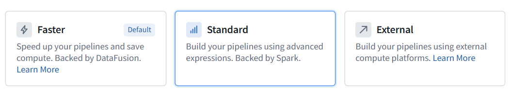

5\. Then click **Create pipeline**. Your first screenshot is useful as the reference. Our new pipeline will contain **one processing path**, without the older experimental branches. Show the editor after creation.

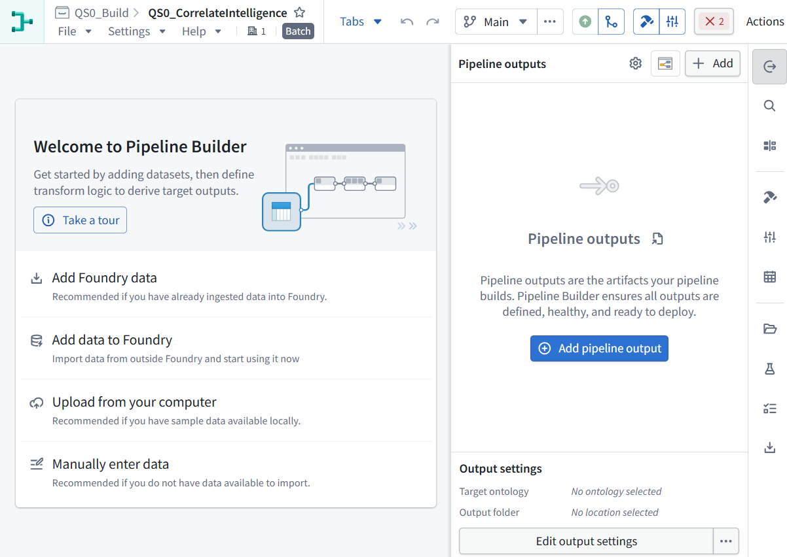

**QS0_CorrelateIntelligence (Pipeline Builder pipeline) is created.**

<br>

<a id="section-4-2-add-the-two-input-datasets"></a>
### **4.2 Add the two input datasets**

1\. Click **Add Foundry data** on the welcome panel.

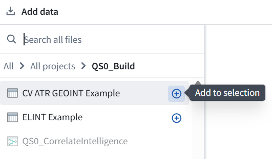

2\. Select these datasets from **QS0_Build (project)**:

**ELINT Example**

**CV ATR GEOINT Example**

3\. Confirm adding them.

4\. **Check the project path carefully**—choose the copies we just uploaded, not the identically named datasets in QS0b or older installations.

5\. Show the canvas with both input nodes. We’ll configure transformations next; no pipeline output is needed yet.

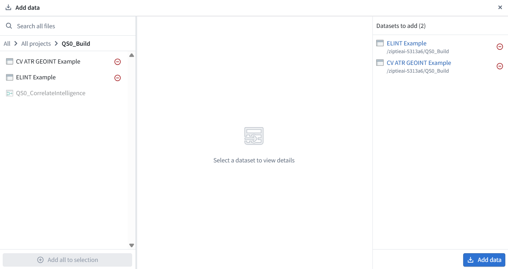


<br>

<a id="section-both-inputs-are-on-the-canvas-elint-has-11-columns-and-geoint-has-10"></a>
#### **Both inputs are on the canvas: ELINT has 11 columns and GEOINT has 10.**

1\. **Inspect the reference’s first transformation.** Keep **QS0_CorrelateIntelligence (our new pipeline)** open.

2\. In a **separate browser tab**:

- Open **QS0b (installed-example project)**.

- Open **Correlate Intelligence (Pipeline Builder pipeline)**.

- Select the first **Marketplace transforms** node directly after **ELINT Example**.

- Click **Edit** and show the operations inside it.

**Do not change the reference pipeline.** We’ll inspect its settings, then recreate the operations in our new pipeline—one explained step at a time.

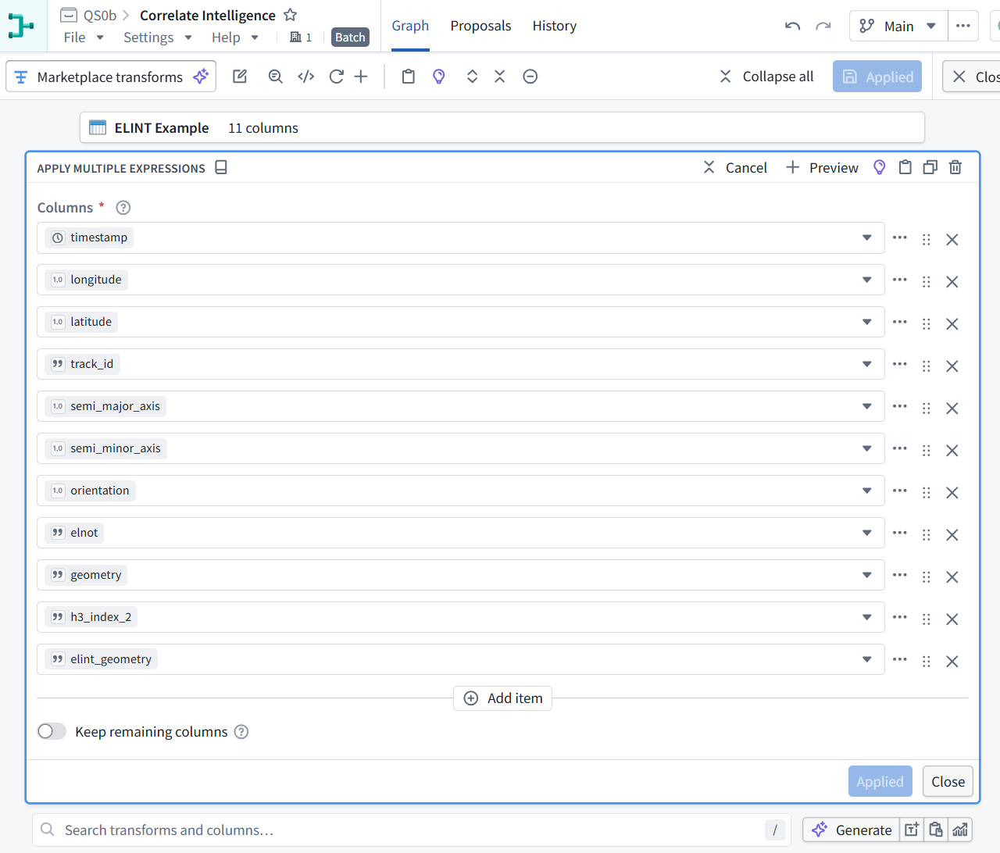

**This node simply selects the existing 11 columns.** It shows no calculations or filters—so **no needle matching happens here**.

Our imported ELINT dataset already has these columns. **We can omit this pass-through node** from the new pipeline.

1\. In the **reference pipeline**:

- Click **Close** to return to the graph.

- Select the next node, **Cast to H3**, on the ELINT branch.

- Click **Edit** and show its configuration.

That is the next substantive operation to inspect.

We will R**emove unnecessary pass-through steps while preserving the actual matching logic and results.** The goal is **the simplest pipeline that reproduces the example**, with each remaining step serving a clear purpose.


<br>

<a id="section-4-3-this-node-cast-to-h3-contains-two-necessary-type-conversions"></a>
### **4.3 This node (Cast to H3) contains two necessary type conversions**

The data already contains H3 indexes and geometry; we are telling Pipeline Builder how to interpret those String columns—not calculating new locations.

<br>

<a id="section-prepare-elint-in-our-new-pipeline"></a>
#### **Prepare ELINT in our new pipeline**

1\. Switch to **QS0_Build → QS0_CorrelateIntelligence (our pipeline)**.

2\. Select **ELINT Example (input node)**.

3\. Click the blue **Transform** icon.

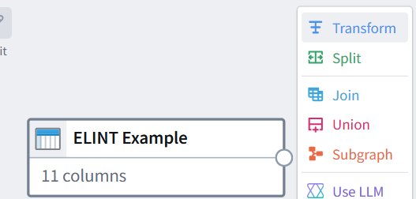

4\. Search for **Logical type cast** and add it.

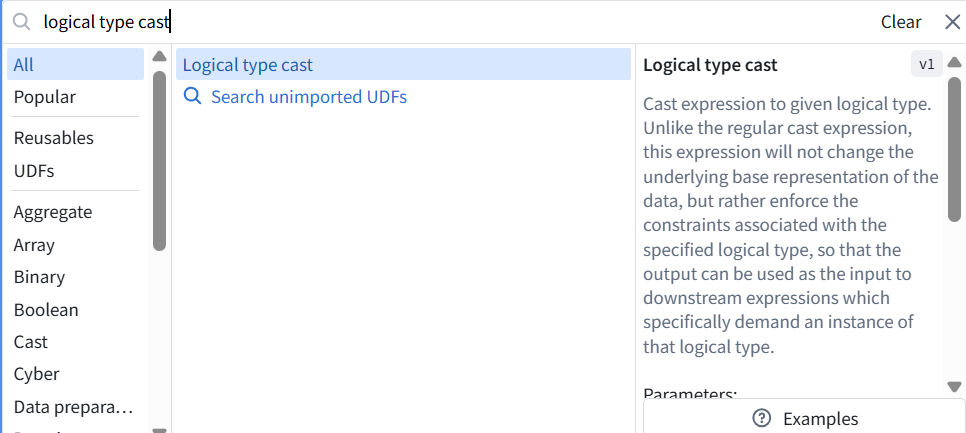

5\. Configure:

| Setting | Value |
| --- | --- |
| Expression | h3_index_2 |
| Logical type | H3 Index |
| Output column | h3_index_2—replace the existing column |
| Default value | Leave unset |

Show this first conversion before applying it. Then we’ll add the second conversion: **elint_geometry → Geometry**. We are recreating these operations **directly after the input**, without the unnecessary Marketplace pass-through node.

6\. The first conversion is correct. Click Apply within the transform card.

<br>

<a id="section-add-the-geometry-conversion"></a>
#### **Add the geometry conversion**

In the same node:

1\. Search for **Logical type cast** in the bottom transform search.

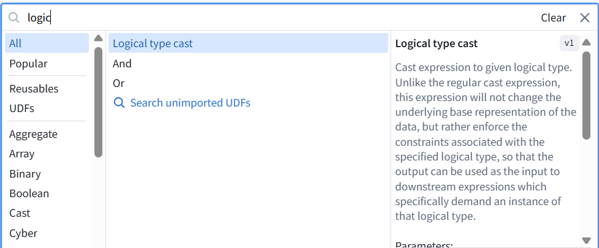

2\. Add another conversion:

| Setting | Value |
| --- | --- |
| Expression | elint_geometry |
| Logical type | Geometry |
| Output column | elint_geometry—replace |
| Default value | Leave unset |

3\. Click **Apply**,

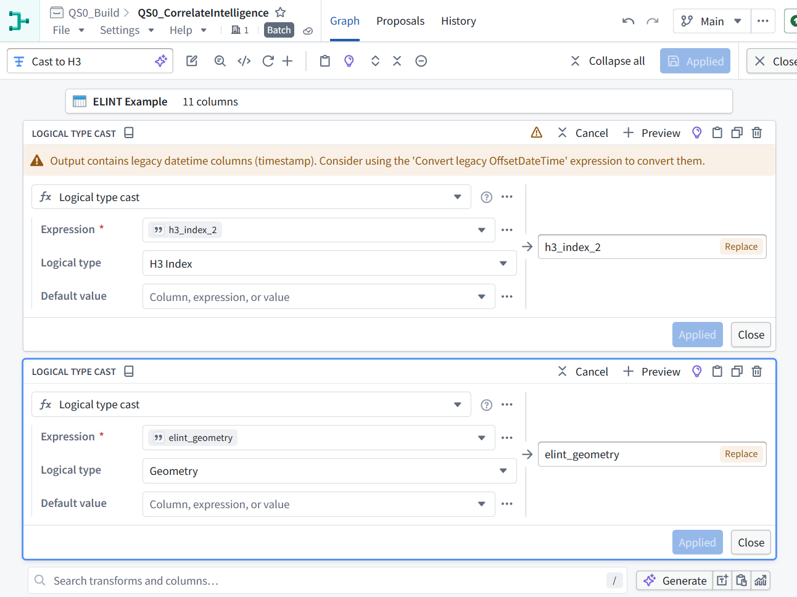

4\. then **Apply all** at the top if enabled.

5\. Rename the node **Prepare ELINT** using its name field at the upper left.

6\. Show the completed node or its Preview. It should still have **11 columns**.

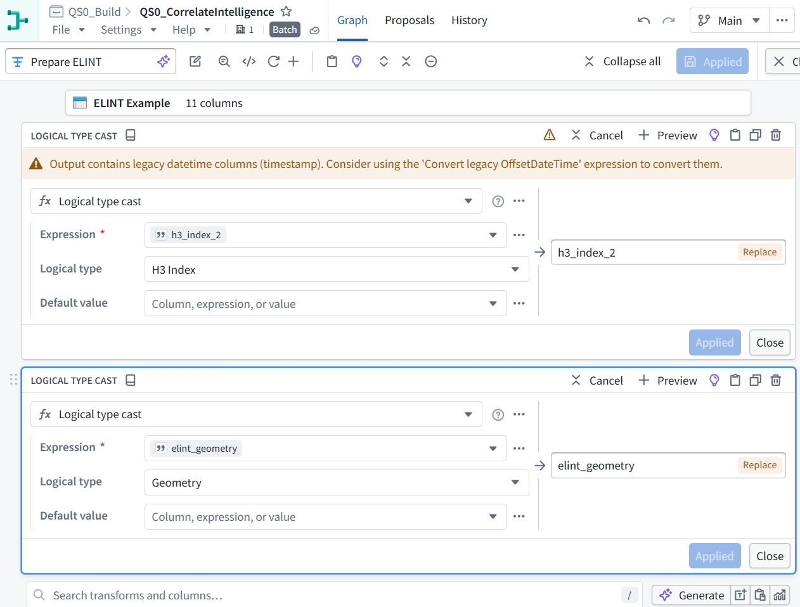

<br>

<a id="section-prepare-elint-is-configured-correctly-both-conversions-are-applied"></a>
#### **Prepare ELINT is configured correctly: both conversions are applied.**

- h3_index_2 → **H3 Index**

- elint_geometry → **Geometry**

The orange warning concerns the imported **timestamp**, not those conversions. It identifies a **legacy datetime type** that we should convert before building the time filter.

<br>

<a id="section-4-4-convert-the-timestamp-3-206-total-rows"></a>
### **4.4 Convert the timestamp (3,206 total rows)**

1\. In the bottom **Search transforms and columns…** field, search for:

```

Convert legacy OffsetDateTime
```

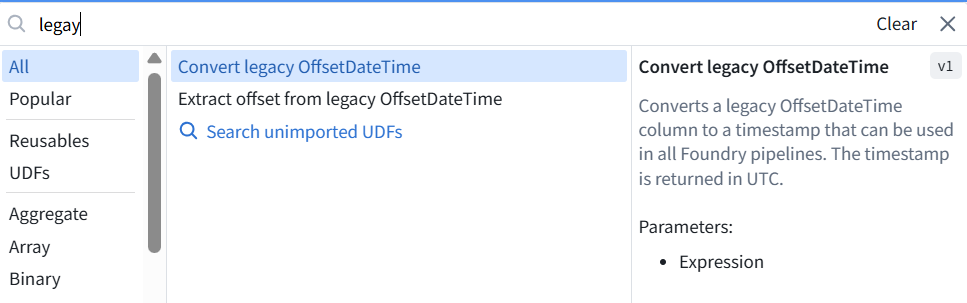

2\. Select that expression and show its configuration. We’ll convert **timestamp** within this same **Prepare ELINT** node.

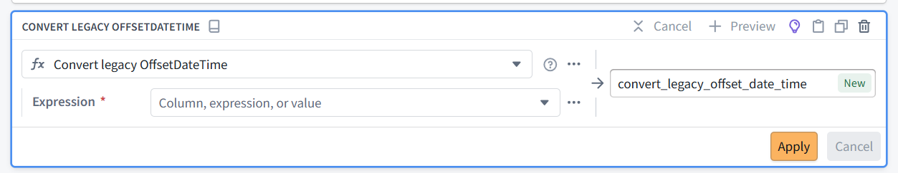

3\. Configure this conversion:

- **Expression:** select timestamp.

- **Output name** on the right: replace convert_legacy_offset_date_time with timestamp.

4\. Confirm the badge changes from **New** to **Replace**.


5\. Click **Apply**, then **Apply all** at the top if enabled.

6\. This updates the timestamp type **without adding a column**. Show the Preview result so we can verify the values remain correct and the node still has **11 columns**.

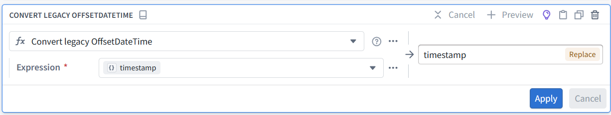

Prepare ELINT is verified

- **3,206 total rows** and **11 columns** retained.

- **timestamp:** now Timestamp, with the displayed UTC values preserved.

- **elint_geometry:** Geometry.

- **h3_index_2:** H3 Index.


<br>

<a id="section-4-5-inspect-geoint-preparation-24-019-rows"></a>
### **4.5 Inspect GEOINT preparation (24,019 rows)**

In the **QS0b reference pipeline**, open **Cast to H3** on the **CV ATR GEOINT Example** branch and show its configuration.

We’ll check which columns it converts, then recreate that preparation directly after our imported GEOINT input.

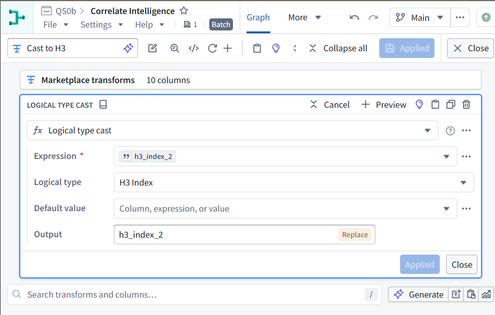

The reference GEOINT step converts only h3_index_2 to H3 Index.

Switch back to **QS0_Build → QS0_CorrelateIntelligence (our pipeline)**.

Prepare GEOINT

1\. Select **CV ATR GEOINT Example**.

2\. Click **Transform** and add **Logical type cast**:

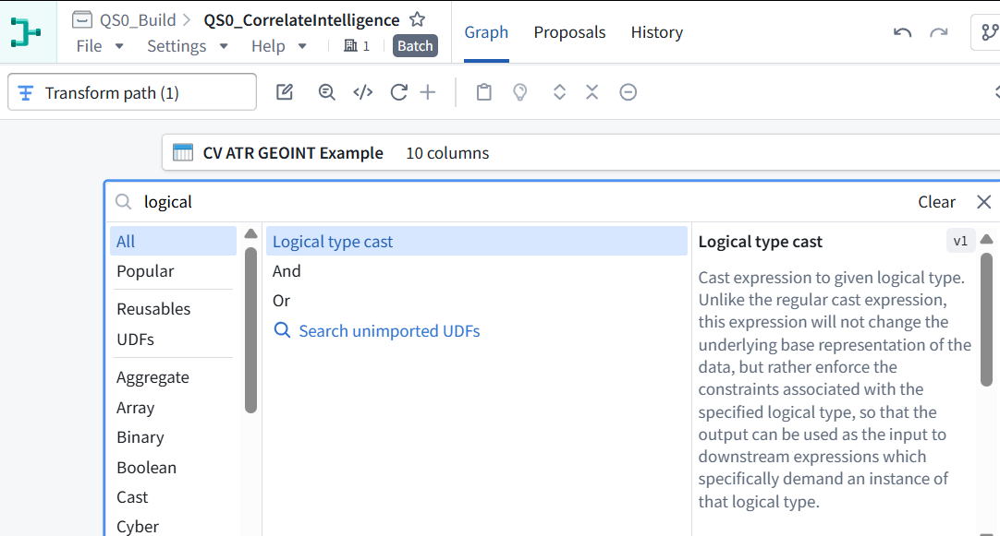

| Setting | Value |
| --- | --- |
| Expression | h3_index_2 |
| Logical type | H3 Index |
| Output | h3_index_2—Replace |
| Default value | Leave unset |

3\. Add **Convert legacy OffsetDateTime**:

- **Expression:** detection_timestamp

- **Output:** detection_timestamp—Replace

4\. Apply both operations.

5\. Rename the node **Prepare GEOINT**.

6\. Run **Preview**. Expected: **10 columns**, **24,019 total rows**, with **H3 Index** and **Timestamp** types on the converted columns.

7\. Show the Preview.


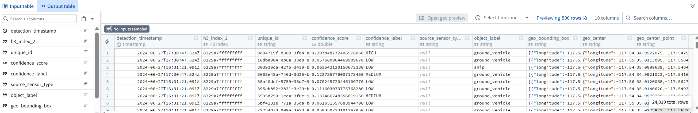

Prepare GEOINT is verified:

- **24,019 total rows**

- **10 columns**

- **h3_index_2:** H3 Index

- **detection_timestamp:** Timestamp

7\. Click **Save** in our pipeline.

<br>

<a id="section-4-6-inspect-the-spatial-join-3-266-584-rows"></a>
### **4.6 Inspect the spatial join (3,266,584 rows)**

In the **QS0b reference pipeline**:

1\. Return to its graph.

2\. Select **H3 Geospatial Join**.

3\. Click **Edit**.

4\. Show the join settings, including its input columns and conditions.

We’ll reproduce the exact spatial-matching rule next.

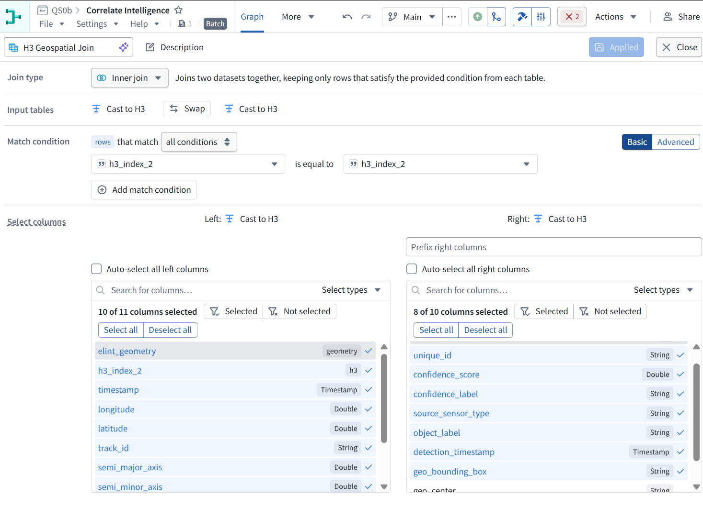

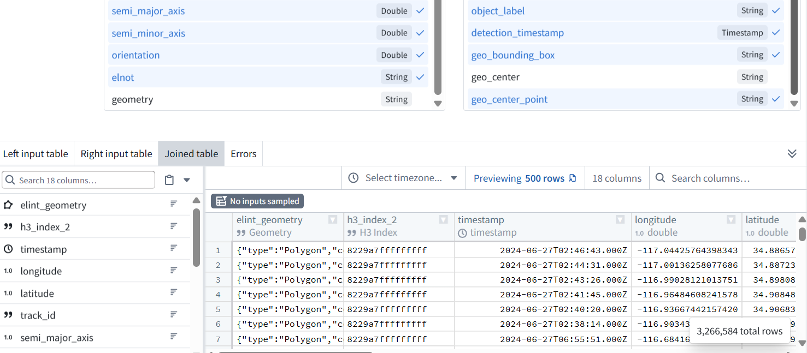

The reference uses an ordinary inner join on equal H3 cell IDs . Despite the node’s name, its condition is simply:

```

ELINT.h3_index_2 = GEOINT.h3_index_2
```

This produces **candidate pairs in the same H3 cell**, not yet the final needles. The reference shows **3,266,584 candidate rows**—multiple records can match each other within a cell.

<br>

<a id="section-4-6-1-create-the-join-in-our-pipeline"></a>
#### **4.6.1 Create the join in our pipeline**

Return to **QS0_CorrelateIntelligence**:

1\. Select **Prepare ELINT**.

2\. Click the blue **Join** icon—the overlapping-tables symbol.


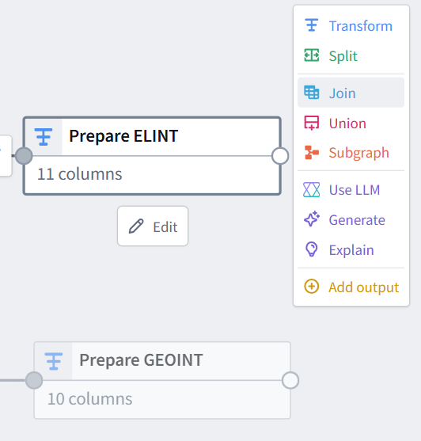

3\. Choose **Prepare GEOINT** as the other input.


4\. Click start.

5\. Configure:

| Setting | Value |
| --- | --- |
| Join type | Inner join |
| Left input | Prepare ELINT |
| Right input | Prepare GEOINT |
| Condition | h3_index_2 is equal to h3_index_2 |

Show the join editor before applying. We’ll then match the reference’s column selection: **18 output columns**, excluding ELINT’s geometry and GEOINT’s geo_center and duplicate H3 column.

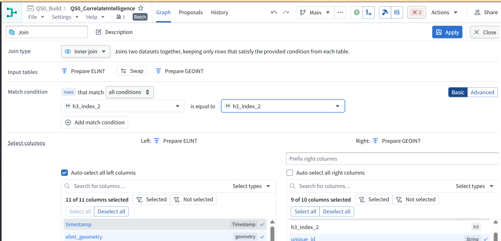

The join inputs and condition are correct.

<br>

<a id="section-4-6-3-now-match-the-reference-s-column-selection"></a>
#### **4.6.3 Now match the reference’s column selection:**

1\. **Left—Prepare ELINT:**

- Turn **Auto-select all left columns** OFF.

- Deselect **geometry** only.

- Expected: **10 of 11 columns selected**.

2\. **Right—Prepare GEOINT:**

- Keep **h3_index_2** deselected.

- Deselect **geo_center**.

- Keep **geo_center_point** selected.

- Expected: **8 of 10 columns selected**.

Leave **Prefix right columns** empty.

3\. Rename the node **Match H3 cells**.


4\. Click **Apply**, and run its **Preview**. Expected: **18 columns** and **3,266,584 total candidate rows**. The preview displays only a subset.

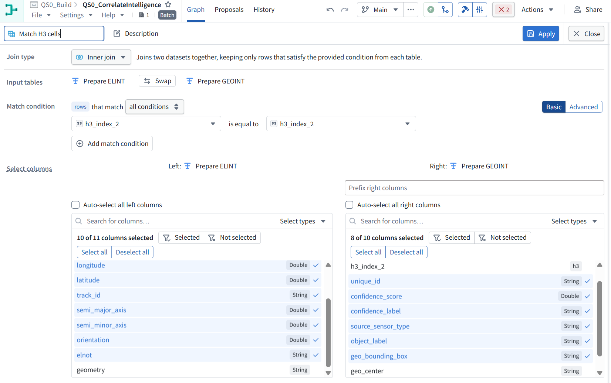

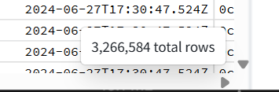

The join matches the reference: 18 columns and 3,266,584 candidate rows.

5\. Click **Save** in our pipeline.

<br>

<a id="section-4-7-next-inspect-the-final-filtering-steps-2-419-560-rows"></a>
### **4.7 Next: inspect the final filtering steps (2,419,560 rows)**

In the **QS0b reference pipeline**, open **Adjust dates, filter detec…** and show its operations, starting at the top.

We’ll check the exact time-window calculations and any additional filters before recreating them.


**The actual setting is +1 day**, even though the output column is named elint_plus_10. This is why we inspect settings rather than infer their meaning from names.

The remaining operations include the time filter, map geometry, duplicate removal, and final column selection.

**Before we recreate the time window:**

1\. In this **reference pipeline**, expand **Timestamp subtract → elint_minus_10**.

2\. Show its **Value to subtract** and **Unit**. Leave the reference unchanged. Once both boundaries are confirmed, we’ll use clearer names in our pipeline.

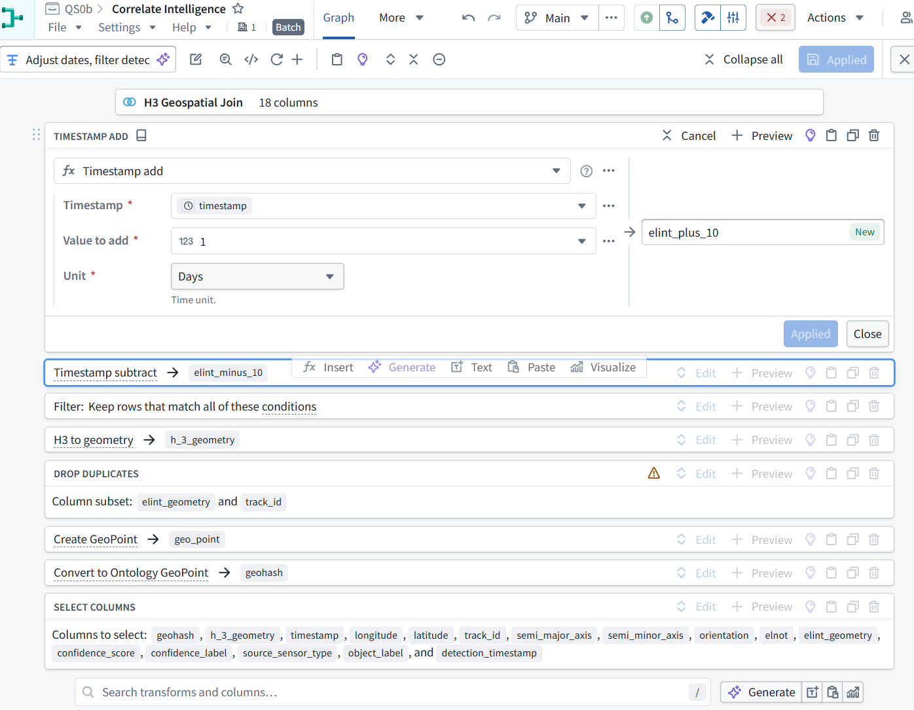

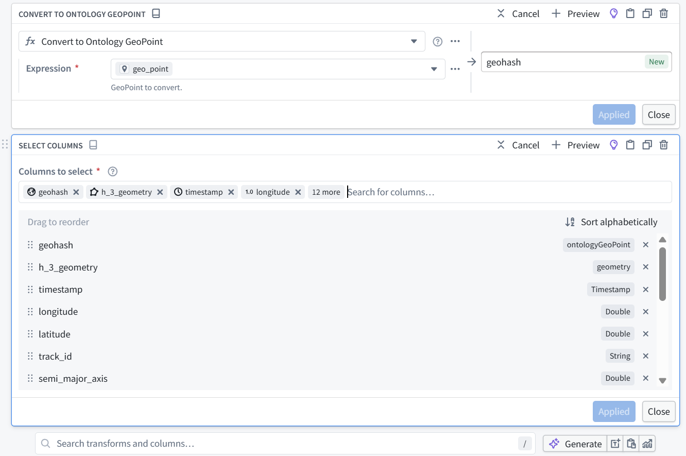

**We now have the exact reference settings:** its time window is **10 minutes before through 1 day after** the ELINT timestamp—not ±10 minutes.

We’ll preserve that behavior but use accurate column names.

<br>

<a id="section-4-7-1-add-the-time-window-calculations"></a>
#### **4.7.1 Add the time-window calculations**

1\. In **our pipeline**, select **Match H3 cells**, click **Transform**,

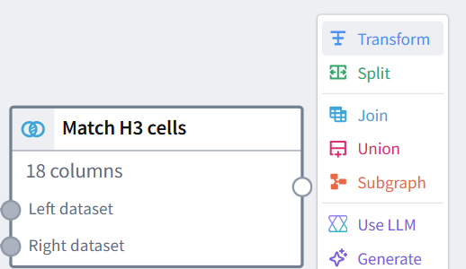

2\. and name the new node **Filter by time**.

3\. Add these two operations:

| Operation | Timestamp input | Amount | Unit | New output column |
| --- | --- | --- | --- | --- |
| Timestamp add | timestamp | 1 | Days | elint_plus_1_day |
| Timestamp subtract | timestamp | 10 | Minutes | elint_minus_10_min |

4\. Click **Apply** for each operation. Show the two calculations before adding the filter. We’ll handle duplicate removal and map-display columns afterward.

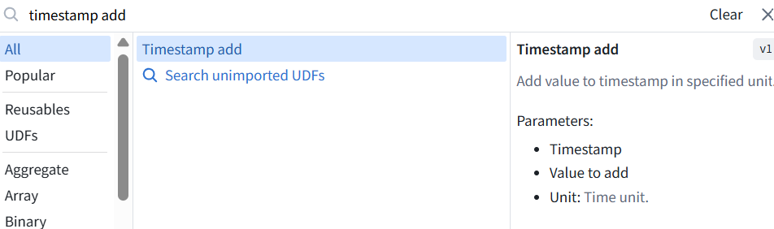

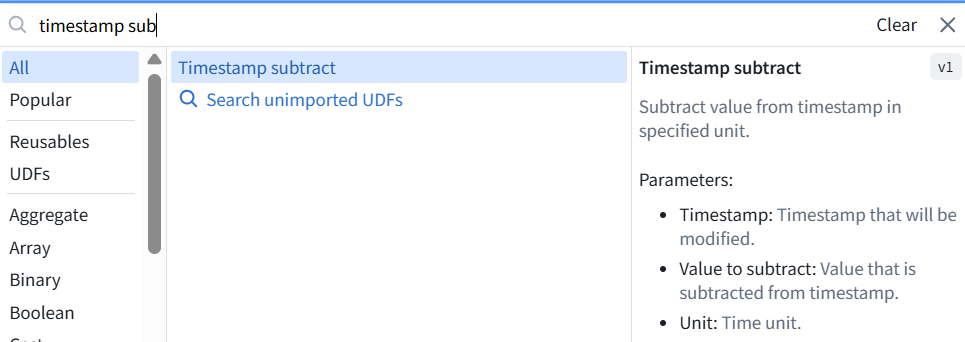

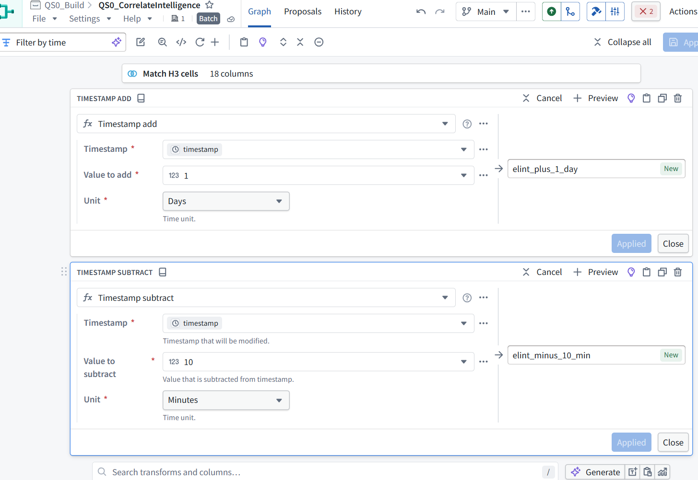

**Both time-window calculations are correct and applied.**

<br>

<a id="section-4-7-2-add-the-time-filter"></a>
#### **4.7.2 Add the time filter**

1\. In the same **Filter by time** node, search for and add **Filter**. Select **Keep rows** that match **all conditions**:

| Column | Operator | Compare with column |
| --- | --- | --- |
| detection_timestamp | on or after | elint_minus_10_min |
| detection_timestamp | on or before | elint_plus_1_day |

2\. Use **column references** on the right—not literal text or fixed dates.

3\. Click **Apply**, then run **Preview**. Show the filter settings and resulting **total row count**. There should still be **20 columns**: the joined 18 plus the two time boundaries.


4\. Select **Filter rows**—the third option shown.

5\. Then configure **Keep rows → all conditions** with the two timestamp comparisons above.

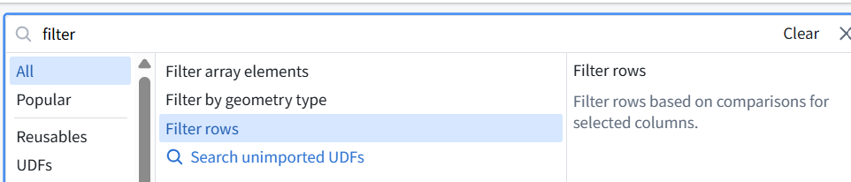

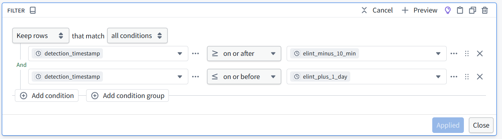


**The Preview shows 20 columns and 2,419,560 rows**, down from **3,266,584** candidate pairs after the H3 join.

Before continuing, show the **Filter rows configuration** so we can verify both timestamp comparisons. The row count alone does not confirm the filter is configured correctly.

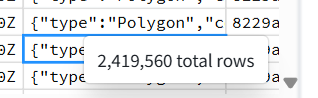

**Yes—that’s the screen I meant. Both conditions are correct.** The time filter is verified.

<br>

<a id="section-4-8-remove-repeated-matches-4-rows"></a>
### **4.8 Remove repeated matches (4 rows)**

<br>

<a id="section-4-8-1-remove-repeated-matches"></a>
#### **4.8.1 Remove repeated matches**

1\. Save the changes, return to the graph, then:

2\. Select **Filter by time**.

3\. Click **Transform** to create a new node.

4\. Name it **Remove repeated matches**.

5\. Search for and add **Drop duplicates**.

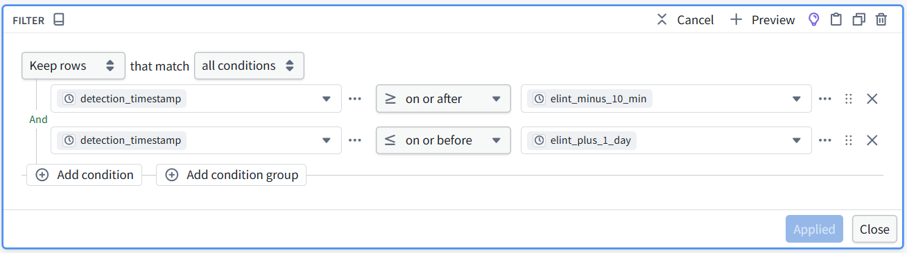

6\. For **Column subset**, select only:

- elint_geometry

- track_id

This matches the reference: keep one row for each unique combination of those two values.

7\. Show the configuration before applying it. **The column subset is correct:** elint_geometry and track_id.

8\. Click **Apply**, then run **Preview**.

Expected: **4 rows**, still with **20 columns**.

**Important:** this operation keeps an arbitrary matching row for each pair of key values. Other fields, such as the selected detection’s timestamp, may therefore differ from the reference. We’ll note that limitation in the final review.

Show the resulting row count.

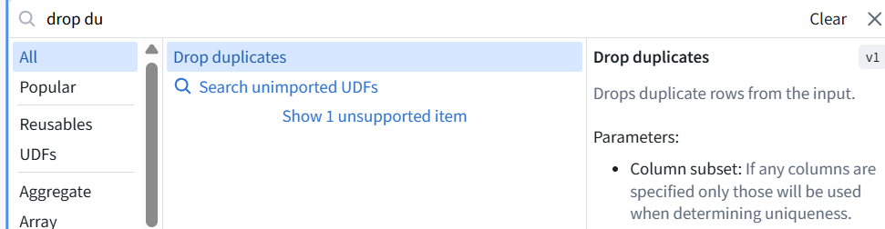

**Verified: 4 rows and 20 columns.** We now have one retained match for each unique **elint_geometry + track_id** combination.

<br>

<a id="section-4-9-next-prepare-the-map-display-fields"></a>
### **4.9 Next: prepare the map-display fields**

1\. Save, return to the graph, and:

2\. Select **Remove repeated matches**.

3\. Click **Transform** to create a new node.

4\. Name it **Prepare map fields**.

5\. Search for **H3 to geometry**.

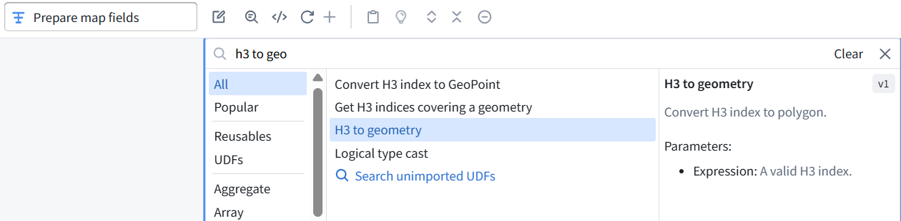

6\. Configure:

- **Expression:** h3_index_2

- **New output column:** h_3_geometry

7\. Click **Apply**.

This creates the H3 cell’s polygon for map display. Show the configured operation; we’ll add the point location next.

ME: maybe change h_3_geometry to h3_geometry?

**FDE:** **Yes—use h3_geometry.** It is clearer and consistent with h3_index_2.

We’ll use **h3_geometry** throughout our pipeline and map configuration.


**Correct: h3_index_2 → h3_geometry is applied.**

<br>

<a id="section-4-9-1-add-the-point-location"></a>
#### **4.9.1 Add the point location**

1\. In the same **Prepare map fields** node: Search for **Create GeoPoint**.

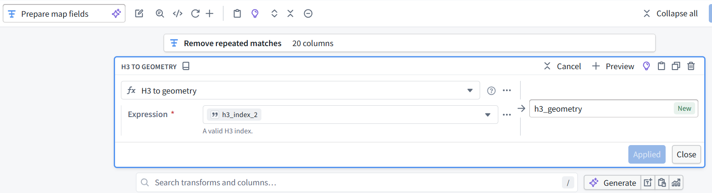

2\. Set:

- **Latitude:** latitude

- **Longitude:** longitude

- **New output column:** geo_point

3\. Click **Apply**.

4\. Then add **Convert to Ontology GeoPoint**:

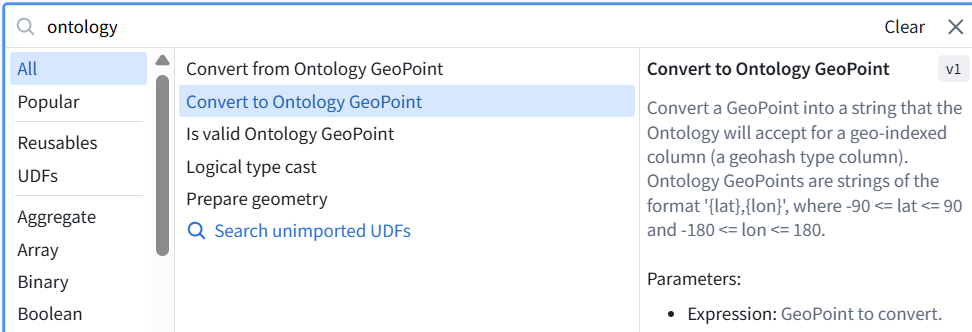

- **Expression:** geo_point

- **New output column:** geohash

5\. Click **Apply** and show both operations. We’re using the **ELINT latitude and longitude**, matching the reference.

**Yes—geo_hash is fine.** We’ll use that name consistently from now on. Both operations are correctly configured.

<br>

<a id="section-4-9-2-select-the-final-output-columns"></a>
#### **4.9.2 Select the final output columns**

1\. In **Prepare map fields**, add **Select columns**

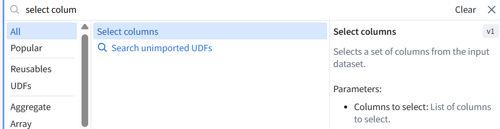

and keep these **16 columns**:

```

geo_hash
h3_geometry
timestamp
longitude
latitude
track_id
semi_major_axis
semi_minor_axis
orientation
elnot
elint_geometry
confidence_score
confidence_label
source_sensor_type
object_label
detection_timestamp
```

This removes the temporary time boundaries, intermediate point, and unused columns.

Click **Apply**, run **Preview**, and verify **4 rows / 16 columns**. Then **Save all changes**.

**The three map-field operations are correct. One column is missing from Select columns: elint_geometry.**

1\. Expand **Select columns → Edit**.

2\. Add **elint_geometry** without removing the others.

3\. Click **Apply**.

4\. Run **Preview**.

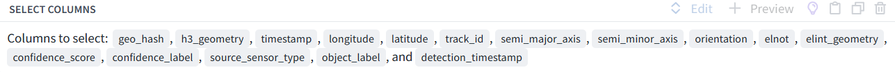

Expected: **4 rows and 16 columns**.

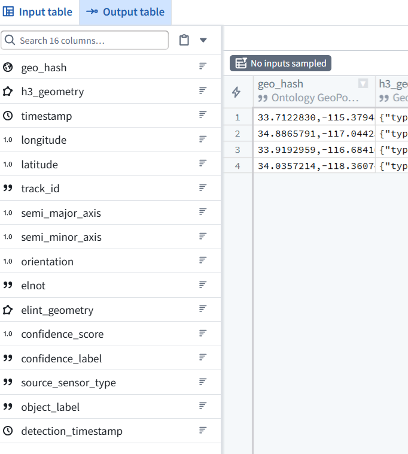

5\. Keep both:

- **elint_geometry**—the supplied ELINT geometry.

- **h3_geometry**—the H3 cell polygon we generated.

6\. Then **Save all changes**.

**Preview verified: 4 rows and 16 columns**, including the map-ready point and geometry fields.

<br>

<a id="section-4-10-create-the-output-dataset"></a>
### **4.10 Create the output dataset**

1\. **Save all changes**, then return to the graph.

2\. Select **Prepare map fields**.

3\. Click **Add pipeline output** in the right-hand panel.

4\. Choose a **dataset output**.

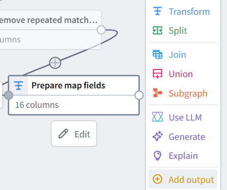

5\. Set:

**Name:** QS0_CorrelatedIntelligence

**Location:** **QS0_Build (project)**

Show the output configuration before deploying.


**Correct—Location is not in this individual output panel.** My instruction was imprecise.

6\. Click **Back to outputs** at the top of the right-hand panel. Look near the bottom for **Output settings → Edit output settings**.

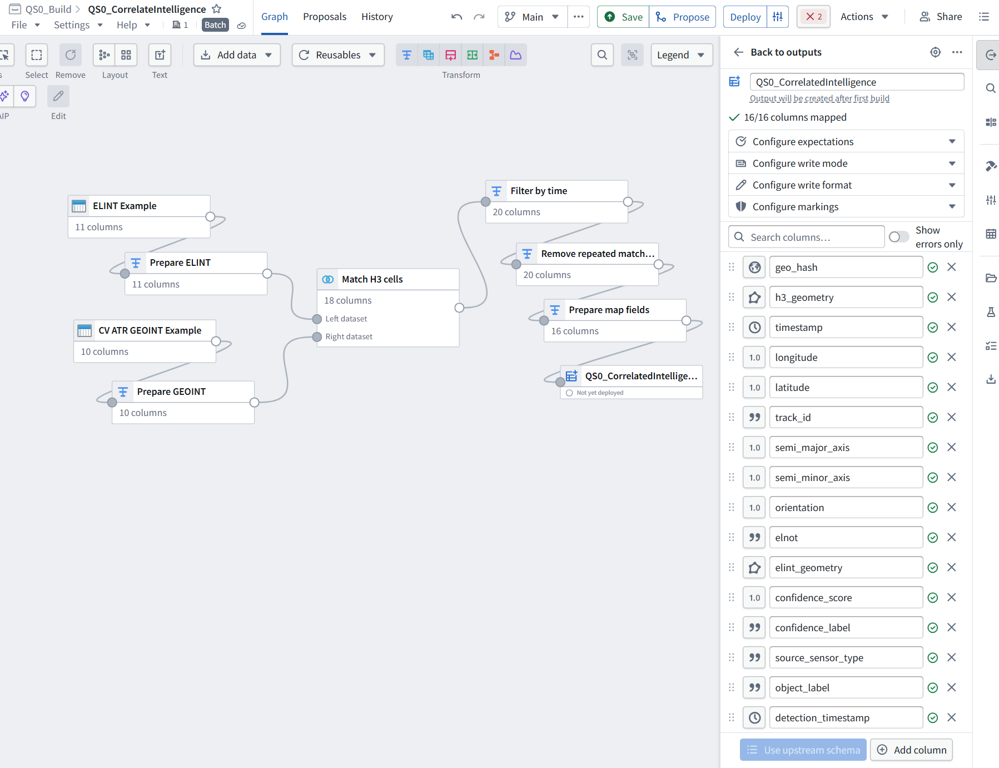

7\. Set **Output folder** to **QS0_Build (project)**.

8\. Show that settings panel if the location is not already selected. Leave **Target ontology** unset—we’re creating only a dataset at this stage.

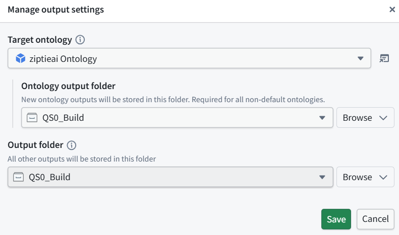

**The location is already correct: Output folder → QS0_Build.**

The selected **Target ontology** can stay as it is—it does not create an object type by itself. Our only configured output is a dataset.

9\. Click **Save** in this dialog.

10\. Save any remaining pipeline changes.

11\. Click **Deploy** at the top.


12\. Show the deployment dialog before confirming.

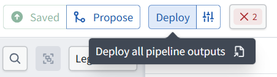

**Ready to deploy:**

- **Errors: 0**

- **Compute profile:** Default / Extra small

- **Our output dataset:** selected for building

13\. Click **Deploy pipeline** at the bottom. This deploys the pipeline logic and runs the build to create **QS0_CorrelatedIntelligence (dataset)**. Wait for completion, then show the build result.

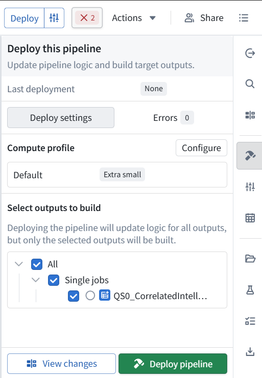

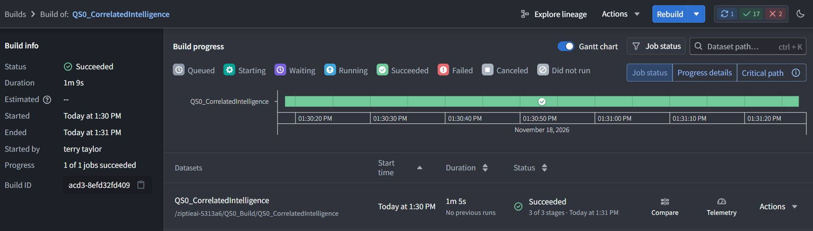

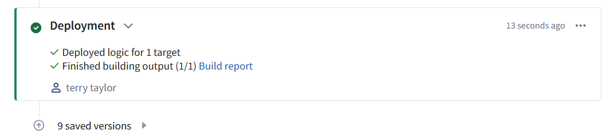

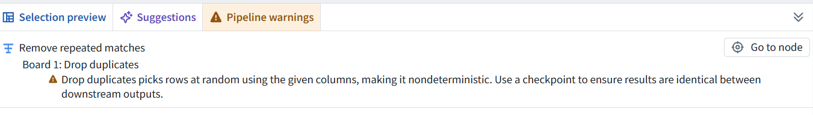


<br>

<a id="section-4-10-1-deployment-and-build-succeeded-1-of-1-outputs-built-no-redeployment-is-needed"></a>
#### **4.10.1 Deployment and build succeeded: 1 of 1 outputs built. No redeployment is needed.**

The **Drop duplicates** warning is expected: when several rows share the same elint_geometry and track_id, it keeps an arbitrary representative. This does not block the build, but some retained detection fields may differ between runs.

<br>

<a id="section-verify-the-saved-dataset"></a>
#### **Verify the saved dataset**

1\. Open **QS0_Build (project) → Files**.

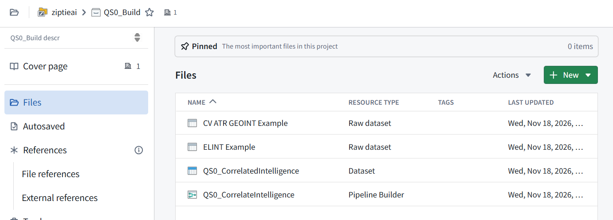

2\. Open **QS0_CorrelatedIntelligence (dataset)**.

3\. Confirm its Preview shows **4 rows and 16 columns**.

4\. Show that Preview. This verifies the **stored output**, not just the pipeline Preview. Then we’ll create our own object type for Maps.

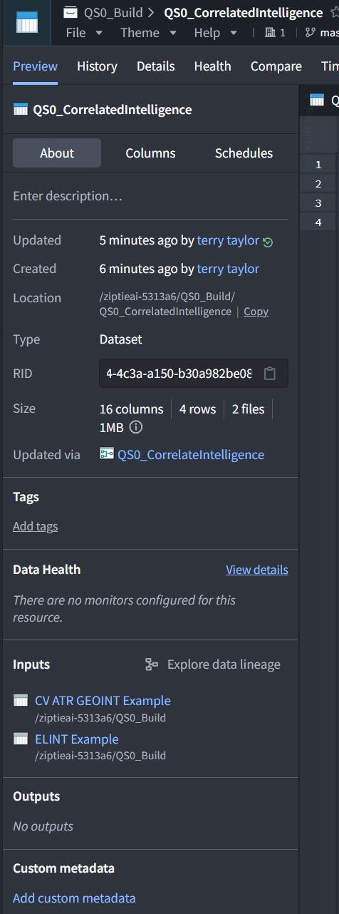


Stored output verified: 4 rows and 16 columns, produced from our two imported datasets.

The varying detection timestamps and confidence values are consistent with **Drop duplicates retaining an arbitrary matching row**.
