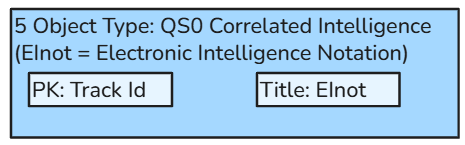
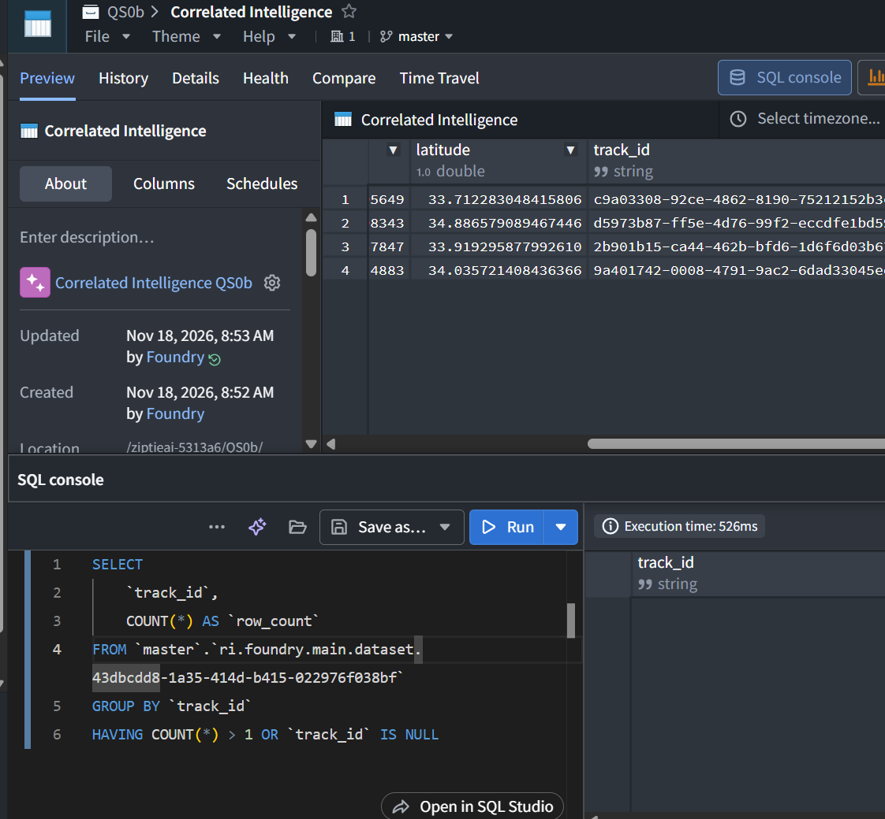
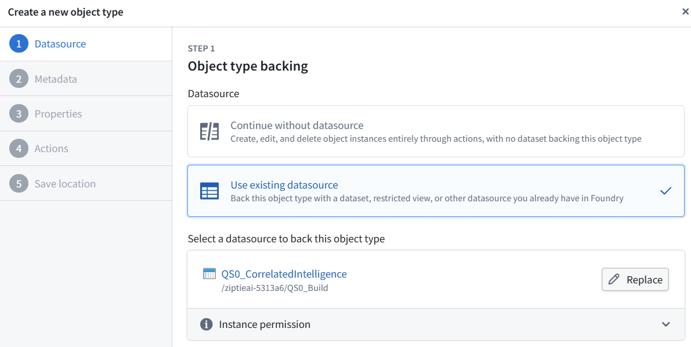
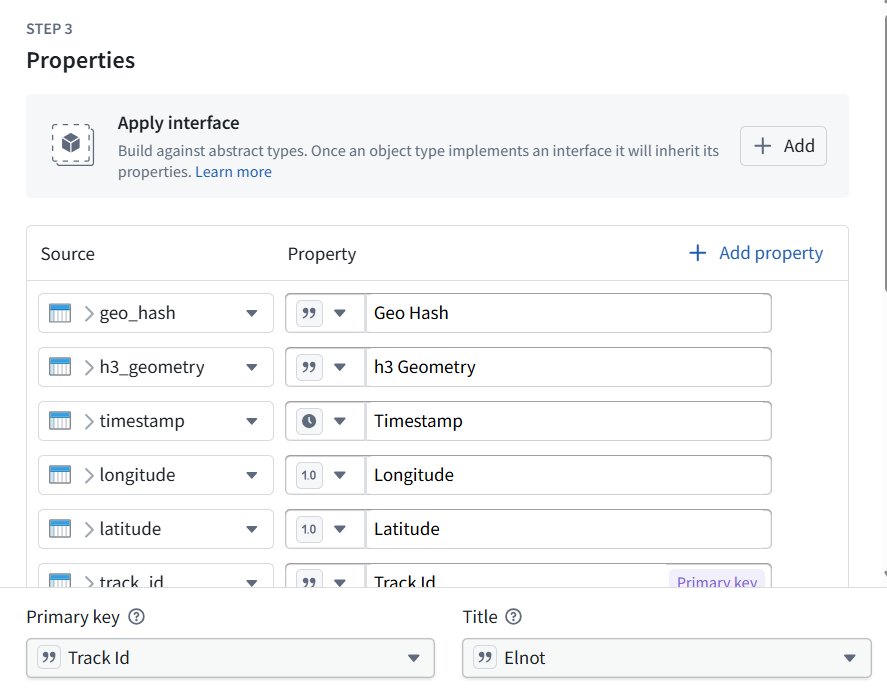
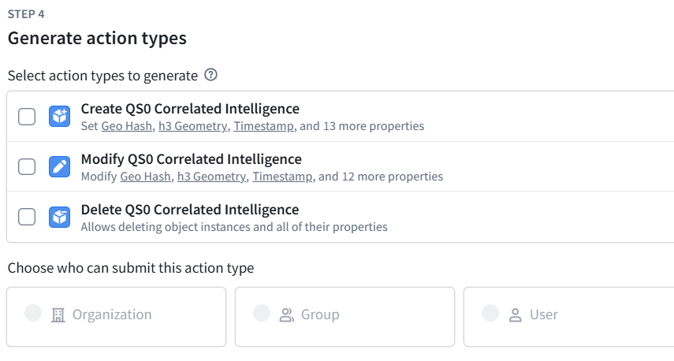
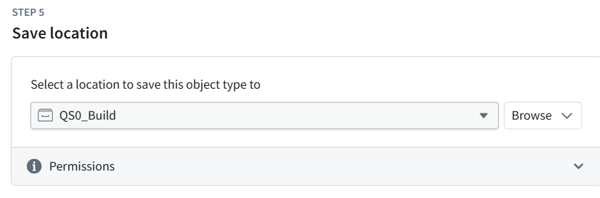
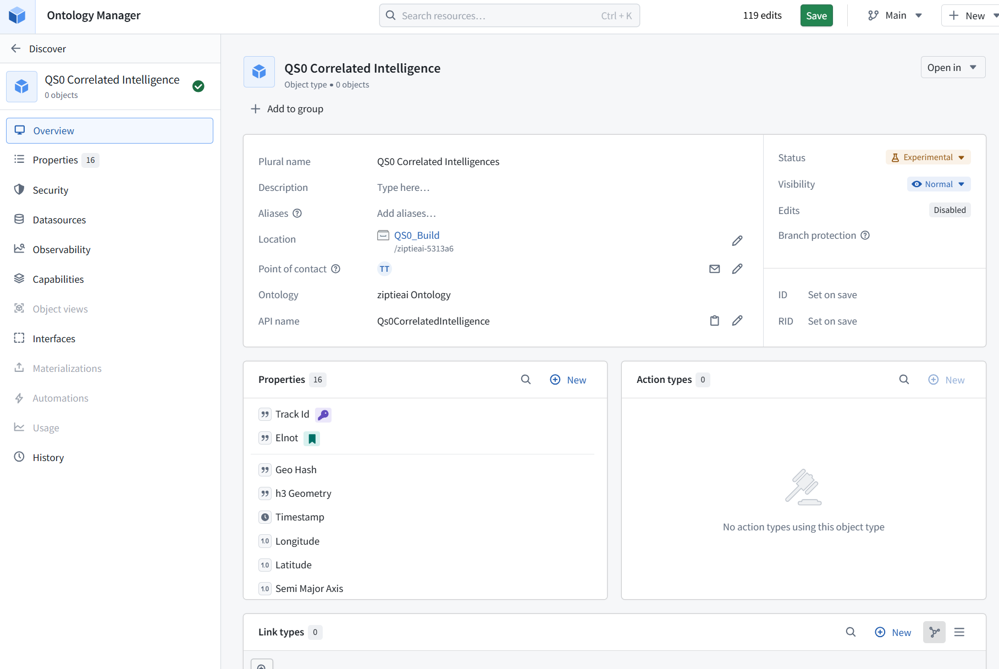
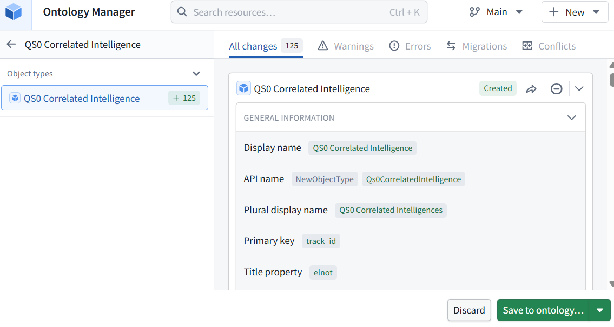
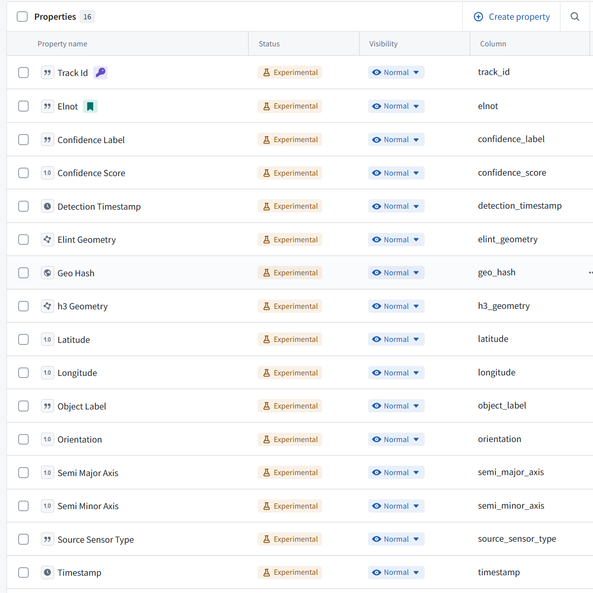

<!-- 5 Create object type -->
[← 4 Build pipeline](/pal_qs0_4_pipeline/) / [↑ 3.2 Foundry QS0](/pal_qs0/) / [→ 6 Display in Maps](/pal_qs0_6_maps/)


_Converted from DOCX by GPT on 2026-11-26 08:59:25 EST_

<br>



One correction: **ELNOT = Electronic Intelligence Notation**, not “Notification.”

The rest describes your configuration:

- **Object type:** QS0 Correlated Intelligence

- **Primary key:** Track Id—uniquely identifies each object.

- **Title:** Elnot—the label displayed for the object; it does not need to be unique.

**TOC**
- [5.1 Check that Track Id is unique in the final output dataset.](#section-1)
- [5.2 Create object type](#section-2)

<br>

<a id="section-1"></a>
### **5.1 Check that Track Id is unique in the final output dataset.**

If one track produces several correlation rows, Track Id alone cannot identify each match separately.


**Check all rows with SQL**, rather than relying on their appearance.

In the **final output dataset**, click **SQL console**. Keep the dataset reference Foundry inserts into the FROM clause, and run:

```
SELECT
`track_id`,
COUNT(*) AS `row_count`
FROM <dataset reference>
GROUP BY `track_id`
HAVING COUNT(*) > 1 OR `track_id` IS NULL
```


Replace **<dataset reference>** with the console’s actual dataset reference.

- **No rows returned:** every track_id is non-null and unique in the current dataset.

- **Rows returned:** those values are duplicates or nulls and need investigation.

This verifies the **current data**. To enforce it on future builds, add a **primary-key data-quality check** in the pipeline.



**The query succeeded and returned no rows.** That confirms **track_id is unique and non-null in the current Correlated Intelligence dataset**.

It is therefore suitable as the **primary key for these records**. A pipeline data-quality check would enforce that requirement on future builds.

<br>

<a id="section-2"></a>
### **5.2 Create object type**

In this dataset’s upper-right toolbar:

Open **All actions**.

Select **Create object type**.


We’ll configure:

- **Name:** QS0 Correlated Intelligence

- **Primary key:** track_id

- **Title:** elnot

- **Backing dataset:** this **QS0_CorrelatedIntelligence** dataset

Show the creation screen before saving. We’ll also verify the geographic property types so Maps can display the objects.












**The name, location, primary key, and title are correct:**

- **Name:** QS0 Correlated Intelligence

- **Location:** QS0_Build

- **Primary key:** Track Id

- **Title:** Elnot

**Before saving, we need to fix the geographic property types.** The screenshot shows **Geo Hash** and **h3 Geometry** currently imported as Strings.

1\. Click **Properties** in the left sidebar.

2\. Select **Geo Hash**.

3\. Open its **Base type** dropdown and show the options.

We’ll configure:

- **Geo Hash → Geopoint**

- **h3 Geometry → Geoshape**

- **Elint Geometry → Geoshape**

These types tell Maps how to interpret the stored coordinates and polygons.




4\. **Yes—click Save to ontology… at the bottom right.** This is the confirmation step that persists the new object type and its property definitions. The **125 changes** are individual configuration changes for this one object type—not 125 objects. Follow any final confirmation prompt.




**Yes—this property list is correct. No further changes are needed here.**

The key settings are:

| **Property** | **Correct configuration** |
| --- | --- |
| **Track Id** | Primary key—the purple key icon |
| **Elnot** | Display title—the green bookmark icon |
| **Geo Hash** | Geopoint—the globe icon |
| **Elint Geometry** | Geoshape—the shape icon |
| **h3 Geometry** | Geoshape—the shape icon |
| **Timestamp / Detection Timestamp** | Timestamp—the clock icons |

**Experimental** is a lifecycle label, not an error. Leave it unchanged.

**Next—just verify the objects**

5\. Click **Overview** in the left sidebar. Wait for indexing, then check whether it shows **4 objects**. Show that screen.

Why an icon? Why not a column? **A visible “Base type” column would be much clearer.** It would let you verify **String, Geopoint, Geoshape, Timestamp**, etc., without memorizing icons or opening each property. I don’t know why this view uses icons instead. **Your confusion is reasonable—I should have named the types explicitly rather than treating the icons as self-explanatory.**
